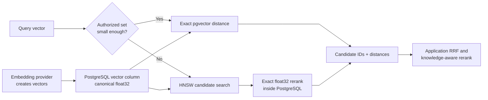
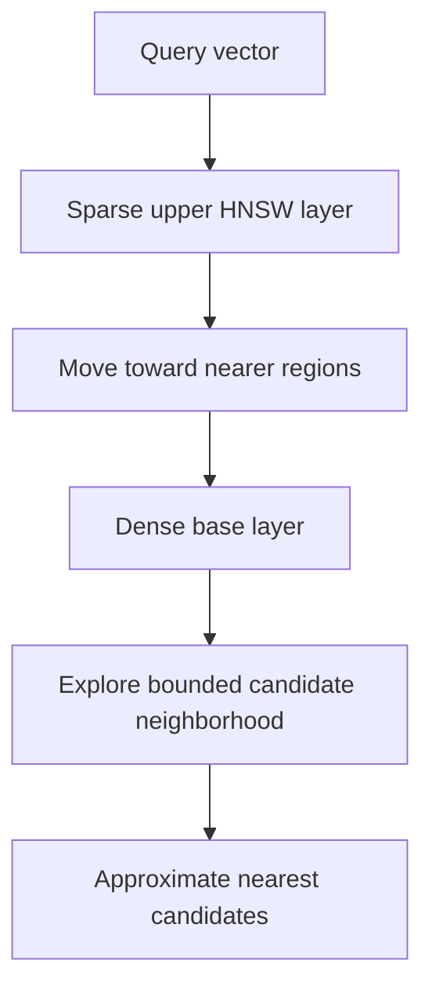
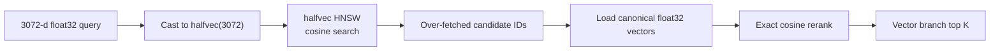
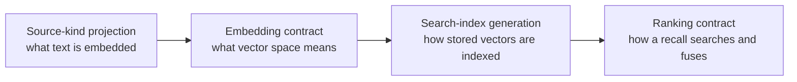
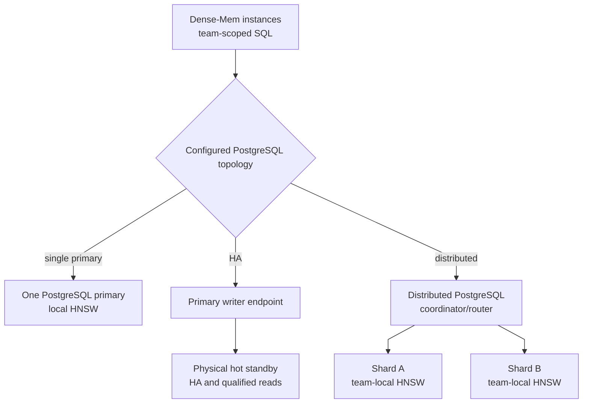
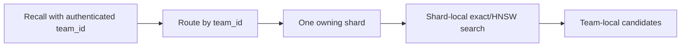
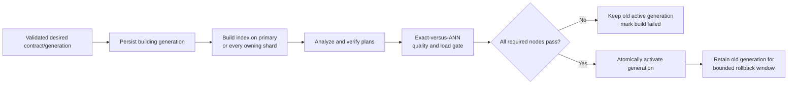

# ANN, HNSW, And Halfvec

This page is the single source of truth for Dense-Mem's exact/approximate
vector-search execution, HNSW and `halfvec` responsibilities, index lifecycle,
database load boundary, and vector-search deployment topology. Embedding and
cosine-distance meaning belongs in
[Vector Search And Ranking](Vector-Search-And-Ranking). Configuration values
and defaults belong in [Configuration](Configuration). Evaluation procedures
and release gates belong in [Evaluation](Evaluation). Tenant keys, composite
constraints, and shard-safe query shape belong in
[PostgreSQL Cluster-Safe Schema](PostgreSQL-Cluster-Safe-Schema).

## Outcome And Responsibility

PostgreSQL with `pgvector` stores canonical vectors, calculates vector distance,
performs exact search, and owns approximate-nearest-neighbor indexes. HNSW is a
database index used to find a bounded candidate set; it is not Dense-Mem's
semantic graph and never becomes knowledge authority.

Dense-Mem retains full-precision canonical vectors. When a configured dimension
cannot use a full-precision HNSW index, a compatible lower-precision expression
index may find candidates, after which PostgreSQL reranks those candidates with
the canonical vectors. The service receives IDs and distances, not thousands of
vector values to rerank in process memory.



## Terms

| Term | Meaning | Does not mean |
| --- | --- | --- |
| embedding | fixed-length numeric representation produced under one embedding contract | evidence, truth, or an explanation |
| distance metric | function used to order two compatible vectors; Dense-Mem initially uses cosine distance | ANN or graph traversal |
| nearest-neighbor search | return the vectors with the lowest configured distance from a query | proof that a result is correct |
| exact search | calculate distance against every eligible vector, then order the complete eligible set | necessarily slow for every filtered set |
| ANN | approximate nearest-neighbor search; a category of faster candidate-search methods | a specific index implementation |
| HNSW | Hierarchical Navigable Small World, the selected ANN index family | Dense-Mem Entity/Relationship edges |
| `vector` | pgvector float32 vector type | an HNSW index |
| `halfvec` | pgvector float16 vector type | a shortened embedding or another model |
| exact rerank | recalculate distance for ANN candidates using canonical float32 vectors | recovery of candidates ANN never returned |

## Distance, ANN, And HNSW Are Separate

Cosine distance answers one local question: how close are two vectors? HNSW
answers an execution question: which stored vectors should PostgreSQL compare
instead of scanning all eligible vectors?

```text
cosine_distance(query, document) -> one numeric distance
ANN                              -> approximate-search category
HNSW                             -> one ANN index algorithm
halfvec                          -> one numeric storage precision
```

An exact query calculates the configured distance for the complete authorized
set. An HNSW query traverses a multilayer proximity graph maintained by the
database and calculates distance only for visited entries. It normally visits
far fewer entries, but it can miss a true nearest neighbor.



HNSW graph links are derived physical index entries. They are not exposed by
the API, are not evidence, and may be dropped and rebuilt without changing any
Entity, Relationship, or provenance.

## Why HNSW Matters

For `N` eligible vectors with `D` dimensions, exact search performs distance
work across the full eligible set. Team, state, and time filters can make that
set small enough that exact search is the better path. As a tenant or corpus
grows, repeated exact scans consume CPU and memory bandwidth and reduce
concurrent recall throughput.

HNSW trades exact candidate coverage for lower-latency bounded exploration. It
also costs database resources:

- the graph and indexed vector representation consume memory and disk
- inserts and vector updates must add or replace index entries
- larger construction breadth improves recall but increases build and insert
  cost
- larger query breadth improves recall but increases CPU, buffers, and latency
- dead tuples and index growth require vacuum/reindex planning

Dense-Mem therefore does not use HNSW merely because an index exists. The
ranking contract selects exact or ANN from the authorized-set shape and an
evaluated workload boundary.

## Full Precision And `halfvec`

pgvector's `vector` stores each component as float32. `halfvec` stores each
component as float16. For 3,072 dimensions, the vector payload is approximately
12 KiB as `vector` and 6 KiB as `halfvec`, before row and HNSW graph overhead.

Lower precision can perturb distances. Dense-Mem therefore does not make
`halfvec` the canonical copy solely to fit an ANN index. For the required
3,072-dimensional `text-embedding-3-large` configuration:



Exact reranking restores full-precision ordering only within the candidate
pool. It cannot recover a relevant row omitted by HNSW or by an early tenant,
status, or time filter. Candidate breadth and iterative scanning must therefore
pass the exact-oracle evaluation.

## Dimension And Index Capability

The configured model and dimension remain deployment choices. Dense-Mem does
not infer dimensions from a model name or hardcode 3,072 into static schema
migrations. Startup probes the provider, validates the returned length, and
persists the resolved embedding contract and compatible search-index generation.

| Configured dimensions | Canonical storage | Default candidate strategy | Final vector ordering |
| ---: | --- | --- | --- |
| `1..2000` | float32 `vector` | full-precision HNSW for large sets; exact for bounded sets | exact float32 distance over candidates |
| `2001..4000` | float32 `vector` | `halfvec` HNSW expression index for large sets; exact for bounded sets | exact float32 distance over candidates |
| `4001..16000` | float32 `vector` | exact only until a separately evaluated index strategy is approved | exact float32 distance |
| above `16000` | unsupported by the target pgvector `vector` contract | reject before writes | none |

Operators choose the embedding model and dimensions. Dense-Mem derives the
internal index generation from dimensions and supported pgvector capabilities.
Exact diagnostic mode is allowed for bounded candidate sets; incompatible HNSW
strategies are rejected instead of exposed as startup knobs. Dimensions above
4,000 do not silently switch to an unmeasured binary or subvector index; that
would be a new design and evaluation decision.

The current pgvector HNSW limits are `vector` up to 2,000 dimensions and
`halfvec` up to 4,000 dimensions. The underlying types can store more than
their HNSW limits. Verify limits against the supported extension version during
release qualification; upstream behavior is documented in the
[pgvector HNSW reference](https://github.com/pgvector/pgvector#hnsw).

## Contract And Index Decision Guide

The operator-facing search contract is the embedding model plus dimensions.
Dense-Mem fixes cosine distance and derives the internal index generation from
the persisted dimensions. Normal memory callers never select a distance, index
name, operator class, or generation.

Use this table before initializing or replacing the embedding contract.

| Situation | Contract/index result | Why | Re-embed? | Rebuild index? | Extra gate |
| --- | --- | --- | --- | --- | --- |
| Small tenant, development, or upgrade verification | exact search generation | simplest behavior; no ANN recall loss; good oracle for tests | no, if contract unchanged | no | row-count budget must stay below exact threshold |
| 1536-dimensional embedding contract | `vector_hnsw` generation when pgvector supports the dimension | HNSW keeps latency bounded while exact rerank preserves final candidate order | no, if contract unchanged | yes | Recall@K and load comparison against exact |
| 3072-dimensional `text-embedding-3-large` contract | `halfvec_hnsw` generation plus exact float32 rerank | full-precision HNSW is outside pgvector's `vector` HNSW limit; `halfvec` is only the ANN expression | yes, when moving from another embedding contract | yes | candidate Recall@K must pass exact oracle |
| High-quality debugging, audit, or release qualification | exact diagnostic mode | removes ANN approximation from the investigation | no | no | bounded authorized candidate set |
| Latency/cost pressure after quality is acceptable | tune ranking budgets before changing model | avoids provider calls and vector rewrite | no | maybe, if physical HNSW parameters change | saturation and quality comparison |
| Provider/model upgrade | new embedding contract plus derived index generation | vector meaning changes; old vectors cannot be compared as if they came from the new model | yes | yes | staged backfill, dual-read evaluation, then activation |
| Relationship semantic renderer change | new Relationship projection generation under the same embedding/index contracts | only Relationship document text changes | Relationships only | no | complete text before serve; whole-team vector gate until current |
| Ranking/fusion experiment only | ranking contract change | changes branch fusion or rerank order without changing vector meaning | no | no | deterministic 1k comparison and regression slices |

Decision sequence:

1. Choose source-kind projection formats, then the numerical embedding
   contract: provider, model, dimensions, normalization, and query construction.
2. Resolve index capability from dimensions and pgvector support. Use `exact`
   for bounded sets, `vector_hnsw` only when the full-precision dimension is
   supported, and `halfvec_hnsw` when ANN needs a half-precision expression.
3. Use cosine distance and the matching cosine operator class. Exact cosine uses
   `<=>`; a different metric is a new architecture decision, not a runtime
   setting.
4. Build or validate the physical index for the derived generation. A normal startup
   mismatch must not silently rebuild or fall back to an unbounded scan.
5. Compare the proposed generation against exact, team-filtered results. Use
   fixed Recall@K, latency, CPU, memory, WAL, and replica-lag gates.
6. Activate the complete contract/generation atomically, keep the previous
   generation available for rollback, and include contract/generation IDs in
   internal telemetry.

Do not create configuration options for unsupported combinations. Examples:

| Requested configuration | Decision |
| --- | --- |
| full-precision HNSW for a 3072-dimensional `vector` contract | reject; use exact or `halfvec_hnsw` candidates with exact rerank |
| dimensions above 4000 with ANN | reject until a separately evaluated strategy exists |
| `halfvec` as canonical storage | reject; canonical embeddings remain float32 `vector` |
| query-time caller selects distance, index name, operator class, or generation | reject; only persisted validated contracts select SQL shape |
| exact fallback for a large unbounded tenant | reject unless the active generation explicitly allows and budgets it |

## Separate Versioned Contracts

One version number must not imply that every vector-related change requires
provider calls. Dense-Mem persists and reports separate linked records:



### Source-kind projection

Each `source_kind` owns a `projection_format_version` and deterministic text
renderer. A Relationship projection change rebuilds Relationship documents and
vectors only. Its per-team projection generation controls text convergence and
vector-branch activation; it does not create an embedding contract or HNSW
generation. See
[Data Model And Storage](Data-Model-And-Storage#relationship-projection-generation).

### Embedding contract

The embedding contract owns:

```text
provider adapter kind and semantic provider identity, excluding credentials
model identifier
dimensions
input normalization version
query-construction version
output normalization declaration and validation
```

Changing one of these fields creates a new embedding contract and regenerates
vectors. Old and building contracts may coexist during a controlled rebuild,
but one contract is active for normal query/document comparison.

### Search-index generation

The search-index generation owns physical compatibility and construction:

```text
search_index_generation_id and embedding_contract_id
fixed cosine metric and matching pgvector operator class
canonical vector type/precision
candidate strategy: exact | vector_hnsw | halfvec_hnsw
indexed cast and dimensions
HNSW m and ef_construction
physical relation/index identifiers and extension version
state: building | validating | active | retired | failed
```

Changing indexed cast, HNSW strategy, `m`, or `ef_construction` requires a new
index build and exact-oracle validation. It does not require new provider
embeddings when the embedding contract is unchanged.

### Ranking contract

The query-time ranking contract defines:

```text
exact-versus-ANN eligibility threshold
candidate over-fetch
hnsw.ef_search
iterative-scan mode and bounded scan work/memory
branch enablement, RRF/priority fusion, and deterministic reranking
```

Changing these fields requires matched evaluation and atomic ranking-contract
activation. It does not rebuild embeddings or the HNSW graph. Exact names and
defaults remain in [Configuration](Configuration#postgresql-search-and-recall).

### Change-impact matrix

| Change | Provider calls | Vector rewrite | Index build | Runtime activation |
| --- | --- | --- | --- | --- |
| model, dimensions, query construction, normalization | yes | yes | yes | embedding-contract/index-generation activation |
| Relationship projection format | Relationships only | Relationships only | no | per-team projection-generation activation |
| HNSW kind, cast, `m`, `ef_construction` | no | no | yes | generation activation |
| distance metric | unsupported | unsupported | unsupported | new architecture decision |
| `ef_search`, iterative scan, scan/candidate budget | no | no | no | ranking-contract activation |
| RRF or deterministic rerank weights | no | no | no | ranking-contract activation |

## PostgreSQL Storage And Query Shape

The schema must support configured dimensions without allowing accidental
mixed-vector comparison. Each vector row carries an embedding-contract ID, and
database constraints validate that the stored dimension equals that contract.
The physical index uses a validated, contract-specific dimension and operator
class.

Representative enforcement is:

```sql
CREATE TABLE embedding_contracts (
  embedding_contract_id uuid PRIMARY KEY,
  dimensions integer NOT NULL CHECK (dimensions BETWEEN 1 AND 16000),
  UNIQUE (embedding_contract_id, dimensions)
);

CREATE TABLE search_documents (
  team_id uuid NOT NULL,
  source_kind text NOT NULL,
  source_id uuid NOT NULL,
  embedding_contract_id uuid NOT NULL,
  embedding_dimensions integer NOT NULL,
  search_state text NOT NULL,
  embedding vector,
  PRIMARY KEY (
    team_id,
    source_kind,
    source_id,
    embedding_contract_id
  ),
  FOREIGN KEY (embedding_contract_id, embedding_dimensions)
    REFERENCES embedding_contracts (embedding_contract_id, dimensions),
  CHECK (
    embedding IS NULL
    OR vector_dims(embedding) = embedding_dimensions
  )
);
```

The full storage schema also contains document/freshness, text, and
source-version fields defined in
[Data Model And Storage](Data-Model-And-Storage#search-in-postgresql). This
fragment combines the dimension/contract invariant with the tenant-owned key
defined in
[PostgreSQL Cluster-Safe Schema](PostgreSQL-Cluster-Safe-Schema#search-and-embedding-shape).

The target stores vectors in a dimension-flexible pgvector column with an
`embedding_contract_id` and dimension constraint. It creates one
contract-specific partial expression index whose predicate contains the
validated literal active-contract ID. Repository SQL for that active generation
contains the same validated literal, allowing PostgreSQL to prove the partial
predicate and select the index even when other query values are parameters.
Generation activation invalidates the old contract-specific prepared
statements.

For a 3,072-dimensional cosine contract, the derived index shape is:

```sql
CREATE INDEX CONCURRENTLY search_documents_contract_hnsw_idx
ON search_documents
USING hnsw (
  (embedding::halfvec(3072)) halfvec_cosine_ops
)
WHERE embedding_contract_id = '<validated-contract-id>'::uuid
  AND search_state = 'current';
```

Generated DDL also applies the active generation's validated `m` and
`ef_construction`; their canonical target defaults remain only in
[Configuration](Configuration#search-index-construction).

The concrete implementation must prove that:

1. the index contains only rows with the declared dimensions and contract
2. the planned query expression exactly matches the cast and operator class
3. a building contract cannot enter active queries
4. prepared/generic query plans still select the intended partial index
5. activation and rollback do not expose a mixture of contracts

The implementation choice is not complete until real PostgreSQL integration
tests show those properties. A generic untyped `vector` column plus a
parameterized partial-index predicate must not be assumed to use the index;
PostgreSQL must be able to prove the query predicate implies the partial-index
predicate at planning time.

Candidate retrieval and exact reranking stay in one bounded database query so
full vectors do not cross the service boundary:

```sql
WITH ann AS MATERIALIZED (
  SELECT team_id, source_kind, source_id
  FROM search_documents
  WHERE team_id = $2
    AND source_kind = $3
    AND embedding_contract_id = '<validated-contract-id>'::uuid
    AND search_state = 'current'
  ORDER BY embedding::halfvec(3072) <=> $1::halfvec(3072)
  LIMIT $4
),
reranked AS MATERIALIZED (
  SELECT document.source_kind,
         document.source_id,
         document.embedding <=> $1::vector AS exact_cosine_distance
  FROM ann
  JOIN search_documents AS document
    ON document.team_id = ann.team_id
   AND document.source_kind = ann.source_kind
   AND document.source_id = ann.source_id
   AND document.embedding_contract_id = '<validated-contract-id>'::uuid
)
SELECT reranked.source_kind,
       reranked.source_id,
       reranked.exact_cosine_distance
FROM reranked
ORDER BY reranked.exact_cosine_distance + 0,
         reranked.source_kind,
         reranked.source_id
LIMIT $5;
```

This SQL is illustrative. The repository generates only validated casts and
operator classes from the active persisted generation; untrusted input never
becomes SQL identifiers or type dimensions. Integration plans must prove that
the candidate step uses the source-specific HNSW index and the rerank step
performs a bounded exact sort, including when a full-precision HNSW index also
exists.

The current schema keeps one `search_documents` table and creates
separate partial HNSW indexes for `source_kind = 'evidence'`,
`source_kind = 'relationship'`, and `source_kind = 'entity'`. Evidence vector
branches return Evidence IDs for initial fusion. Relationship vector and direct
Entity expansion branches feed only the independently bounded Relationship
frontier. Hydration later reads selected Evidence IDs and grouped eligible
Relationship IDs.

## Database And Application Boundary

| Responsibility | Owner | Reason |
| --- | --- | --- |
| canonical vector storage | PostgreSQL/pgvector | same backup, transaction, authorization, and recovery boundary as search documents |
| distance operator and exact ordering | PostgreSQL/pgvector | avoids transferring large vectors and uses database filtering/planning |
| HNSW construction, maintenance, and traversal | PostgreSQL/pgvector | HNSW is a database access method |
| team/state/time filtering and RLS | PostgreSQL, with application-fixed actor context | reject unauthorized rows before hydration |
| candidate exact rerank | PostgreSQL/pgvector | preserve float32 ordering without vector egress |
| query embedding | embedding-provider adapter | external model computation, bounded outside the transaction |
| exact/ANN branch orchestration and budgets | application using active contracts | database cannot decide product degradation or branch requirements |
| RRF and deterministic reranking | application | combines heterogeneous branches at evidence-ID granularity |
| conflict, clarification, trace, and response shape | application/domain | vector proximity cannot decide truth or lifecycle |

Database-side vector search is appropriate because PostgreSQL already owns the
authorized search rows and pgvector operators. Dense-Mem must still bound that
work; moving it into the database is not permission to issue unbounded scans.

## Load And Concurrency Contract

The vector path must not starve semantic writes, reviews, trace, or control
queries. The target applies these controls:

1. use exact search only after authorization narrows the eligible set below the
   evaluated threshold
2. use HNSW for larger sets with bounded `ef_search`, iterative scan tuples,
   scan memory, candidate over-fetch, statement time, and result count
3. enforce a process-level vector-query concurrency semaphore in addition to
   the shared PostgreSQL connection-pool bound
4. keep provider calls outside PostgreSQL transactions
5. coalesce embedding jobs by source/document/contract version and write a new
   vector only when canonical search text changed
6. return evidence IDs, Entity seeds, and distances first, then hydrate only
   selected evidence IDs after fusion
7. build or reindex HNSW through durable operator work with progress, disk,
   memory, WAL, and replica-lag gates
8. compare every approximate generation with exact team-filtered results under
   concurrent reads and writes
9. use tenant-size metadata or maintained estimates for exact/ANN routing; do
   not run an unbounded `COUNT(*)` before every recall
10. cap aggregate database connections across all service and worker instances,
    not only per process

HNSW construction parameters and query breadth are quality/performance knobs,
not generic values that can be raised until latency disappears. The supported
defaults and hard caps remain centralized in
[Configuration](Configuration#search-index-construction).

## Single Database And Cluster Topologies

"PostgreSQL cluster" can mean high-availability replicas or a horizontally
sharded database. Dense-Mem distinguishes them and keeps the same domain and
repository contracts in each topology.



### Single primary

One PostgreSQL primary supports every required operation. The application uses
one bounded pool, and HNSW/exact selection follows the same contracts used in
larger deployments. This is the reference correctness topology and must not
require Redis when only one Dense-Mem process runs.

### High-availability primary and standbys

All writes, job claims, migrations, contract activation, and index construction
go to the primary writer endpoint. Physical standbys provide failover and may
serve explicitly replica-safe recall only after the release proves extension,
operator, index, cancellation, and freshness behavior.

PostgreSQL hot-standby reads are read-only and may lag or be canceled by WAL
replay conflicts. Dense-Mem therefore:

- routes read-your-write, review, trace, control, migration, and freshness-
  constrained reads to the primary
- does not enable a read endpoint merely because a replica exists
- gates optional replica recall on bounded replay lag and compatible active
  embedding, search-index, and ranking versions
- reports the selected consistency/route in diagnostics
- keeps primary capacity for replica retry/failover rather than saturating it

An HNSW build occurs on the primary and can produce substantial WAL and replica
lag. A hot standby cannot independently run `CREATE INDEX`; build activation
waits for the required standbys to replay the compatible index state.

### Distributed PostgreSQL

Horizontal sharding is an explicit deployment adapter, not an automatic result
of adding replicas. Every tenant-owned table carries `team_id`, and a supported
distributed adapter uses `team_id` as the distribution/colocation key. One
recall, remember, trace, or correction remains inside one team's shard.
The relational key/query requirements are defined in
[PostgreSQL Cluster-Safe Schema](PostgreSQL-Cluster-Safe-Schema).

This avoids a global ANN fan-out:



Global control/audit operations may use coordinator/reference tables or
explicit bounded fan-out, but the latency-sensitive memory paths must not
depend on cross-shard joins. Application-generated stable IDs avoid global
sequence coordination. A distributed topology is supported only when its
adapter proves:

- team-owned rows and required joins are colocated
- RLS/actor context is enforced on workers, not only the coordinator
- pgvector and the active HNSW expression exist on every owning shard
- schema/index activation succeeds on all shards before the profile becomes
  active
- backup, restore, rebalance, failover, and exact-versus-ANN evaluation work
  under the chosen product/version

A single very large team can still become one hot shard. The initial mitigation
is measured tenant placement/rebalancing or a dedicated shard, not silently
splitting one team's semantic transactions and ANN search across shards.
Sharding within one team would require a separate distributed-candidate merge,
consistency, and quality design.

pgvector documents horizontal scaling through replicas or a sharding layer.
Citus documents routing and colocation through a distribution column. These are
capabilities to qualify, not proof that every PostgreSQL-compatible cluster has
the same pgvector behavior:

- [pgvector scaling](https://github.com/pgvector/pgvector#scaling)
- [PostgreSQL hot standby](https://www.postgresql.org/docs/current/hot-standby.html)
- [Citus distributed-table concepts](https://docs.citusdata.com/en/stable/get_started/concepts.html)

## Index Build And Activation



Use concurrent index construction where the supported PostgreSQL/pgvector
topology permits it. Concurrent builds reduce write blocking but increase build
time and have failure/invalid-index cleanup semantics. Partitioned or sharded
relations may require per-child/per-shard builds followed by metadata
attachment or generation activation. The release must test the exact topology;
`CREATE INDEX CONCURRENTLY` is not assumed to be one atomic cluster-wide act.

## Failure Semantics

| Failure | Required behavior |
| --- | --- |
| configured dimensions do not match provider output | fail contract probe; write no vector |
| dimensions cannot use derived strategy | reject the contract/generation before writes |
| HNSW missing or invalid | use exact only when the active generation explicitly allows and budgets it; otherwise fail the vector branch visibly |
| building index fails | leave old active generation unchanged and expose build failure |
| ANN returns too few authorized rows | bounded iterative scan/over-fetch; report degradation if branch contract cannot be met |
| exact rerank fails | fail the vector branch; do not return half-precision ordering as exact |
| replica lag exceeds bound | route eligible work to primary only when declared and capacity permits; otherwise report unavailable/degraded |
| one shard lacks active index/generation | do not activate the distributed generation |
| vector query exceeds statement/work budget | cancel that branch according to required/optional policy; do not remove tenant filters |

## Security And Tenant Boundary

Every exact and ANN query carries the authenticated `team_id` and database actor
context. ANN results are candidate IDs, never authorization. Hydration applies
RLS and explicit team predicates again. A result from another team is a
security incident even if later ranking would have discarded it.

The service does not interpolate request data into type casts, index names,
operator classes, or DDL. Only validated persisted generation values may select
predefined SQL templates.

## Risks And Mitigations

| Risk | Concrete failure mode | Mitigation |
| --- | --- | --- |
| HNSW mistaken for semantic graph | code treats an index neighbor as a knowledge Relationship | separate repository types; HNSW returns search candidates only |
| full-precision 3,072 index fails | bootstrap creates `vector_cosine_ops` HNSW above pgvector's `vector` limit | dimension capability resolver and `halfvec(3072)` expression index |
| half precision becomes truth | canonical vector is stored only as float16 and cannot be exactly reranked | retain float32 canonical vector; `halfvec` is a rebuildable index expression |
| ANN misses relevant tenant rows | global neighbors are selected before selective team/state filters | exact bounded-set path, iterative scan, over-fetch, team-shaped evaluation, optional team partitioning after evidence |
| exact rerank gives false confidence | a missed ANN candidate cannot re-enter the pool | measure candidate Recall@K against exact results and size the pool from gates |
| vector queries starve writes | concurrent high-`ef_search` recalls consume the entire connection/CPU budget | vector semaphore, bounded pool/work, statement timeouts, workload saturation tests |
| process scaling exhausts connections | each replica opens the configured maximum independently | deployment-wide connection-budget formula and readiness/alerting before scale-out |
| index build overloads primary | HNSW construction exhausts memory, disk, or WAL and delays replicas | durable build job, capacity preflight, progress/lag gates, rollback to old profile |
| partial index is never selected | generic prepared plan cannot prove a parameter implies its contract predicate | compile the validated contract literal into generation-specific SQL, invalidate it on activation, and assert query plans |
| standby returns stale recall | replica has not replayed a recent correction or generation activation | primary for freshness-constrained reads; lag/version gate and diagnostic consistency mode |
| shard scatter multiplies database work | recall fans out to every shard and merges global ANN results | distribute/colocate by authenticated `team_id`; one team-local shard per hot path |
| one tenant becomes a hot shard | a very large team exceeds one worker's vector capacity | skew telemetry, placement/rebalance/dedicated shard, separate design before intra-team sharding |

## Acceptance Invariants

1. PostgreSQL/pgvector owns vector storage, distance execution, exact search,
   HNSW traversal, and candidate exact reranking.
2. HNSW and `halfvec` are rebuildable search structures, never semantic truth.
3. Canonical embeddings remain float32 for every supported dimension.
4. The configured provider output length exactly matches the persisted
   embedding contract before vectors become current.
5. Embedding contracts, search-index generations, and ranking contracts have
   separate versions and rebuild lifecycles.
6. A 3,072-dimensional contract uses exact search or halfvec HNSW candidates
   followed by exact float32 reranking; it never creates full-precision HNSW
   that pgvector cannot support.
7. Every ANN generation passes Recall@K and load gates against the same exact,
   team-filtered oracle.
8. Exact/ANN routing, candidate count, scan work, statement time, concurrency,
   and total database connections are bounded.
9. Source-specific evidence, Relationship, and Entity vector branches do not
   share one extraction-density-sensitive candidate list.
10. Single-primary and HA deployments use the same repository/query contract;
   replicas never weaken freshness silently.
11. A supported distributed deployment colocates team-owned data and executes
    latency-sensitive vector search on one team-owning shard.
12. Index/generation activation is atomic from the application's perspective and
    cannot expose a partially built cluster.
13. No request value can select arbitrary SQL casts, operator classes, or DDL.
14. A source-kind projection change rebuilds only that source kind and does not
    create a numerical embedding contract or physical index generation.
