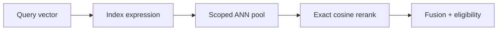

# ANN, HNSW, And Halfvec

PostgreSQL stores canonical float32 vectors and executes vector search.
HNSW is an approximate index for Evidence candidate discovery. Its index structure is independent of topic organization.

## Outcome And Responsibility

The active search-index generation selects exact, full-precision HNSW,
half-precision HNSW, or binary-quantized HNSW execution. Callers cannot select
an index, distance operator, or arbitrary SQL expression.

ANN retrieves a bounded candidate pool. PostgreSQL then orders those candidates
using cosine distance over canonical full-precision vectors. Exact reranking
can correct ordering within the pool; it cannot recover a row the approximate
index omitted.

## Dimension And Index Capability

Startup derives the following strategy from the persisted embedding dimensions:

| Dimensions | Canonical storage | Derived candidate index |
| --- | --- | --- |
| 1–2000 | float32 `vector` | `vector_hnsw`, `vector_cosine_ops`. |
| 2001–4000 | float32 `vector` | `halfvec_hnsw`, `halfvec_cosine_ops`. |
| 4001–16000 | float32 `vector` | `binary_hnsw`, `bit_hamming_ops`. |
| Above 16000 | Unsupported | Reject incompatible dimensions. |

For binary HNSW, Hamming distance selects quantized candidates; final vector
ordering still uses full-precision cosine distance. The 3072-dimensional
example embedding model uses a `halfvec(3072)` index expression.

The active generation selects the execution branch. The runtime does not
automatically choose exact search merely because a tenant is small.
Exact-query paths are bounded and must be permitted by the active contract.

## Contract And Index Decision Guide

| Change | Consequence |
| --- | --- |
| Provider/model/dimensions or vector-space definition | Existing vectors cannot simply be relabeled; a compatible embedding contract and derived generation are required. |
| Source-kind document renderer | Affected documents and vectors need reconciliation under the correct projection format. |
| Physical index definition | Validate/rebuild the index against the existing contract; unchanged vectors do not require provider regeneration solely for an index build. |
| Ranking or candidate policy | Verify retrieval quality and cost with the deterministic comparison. |

A normal environment edit is not an online embedding-model migration API.
Startup fails on incompatible persisted contracts.

## Separate Versioned Contracts

`embedding_contracts` defines the numerical vector space.
`search_index_generations` defines strategy, operator class, expression,
physical index identity, construction parameters, and query bounds.
`search_projection_generations` tracks source-kind document readiness.

These are distinct from application ranking logic. The public MCP schema has
no caller-selected ranking mode or index knobs. Current defaults are described
in [Configuration](Configuration#search-index-construction).

## PostgreSQL Storage And Query Shape

Search documents retain source/version/hash, contract/dimensions, search state,
and the full-precision vector. The physical HNSW index is partial to its
validated active contract and compatible document state.

Adapter SQL derives the cast and operator from the stored generation. It
validates the contract UUID before inserting the literal needed to match the
partial-index predicate; user query values remain parameters. Team and
memory-space predicates stay in candidate SQL.

The query applies a transaction-local `hnsw.ef_search` sufficient for the
candidate budget. Bootstrap starts with a value of 40 and raises it to at least
the generation's candidate limit, which defaults to 200. Physical index
validation checks more than the index name: its expression, predicate, operator
class, validity, and contract must agree.

## Readiness And Failure

An incompatible or invalid required index is a typed readiness/search failure.
It is not permission to run an unbounded exact scan.

A stale vector frontier can be reported as an explicit lexical-only degradation while authorized Evidence retrieval remains useful. A required frontier failure must remain
visible; it cannot become a successful empty result.

Search reconciliation repairs derived documents using current source and
contract fences. See [Operations Runbook](Operations-Runbook) for investigation.

## Topology And Load

The server uses the writable PostgreSQL primary for search. Replica-read and
distributed PostgreSQL profiles are not supported. Index approximation can
lose relevant candidates under filtering even when returned rows are correctly
authorized.

Measure against exact scoped results when changing candidate strategy, query
breadth, or ranking. Track latency, database CPU/memory, index size, and write
cost as well as retrieval quality. Adding application replicas increases pool
and provider pressure; it does not add database search capacity by itself.

## Risks And Verification

| Failure mode | Verification or mitigation |
| --- | --- |
| Half/binary precision omits a useful neighbor | Compare scoped candidate recall with exact results; reranking alone cannot fix omission. |
| An index name exists but its definition is incompatible | Validate the full physical definition and readiness. |
| Vectors from different models are compared | Enforce contract and dimension fences in writes and reads. |
| A fallback scans an unbounded tenant | Require the active contract's exact-search permission and applicable bounds. |
| Search IDs cross a private boundary | Test candidate SQL and final hydration under real PostgreSQL RLS. |

See [Vector Search And Ranking](Vector-Search-And-Ranking) for distance and
fusion, and [Evaluation](Evaluation) for the quality gate.
