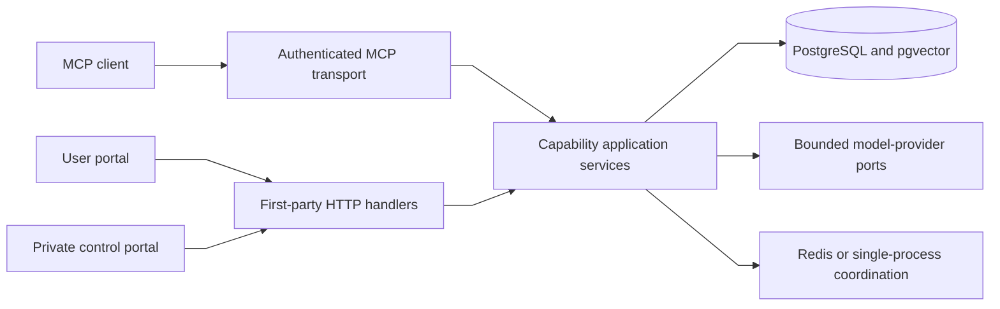

# Architecture

Dense-Mem is a self-hosted MCP memory service. The host decides when memory is
useful. Dense-Mem owns evidence intake, semantic lifecycle, retrieval,
provenance, authorization, and audit.

## System Map



PostgreSQL is the durable authority for knowledge, control state, workflow,
audit, graph-shaped reads, full-text search, and vectors. Redis and process
memory provide coordination only. Multiple server instances require distributed
coordination; one process can use the in-process implementation.

## Responsibility Boundaries

Dependency direction is transport → application → domain and ports.
Providers and storage implement ports. Composition constructs and connects
the concrete implementations.

| Owner | Responsibility |
| --- | --- |
| Access | Authentication, canonical identity, memberships, credentials, portal sessions, grants, and access policy. |
| Remember | Strict intake, security admission, bounded assessment, retry behavior, and synchronous write orchestration. |
| Knowledge | Authoritative evidence, semantic/lifecycle state, search-document and projection writes. |
| Search, recall, graph, trace | Search orchestration and maintenance, authorized retrieval, graph reads, and provenance. |
| Dream, community, conflict | Derived Hypotheses, community snapshots, and governed conflict workflows. |
| Privacy, settings, operations, audit | Private erasure/retention, runtime configuration, operator diagnostics, and audit use cases. |

Models propose closed-schema results. Deterministic server policy decides
authorization, identity, support, lifecycle, and durable state.

## Runtime Composition

The production image contains one executable, `/app/server`, PostgreSQL
migrations, and the user/control browser bundles. Server composition is owned
by `cmd/internal/serverapp`; transports and workers receive explicit capability
dependencies and process contexts.

The demo image uses `/app/demo-server` and the user bundle. The evaluation
image compiles the evaluation profile and adds its bounded harness tools.
A production runtime setting cannot enable evaluation-only tools.

The checked source inventory is
[ownership.v2.json](https://github.com/markhuangai/dense-mem/blob/main/architecture/ownership.v2.json),
assembled from exact capability fragments under `architecture/modules/`.
[Capability contracts](https://github.com/markhuangai/dense-mem/blob/main/architecture/capability-contracts.md)
describe the native package owners.

## Architecture Conformance

Accepted ADRs govern predictable tool outcomes, public-behavior tests, single
policy ownership, simple sufficient designs, and capability visibility.

The manifest has schema version 2. Its fragments classify exact Go/browser
units, worker anchors, and database-case ownership. The dependency role matrix
has one owner in `architecture/manifest.mjs`. Cross-capability imports require
a public target; private adapters and PostgreSQL infrastructure remain private.

Independent discovery checks production/evaluation Go profiles, browser imports,
and worker anchors. Missing, duplicate, stale, unclassified, or forbidden edges
fail. There are no dependency exceptions or ticket-expiring worker records.

```bash
node scripts/check-architecture.mjs
node --test tests/uat/architecture_conformance.test.mjs
```

## Startup And Shutdown

Startup validates configuration, connects to a writable PostgreSQL primary,
serializes migrations under a database session lock, establishes the search
contract, and composes coordination, providers, listeners, and workers.

The main listener serves MCP and the user portal. The separate control listener
serves administrative interfaces and authenticated metrics. Operation logging
has a required PostgreSQL sink whose availability participates in readiness.

Shutdown stops request admission and background work through their owning
contexts, then closes dependencies. Long-lived streams release their slots on
disconnect or cancellation. See [Operations Runbook](Operations-Runbook).

## Write Boundary

Remember validates and scans the complete request, serializes its idempotency
key, resolves duplicate evidence and bounded context, and assesses submitted
evidence/proposals. It embeds required final documents before one fenced
canonical transaction. Duplicate-candidate embedding may also precede
assessment.

Safe evidence may be stored without a Relationship. Unsupported proposals have
explicit dispositions. Invalid assessor responses and required provider,
embedding, or commit failures cannot partially commit accepted knowledge.
The originating call returns the terminal result.

See [Memory Write Pipeline](Write-Pipeline) for ordering, deadlines,
retryability, and failure semantics.

## Read Boundary

Recall retrieves evidence contexts after final authorization and eligible
Relationship support-path checks. It separately returns related Relationships,
communities, conflicts, and Hypotheses. Derived frontiers never turn into
submitted evidence.

Trace expands normalized evidence, support decisions, transitions, and conflict
history for an authorized Relationship. A SemanticEdge is a read projection of
an active eligible Relationship, not another authoritative record.

Search reconciliation repairs derived documents and vectors using source and
contract fences. Required write embeddings remain part of the synchronous
write. See [Recall Ranking](Recall-Ranking) and
[Data Model And Storage](Data-Model-And-Storage).

## Memory-Space Ownership Boundary

Authentication fixes team, actor, membership, permanent owner alias, grants,
credential, and allowed spaces. Tool arguments cannot choose the tenant or
write space.

| Space | Visibility |
| --- | --- |
| `team_shared` | Authorized team members. |
| `profile_private` | The authenticated identity's private space within that team. |
| `credential_private` | The bound credential's private space within that team. |

A credential has an immutable `shared_only`, `profile_private`, or
`credential_private` binding. Remember chooses the authenticated private space
when present, otherwise the shared space. The write scope is still required.
Private-bound recall searches the shared and permitted private branches
independently and fuses authorized results. It never links semantic identities
across those branches.

Same-team read visibility does not grant mutation of another owner's records.
Private erasure also uses space generations and worker fences. See
[Request Lifecycle And Security](Request-Lifecycle-And-Security).

## Risks And Mitigations

| Failure mode | Architectural protection |
| --- | --- |
| A transport duplicates domain authorization or bypasses it | Narrow application APIs and checked dependency boundaries. |
| A provider changes durable lifecycle or owner | Closed-schema results and deterministic server policy. |
| A concurrent source/space change makes a prepared write stale | Commit-time version, source, ownership, and generation fences. |
| A background projection overwrites newer knowledge | Versioned source/hash/search-contract checks. |
| A private result crosses into shared memory | Independent scoped queries and authorization again on hydration/mutation. |
