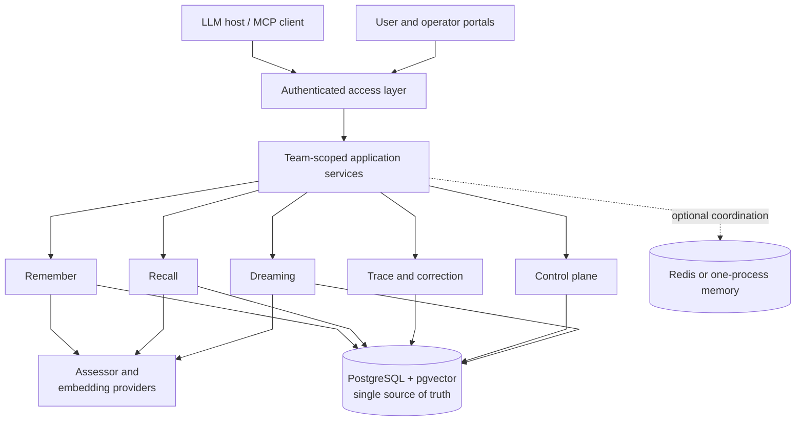
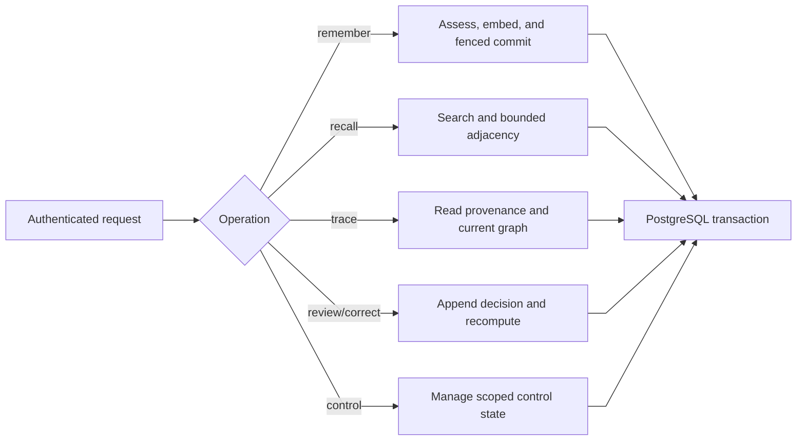
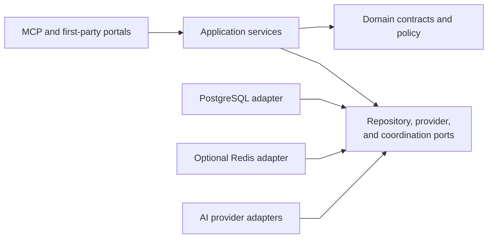
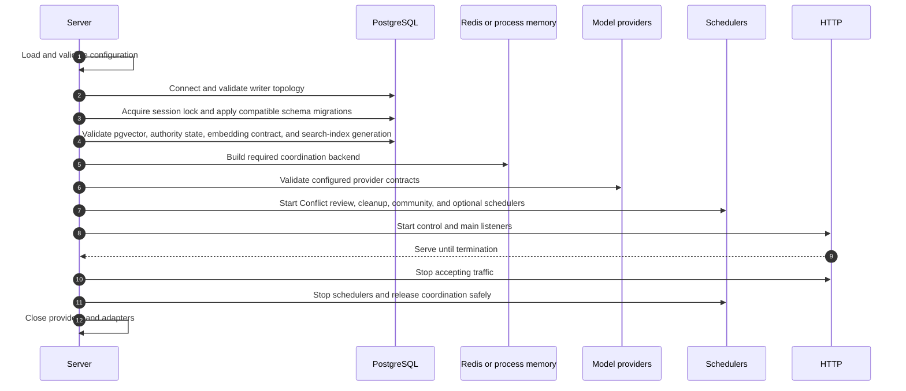
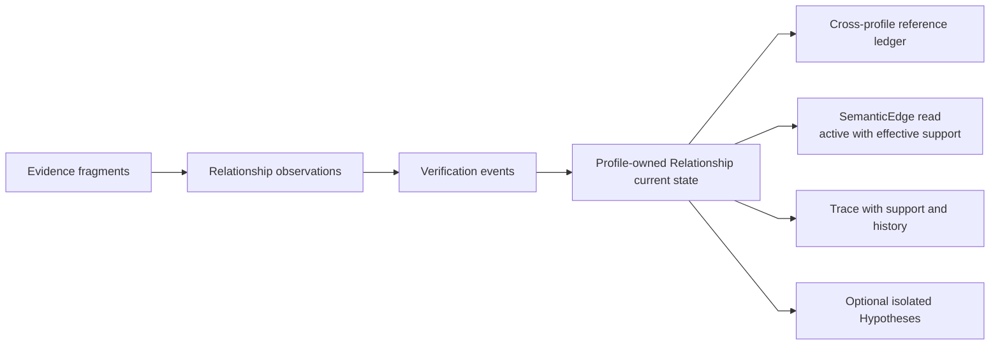
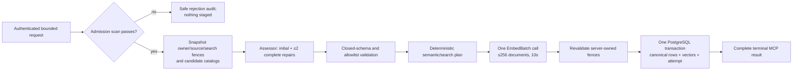
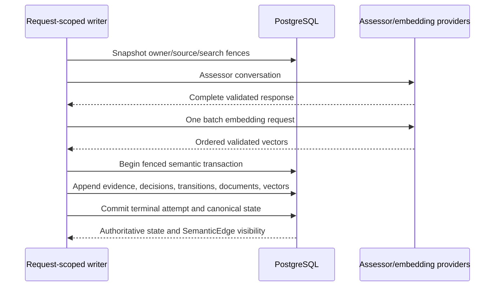

# Architecture

Dense-Mem is a standalone memory service. The host LLM decides when memory is
useful; Dense-Mem owns evidence intake, Entity resolution, Relationship
lifecycle, durable provenance, retrieval, trace, and audit.

This page is the current architecture overview. Detailed rules live in the linked
canonical pages.

## v2.6.1 write authority

The normal Remember write path is request-scoped and queue-free:

```text
authenticate and validate
  -> snapshot owner/source/search fences
  -> assessor conversation (initial + at most two complete repairs)
  -> deterministic semantic/search plan
  -> one EmbedBatch call (≤256 documents, 10s)
  -> one fenced PostgreSQL transaction (≤10s)
  -> terminal MCP result
```

Provider calls happen outside the transaction. Canonical semantic rows are not
visible without their required current vectors. `remember_attempts` and
`remember_attempt_events` provide terminal control diagnostics; placement rows,
normal placement workers, and `embedding_jobs` are historical migration input,
not runtime authority.

## System Map



PostgreSQL is the only required database. It stores durable knowledge and
control state and serves graph-shaped, full-text, and vector reads. `pgvector`
is an extension inside PostgreSQL. Redis is optional coordination and never
contains memory truth.

## Responsibility Boundaries

| Boundary | Responsibility |
| --- | --- |
| Access | listener separation, authentication, authorization, tenant/profile scope, request limits, deterministic injection scanning, and safe errors |
| Application | remember, recall, trace, correction, dreaming, and control orchestration |
| Domain | Entity identity, predicate vocabulary, Relationship identity/lifecycle, evidence acceptance, and Hypothesis rules |
| PostgreSQL | durable ledger, current state, queues, assessor assessments, dispositions, audit, SemanticEdge queries, full-text, and `pgvector` |
| Model providers | one integrated structure/support assessor conversation, embeddings, and optional dream generation; no write authority |
| Coordination | rate limits, leases/signals, and SSE concurrency; Redis when distributed, process memory when safely single-instance |

Store ownership and recovery belong in
[Data Model And Storage](Data-Model-And-Storage). Listener and authorization
boundaries belong in
[Request Lifecycle And Security](Request-Lifecycle-And-Security).

## Access Capability Boundary

The `internal/service/access` application boundary owns team and profile
identity, credential lifecycle, SSO/OAuth/SCIM reconciliation, portal sessions,
entitlement checks, rate-limit policy, and access audit values. It declares the
narrow ports that those policies consume. HTTP/MCP middleware and portal
handlers establish or consume the immutable principal through this API; they do
not select a team, profile owner, or storage adapter.

PostgreSQL repositories, Redis coordination, and the single-node in-process
implementation satisfy those ports at composition time. They preserve the
existing persistence, key, and session formats without becoming access policy.
Supported callers use one canonical application interface; retired Remember and
correction aliases are not retained as runtime compatibility surfaces.

## Remember Intake Capability Boundary

The `internal/service/remember` application capability owns Remember conversion,
the deterministic security gate, request-scoped assessment orchestration, and
terminal result projection. The composition root supplies the assessor,
embedding, and PostgreSQL adapters. Provider calls happen before one fenced
transaction that writes evidence, semantic state, vectors, attempt history, and
chronological events; no placement or embedding worker is involved.

## Request Paths



The authenticated principal fixes team, identity, membership, permanent owner
alias, optional credential, role, and grants before any application service
runs. A request never chooses its tenant or semantic owner.

Remember submissions are assessed by one request-scoped submission-wide
conversation. The result is terminal before the MCP call returns; provider,
configuration, database, and embedding failures are surfaced as bounded errors
and are never converted into queued retry work.

## Runtime Composition

Dependency direction is inward: transports call application services;
application services apply domain policy through ports; adapters implement
storage, provider, and coordination ports.

The release image has one Dense-Mem executable. The control and user portals
are static bundles served by that process, not separate services or binaries:

```text
/app/
  server                 release executable
  migrations/postgres/
    v2_4/                immutable historical startup inputs
    v2_5/                immutable historical startup inputs
    v2_6/                ordered current-release startup inputs
  web/dist/              private control-portal bundle
  web/user-dist/         user-portal bundle
```

The demo image follows the same rule with `/app/demo-server`, migrations, and
the user bundle; it does not contain the private control bundle. Former
operator and manual conflict-review command packages are removed from source
and are not shipped in either runtime image.

```text
cmd/server/
  composition root

internal/
  domain/
    evidence/
    entity/
    relationship/
    verification/
    hypothesis/
  service/
    access/
    remember/
    recall/
    trace/
    correction/
    dreaming/
  repository/
    knowledge/
    search/
    control/
  storage/
    postgres/
      ledger/
      current/
      search/
      queue/
    redis/
      coordination/
  provider/
    assessor/
    embedding/
    dream/
  transport/
    mcp/
    http/
    portal/
```



This tree is a responsibility map, not a command to preserve or invent package
names. Before implementation, map current packages and move code only where a
boundary is otherwise unenforceable.

## Architecture Conformance

The versioned `architecture/ownership.v1.json` manifest records the current
capability and role of every production Go package and reachable browser module.
It is a conformance record, not a speculative future package tree. The
deterministic `scripts/check-architecture.mjs` check discovers both Go profiles
(`production` and `evaluation`), walks the two browser entry points, and scans
long-running worker identities. A discovered package, module, or worker that is
not classified exactly once fails the check; a stale manifest entry fails too.

The enforced dependency direction is:

```text
transport -> application_api -> domain + port
                              <- adapter
worker    -> application_api + domain + port
composition/offline_evaluation -> any declared role
```

The checker evaluates actual import edges against the role matrix. A temporary
edge may be listed only as an exact source/target pair with a reason and a
later removal issue. Wildcards, missing removal bounds, unused exceptions, and
exceptions whose bound has passed are errors. Browser discovery starts only at
the declared production entries; test setup and helper modules are excluded by
explicit paths.

Run the same check locally and in shared CI:

```bash
node scripts/check-architecture.mjs
node --test tests/uat/architecture_conformance.test.mjs
```

The fixtures exercise an allowed composition edge, a forbidden transport to
PostgreSQL edge, an unclassified target, and an expired exception. This gate
changes enforcement only; it does not alter runtime contracts or package
ownership by itself.

## Startup And Shutdown



PostgreSQL authority validation is a readiness gate. Redis is a gate only when
distributed coordination is required or explicitly configured as mandatory. A
multi-instance deployment cannot silently fall back to process-local limits or
leases.

Legacy embedding workers claimed PostgreSQL jobs with worker/attempt-fenced
renewable leases in pre-v2.6.1 releases. They are not part of normal Remember,
correction, or current document-reconciliation writes; those paths use one
bounded provider batch and source/document/hash-fenced vectors with canonical
state.

Migrations finish before either HTTP listener serves traffic. Replicas sharing
one writable PostgreSQL primary serialize startup migration work through the
database session lock. Rolling deployments must keep every migration compatible
with the previous application version; each independent database still needs a
server connected to it to run the same startup gate.

Provider readiness distinguishes required operations: an unavailable assessor
may make synchronous Remember not-ready while authorized trace reads can still
operate. Exact health and incident procedure belongs in
[Operations Runbook](Operations-Runbook).

## Semantic Model Boundary



- Entity and typed Value are the only semantic-node kinds.
- A SemanticEdge is a graph-shaped read of one eligible Relationship row.
- Relationship lifecycle is ordinarily profile-owned and same-team readable;
  corrections of another profile create caller-owned knowledge plus immutable
  references, while nightly Conflict review may close losing stale episodes.
- Names and aliases are Entity metadata.
- Evidence, observations, verification, transitions, reviews, and Hypotheses
  are ledger records, not semantic nodes.
- Pending Relationships have no active edge and do not enter default recall.
- A Hypothesis can connect only existing endpoints and cannot change knowledge.

Canonical ownership:

| Concern | Canonical page |
| --- | --- |
| Entity reuse, create, ambiguity, merge, and split | [Entity Identity And Resolution](Entity-Identity-And-Resolution) |
| Predicate, Relationship identity, evidence, verification, status, effective support, and forget | [Relationship Model And Lifecycle](Relationship-Model-And-Lifecycle) |
| PostgreSQL, Redis, transactions, durable storage, jobs, and recovery | [Data Model And Storage](Data-Model-And-Storage) |
| PostgreSQL tenant keys, table placement, RLS/query locality, and future team sharding | [PostgreSQL Cluster-Safe Schema](PostgreSQL-Cluster-Safe-Schema) |
| pgvector exact/ANN execution, HNSW/halfvec, index load, and search topology | [ANN, HNSW, And Halfvec](ANN-HNSW-And-Halfvec) |
| `remember` stage order and bounded integrated assessor | [Memory Write Pipeline](Write-Pipeline) |
| recall eligibility, PostgreSQL branches, and trace escalation | [Recall Ranking](Recall-Ranking) |
| cosine distance, RRF, reranking, and conflict preference | [Vector Search And Ranking](Vector-Search-And-Ranking) |
| Hypothesis generation boundary | [Dreaming](Dreaming) |
| MCP discovery/execution and first-party portal boundary | [Request Lifecycle And Security](Request-Lifecycle-And-Security#mcp-memory-interface) |

## Write Boundary

Remember first validates and deterministically scans every provider-bound user
field: evidence and the structured proposal. An intake rejection appends only
safe, team-scoped audit metadata and returns a bounded result; it creates no
ingest, fragment, search document, or provider request. A
passing request snapshots owner/source/search fences, builds server-owned Entity
occurrence groundings and complete candidate context, then starts one strict
assessor conversation with an initial call and at most two complete repairs.
The response is validated as a whole; no partial response is persisted. The
server builds a deterministic semantic/search plan, renders and deduplicates
the final documents, makes one bounded `EmbedBatch` call, revalidates the
fences, and commits canonical semantics, evidence, current vectors, terminal
attempt metadata, and chronological events in one PostgreSQL transaction.
Provider calls remain outside that transaction. A security concern is returned
as a bounded quarantine result, semantic unsupported/stale input is returned
with per-ref `not_stored` results, and provider/embedding/commit failures are
structured `isError` results that callers can retry with the same key.



Malformed assessor output is returned to the same provider with bounded
validation errors and full message history for at most three provider calls. The
application does not coerce it or commit a valid subset. Provider failures end
the conversation and produce a replayable failed attempt for retry with the
same idempotency key; no placement attempt or background retry is used. Unsupported hints are
recorded as `not_stored` only when stored support covers every evidence item;
otherwise the complete submission is `rejected/no_supported_memory`. Exact
client-owned races are `rejected/stale_input`; infrastructure faults are
`failed`. Full details belong in
[Memory Write Pipeline](Write-Pipeline#server-owned-assessment).

## Read Boundary

Normal recall searches authorized same-team evidence through PostgreSQL
full-text and `pgvector`. It separately correlation-ranks active, supported,
profile-owned Relationships and, when enabled, derived Communities. It returns
bounded Evidence contexts, Relationship groups, Communities, Conflict status,
Hypotheses, freshness, and trace handles in independent fields and limits—not
assessor history.

Trace fetches normalized provenance when the caller needs to understand,
correct, or forget knowledge. Graph visualization uses the same semantic-node
and SemanticEdge query shape; it is not another database or authority.

## Consistency Boundary

Core semantic state, cross-profile Conflict case disposition, and their
append-only histories commit atomically in PostgreSQL transactions. Conflict
intake opens or updates cases with caller-owned knowledge. Nightly Conflict review may
resolve a locked case, close losing stale Relationship episodes, append
Relationship/Conflict ledger events, and queue search refresh in one transaction.



Required write embeddings are synchronous and current at commit. A separate
document-centric reconciliation pass may repair historical drift, but it is not
part of normal Remember acknowledgement and does not restore a placement or
embedding queue.

## Host And Service Responsibilities

| Area | Dense-Mem owns | Host LLM owns |
| --- | --- | --- |
| Remember | evidence persistence, server-owned grounding, exact candidate prefetch, strict integrated assessment, deterministic validation/lifecycle, and traceability | submitting evidence, logical Relationship intent, and supporting evidence indexes |
| Embeddings | evidence, Entity, Relationship, and query embeddings through configured providers | no normal-use vectors |
| Recall | bounded retrieval, ranking, graph frontier, freshness, and trace handles | deciding which returned context to use, cite, or question |
| Ambiguity | exact candidates, impact, review state, and safe decision application | presenting the ambiguity and collecting the user's evidence-backed choice |
| Cross-profile conflict | durable case/version, deterministic nightly disposition, deadline audit, current/historical recall, and trace | presenting open positions and submitting new evidence through `remember` |
| Operations | isolation, memberships, credentials, roles, keys, portals, telemetry, backup, and recovery | client configuration and safe use of returned context |

Dense-Mem is not an autonomous truth oracle. Models propose structured
judgments; deterministic server rules control durable state.

## Change Boundary

Architecture changes ship as reviewable vertical changes. Each change needs
contract, tenant-isolation, idempotency, and failure tests before another
change relies on it.

## Risks And Mitigations

| Risk | Concrete failure mode | Mitigation |
| --- | --- | --- |
| PostgreSQL graph query is unbounded | a hub Entity causes a recursive query to exhaust memory | partial adjacency indexes and strict seed/fan-out/depth/edge/time budgets |
| ANN tenant filter loses recall | shared approximate search omits relevant team rows before hydration | enforce the team-shaped execution/topology gates in [ANN, HNSW, And Halfvec](ANN-HNSW-And-Halfvec) |
| Provider controls truth | assessor returns lifecycle status, an unknown predicate, or an arbitrary ID and it reaches storage | closed schema excludes writes; exact candidate allowlists, structured predicate catalog, and deterministic lifecycle |
| Retry makes a second write-time decision | a worker restarts after receiving a valid response and calls the assessor again | persist the first valid assessment under a stable claim key and reload it before any provider call |
| Assessor repair changes submitted meaning | a repair silently changes polarity or an exact Entity/predicate constraint | preserve submitted endpoints/polarity/bounds, enforce exact constraints, and repair only grounding/catalog state |
| Unsupported subset activates a source | a stored Relationship covers one evidence item while another is omitted | require stored support for every evidence item before source activation or supersession |
| Big-bang refactor stalls | every package changes before one end-to-end path works | small vertical changes and passing acceptance invariants per change |
| Redis becomes a hidden database | replicas lose identity or review state after Redis restart | coordination-only ports and restart tests proving PostgreSQL is complete |
| Conflict workflow becomes a truth edge | a team preference appears as a semantic predicate or closes an unrelated A Relationship | separate non-semantic case/event records, locked case membership, system reviewer transitions, and support-path-only recall disposition |

## Architecture Invariants

1. Authentication fixes the team; request data cannot override it.
2. PostgreSQL is the only durable source of knowledge and control state.
3. `pgvector` is part of PostgreSQL, not a separate authority.
4. Redis and process memory contain no canonical memory.
5. Entity and typed Value are the only semantic nodes.
6. One active profile-owned Relationship with effective support produces at
   most one SemanticEdge.
7. Pending Relationships and Hypotheses never enter default recall or active
   graph reads.
8. Stored knowledge and search context can inform comparison but never count as
   submitted evidence.
9. Only deterministic policy after a valid complete persisted assessor response
   changes lifecycle status or effective support; the assessor never writes
   active state.
10. Every submitted Relationship ref receives one stored/not_stored disposition,
    and accepted support covers every evidence item before source activation.
11. Required recall failures are visible; optional degradation is reported.
12. Embedding and search-index versions form explicit linked deployment
    contracts with separate rebuild lifecycles.
13. Runtime has no secondary durable knowledge-store dependency.
14. Same-team visibility never permits one profile to mutate another profile's
    knowledge.
15. A team Conflict case never owns evidence or changes a member Relationship's
    owner, author attribution, support, Entity resolution, or source history.
16. Nightly Conflict review may close losing stale Relationship episodes with
    audited `status=superseded` and `valid_to` transitions.
16. Relationship projection version is separate from the numerical embedding
    and physical search-index contracts; its migration cannot re-embed Evidence.
17. Relationship vector fusion is team-gated until a complete projection
    generation is current.
18. One Remember request owns one assessor conversation with at most three total
    provider turns; every retry after a valid persisted assessment makes zero
    provider calls.
19. Stored support must cover every submitted evidence item before source or
    supersession activation; unsupported hints are not client errors when this
    coverage remains true.
20. Retained legacy review rows are audit-only; they never activate knowledge or
    directly create a Hypothesis.
21. Historical v2.4/v2.5 migrations and rows are audit/upgrade input only. They
    do not change v2.6 Remember behavior, re-enter the worker, or appear through
    the public v2.6 submission-status projection.
22. MCP has one current closed schema per running server; clients do not select
    a Dense-Mem schema/server contract version. Older wire revisions negotiate
    through `initialize`; the `2026-07-28` revision uses `server/discover`.

## Historical v2.5 Transport And Identity Foundations

MCP Streamable HTTP is composed through the official Go SDK v1.7.0 at the
transport edge. The existing registry, authenticated context, schemas, and
`invokeTool` seam remain the only catalog and execution authority. The legacy
transport and differential implementation are removed; `MCP_TRANSPORT=legacy`
fails startup. The SDK is absent from domain/provider/repository packages.

```text
HTTP auth middleware
        │ immutable team/identity/membership/owner/credential context
        ▼
MCP edge (official SDK only)
        │ shared registry + invokeTool
        ▼
application services → domain policy → PostgreSQL/Redis/provider ports
```

The ordered identity migrations first backfill `actor_identities`,
`team_memberships`, `credentials`, `membership_grants`,
`identity_external_links`, and `ownership_aliases` without changing key,
profile, team, or semantic owner IDs. The next transactional migration takes an
exclusive legacy-table lock, reruns reconciliation, validates every retained
reference, and removes the bridge plus its two legacy tables. Skipped releases
run both migrations in numeric Goose order. `team_admin` is governance;
effective memory access remains the intersection of membership maximum grants
and credential scopes. Migration `2026081602` then validates direct semantic
foreign keys to `teams` and `ownership_aliases`, replaces the mirror-backed
constraints, and removes `semantic_team_refs`, `semantic_profile_refs`, and
`embedding_config`.

For SSO, the selected membership supplies the permanent owner alias while the
stable SSO actor owns the canonical team membership and grants; there is no
credential unless a personal one is used. For direct API-key auth, the stable
credential ID is also the permanent owner alias. System actors retain
`actor_identities.kind = system`. Canonical identity tables are now the only
runtime authority.

## Memory-Space Ownership Boundary

All memory is team-scoped and carries an explicit space boundary. The supported
space kinds are:

| Space kind | Owner | Visibility | Write authority |
| --- | --- | --- | --- |
| `team_shared` | team | authorized members of the team | existing `remember` flow |
| `profile_private` | one authenticated identity in the team | that identity's authenticated profile context | reserved for private ingestion |
| `credential_private` | one team-bound credential | that credential's authenticated context | reserved for private ingestion |

There is no global private space. A credential has one immutable binding:
`shared_only`, `profile_private`, or `credential_private`. Read-only
credentials may be private-bound, but their effective grants cannot write. A
private-bound recall executes the team-shared and the credential's own private
branch independently; it never resolves entities, graph edges, or search hits
across branches. Normal `remember` remains team-shared and has no space selector.
