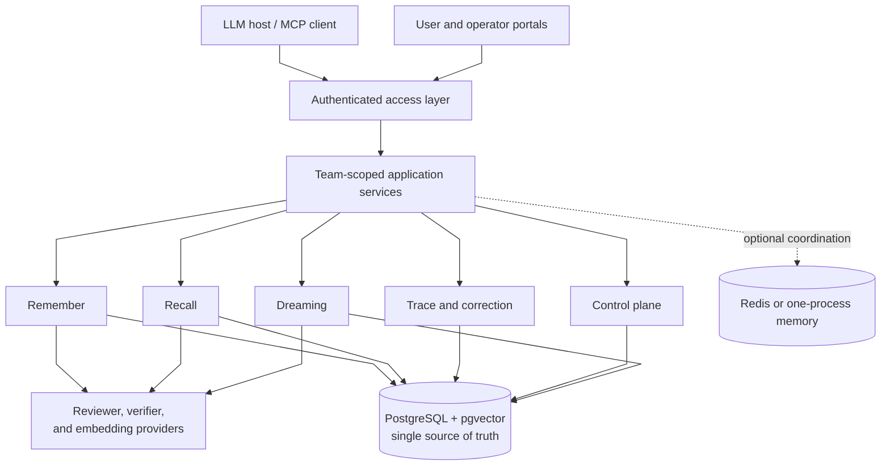
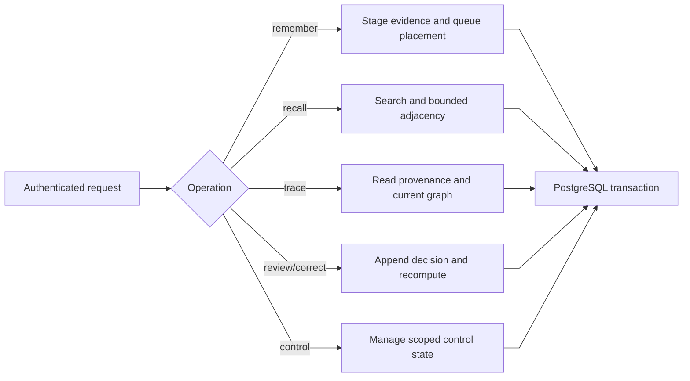
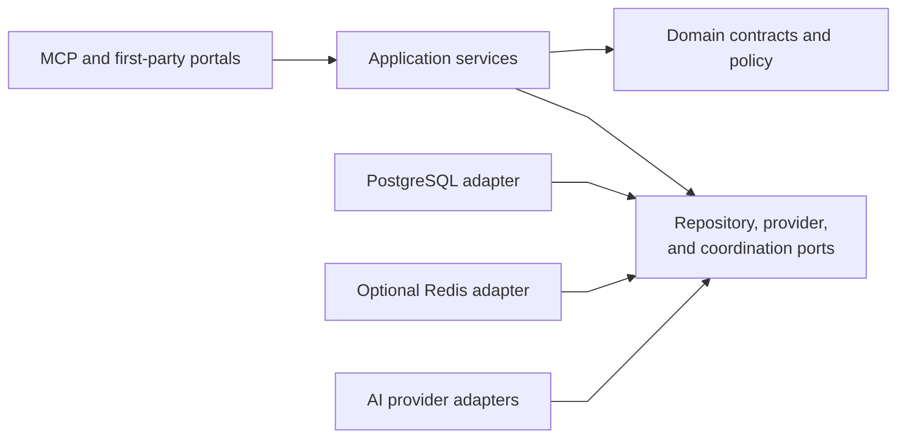
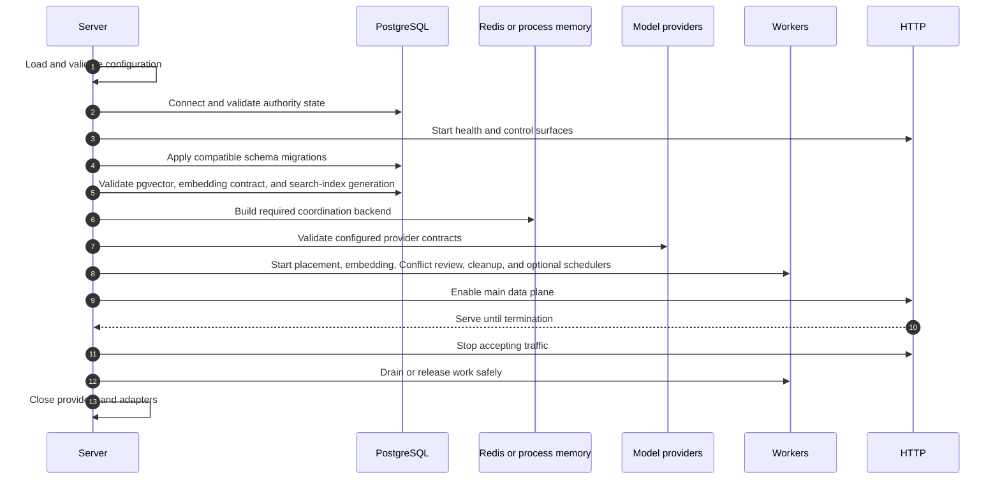
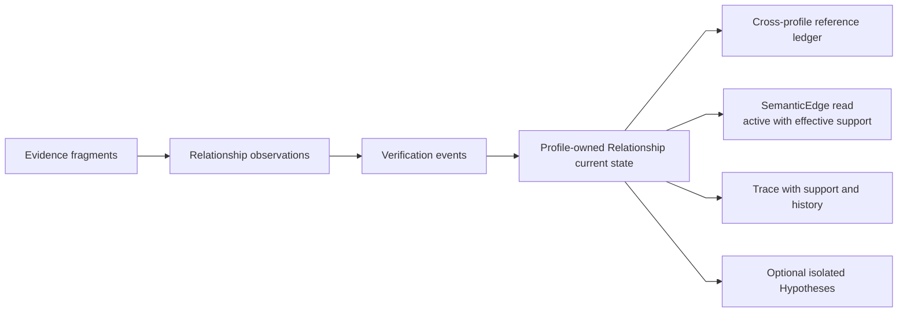
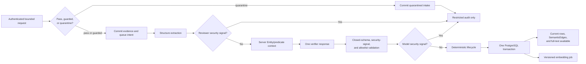
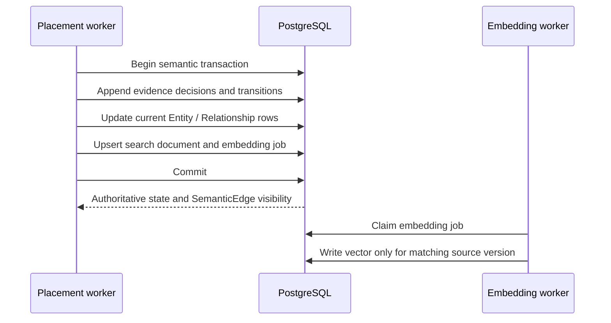

# Architecture

Dense-Mem is a standalone memory service. The host LLM decides when memory is
useful; Dense-Mem owns evidence intake, Entity resolution, Relationship
lifecycle, durable provenance, retrieval, trace, and audit.

This page is the current architecture overview. Detailed rules live in the linked
canonical pages.

## System Map



PostgreSQL is the only required database. It stores durable knowledge and
control state and serves graph-shaped, full-text, and vector reads. `pgvector`
is an extension inside PostgreSQL. Redis is optional coordination and never
contains memory truth.

## Responsibility Boundaries

| Boundary | Responsibility |
| --- | --- |
| Access | listener separation, authentication, authorization, tenant/profile scope, request limits, deterministic injection scanning, and safe errors |
| Application | remember, recall, trace, correction, dreaming, and control orchestration |
| Domain | Entity identity, predicate vocabulary, Relationship identity/lifecycle, evidence acceptance, and Hypothesis rules |
| PostgreSQL | durable ledger, current state, queues, review, audit, SemanticEdge queries, full-text, and `pgvector` |
| Model providers | structured extraction, one-call verification, embeddings, and optional dream generation; no write authority |
| Coordination | rate limits, leases/signals, and SSE concurrency; Redis when distributed, process memory when safely single-instance |

Store ownership and recovery belong in
[Data Model And Storage](Data-Model-And-Storage). Listener and authorization
boundaries belong in
[Request Lifecycle And Security](Request-Lifecycle-And-Security).

## Request Paths



The authenticated principal fixes team, profile, role, and scopes before any
application service runs. A request never chooses its tenant.

## Runtime Composition

Dependency direction is inward: transports call application services;
application services apply domain policy through ports; adapters implement
storage, provider, and coordination ports.

```text
cmd/server/
  composition root

internal/
  domain/
    evidence/
    entity/
    relationship/
    verification/
    hypothesis/
  service/
    remember/
    recall/
    trace/
    correction/
    dreaming/
  repository/
    knowledge/
    search/
    control/
  storage/
    postgres/
      ledger/
      current/
      search/
      queue/
    redis/
      coordination/
  provider/
    embedding/
    reviewer/
    verifier/
    dream/
  transport/
    mcp/
    http/
    portal/
```



This tree is a responsibility map, not a command to preserve or invent package
names. Before implementation, map current packages and move code only where a
boundary is otherwise unenforceable.

## Startup And Shutdown



PostgreSQL authority validation is a readiness gate. Redis is a gate only when
distributed coordination is required or explicitly configured as mandatory. A
multi-instance deployment cannot silently fall back to process-local limits or
leases.

Provider readiness distinguishes required operations: an unavailable verifier
may make write placement not-ready while authorized trace reads can still
operate. Exact health and incident procedure belongs in
[Operations Runbook](Operations-Runbook).

## Semantic Model Boundary



- Entity and typed Value are the only semantic-node kinds.
- A SemanticEdge is a graph-shaped read of one eligible Relationship row.
- Relationship lifecycle is ordinarily profile-owned and same-team readable;
  corrections of another profile create caller-owned knowledge plus immutable
  references, while nightly Conflict review may close losing stale episodes.
- Names and aliases are Entity metadata.
- Evidence, observations, verification, transitions, reviews, and Hypotheses
  are ledger records, not semantic nodes.
- Pending Relationships have no active edge and do not enter default recall.
- A Hypothesis can connect only existing endpoints and cannot change knowledge.

Canonical ownership:

| Concern | Canonical page |
| --- | --- |
| Entity reuse, create, ambiguity, merge, and split | [Entity Identity And Resolution](Entity-Identity-And-Resolution) |
| Predicate, Relationship identity, evidence, verification, status, effective support, and forget | [Relationship Model And Lifecycle](Relationship-Model-And-Lifecycle) |
| PostgreSQL, Redis, transactions, durable storage, jobs, and recovery | [Data Model And Storage](Data-Model-And-Storage) |
| PostgreSQL tenant keys, table placement, RLS/query locality, and future team sharding | [PostgreSQL Cluster-Safe Schema](PostgreSQL-Cluster-Safe-Schema) |
| pgvector exact/ANN execution, HNSW/halfvec, index load, and search topology | [ANN, HNSW, And Halfvec](ANN-HNSW-And-Halfvec) |
| `remember` stage order and strict one-call verifier | [Memory Write Pipeline](Write-Pipeline) |
| recall eligibility, PostgreSQL branches, and trace escalation | [Recall Ranking](Recall-Ranking) |
| cosine distance, RRF, reranking, and conflict preference | [Vector Search And Ranking](Vector-Search-And-Ranking) |
| Hypothesis generation boundary | [Dreaming](Dreaming) |
| MCP discovery/execution and first-party portal boundary | [Request Lifecycle And Security](Request-Lifecycle-And-Security#mcp-memory-interface) |

## Write Boundary

Remember first validates and deterministically scans the bounded request, then
atomically commits exact evidence, the scan event, and queued, guarded, or
quarantined processing intent. A worker handling queued evidence extracts
structure, retrieves immutable Entity/predicate candidates, makes one strict
verifier request containing bounded `security_signals`, `entity_results`, and
`relationship_results`, validates the whole response, applies deterministic
policy, and commits all material outcomes in PostgreSQL.



Invalid verifier output is regenerated as a complete response. The application
does not coerce it or commit a valid subset. Full details belong in
[Memory Write Pipeline](Write-Pipeline#strict-verifier-contract).

## Read Boundary

Normal recall searches authorized same-team evidence through PostgreSQL
full-text and `pgvector`. It separately correlation-ranks active, supported,
profile-owned Relationships and, when enabled, derived Communities. It returns
bounded Evidence contexts, Relationship groups, Communities, Conflict status,
Hypotheses, freshness, and trace handles in independent fields and limits—not
verifier history.

Trace fetches normalized provenance when the caller needs to understand,
correct, or forget knowledge. Graph visualization uses the same semantic-node
and SemanticEdge query shape; it is not another database or authority.

## Consistency Boundary

Core semantic state, cross-profile Conflict case disposition, and their
append-only histories commit atomically in PostgreSQL transactions. Placement
opens or updates cases with caller-owned knowledge. Nightly Conflict review may
resolve a locked case, close losing stale Relationship episodes, append
Relationship/Conflict ledger events, and queue search refresh in one transaction.



Only embeddings are intentionally asynchronous because they are derived.
`search_state` exposes their freshness. There is no cross-database graph
projection, outbox, or graph-reconciliation loop in the target.

## Host And Service Responsibilities

| Area | Dense-Mem owns | Host LLM owns |
| --- | --- | --- |
| Remember | evidence persistence, extraction review, strict verification, identity resolution, lifecycle, and traceability | submitting evidence and the smallest supported hint |
| Embeddings | evidence, Entity, Relationship, and query embeddings through configured providers | no normal-use vectors |
| Recall | bounded retrieval, ranking, graph frontier, freshness, and trace handles | deciding which returned context to use, cite, or question |
| Ambiguity | exact candidates, impact, review state, and safe decision application | presenting the ambiguity and collecting the user's evidence-backed choice |
| Cross-profile conflict | durable case/version, deterministic nightly disposition, deadline audit, current/historical recall, and trace | presenting open positions and submitting new evidence through `remember` |
| Operations | isolation, profiles, roles, keys, portals, telemetry, backup, and recovery | client configuration and safe use of returned context |

Dense-Mem is not an autonomous truth oracle. Models propose structured
judgments; deterministic server rules control durable state.

## Change Boundary

Architecture changes ship as reviewable vertical changes. Each change needs
contract, tenant-isolation, idempotency, and failure tests before another
change relies on it.

## Risks And Mitigations

| Risk | Concrete failure mode | Mitigation |
| --- | --- | --- |
| PostgreSQL graph query is unbounded | a hub Entity causes a recursive query to exhaust memory | partial adjacency indexes and strict seed/fan-out/depth/edge/time budgets |
| ANN tenant filter loses recall | shared approximate search omits relevant team rows before hydration | enforce the team-shaped execution/topology gates in [ANN, HNSW, And Halfvec](ANN-HNSW-And-Halfvec) |
| Provider controls truth | verifier returns lifecycle status or an arbitrary ID and it reaches storage | closed schema excludes writes; allowlist validation and deterministic lifecycle |
| Big-bang refactor stalls | every package changes before one end-to-end path works | small vertical changes and passing acceptance invariants per change |
| Redis becomes a hidden database | replicas lose identity or review state after Redis restart | coordination-only ports and restart tests proving PostgreSQL is complete |
| Conflict workflow becomes a truth edge | a team preference appears as a semantic predicate or closes an unrelated A Relationship | separate non-semantic case/event records, locked case membership, system reviewer transitions, and support-path-only recall disposition |

## Architecture Invariants

1. Authentication fixes the team; request data cannot override it.
2. PostgreSQL is the only durable source of knowledge and control state.
3. `pgvector` is part of PostgreSQL, not a separate authority.
4. Redis and process memory contain no canonical memory.
5. Entity and typed Value are the only semantic nodes.
6. One active profile-owned Relationship with effective support produces at
   most one SemanticEdge.
7. Pending Relationships and Hypotheses never enter default recall or active
   graph reads.
8. Stored knowledge and search context can inform comparison but never count as
   submitted evidence.
9. Only deterministic policy after a valid complete verifier response changes
   lifecycle status or effective support.
10. Required recall failures are visible; optional degradation is reported.
11. Embedding and search-index versions form explicit linked deployment
    contracts with separate rebuild lifecycles.
12. Runtime has no secondary durable knowledge-store dependency.
13. Same-team visibility never permits one profile to mutate another profile's
    knowledge.
14. A team Conflict case never owns evidence or changes a member Relationship's
    owner, author attribution, support, Entity resolution, or source history.
15. Nightly Conflict review may close losing stale Relationship episodes with
    audited `status=superseded` and `valid_to` transitions.
16. Relationship projection version is separate from the numerical embedding
    and physical search-index contracts; its migration cannot re-embed Evidence.
17. Relationship vector fusion is team-gated until a complete projection
    generation is current.
