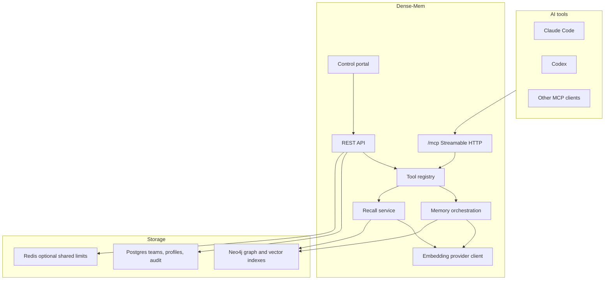
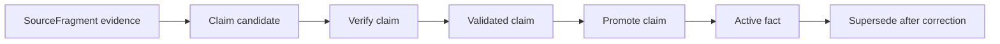
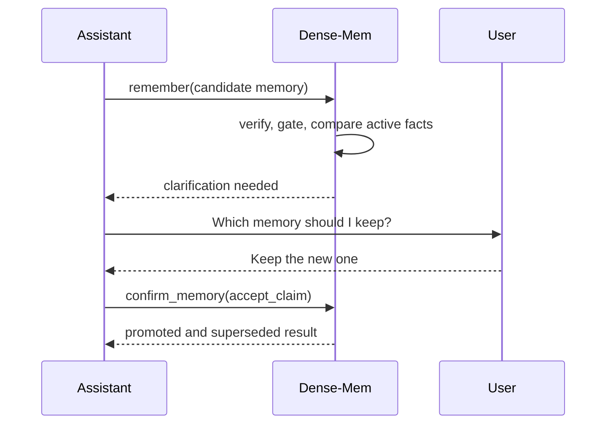

# Architecture

Dense-Mem separates memory from the AI assistant.

The assistant still talks to the user and decides how to respond. Dense-Mem owns
the memory database, evidence, embeddings, claims, facts, teams, profiles, and
API keys.

## System Map



## Responsibility Boundary

| Area | Dense-Mem owns | AI assistant owns |
| --- | --- | --- |
| Memory writes | Evidence, typed claims, verification, gates, promotion | Deciding what candidate memories to send |
| Embeddings | Fragment embeddings and recall-query embeddings | No vectors for normal use |
| Retrieval | Facts, claims, fragments, and clarifications | Choosing how to use recalled context |
| Corrections | Conflict detection and supersession records | Asking the user which memory is correct |
| Operations | Teams, profiles, API keys, audit metadata | Client-side MCP configuration |

Dense-Mem is intentionally narrow. It does not replace the assistant. It gives
the assistant a reliable memory service.

## Memory Model

Dense-Mem uses three layers:

| Layer | Plain meaning | Why it exists |
| --- | --- | --- |
| SourceFragment | Original evidence text | Preserves where a memory came from. |
| Claim | A typed candidate assertion | Lets Dense-Mem check and gate possible memories. |
| Fact | A promoted active memory | Gives assistants stable memory to recall. |

The flow looks like this:



Facts are not overwritten in place. Corrections create new facts and mark older
comparable facts as superseded. That preserves history.

## Conflict Handling

When a new memory conflicts with an active fact, Dense-Mem should return a
clarification instead of guessing.



This is important because memory systems should not silently decide what the user
meant.

## Team And Profile Isolation

Every memory operation is scoped to the authenticated API key.

An API key belongs to:

- one team
- one named profile
- one scope set, either read-only or read-write

Clients do not need to send a team ID for normal memory routes. Dense-Mem derives
the team and profile from the bearer key.

## Transport

Dense-Mem uses MCP Streamable HTTP at:

```text
/mcp
```

Supported methods:

| Method | Path | Purpose |
| --- | --- | --- |
| `POST` | `/mcp` | JSON-RPC requests and notifications. |
| `GET` | `/mcp` | Server-to-client SSE stream where supported. |

REST and OpenAPI remain available for non-MCP integrations and operations.

## Storage Choices

| Component | Purpose |
| --- | --- |
| Postgres | Teams, profiles, key metadata, audit records, migrations. |
| Neo4j | Memory graph, claims, facts, relationships, vector indexes. |
| Redis | Optional for one server; required for multi-instance shared limits. |

## Embedding Ownership

Dense-Mem embeds normal write and recall text itself.

Clients send text. Dense-Mem sends that text to the configured embedding
provider, stores the resulting vectors, and checks that model dimensions stay
consistent.

Client-supplied vectors are reserved for advanced search use cases.
