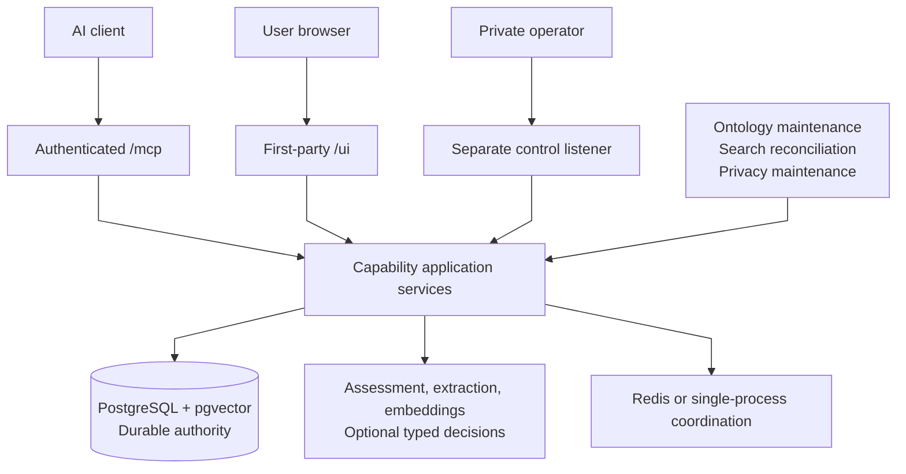
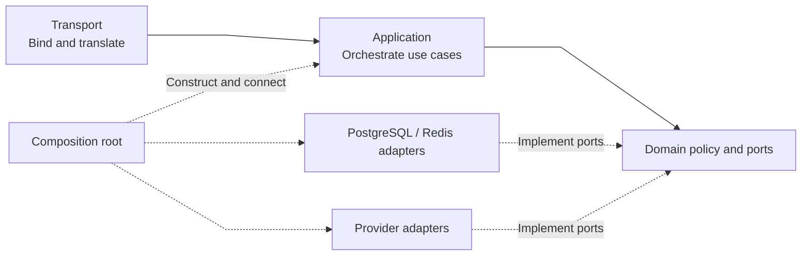

# Architecture

Dense-Mem is a standalone MCP Streamable HTTP memory service. PostgreSQL with pgvector owns durable memory, provenance, workflow, security, search, and audit. Model providers propose assessments; deterministic server policy decides what can commit.

## Runtime Boundaries



MCP is the supported external memory integration contract. Browser handlers are first-party interfaces. The control listener stays private or behind dedicated administrative ingress.

## Dependency Direction



| Capability | Owns |
| --- | --- |
| Access | Identity, memberships, credentials, sessions, grants, and access policy. |
| Remember / Session | Strict intake, exact source staging, bounded provider orchestration, and terminal outcomes. |
| Knowledge | Evidence, occurrences, source revisions, lifecycle, Evidence conflicts, and authoritative search writes. |
| Recall / Trace / Memory packs | Authorized retrieval, bounded provenance reads, and portable Evidence exports. |
| Ontology | Derived shared-Evidence topics, memberships, equivalence, and manager overrides. |
| Search | Search contracts, query orchestration, index mechanics, and reconciliation. |
| Privacy / Settings / Operations / Audit | Erasure and retention, configuration, diagnostics, and audit use cases. |

The [checked architecture inventory](https://github.com/markhuangai/dense-mem/blob/152448a4c4c4192a7492ad3ae2ca311fcb82851a/architecture/ownership.v2.json) and [capability contracts](https://github.com/markhuangai/dense-mem/blob/152448a4c4c4192a7492ad3ae2ca311fcb82851a/architecture/capability-contracts.md) own package-level detail.

## Runtime Composition

| Runtime | Boundary |
| --- | --- |
| Production | `/app/server`, migrations, user/control browser bundles. |
| Demo | `/app/demo-server`, bounded temporary-team behavior and user bundle. |
| Evaluation | Separate build profile with bounded evaluation tools. A runtime flag cannot enable them in production. |
| One server process | Process-local coordination is supported. |
| Multiple server processes | Redis or an equivalent distributed implementation is required. |

Startup validates configuration, connects to a writable PostgreSQL primary, serializes migrations under a session lock, verifies search contracts, and composes providers, listeners, and workers. Readiness remains false until required dependencies are ready. Shutdown cancels request/worker contexts and closes dependencies.

## Read And Write Responsibilities

| Question | Canonical explanation |
| --- | --- |
| What is stored, and what changes eligibility? | [Evidence Model And Lifecycle](Evidence-Model-And-Lifecycle) |
| When is input staged, assessed, embedded, and committed? | [Memory Write Pipeline](Write-Pipeline) |
| How are shared sources organized? | [Topics And Organization](Topics-And-Organization) |
| How are candidates selected and hydrated? | [Recall Ranking](Recall-Ranking) |
| How are identity and spaces enforced? | [Request Lifecycle And Security](Request-Lifecycle-And-Security) |
| How do startup, backup, and recovery work? | [Operations Runbook](Operations-Runbook) |

## Architecture Checks

```bash
node scripts/check-architecture.mjs
node --test tests/uat/architecture_conformance.test.mjs
```

Schema-version-2 fragments declare exact package/browser units, public/private visibility, worker anchors, and database-case ownership. Independent discovery rejects missing, duplicate, stale, or forbidden dependencies. One cohesive owner supplies each authoritative policy; similar syntax alone is not a reason to create a shared abstraction.
