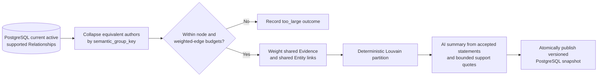
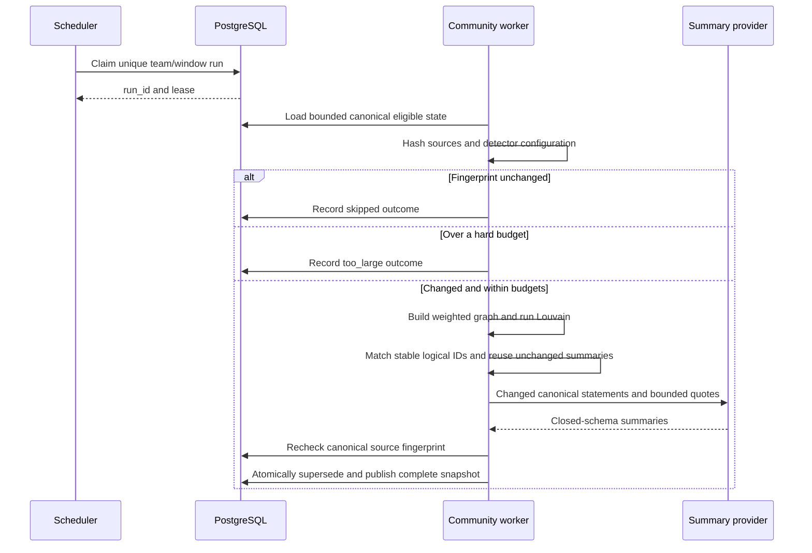
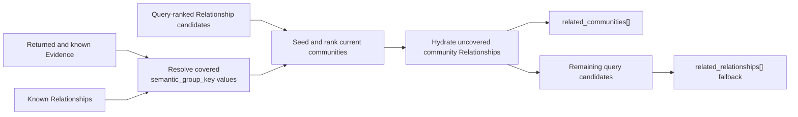
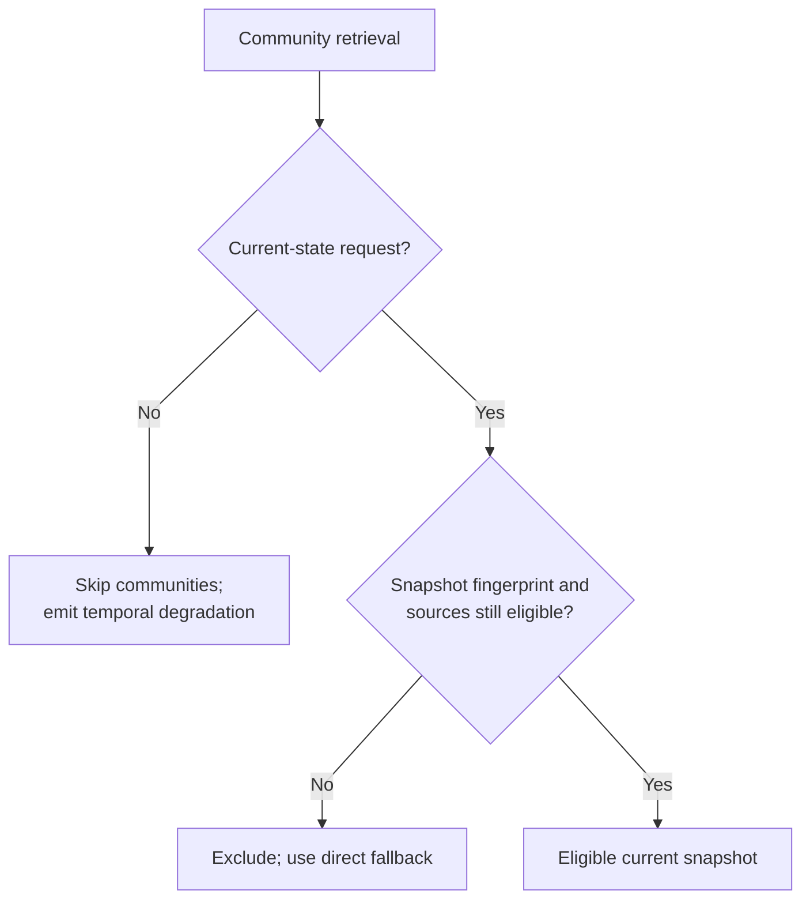

# Community Memory

PostgreSQL is the authority for versioned Louvain snapshots, the nightly
runner is opt-in, and recall emits the normalized `related_communities[]` shape
with semantic-group coverage and explicit temporal/staleness degradation.
[Technical Reference](Technical-Reference) is the live public contract.

Community detection groups related same-team Relationship semantic groups. A
community is a derived analytical cluster for discovery—not an Entity,
Relationship, predicate behavior, lifecycle state, or evidence.

It is unrelated to the retired `policy_family` term. Dreaming is a separate
Hypothesis process; see [Dreaming](Dreaming).

## Boundary



No graph database or durable semantic projection is required. A worker reads
bounded authoritative state from PostgreSQL, runs Louvain in isolated process
memory, and discards the analytical graph after the run.

Each analytical node represents one current `semantic_group_key` with at least
one `active`, non-alias Relationship and effective grant/reinstate support from
a current, non-quarantined, non-retracted Evidence revision. Entity-to-Entity
and Entity-to-Value Relationships are eligible. Candidates, Hypotheses,
pending/review state, unsupported state, and unauthorized sources are excluded.

Evidence is many-to-many provenance and an analytical link signal; it never
becomes a member node. Entity endpoints also create analytical links but never
replace the Relationship-group membership model. Equivalent authored
Relationships collapse to one node so repeated same-team authorship does not
multiply topology, while every eligible raw Relationship remains source
provenance.

When a Conflict case is resolved under the active deterministic policy, only
the preferred eligible position enters the projection. An open or overdue case
is omitted and reported rather than guessed into the analytical graph.

Conflict preference is defined in
[Vector Search And Ranking](Vector-Search-And-Ranking#cross-profile-conflict-reranking).

## Persisted Records

Use normalized PostgreSQL records:

```text
CommunityDetectionRun
  run_id
  team_id
  window_key
  algorithm_kind/version
  configuration_hash
  source_fingerprint
  node_count / edge_count
  status
  started_at / completed_at

CommunityRecord
  community_id (immutable version-row key)
  logical_community_id (stable public identity)
  run_id
  summary
  summary_model / prompt_version / response_hash
  summary_input_hash / admitted source IDs / generated_at
  status
  created_at / superseded_at

CommunityMembership
  community_id
  entity_id
  membership_score or rank

CommunitySource
  community_id
  semantic_group_key
  relationship_id
  owner_profile_id
  relationship_version
  source_state_hash
```

Membership and source IDs are normalized rows, not unbounded arrays. Existing
rows are backfilled with `logical_community_id = community_id`. Publication
inserts a new immutable record for each logical community and retains
superseded versions for audit. A partial unique constraint allows at most one
current record per team and logical community.

`CommunitySource.semantic_group_key` is the definitive partition membership.
`CommunityMembership` is the derived Entity ranking used for top-Entity reads;
it does not change the Relationship-group partition.

Community summaries have no search document or embedding. Evidence and
Relationship candidates seed community selection; summary text only explains
the selected cluster.

## Detection Sequence



If source state changes during computation, the worker fails the attempt
instead of publishing a mixed-version snapshot. Provider work occurs outside
the publication transaction. Missing, duplicate, unknown, out-of-allowlist, or
otherwise invalid summary output triggers at most three complete-response
attempts; any unresolved failure produces zero publication.

## Louvain Contract

For two Relationship-group nodes, sum these undirected contributions:

```text
shared effective Evidence = 2 / max(1, attached relationship groups - 1)
shared Entity endpoint    = 1 / max(1, attached relationship groups - 1)
shared typed Value endpoint = 1 / max(1, attached relationship groups - 1)
```

The stronger Evidence link captures shared provenance. The weaker
degree-normalized Entity link connects related assertions without allowing a
hub Entity to collapse unrelated topics. Contributions aggregate when a pair
shares several sources or endpoints.

The detector uses Gonum's `graph/community` Louvain implementation with sorted
input, resolution `1.0`, and a fixed PRNG seed. Its algorithm version,
resolution, weights, seed policy, and bounds enter the configuration hash.
Runs are capped at 5,000 semantic-group nodes and 20,000 weighted edges. Shared
typed Value endpoints contribute the same degree-normalized weak link as shared
Entity endpoints; they do not become analytical member nodes. The input loader
uses one overflow sentinel row, so a tenant over the node budget fails closed
instead of silently truncating. A persisted community needs at least two
semantic groups; singletons remain available through direct Relationship
recall.

## Stable Logical Identity

Candidate membership sets match prior current communities by Jaccard overlap.
The threshold is `0.60`; highest overlap wins and ties resolve by logical
community ID. On a split, only the best branch retains the prior ID. On a
merge, the best predecessor supplies the retained ID. Changed algorithm meaning
or configuration creates new versioned analysis and never rewrites history.

## Community Discovery

Communities use `related_communities[]` when team configuration enables the
feature, the request is current-state, and the snapshot passes freshness
checks. The feature is disabled by default. `community_limit` defaults to `3`,
has maximum `10`, and `0` disables the frontier for one request.
`community_relationship_limit` defaults to `5` and has range `1..20`.

There is no public `list_communities` MCP tool. The first-party portal may show
the same authorized derived read model as an analytical overlay, but that does
not add a public memory contract.



Current and previously seen Evidence and Relationships establish a semantic
coverage set. Communities are seeded first by returned Evidence, then known
Evidence/Relationships, then query-ranked Relationship candidates and direct
Entity expansion. A returned community must contribute at least one uncovered
semantic group. `related_relationships[]` then fills from remaining candidates,
including a member omitted by a community response limit. No semantic group can
appear in Evidence coverage, a nested community response, and direct fallback
at the same time.

Community results cannot rerank Evidence, create support, bypass authorization
or lifecycle filters, enter `related_hypotheses`, or appear without freshness
checks. Each public item contains:

```json
{
  "community_id": "community-1",
  "logical_community_id": "logical-community-1",
  "rank": 1,
  "summary": "Dense-Mem project work and storage choices.",
  "top_entities": [
    {"entity_id": "dense-mem", "name": "Dense-Mem"}
  ],
  "top_predicates": ["works_on", "uses"],
  "entity_count": 4,
  "relationship_count": 7,
  "relationships": [
    {
      "relationship_id": "relationship-1",
      "equivalent_relationship_ids": [],
      "subject": {"entity_id": "dense-mem", "name": "Dense-Mem"},
      "predicate": "uses",
      "object": {"entity_id": "postgresql", "name": "PostgreSQL"},
      "polarity": "+",
      "evidence_ids": ["evidence-2"]
    }
  ],
  "relationships_truncated": true
}
```

`top_entities` and `top_predicates` contain at most five items. Nested and
fallback Relationships use one public schema. The summary is never presented
as a fact; exact Relationships and Evidence remain the traceable support.
Ranking ownership remains in
[Recall Ranking](Recall-Ranking#community-frontier).

## Scheduling

Scheduling uses PostgreSQL due state and a unique team/window lease. Redis may
wake workers but is not the run source. Detection is nightly only: there is no
boot catch-up, first-recall generation, or write-transaction detection.

The scheduler enforces:

- per-team node and edge hard caps
- cross-team concurrency
- total and database-stream timeouts
- configured local start time and stable jitter
- one durable outcome per team/window
- complete canonical source/configuration fingerprint comparison

Exact settings belong in
[Configuration](Configuration#community-detection).

## Summary Generation

Summaries use `AI_VERIFIER_MODEL`; there is no second community model setting.
Input contains only canonical accepted Relationship statements and bounded
effective support quotes, never whole Evidence fragments. The model returns
summary text plus closed-schema allowlisted references. PostgreSQL retains the
model, prompt version, response hash, summary-input hash, admitted Relationship
and Evidence IDs, and generation time. Raw prompts and provider responses are
never logged.

Top Entities, top predicates, counts, source ranks, membership, and durable
status remain deterministic server decisions. The model controls summary text
only. An unchanged canonical fingerprint skips detection and provider calls;
an unchanged community summary-input hash reuses its prior summary/provenance
only when the provider model and prompt version also match; otherwise the
summary is regenerated inside the next complete snapshot.

Summary text never becomes evidence. A possible new connection belongs in a
Hypothesis and must still satisfy the existing-endpoint rules in
[Dreaming](Dreaming).

## Freshness



Newly accepted Relationships can be absent until the next nightly window. A
stored source that becomes revised, unsupported, quarantined, retracted, or
otherwise ineligible immediately makes the affected community unservable. If a
changed nightly run fails before publication, the older fingerprint remains
auditable but cannot be served as current.

Communities do not reconstruct `valid_at` or `known_at`. A temporal recall skips
the frontier, preserves temporal Evidence and direct Relationship recall, and
emits optional `community_temporal_not_supported`. Disabled communities produce
an empty frontier without degradation. Missing, stale, failed, or oversized
enabled snapshots produce bounded community degradation and direct fallback.

## Portal And Operations

The portal shows communities as a separate analytical overlay. Operators can
inspect run status/duration, source fingerprint, input estimates, algorithm
version/configuration, cluster count/size distribution, summary metadata, and
stale/too-large/error outcomes.

Metrics belong in [Telemetry](Telemetry).

## Risks And Mitigations

| Risk | Concrete failure mode | Mitigation |
| --- | --- | --- |
| Community becomes knowledge | generated summary is quoted as a fact | distinct record/visual style, no support/lifecycle state, and exact nested Relationships/Evidence |
| Cross-team input | a system worker streams another team's edges | explicit team predicate, worker transaction scope, RLS/system-mode audit, and leakage test |
| Stale cluster | correction commits during a long detection run | canonical fingerprint recheck before atomic publish and source validation on read |
| Worker OOM | a large tenant graph is loaded without a cap | count first, stream input, hard nodes/edges/memory/timeout, isolated worker |
| Hub-dominated or unstable partition | a broad Evidence item or Entity merges unrelated topics | degree-normalized weights, fixed seed/order/resolution, versioned configuration, and graph fixtures |
| Duplicate schedule | replicas publish two runs for one window | unique team/window key and PostgreSQL lease |
| Direct recall displaced | a singleton or truncated member disappears | retain a semantic-group-disjoint direct Relationship fallback |
| Profile copies distort clusters | three profiles repeat one edge and triple its graph weight | collapse semantic groups and bound weight by independent source groups |
| Unresolved correction creates false topology | A/B identity disagreement links two unrelated subgraphs | omit unresolved conflict sets and report the omission |
| Provider output is unsupported | summary invents a fact or references unknown input | bounded accepted statements/quotes, closed reference validation, provenance, and zero partial publication |
| Nightly generation fails | no current community snapshot can be served | explicit degradation, direct fallback, retained audit versions, and next-window retry |

## Acceptance Invariants

1. detection input contains only same-team current active Relationships with
   effective support
2. one analytical node represents one semantic group, including eligible
   Entity-to-Value Relationships
3. Evidence creates weighted provenance links but never becomes a member node
4. Candidates, pending state, and Hypotheses never enter the analytical graph
5. persisted analysis records logical/version identity, exact sources, source
   state, configuration, and summary provenance
6. unchanged canonical input performs no detector or provider work
7. source change prevents mixed-version publication or stale retrieval
8. invalid summary output produces zero partial publication
9. equivalent cross-profile positions create one analytical node
10. current and known Evidence/Relationships suppress complete semantic groups
11. nested Community and direct fallback Relationships are disjoint by semantic
    group
12. singletons, truncation, and unavailable Communities retain direct fallback
13. temporal recall skips Communities and reports optional degradation
14. retries do not duplicate team/window runs
15. the working analytical graph is discarded and never becomes semantic state
16. unresolved conflict sets are excluded rather than guessed into a community
