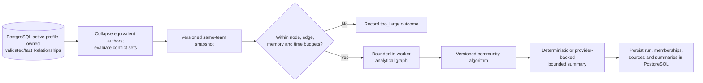
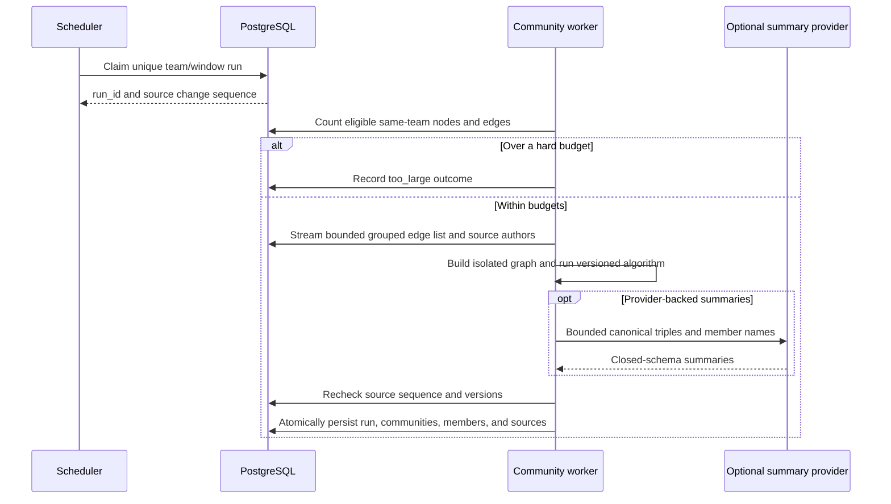
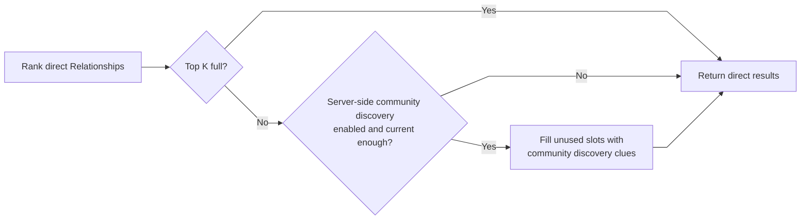
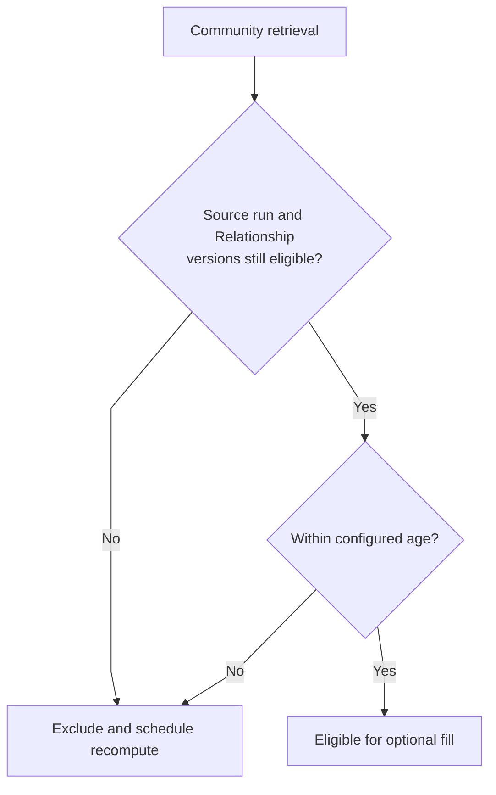

# Community Memory

Community detection groups related same-team Entities from eligible
Relationships. A community is a derived analytical cluster for discovery—not
an Entity, Relationship, predicate behavior, tier, or evidence.

It is unrelated to the retired `policy_family` term. Dreaming is a separate
Hypothesis process; see [Dreaming](Dreaming).

## Boundary



No graph database or semantic projection is required. A worker reads a bounded
edge list from PostgreSQL, runs the configured algorithm in isolated analytical
memory, and discards that working graph after the run.

Inputs include only same-team Relationships that are `active` and tiered
`validated_claim` or `fact` for the selected time scope. Candidates, evidence,
observations, verifier history, reviews, and Hypotheses are excluded.

Equivalent authored Relationships collapse to one analytical edge so several
profiles repeating the same meaning do not multiply topology. A bounded edge
weight may reflect genuinely independent accepted source groups, never raw
profile count. When a Conflict case is `resolved` under the active deterministic
policy, the snapshot uses its preferred position and retains all source
Relationship IDs. An `open` or `overdue` case is omitted and reported rather
than guessed into the analytical graph.

Conflict preference is defined in
[Vector Search And Ranking](Vector-Search-And-Ranking#cross-profile-conflict-reranking).

## Persisted Records

Use normalized PostgreSQL records:

```text
CommunityDetectionRun
  run_id
  team_id
  window_key
  source_change_sequence
  algorithm_kind/version
  configuration_hash
  node_count / edge_count
  status
  started_at / completed_at

CommunityRecord
  community_id
  run_id
  summary
  summary_generator_kind/version
  status
  created_at / superseded_at

CommunityMembership
  community_id
  entity_id
  membership_score or rank

CommunitySource
  community_id
  relationship_id
  owner_profile_id
  relationship_version
```

Membership and source IDs are rows, not unbounded arrays. The run's source
change sequence plus per-source versions makes staleness detectable. A derived
community search document may support optional recall fill; it is rebuildable.

## Detection Sequence



If source versions change during computation, the worker marks the attempt
stale/retryable instead of publishing mixed-version clusters.

## Algorithm Contract

The target does not require one library, but every implementation declares:

- algorithm name and version
- deterministic seed behavior
- directed/undirected and weight interpretation
- isolated memory and timeout caps
- minimum/maximum community size policy
- configuration hash
- stable result ordering for equivalent output

Changing algorithm meaning creates a new run version; it does not overwrite old
analysis. A library that cannot enforce input/time/memory bounds is not an
acceptable production adapter.

## Community Discovery

Normal public recall does not expose a `use_communities` flag. Community
signals may be used only as server-controlled discovery context when the team
configuration enables them and freshness checks pass.



Community fill cannot replace a direct Relationship, create support, affect
tier, bypass team/time/status filters, enter `related_hypotheses`, or appear
without freshness metadata.

A clue carries `community_id`, member Entity handles, source run/change
sequence, and a follow-up recall/trace option. It is never presented as a fact.
Ranking ownership remains in
[Recall Ranking](Recall-Ranking#community-expansion).

## Scheduling

Scheduling uses PostgreSQL due state and a unique team/window lease. Redis may
wake workers but is not the run source.

The scheduler enforces:

- per-team node and edge hard caps
- estimated and observed memory limits
- cross-team concurrency
- total and database-stream timeouts
- stable jitter and optional same-window catch-up
- one durable outcome per team/window
- minimum eligible-Relationship change before recomputation

Exact settings belong in
[Configuration](Configuration#community-detection).

## Summary Generation

The default summary should be deterministic from canonical Entity names and
predicate triples. A provider-backed profile is optional and records the model,
prompt revision, and local contract hash; validates a closed response; and
treats all input text as untrusted.

Summary text never becomes evidence. A possible new connection belongs in a
Hypothesis and must still satisfy the existing-endpoint rules in
[Dreaming](Dreaming).

## Freshness



Material Relationship changes advance a PostgreSQL change sequence or enqueue
bounded work. They never run community detection inside the write transaction.

## Portal And Operations

The portal shows communities as a separate analytical overlay. Operators can
inspect run status/duration, source change sequence, input estimates, algorithm
version/configuration, cluster count/size distribution, summary metadata, and
stale/too-large/error outcomes.

Metrics belong in [Telemetry](Telemetry).

## Risks And Mitigations

| Risk | Concrete failure mode | Mitigation |
| --- | --- | --- |
| Community becomes knowledge | generated summary is quoted as a fact | distinct record/visual style, no support/tier, optional-fill-only response |
| Cross-team input | a system worker streams another team's edges | explicit team predicate, worker transaction scope, RLS/system-mode audit, and leakage test |
| Stale cluster | correction commits during a long detection run | source sequence/version recheck before atomic publish |
| Worker OOM | a large tenant graph is loaded without a cap | count first, stream input, hard nodes/edges/memory/timeout, isolated worker |
| Algorithm drift | library upgrade silently changes clusters | algorithm/version/config hash and matched evaluation |
| Duplicate schedule | replicas publish two runs for one window | unique team/window key and PostgreSQL lease |
| Direct recall displaced | weak community clue takes a direct top-K slot | fill unused slots only |
| Profile copies distort clusters | three profiles repeat one edge and triple its graph weight | collapse semantic groups and bound weight by independent source groups |
| Unresolved correction creates false topology | A/B identity disagreement links two unrelated subgraphs | omit unresolved conflict sets and report the omission |

## Acceptance Invariants

1. detection input contains only same-team active `validated_claim` and `fact`
   Relationships
2. evidence, candidates, and Hypotheses never enter the analytical graph
3. persisted analysis records exact source IDs/versions and algorithm version
4. a source change prevents stale publication or retrieval
5. community fill never replaces a direct Relationship
6. unavailable/over-budget analysis produces explicit degradation
7. retries do not duplicate team/window runs
8. the working analytical graph is discarded and never becomes semantic state
9. equivalent cross-profile positions create one analytical edge
10. unresolved conflict sets are excluded rather than guessed into a community
