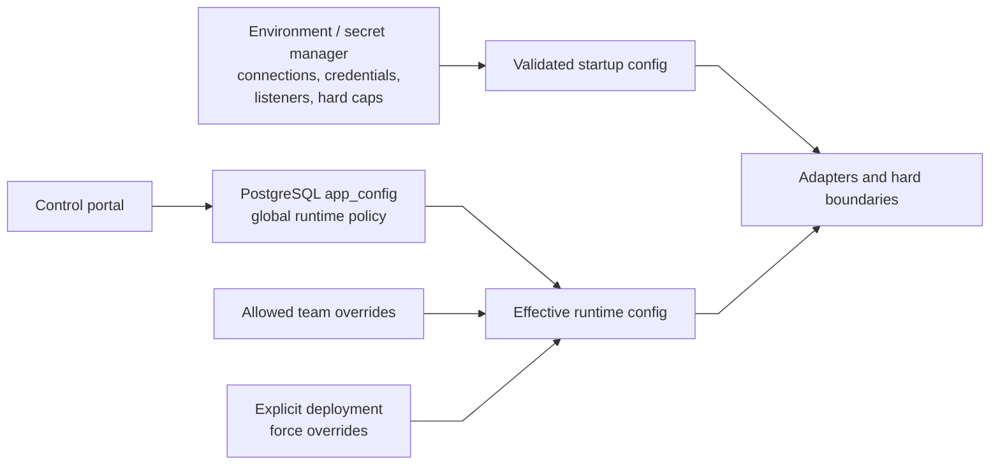
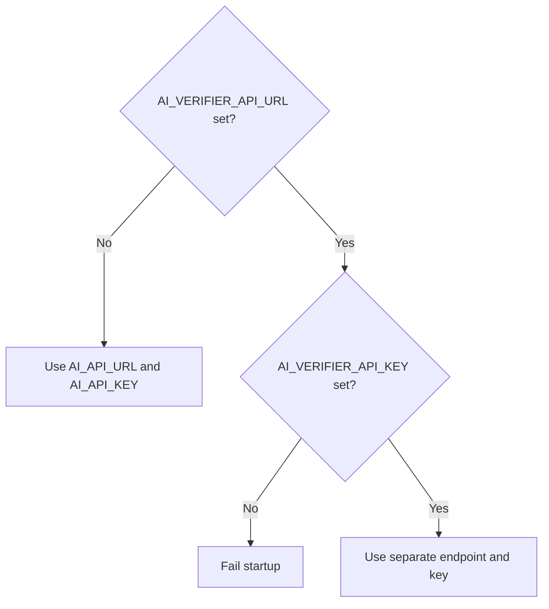
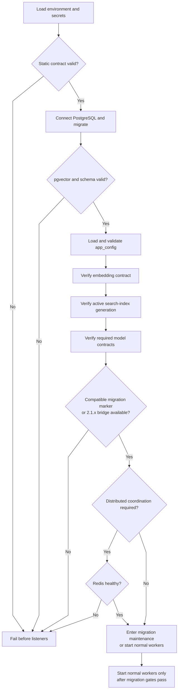

# Configuration

This page is the single source of truth for the target configuration contract.
It separates immutable startup/secrets from PostgreSQL-backed runtime policy.
Names in this page are the v2 configuration contract.

## Sources And Precedence



Runtime-policy precedence:

```text
explicit deployment force override
team override when that key permits it
global PostgreSQL app_config
built-in default
```

Credentials, encryption/signing material, listener addresses, hard safety caps,
and provider secrets are environment/secret settings only. They are rejected
from `app_config`.

## Required Startup Settings

Production startup requires:

- PostgreSQL connection and migration/runtime credentials
- `pgvector` extension availability, one active embedding contract, and one
  compatible active search-index generation
- reviewer and verifier provider contracts
- embedding provider contract
- control-portal authentication secret or explicit private/disabled policy
- encryption/signing material required by enabled features

Neo4j settings are not part of normal target runtime. The temporary `2.1.x`
bridge may read explicitly prefixed legacy Neo4j settings only while the
boot-gated migration is pending or running. It closes the connection after a
successful cutover. Version `2.2.0` removes that adapter and refuses startup
without the completed `2.1.x` migration marker. The canonical lifecycle is in
[Release Process](Release-Process#bridge-release-contract).

## Listeners

| Variable | Target default | Meaning |
| --- | --- | --- |
| `HTTP_ADDR` | `:8080` | main MCP and first-party user-portal listener inside the container |
| `CONTROL_HTTP_ADDR` | `:8090` | private control and metrics listener |
| `DENSE_MEM_BIND` | `127.0.0.1` | local host bind in base Compose |
| `DENSE_MEM_PORT` | `8080` | local host main port |
| `CONTROL_PORTAL_BIND` | `127.0.0.1` | control host bind |
| `CONTROL_PORTAL_PORT` | `8090` | control host port |

Keep control and metrics private. Public routing belongs in
[Public HTTPS And Redis](Public-HTTPS-And-Redis).

## PostgreSQL And `pgvector`

PostgreSQL is authoritative for knowledge, workflow, search, and control state.

| Variable | Target default | Meaning |
| --- | --- | --- |
| `POSTGRES_USER` | `densemem` | bundled database user |
| `POSTGRES_PASSWORD` | none | required secret |
| `POSTGRES_DB` | `densemem` | database name |
| `POSTGRES_HOST` | `postgres` | Compose service host |
| `POSTGRES_PORT` | `5432` | database port |
| `POSTGRES_SSLMODE` | `disable` locally | driver TLS mode |
| `POSTGRES_DSN` | empty | writable single-primary DSN override |
| `POSTGRES_MAX_OPEN_CONNS` | `25` | per-process pool maximum, also subject to deployment-wide budget |
| `POSTGRES_MAX_IDLE_CONNS` | `10` | idle pool target |
| `POSTGRES_CONN_MAX_LIFETIME_SECONDS` | `1800` | connection lifetime |
| `POSTGRES_VECTOR_MAX_CONCURRENCY` | `4` | per-process semaphore for exact/ANN database queries |
| `POSTGRES_STATEMENT_TIMEOUT_SECONDS` | `30` | default application statement ceiling |
| `POSTGRES_LOCK_TIMEOUT_SECONDS` | `5` | default lock-wait ceiling |

Production should separate migration and runtime roles. The runtime role needs
only application DML, approved functions, and tenant-scoped/RLS access.
The `vector` extension is installed by the global PostgreSQL migration and is
not optional after the pgvector image cutover.

The connection budget is deployment-wide:

```text
service instances * POSTGRES_MAX_OPEN_CONNS
+ separately pooled worker/migration connections
<= database connection limit - operator/failover reserve
```

Adding service replicas without recalculating this budget fails the production
preflight.

Topology is detected from PostgreSQL at boot; it is not selected by an
environment hint. This release requires a writable single primary and stops
before migrations or normal service startup when `pg_is_in_recovery()` is true,
`transaction_read_only` is enabled, or Citus is installed. `POSTGRES_READ_DSN`
is rejected because replica reads are not supported yet. The composite tenant
keys, scoped lookups, and placement classes in
[PostgreSQL Cluster-Safe Schema](PostgreSQL-Cluster-Safe-Schema) remain the
required schema design for future HA or distributed support; they do not imply
that those runtime topologies are enabled in this release.

PostgreSQL contains the records listed in
[Data Model And Storage](Data-Model-And-Storage). No configuration flag can
move semantic authority to Redis, a model provider, or a legacy graph store.

## Embedding Provider And Contract

| Variable | Target default | Meaning |
| --- | --- | --- |
| `AI_API_URL` | none | required OpenAI-compatible base URL |
| `AI_API_KEY` | none | required provider secret |
| `AI_API_EMBEDDING_MODEL` | `text-embedding-3-large` | required model ID |
| `AI_API_EMBEDDING_DIMENSIONS` | `3072` | required expected vector dimensions; requested from capable providers and always response-validated |
| `AI_API_EMBEDDING_TIMEOUT_SECONDS` | `30` | request timeout |
| `AI_API_EMBEDDING_MAX_CONCURRENCY` | `8` | process-wide concurrency |
| `SEARCH_DOCUMENT_FORMAT_VERSION` | required | canonical text-builder version |
| `EMBEDDING_NORMALIZATION_VERSION` | required | canonical preprocessing version |

Provider adapter, model, dimensions, normalization, and document format are one
persisted embedding contract. Dense-Mem does not infer dimensions from a model
name. The first database initialization records the configured model/dimensions;
later mismatches fail startup until a deliberate vector rebuild or reset workflow
replaces the stored contract. Mixed vectors fail readiness or remain excluded by
version checks.
The adapter sends a dimensions request only when the configured provider/model
supports it, but every response must have exactly the configured length.

Embedding and cosine meaning is defined in
[Vector Search And Ranking](Vector-Search-And-Ranking). Index compatibility and
rebuild impact is defined in
[ANN, HNSW, And Halfvec](ANN-HNSW-And-Halfvec#separate-versioned-contracts).

## Search Index Construction

Startup derives the persisted search-index generation from the active embedding
contract dimensions and supported pgvector capabilities. A different configured
model or dimension from the active embedding contract fails startup until a
controlled rebuild/reset workflow replaces the contract and derived generation.

| Variable | Target default | Meaning |
| --- | --- | --- |
| `PGVECTOR_HNSW_M` | `16` | maximum graph connections per HNSW layer; changing it rebuilds the index |
| `PGVECTOR_HNSW_EF_CONSTRUCTION` | `64` | HNSW construction candidate breadth; changing it rebuilds the index |
| `PGVECTOR_INDEX_BUILD_MAX_CONCURRENCY` | `1` | process-wide concurrent physical vector-index builds |

Cosine distance is fixed for the initial v2 contract. The default
3,072-dimensional OpenAI embedding contract derives a `halfvec_hnsw` generation.
The dimension matrix, 3,072-dimensional halfvec expression index, exact rerank,
and activation procedure belong only in
[ANN, HNSW, And Halfvec](ANN-HNSW-And-Halfvec#contract-and-index-decision-guide).

## Reviewer And Verifier

The structure reviewer and Entity/Relationship verifier may share the embedding
endpoint or use a separate OpenAI-compatible endpoint.



| Variable | Target default | Meaning |
| --- | --- | --- |
| `AI_VERIFIER_API_URL` | empty | share `AI_API_URL` |
| `AI_VERIFIER_API_KEY` | empty | share key only when URL is shared |
| `AI_REVIEWER_MODEL` | none | structure-extraction model |
| `AI_VERIFIER_MODEL` | none | one-call Entity and Relationship verifier |
| `AI_VERIFIER_DISABLE_TEMPERATURE` | `false` | omit unsupported parameter |
| `AI_VERIFIER_TIMEOUT_SECONDS` | `60` | one attempt timeout |
| `AI_VERIFIER_MAX_CONCURRENCY` | `5` | shared reviewer/verifier gate |
| `AI_VERIFIER_COOLDOWN_POLL_SECONDS` | `60` | one-probe interval after 429 |
| `AI_VERIFIER_MAX_ENTITY_RESULTS` | `100` | hard per-request result cap |
| `AI_VERIFIER_MAX_RELATIONSHIP_RESULTS` | `200` | hard per-request result cap |
| `AI_VERIFIER_MAX_INPUT_BYTES` | `131072` | serialized request cap |
| `AI_VERIFIER_MAX_OUTPUT_BYTES` | `131072` | response cap |
| `AI_VERIFIER_MAX_RESPONSE_REGENERATIONS` | `2` | full-response correction attempts |
| `RELATIONSHIP_MATCH_MAX_CANDIDATES` | `100` | post-verification server-side identity/conflict comparison cap |

There is no partial-response retry setting. Each correction regenerates the
complete `entity_results` and `relationship_results` response. If an ingest
cannot fit the declared one-request contract, intake or extraction fails with a
size error; the application does not split semantic dependencies and splice
model outputs.

The closed contract and validation rules belong in
[Memory Write Pipeline](Write-Pipeline#strict-verifier-contract).
The server may fingerprint that local contract for deployment and telemetry,
but no schema-version field is sent to or accepted from the model.

## Entity Resolution

| Variable | Target default | Meaning |
| --- | --- | --- |
| `ENTITY_RESOLUTION_MAX_CANDIDATES` | `20` | candidate allowlist per mention |
| `ENTITY_RESOLUTION_VECTOR_OVERFETCH` | `5` | internal vector over-fetch multiplier |
| `ENTITY_RESOLUTION_NAME_LOCK_TIMEOUT_SECONDS` | `5` | create-recheck lock timeout |
| `ENTITY_RESOLUTION_RECHECK_LIMIT` | `2` | bounded retries after a concurrent candidate |
| `ENTITY_DUPLICATE_REVIEW_ENABLED` | `true` | surface likely duplicate pairs |

Vector similarity retrieves candidates only. No threshold authorizes an
automatic merge. See
[Entity Identity And Resolution](Entity-Identity-And-Resolution).

## Placement And Embedding Workers

| Variable | Target default | Meaning |
| --- | --- | --- |
| `MEMORY_PLACEMENT_WORKER_COUNT` | `1` | concurrent placement workers |
| `MEMORY_PLACEMENT_LEASE_SECONDS` | `300` | renewable work lease |
| `MEMORY_PLACEMENT_HEARTBEAT_SECONDS` | `30` | lease heartbeat |
| `MEMORY_PLACEMENT_POLL_SECONDS` | `5` | durable queue poll interval |
| `MEMORY_PLACEMENT_MAX_ATTEMPTS` | `5` | orchestration attempts before visible failure |
| `EMBEDDING_WORKER_COUNT` | `2` | concurrent derived-vector workers |
| `EMBEDDING_BATCH_SIZE` | `64` | maximum same-team search-document jobs claimed for one provider batch, 1-256 |
| `EMBEDDING_JOB_LEASE_SECONDS` | `60` | job lease |
| `EMBEDDING_JOB_POLL_SECONDS` | `1` | durable queue poll |
| `EMBEDDING_JOB_MAX_ATTEMPTS` | `20` | attempts before `search_state=failed` |
| `EMBEDDING_JOB_RETRY_MAX_SECONDS` | `300` | backoff ceiling |
| `EMBEDDING_PENDING_STALE_SECONDS` | `60` | freshness warning threshold |

Embedding workers batch before scaling worker count. Each batch claims ready
jobs for one team with `FOR UPDATE SKIP LOCKED`, embeds the document texts with
one provider batch call, and completes each job against its claimed attempt and
document version. Provider output count, dimensions, and ordering are validated
before any vector is written. Batch failure is retried by splitting the batch
until the failing document is isolated or the error is classified as a
whole-provider/configuration failure.

Worker count must fit database and provider capacity. `AI_API_EMBEDDING_MAX_CONCURRENCY`
is the process-wide provider request cap; `EMBEDDING_BATCH_SIZE` controls request
width. PostgreSQL owns queue, lease, attempt, and result state. Redis may reduce
wake-up latency only.

## PostgreSQL Search And Recall

These startup settings define the active semantic-v2 recall ranking contract for
the process. They are internal telemetry and evaluation metadata; public recall
responses do not expose them. Future control-portal management must activate the
same complete contract shape atomically instead of mutating individual fields.

| Setting | Default | Meaning |
| --- | --- | --- |
| `RECALL_RRF_ENABLED` | `false` | use reciprocal rank fusion; `false` selects explicit branch-priority fusion |
| `RECALL_RRF_K` | `60` | reciprocal-rank-fusion constant |
| `RECALL_RRF_BRANCH_WEIGHTS` | `exact=2,evidence_text=1,evidence_vector=1` | bounded initial evidence-branch RRF weights |
| `RECALL_BRANCH_PRIORITY` | `exact,evidence_vector,evidence_text` | explicit initial evidence branch order when RRF is disabled |
| `RECALL_BRANCH_LIMIT_MULTIPLIER` | `6` | requested limit multiplier for per-branch over-fetch |
| `RECALL_BRANCH_LIMIT_FLOOR` | `60` | minimum per-branch candidate pool |
| `RECALL_BRANCH_LIMIT_MAX` | `200` | maximum per-branch candidate pool |
| `RECALL_DETERMINISTIC_RERANK_ENABLED` | `true` | apply bounded query/support/temporal reranking |
| `RECALL_MAX_ENTITY_SEEDS` | `20` | Entity search seeds |
| `RECALL_DISCOVERY_RELATIONSHIPS_PER_EVIDENCE` | `2` | compact discovery-path relationships loaded during hydration |
| `RECALL_MAX_GRAPH_DEPTH` | `1` initially | hard adjacency depth for default recall |
| `RECALL_MAX_EDGES` | `100` | hard expanded Relationship cap before evidence mapping |
| `RECALL_GRAPH_TIMEOUT_MILLISECONDS` | `500` | adjacency-branch budget |
| `RECALL_REQUIRED_BRANCH_PROFILE` | `relationship_v2` | versioned branch policy |
| `PGVECTOR_EXACT_FILTERED_MAX_ROWS` | `5000` | use exact distance below this authorized set size |
| `PGVECTOR_HNSW_EF_SEARCH` | `100` | base approximate search breadth |
| `PGVECTOR_HNSW_ITERATIVE_SCAN` | `strict_order` | filtered approximate scan behavior |
| `PGVECTOR_HNSW_MAX_SCAN_TUPLES` | `20000` | bounded iterative-scan work |
| `PGVECTOR_HNSW_SCAN_MEM_MULTIPLIER` | `1` | bounded iterative-scan memory as a multiple of transaction-local `work_mem` |

There is no candidate tier weight because candidates are ineligible for normal
recall. Disabling RRF selects the complete branch-priority contract; it never
mixes raw text/vector scores or chooses an implicit order. Relationship, Entity,
and adjacency branches are discovery branches and do not contribute to initial
evidence fusion. Ranking-contract changes require paired evaluation, including
approximate Recall@K against exact filtered search. The algorithm is defined in
[Vector Search And Ranking](Vector-Search-And-Ranking#runtime-control).

## Predicate Registry

| Setting | Target default | Meaning |
| --- | --- | --- |
| `PREDICATE_REGISTRY_VERSION` | required | active registry version |
| `PREDICATE_REGISTRY_CACHE_TTL_SECONDS` | `60` | bounded local cache |
| `PREDICATE_UNKNOWN_ACTION` | `review` | preserve and review; never invent |

Registry data lives in PostgreSQL. It supplies `relationship_kind`,
`current_cardinality`, aliases, and endpoint-kind rules. `policy_family` and
graph relationship-type mappings are not target settings.

## Redis Coordination

| Variable | Target default | Meaning |
| --- | --- | --- |
| `REDIS_ADDR` | empty | use safe one-process coordination when empty |
| `REDIS_PORT` | `6379` | local exposed port |
| `REDIS_PASSWORD` | empty | optional secret |
| `REDIS_DB` | `0` | logical database |
| `REDIS_TLS_ENABLED` | `false` | TLS for external Redis |
| `DISTRIBUTED_COORDINATION_REQUIRED` | `false` | fail instead of process-local fallback |

Set `DISTRIBUTED_COORDINATION_REQUIRED=true` for multiple service instances.
When required/configured Redis is unavailable, the server must not silently
fall back.

Redis may hold rate-limit counters, provider cooldown coordination, short
leases/signals, cleanup wakeups, and SSE concurrency. It cannot own evidence,
Entities, Relationships, reviews, queues, API keys, or audit.

## Authentication, Limits, And SSO

| Variable | Target default | Meaning |
| --- | --- | --- |
| `AUTH_VERIFY_MAX_CONCURRENCY` | `8` | concurrent key verification |
| `RATE_LIMIT_PER_MINUTE` | `100` | general authenticated requests |
| `REMEMBER_RATE_LIMIT_PER_MINUTE` | `60` | evidence intake |
| `RECALL_RATE_LIMIT_PER_MINUTE` | `300` | recall |
| `TRACE_RATE_LIMIT_PER_MINUTE` | `120` | trace |
| `HTTP_MAX_BODY_BYTES` | `1048576` | request body ceiling |
| `SSE_HEARTBEAT_SECONDS` | `30` | stream heartbeat |
| `SSE_MAX_DURATION_SECONDS` | `300` | stream maximum |
| `SSE_MAX_CONCURRENT_STREAMS` | `10` | streams per principal |
| `SSO_PUBLIC_BASE_URL` | empty | disable browser SSO when empty |
| `SSO_ENTITLEMENT_CACHE_TTL_SECONDS` | `300` | entitlement refresh |
| `SSO_SESSION_TTL_SECONDS` | `28800` | browser session lifetime |
| `SSO_STATE_TTL_SECONDS` | `600` | OAuth state/PKCE lifetime |
| `SSO_HTTP_TIMEOUT_SECONDS` | `10` | provider timeout |
| `SSO_COOKIE_SECURE` | derived | true for HTTPS by default |

Detailed public-edge policy is in [Public HTTPS And Redis](Public-HTTPS-And-Redis);
SSO mapping is in [User Portal SSO](User-Portal-SSO).

## Telemetry And Logging

| Variable | Target default | Meaning |
| --- | --- | --- |
| `TELEMETRY_ENABLED` | `false` | enable metrics/telemetry APIs |
| `TELEMETRY_PROMETHEUS_URL` | empty | dashboard query endpoint |
| `TELEMETRY_PROMETHEUS_JOB` | empty | bounded job selector |
| `TELEMETRY_QUERY_TIMEOUT_SECONDS` | `5` | Prometheus timeout |
| `TELEMETRY_SCRAPE_TOKEN` | none when enabled | private metrics bearer secret |
| `OPERATION_LOG_RETENTION_DAYS` | `30` | database log retention, 1–365 |
| `LOG_LEVEL` | `info` | structured level |
| `LOG_FORMAT` | `json` in production | `json` or `text` |
| `LOG_INCLUDE_RECORD_IDS` | `false` | bounded diagnostic IDs, never content |

Debug output still redacts secrets, evidence, vectors, and provider payloads.
Metric definitions belong in [Telemetry](Telemetry).

## Feature-Gated Runtime Policy

These keys are PostgreSQL-backed unless identified as hard environment caps.

### Recall feedback and evaluation

| Key | Target default | Meaning |
| --- | --- | --- |
| `RECALL_FEEDBACK_ENABLED` | `false` | expose feedback collection |
| `RECALL_FEEDBACK_RETENTION_DAYS` | `30` | detail retention, 1–365 |
| `EVALUATION_MODE_ENABLED` | `false` | expose evaluation-only APIs |
| `EVALUATION_EXPORT_MAX_PAGE_SIZE` | `100` | export maximum, 1–500 |

Never enable evaluation mode for production teams.

### Dreaming

| Key | Target default | Meaning |
| --- | --- | --- |
| `DREAMING_ENABLED` | `false` | scheduled cycles |
| `DREAMING_START_TIME_LOCAL` | `03:00` | local schedule |
| `DREAMING_CATCH_UP_ENABLED` | `false` | bounded same-window catch-up |
| `DREAMING_GENERATOR_KIND` | `deterministic` | `deterministic` or `provider` |
| `DREAMING_GENERATOR_MODEL` | empty | required for provider kind |
| `DREAMING_MAX_ACTIVE_RELATIONSHIPS` | `100` | active-source cap |
| `DREAMING_MAX_PENDING_CANDIDATES` | `25` | eligible insufficient-candidate cap |
| `DREAMING_MAX_OUTPUTS` | `5` | Hypotheses per cycle, 1–50 |
| `DREAMING_MAX_CONCURRENCY` | `1` | concurrent team cycles |

Eligibility and no-new-node behavior belong in [Dreaming](Dreaming).

### Community detection

| Key | Target default | Meaning |
| --- | --- | --- |
| `COMMUNITY_DETECTION_ENABLED` | `false` | scheduled derived clustering |
| `COMMUNITY_DETECTION_START_TIME_LOCAL` | `03:30` | local schedule |
| `COMMUNITY_DETECTION_MAX_CONCURRENCY` | `1` | concurrent team runs |
| `COMMUNITY_DETECTION_JITTER_SECONDS` | `600` | stable jitter |
| `COMMUNITY_DETECTION_MIN_CHANGED_RELATIONSHIPS` | `100` | recompute threshold |
| `COMMUNITY_DETECTION_MAX_AGE_HOURS` | `24` | staleness boundary |
| `COMMUNITY_DETECTION_MAX_NODES` | `500000` | hard input cap |
| `COMMUNITY_DETECTION_MAX_EDGES` | `2000000` | hard input cap |
| `COMMUNITY_DETECTION_TIMEOUT_SECONDS` | `600` | run timeout |

The service reads eligible IDs from PostgreSQL into a bounded analytical job;
no Neo4j/GDS dependency is implied. See
[Community And Dreaming](Community-And-Dreaming).

### Scheduling

| Key | Target default | Meaning |
| --- | --- | --- |
| `APP_TIMEZONE` | `Local` | use an IANA name in production |

## Startup Validation



Configuration errors fail visibly. Startup does not substitute another store,
embedding model, verifier schema, or coordination mode.
During a pending `2.1.x` migration, only health/control surfaces start; service
logs and the control portal expose durable progress. Version `2.2.0+` has no
bridge and fails when the marker is absent.

## Secret Rules

- use secret files or a secret manager
- never commit database, provider, control, telemetry, or Redis credentials
- never expose control/metrics listeners publicly
- rotate keys with overlapping validity, then revoke the old key
- sanitize `docker compose config` and support bundles before sharing
- reject secrets from PostgreSQL `app_config`

## Risks And Mitigations

| Risk | Concrete failure mode | Mitigation |
| --- | --- | --- |
| Legacy variable silently revives Neo4j | old `NEO4J_URI` makes normal runtime depend on a second store | explicit `2.1.x` bridge-only namespace, close after cutover, and reject/remove in `2.2.0` |
| Mixed embeddings | new vectors have different dimensions or document meaning | persisted contract, version predicate, readiness gate, and explicit rebuild |
| Incompatible ANN generation | a 3,072-dimensional contract attempts unsupported full-precision HNSW | capability resolver, persisted search-index generation, and controlled build gate |
| Replica read is stale | recall after correction is routed to a lagging standby | primary-only freshness paths plus explicit lag/version gate |
| Service scale-out exhausts PostgreSQL | each service instance opens 25 connections independently | deployment-wide pool formula and vector-query semaphore |
| Partial verifier retry returns | operator enables an old setting that splices missing results | remove legacy setting, expose only full-response regeneration, and contract-test config parsing |
| Redis fallback breaks replicas | outage switches multi-instance limits to local state | required distributed flag and no silent fallback |
| ANN tuning harms quality | low HNSW breadth improves latency but loses tenant results | exact-baseline Recall@K gate and versioned atomic ranking contract/search generation |
| Worker overload | placement and embedding workers exceed provider/database capacity | startup range checks, saturation metrics, and load testing |
| Secret enters runtime policy | portal stores provider key in `app_config` | allowlisted keys and secret-shaped value rejection |

## First-Run Checklist

- set non-template PostgreSQL, provider, Redis-if-needed, control, and telemetry
  secrets
- keep main/control ports on loopback until HTTPS policy is ready
- install/verify `pgvector` and run migrations
- verify one embedding has the configured dimensions and contract version
- verify the active search-index generation, query plan, and exact-versus-ANN gate
- verify the cluster-safe schema/key contract and two-team composite-FK/RLS
  probes
- verify reviewer extraction and the closed verifier schema
- create a manager key and least-privilege client key
- confirm Redis requirement matches one- or multi-instance topology
- run `remember` → placement → recall → trace, including a pending-vector case
- test PostgreSQL backup/PITR and vector rebuild before important use
