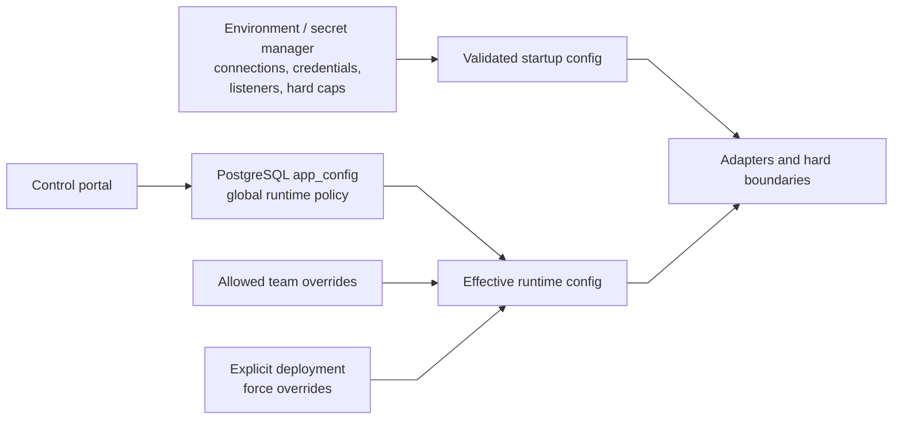
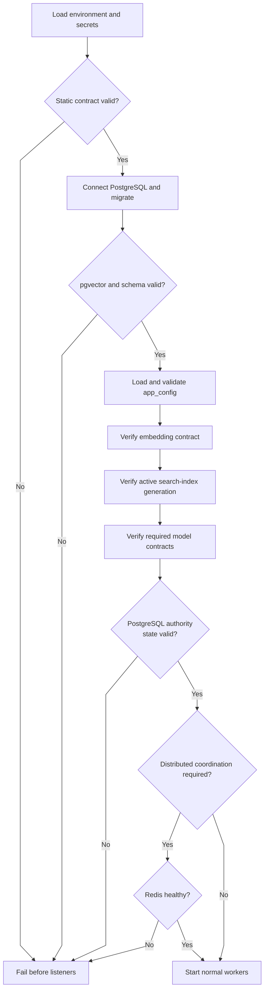

# Configuration

This page is the single source of truth for the current configuration contract.
It separates immutable startup/secrets from PostgreSQL-backed runtime policy.
Names in this page are the supported configuration contract.

## Sources And Precedence



Runtime-policy precedence:

```text
explicit deployment force override
team override when that key permits it
global PostgreSQL app_config
built-in default
```

Credentials, encryption/signing material, listener addresses, hard safety caps,
and provider secrets are environment/secret settings only. They are rejected
from `app_config`.

## Required Startup Settings

Production startup requires:

- PostgreSQL connection and migration/runtime credentials
- `pgvector` extension availability, one active embedding contract, and one
  compatible active search-index generation
- integrated assessor provider contract
- embedding provider contract
- control-portal authentication secret or explicit private/disabled policy
- encryption/signing material required by enabled features

Unsupported graph settings are rejected at startup instead of
connecting to a second durable store.

## Listeners

| Variable | Target default | Meaning |
| --- | --- | --- |
| `HTTP_ADDR` | `:8080` | main MCP and first-party user-portal listener inside the container |
| `CONTROL_HTTP_ADDR` | `:8090` | private control and metrics listener |
| `DENSE_MEM_BIND` | `127.0.0.1` | local host bind in base Compose |
| `DENSE_MEM_PORT` | `8080` | local host main port |
| `CONTROL_PORTAL_BIND` | `127.0.0.1` | control host bind |
| `CONTROL_PORTAL_PORT` | `8090` | control host port |

Keep control and metrics private. Public routing belongs in
[Public HTTPS And Redis](Public-HTTPS-And-Redis).

## PostgreSQL And `pgvector`

PostgreSQL is authoritative for knowledge, workflow, search, and control state.

| Variable | Target default | Meaning |
| --- | --- | --- |
| `POSTGRES_USER` | `densemem` | bundled database user |
| `POSTGRES_PASSWORD` | none | required secret |
| `POSTGRES_DB` | `densemem` | database name |
| `POSTGRES_HOST` | `postgres` | Compose service host |
| `POSTGRES_PORT` | `5432` | database port |
| `POSTGRES_SSLMODE` | `disable` locally | driver TLS mode |
| `POSTGRES_DSN` | empty | writable single-primary DSN override |
| `POSTGRES_MAX_OPEN_CONNS` | `25` | per-process pool maximum, also subject to deployment-wide budget |
| `POSTGRES_MAX_IDLE_CONNS` | `10` | idle pool target |
| `POSTGRES_CONN_MAX_LIFETIME_SECONDS` | `1800` | connection lifetime |
| `POSTGRES_MIGRATION_TIMEOUT_SECONDS` | `1800` | bounded migration-run deadline; valid range `1`–`86400` seconds |
| `POSTGRES_VECTOR_MAX_CONCURRENCY` | `4` | per-process semaphore for exact/ANN database queries |
| `POSTGRES_STATEMENT_TIMEOUT_SECONDS` | `30` | default application statement ceiling |
| `POSTGRES_LOCK_TIMEOUT_SECONDS` | `5` | default lock-wait ceiling |

Production should separate migration and runtime roles. The runtime role needs
only application DML, approved functions, and tenant-scoped/RLS access.
The `vector` extension is installed by the global PostgreSQL migration and is
not optional after the pgvector image cutover.

The connection budget is deployment-wide:

```text
service instances * POSTGRES_MAX_OPEN_CONNS
+ separately pooled worker/migration connections
<= database connection limit - operator/failover reserve
```

Adding service replicas without recalculating this budget fails the production
preflight.

Topology is detected from PostgreSQL at boot; it is not selected by an
environment hint. This release requires a writable single primary and stops
before migrations or normal service startup when `pg_is_in_recovery()` is true,
`transaction_read_only` is enabled, or Citus is installed. `POSTGRES_READ_DSN`
is rejected because replica reads are not supported yet. The composite tenant
keys, scoped lookups, and placement classes in
[PostgreSQL Cluster-Safe Schema](PostgreSQL-Cluster-Safe-Schema) remain the
required schema design for future HA or distributed support; they do not imply
that those runtime topologies are enabled in this release.

PostgreSQL contains the records listed in
[Data Model And Storage](Data-Model-And-Storage). No configuration flag can
move semantic authority to Redis, a model provider, or a secondary graph store.

## Embedding Provider And Contract

| Variable | Target default | Meaning |
| --- | --- | --- |
| `AI_API_URL` | none | required OpenAI-compatible base URL |
| `AI_API_KEY` | none | required provider secret |
| `AI_API_EMBEDDING_MODEL` | `text-embedding-3-large` | required model ID |
| `AI_API_EMBEDDING_DIMENSIONS` | `3072` | required expected vector dimensions; requested from capable providers and always response-validated |
| `AI_API_EMBEDDING_TIMEOUT_SECONDS` | `30` | request timeout |
| `AI_API_EMBEDDING_MAX_CONCURRENCY` | `8` | process-wide concurrency |
| `EMBEDDING_NORMALIZATION_VERSION` | required | canonical preprocessing version |

Provider adapter, model, dimensions, normalization, and query construction are
one persisted numerical embedding contract. Projection format is separately
versioned per `source_kind`; changing the Relationship renderer does not change
Evidence text/vectors or the numerical contract. Dense-Mem does not infer
dimensions from a model name. The first database initialization records the
configured model/dimensions; later mismatches fail startup until a deliberate
vector rebuild or reset workflow replaces the stored contract. Mixed vectors
fail readiness or remain excluded by version checks. Relationship projection
format `2` is owned by the release and persisted per search document; it is not
an operator-selected environment setting.
The adapter sends a dimensions request only when the configured provider/model
supports it, but every response must have exactly the configured length.
`AI_API_URL` must point at an endpoint that implements OpenAI-compatible
`/embeddings` for the configured embedding model. A chat-only endpoint is not a
valid embedding provider even if assessor calls work there.

Embedding and cosine meaning is defined in
[Vector Search And Ranking](Vector-Search-And-Ranking). Index compatibility and
rebuild impact is defined in
[ANN, HNSW, And Halfvec](ANN-HNSW-And-Halfvec#separate-versioned-contracts).

## Search Index Construction

Startup derives the persisted search-index generation from the active embedding
contract dimensions and supported pgvector capabilities. A different configured
model or dimension from the active embedding contract fails startup until a
controlled rebuild/reset workflow replaces the contract and derived generation.

| Variable | Target default | Meaning |
| --- | --- | --- |
| `PGVECTOR_HNSW_M` | `16` | maximum graph connections per HNSW layer; changing it rebuilds the index |
| `PGVECTOR_HNSW_EF_CONSTRUCTION` | `64` | HNSW construction candidate breadth; changing it rebuilds the index |
| `PGVECTOR_INDEX_BUILD_MAX_CONCURRENCY` | `1` | process-wide concurrent physical vector-index builds |

Cosine distance is fixed for the current contract. The default
3,072-dimensional OpenAI embedding contract derives a `halfvec_hnsw` generation.
The dimension matrix, 3,072-dimensional halfvec expression index, exact rerank,
and activation procedure belong only in
[ANN, HNSW, And Halfvec](ANN-HNSW-And-Halfvec#contract-and-index-decision-guide).

## Assessor

The integrated structure/support assessor may share the embedding endpoint or
use a separate OpenAI-compatible chat endpoint.


| Variable | Target default | Meaning |
| --- | --- | --- |
| `AI_ASSESSOR_API_URL` | empty | share `AI_API_URL` |
| `AI_ASSESSOR_API_KEY` | empty | share key only when URL is shared |
| `AI_ASSESSOR_MODEL` | none | integrated structure/support assessment model |
| `AI_ASSESSOR_DISABLE_TEMPERATURE` | `false` | omit unsupported parameter |
| `AI_ASSESSOR_TIMEOUT_SECONDS` | `60` | one request timeout |
| `AI_ASSESSOR_MAX_CONCURRENCY` | `5` | process-wide assessor gate |
| `AI_ASSESSOR_COOLDOWN_POLL_SECONDS` | `60` | one-probe interval after 429 |
| `AI_ASSESSOR_MAX_ENTITY_RESULTS` | `100` | hard per-request extracted-Entity cap |
| `AI_ASSESSOR_MAX_RELATIONSHIP_RESULTS` | `200` | hard per-request Relationship cap |
| `AI_ASSESSOR_MAX_INPUT_BYTES` | `131072` | complete serialized request cap |
| `AI_ASSESSOR_MAX_OUTPUT_BYTES` | `131072` | response cap |
| `AI_ASSESSOR_MAX_CANDIDATE_CONTEXT_BYTES` | `32768` | combined Entity/predicate context inside the input cap |
| `AI_ASSESSOR_MAX_ENTITY_CANDIDATES_PER_SURFACE` | `20` | exact current-name matches for one evidence span |
| `AI_ASSESSOR_MAX_PREDICATE_OPTIONS` | `100` | structured active definitions, with exact evidence key/alias matches first |
| `MEMORY_AUTO_WRITE_CONFIDENCE_THRESHOLD` | `0.7` | global bootstrap gate for positive Relationship support |
| `MEMORY_SEMANTIC_REVIEW_TTL_DAYS` | `7` | support-confidence, identity, predicate, scope, and time review expiry |
| `RELATIONSHIP_MATCH_MAX_CANDIDATES` | `100` | post-assessment server-side identity/conflict comparison cap |

There is no response-regeneration or partial-response retry setting. One
placement claim may make at most one assessor request. A later claim may make
one new request only when no valid fingerprint-matched assessment was persisted.
If an item cannot fit the one-request contract, placement fails with a size
error; the application does not split semantic dependencies or splice outputs.

The closed contract and validation rules belong in
[Memory Write Pipeline](Write-Pipeline#strict-assessor-contract).
The server may fingerprint that local contract for deployment and telemetry,
but no schema-version field is sent to or accepted from the model.

`MEMORY_AUTO_WRITE_CONFIDENCE_THRESHOLD` accepts `0..1` and comparison is
inclusive. A manager may override it at
`teams.config.memory_write.auto_write_confidence_threshold`. The update is
audited and applies at commit time to in-flight/future assessments only; it
never re-scores completed or already-held knowledge. It gates only positive
Relationship support and cannot resolve identity, predicate, scope, time,
security, or Conflict state.

## Entity Resolution

| Variable | Target default | Meaning |
| --- | --- | --- |
| `ENTITY_RESOLUTION_NAME_LOCK_TIMEOUT_SECONDS` | `5` | create-recheck lock timeout |
| `ENTITY_RESOLUTION_RECHECK_LIMIT` | `2` | bounded retries after a concurrent candidate |
| `ENTITY_DUPLICATE_REVIEW_ENABLED` | `true` | surface likely duplicate pairs |

The assessor receives only revalidated known IDs and exact token-bounded
current canonical/alias matches. Vector similarity may support separate
duplicate review, but it never enters the automatic write allowlist and no
confidence threshold authorizes a merge. See
[Entity Identity And Resolution](Entity-Identity-And-Resolution).

## Placement And Embedding Workers

| Variable | Target default | Meaning |
| --- | --- | --- |
| `MEMORY_PLACEMENT_WORKER_COUNT` | `1` | concurrent placement workers |
| `MEMORY_PLACEMENT_LEASE_SECONDS` | `300` | renewable work lease |
| `MEMORY_PLACEMENT_HEARTBEAT_SECONDS` | `30` | lease heartbeat |
| `MEMORY_PLACEMENT_POLL_SECONDS` | `5` | durable queue poll interval |
| `MEMORY_PLACEMENT_MAX_ATTEMPTS` | `5` | orchestration attempts before visible failure |
| `EMBEDDING_WORKER_COUNT` | `2` | concurrent derived-vector workers |
| `EMBEDDING_BATCH_SIZE` | `64` | maximum same-team search-document jobs claimed for one provider batch, 1-256 |
| `EMBEDDING_JOB_LEASE_SECONDS` | `60` | job lease |
| `EMBEDDING_JOB_POLL_SECONDS` | `1` | durable queue poll |
| `EMBEDDING_JOB_MAX_ATTEMPTS` | `20` | attempts before `search_state=failed` |
| `EMBEDDING_JOB_RETRY_MAX_SECONDS` | `300` | backoff ceiling |
| `EMBEDDING_PENDING_STALE_SECONDS` | `60` | freshness warning threshold |

Embedding workers batch before scaling worker count. Each batch claims ready
jobs for one team with `FOR UPDATE SKIP LOCKED`, embeds the document texts with
one provider batch call, and completes each job against its claimed attempt and
document version. Provider output count, dimensions, and ordering are validated
before any vector is written. Batch failure is retried by splitting the batch
until the failing document is isolated or the error is classified as a
whole-provider/configuration failure.

Worker count must fit database and provider capacity. `AI_API_EMBEDDING_MAX_CONCURRENCY`
is the process-wide provider request cap; `EMBEDDING_BATCH_SIZE` controls request
width. PostgreSQL owns queue, lease, attempt, and result state. Redis may reduce
wake-up latency only. Workers claim again immediately while backlog remains;
`EMBEDDING_JOB_POLL_SECONDS` applies only when no work is claimable.
The release projection uses fixed keyset batches of 500. When both work classes
are non-empty, the claim policy reserves one slot for each class and fills the
remaining batch foreground-first; this fairness rule is not a runtime knob.

## PostgreSQL Search And Recall

These startup settings define the active semantic recall ranking contract for
the process. They are internal telemetry and evaluation metadata; public recall
responses do not expose them. Future control-portal management must activate the
same complete contract shape atomically instead of mutating individual fields.

| Setting | Default | Meaning |
| --- | --- | --- |
| `RECALL_RRF_ENABLED` | `false` | use reciprocal rank fusion; `false` selects explicit branch-priority fusion |
| `RECALL_RRF_K` | `60` | reciprocal-rank-fusion constant |
| `RECALL_RRF_BRANCH_WEIGHTS` | `exact=2,evidence_text=1,evidence_vector=1` | bounded initial evidence-branch RRF weights |
| `RECALL_BRANCH_PRIORITY` | `exact,evidence_vector,evidence_text` | explicit initial evidence branch order when RRF is disabled |
| `RECALL_BRANCH_LIMIT_MULTIPLIER` | `6` | requested limit multiplier for per-branch over-fetch |
| `RECALL_BRANCH_LIMIT_FLOOR` | `60` | minimum per-branch candidate pool |
| `RECALL_BRANCH_LIMIT_MAX` | `200` | maximum per-branch candidate pool |
| `RECALL_DETERMINISTIC_RERANK_ENABLED` | `true` | apply bounded query/support/temporal reranking |
| `RECALL_MAX_ENTITY_SEEDS` | `20` | Entity search seeds |
| `RECALL_RELATIONSHIP_RRF_K` | `60` | fixed equal-weight full-text/vector Relationship fusion constant |
| `RECALL_RELATIONSHIP_BRANCH_LIMIT_MULTIPLIER` | `6` | Relationship branch over-fetch before eligibility and semantic grouping |
| `RECALL_MAX_GRAPH_DEPTH` | `1` | direct Entity-to-Relationship expansion only |
| `RECALL_MAX_EDGES` | `100` | hard expanded Relationship cap before eligibility and semantic grouping |
| `RECALL_GRAPH_TIMEOUT_MILLISECONDS` | `500` | adjacency-branch budget |
| `RECALL_REQUIRED_BRANCH_PROFILE` | `relationship_v2.3` | versioned branch policy |
| `PGVECTOR_EXACT_FILTERED_MAX_ROWS` | `5000` | use exact distance below this authorized set size |
| `PGVECTOR_HNSW_EF_SEARCH` | `100` | base approximate search breadth |
| `PGVECTOR_HNSW_ITERATIVE_SCAN` | `strict_order` | filtered approximate scan behavior |
| `PGVECTOR_HNSW_MAX_SCAN_TUPLES` | `20000` | bounded iterative-scan work |
| `PGVECTOR_HNSW_SCAN_MEM_MULTIPLIER` | `1` | bounded iterative-scan memory as a multiple of transaction-local `work_mem` |

`RECALL_REQUIRED_BRANCH_PROFILE=relationship_v2.3` remains intentional under
the V2.4 public tool contract: V2.4 changes write placement and review policy,
not the recall branch/ranking contract.

There is no Relationship lifecycle, support, source, authority, profile, or
popularity weight. Disabling RRF changes only the Evidence branch-priority
contract; Relationship full-text/vector fusion remains equal-weight RRF.
Relationship and direct Entity-adjacency branches do not contribute to Evidence
fusion. Ranking-contract changes require paired evaluation, including
approximate Recall@K against exact filtered search. The algorithm is defined in
[Vector Search And Ranking](Vector-Search-And-Ranking#runtime-control).

## Predicate Registry

| Setting | Target default | Meaning |
| --- | --- | --- |
| `PREDICATE_REGISTRY_VERSION` | required | active registry version |
| `PREDICATE_REGISTRY_CACHE_TTL_SECONDS` | `60` | bounded local cache |
| `PREDICATE_UNKNOWN_ACTION` | `review` | preserve and review; never invent |

Registry data lives in PostgreSQL. It supplies `relationship_kind`,
`current_cardinality`, aliases, and endpoint-kind rules. `policy_family` and
graph relationship-type mappings are not target settings.

## Redis Coordination

| Variable | Target default | Meaning |
| --- | --- | --- |
| `REDIS_ADDR` | empty | use safe one-process coordination when empty |
| `REDIS_PORT` | `6379` | local exposed port |
| `REDIS_PASSWORD` | empty | optional secret |
| `REDIS_DB` | `0` | logical database |
| `REDIS_TLS_ENABLED` | `false` | TLS for external Redis |
| `DISTRIBUTED_COORDINATION_REQUIRED` | `false` | fail instead of process-local fallback |

Set `DISTRIBUTED_COORDINATION_REQUIRED=true` for multiple service instances.
When required/configured Redis is unavailable, the server must not silently
fall back.

Redis may hold rate-limit counters, provider cooldown coordination, short
leases/signals, cleanup wakeups, and SSE concurrency. It cannot own evidence,
Entities, Relationships, reviews, queues, API keys, or audit.

## Authentication, Limits, And SSO

| Variable | Target default | Meaning |
| --- | --- | --- |
| `AUTH_VERIFY_MAX_CONCURRENCY` | `8` | concurrent key verification |
| `RATE_LIMIT_PER_MINUTE` | `100` | general authenticated requests |
| `REMEMBER_RATE_LIMIT_PER_MINUTE` | `60` | evidence intake |
| `RECALL_RATE_LIMIT_PER_MINUTE` | `300` | recall |
| `TRACE_RATE_LIMIT_PER_MINUTE` | `120` | trace |
| `HTTP_MAX_BODY_BYTES` | `1048576` | request body ceiling |
| `SSE_HEARTBEAT_SECONDS` | `30` | stream heartbeat |
| `SSE_MAX_DURATION_SECONDS` | `300` | stream maximum |
| `SSE_MAX_CONCURRENT_STREAMS` | `10` | streams per principal |
| `SSO_PUBLIC_BASE_URL` | empty | disable browser SSO when empty |
| `SSO_ENTITLEMENT_CACHE_TTL_SECONDS` | `300` | entitlement refresh |
| `SSO_SESSION_TTL_SECONDS` | `28800` | browser session lifetime |
| `SSO_STATE_TTL_SECONDS` | `600` | OAuth state/PKCE lifetime |
| `SSO_HTTP_TIMEOUT_SECONDS` | `10` | provider timeout |
| `SSO_COOKIE_SECURE` | derived | true for HTTPS by default |

Detailed public-edge policy is in [Public HTTPS And Redis](Public-HTTPS-And-Redis);
SSO mapping is in [User Portal SSO](User-Portal-SSO).

## Telemetry And Logging

| Variable | Target default | Meaning |
| --- | --- | --- |
| `TELEMETRY_ENABLED` | `false` | enable metrics/telemetry APIs |
| `TELEMETRY_PROMETHEUS_URL` | empty | dashboard query endpoint |
| `TELEMETRY_PROMETHEUS_JOB` | empty | bounded job selector |
| `TELEMETRY_QUERY_TIMEOUT_SECONDS` | `5` | Prometheus timeout |
| `TELEMETRY_SCRAPE_TOKEN` | none when enabled | private metrics bearer secret |
| `OPERATION_LOG_RETENTION_DAYS` | `30` | database log retention, 1–365 |
| `LOG_LEVEL` | `info` | structured level |
| `LOG_FORMAT` | `json` in production | `json` or `text` |
| `LOG_INCLUDE_RECORD_IDS` | `false` | bounded diagnostic IDs, never content |

Debug output still redacts secrets, evidence, vectors, and provider payloads.
Metric definitions belong in [Telemetry](Telemetry).

## Feature-Gated Runtime Policy

These keys are PostgreSQL-backed unless identified as hard environment caps.

### Recall feedback and evaluation

| Key | Target default | Meaning |
| --- | --- | --- |
| `RECALL_FEEDBACK_ENABLED` | `false` | expose feedback collection |
| `RECALL_FEEDBACK_RETENTION_DAYS` | `30` | detail retention, 1–365 |
| `EVALUATION_MODE_ENABLED` | `false` | expose evaluation-only APIs |
| `EVALUATION_EXPORT_MAX_PAGE_SIZE` | `100` | export maximum, 1–500 |

Never enable evaluation mode for production teams.

### Dreaming

| Key | Target default | Meaning |
| --- | --- | --- |
| `DREAMING_ENABLED` | `false` | scheduled cycles |
| `DREAMING_START_TIME_LOCAL` | `03:00` | local schedule |
| `DREAMING_CATCH_UP_ENABLED` | `false` | bounded same-window catch-up |
| `DREAMING_GENERATOR_KIND` | `deterministic` | `deterministic` or `provider` |
| `DREAMING_GENERATOR_MODEL` | empty | required for provider kind |
| `DREAMING_MAX_ACTIVE_RELATIONSHIPS` | `100` | active-source cap |
| `DREAMING_MAX_PENDING_RELATIONSHIPS` | `25` | eligible insufficient-Relationship cap |
| `DREAMING_MAX_OUTPUTS` | `5` | Hypotheses per cycle, 1–50 |
| `DREAMING_MAX_CONCURRENCY` | `1` | concurrent team cycles |

Eligibility and no-new-node behavior belong in [Dreaming](Dreaming).

### Community detection

| Key | Target default | Meaning |
| --- | --- | --- |
| `COMMUNITY_DETECTION_ENABLED` | `false` | scheduled derived clustering |
| `COMMUNITY_DETECTION_START_TIME_LOCAL` | `03:30` | local schedule |
| `COMMUNITY_DETECTION_MAX_CONCURRENCY` | `1` | concurrent team runs |
| `COMMUNITY_DETECTION_JITTER_SECONDS` | `600` | stable jitter |
| `COMMUNITY_DETECTION_MIN_CHANGED_RELATIONSHIPS` | `100` | recompute threshold |
| `COMMUNITY_DETECTION_MAX_AGE_HOURS` | `24` | staleness boundary |
| `COMMUNITY_DETECTION_MAX_NODES` | `500000` | hard input cap |
| `COMMUNITY_DETECTION_MAX_EDGES` | `2000000` | hard input cap |
| `COMMUNITY_DETECTION_TIMEOUT_SECONDS` | `600` | run timeout |

The service reads eligible IDs from PostgreSQL into a bounded analytical job;
no external graph-analysis dependency is implied. See
[Community And Dreaming](Community-And-Dreaming).

### Conflict review

Conflict review is core deterministic maintenance, not an optional/model-backed
feature. Placement opens or updates durable cases in the committing transaction;
automatic disposition belongs to the nightly reviewer. There is no
shadow/observe mode and no normal-runtime disable flag. The nightly job reviews
known open/overdue cases, may close losing stale Relationship episodes through
audited lifecycle transitions, and calls no model.

| Key | Target default | Meaning |
| --- | --- | --- |
| `CONFLICT_REVIEW_TTL_DAYS` | `7` | default open review window before lower automatic threshold is available, 1–30 days |
| `CONFLICT_REVIEW_START_TIME_LOCAL` | `04:00` | nightly schedule in `APP_TIMEZONE` |
| `CONFLICT_REVIEW_MAX_CONCURRENCY` | `1` | concurrent team runs per process, 1–16 |
| `CONFLICT_REVIEW_BATCH_SIZE` | `100` | team-local case claim size, 1–500 |
| `CONFLICT_REVIEW_LEASE_SECONDS` | `300` | renewable case-claim lease, 30–1800 |
| `CONFLICT_REVIEW_MAX_ATTEMPTS` | `5` | bounded retry attempts before operator alert, 1–20 |
| `CONFLICT_REVIEW_JITTER_SECONDS` | `600` | stable per-team schedule jitter, 0–3600 |

A team may set only `review_ttl_days` as a PostgreSQL-backed override in the
same 1–30 range. The control-plane change is audited and applies to cases opened
afterward; an existing case retains its captured deadline and policy version.
New evidence does not extend the original deadline. The override cannot disable
review, weaken either evidence floor, or select a preferred position. Conflict
policy is not exposed through MCP and no portal conflict inbox is implied.

Conflict `policy_version` is not runtime configuration. It is a server-owned
resolver contract identifier captured on case and Relationship transition events
for audit, replay, and migration safety. Changing that resolver contract is a
code/schema rollout with evaluation gates, not an operator or team override.

The scheduler performs bounded catch-up after downtime by reserving at most one
run per team/local date. Missing the nominal start time does not skip due cases,
and repeated ticks/replicas converge through the durable reservation and leases.
Lifecycle and job semantics belong in
[Conflicts And Corrections](Conflicts-And-Corrections#nightly-conflict-review).

### Scheduling

| Key | Target default | Meaning |
| --- | --- | --- |
| `APP_TIMEZONE` | `Local` | use an IANA name in production |

## Startup Validation



Configuration errors fail visibly. Startup does not substitute another store,
embedding model, assessor schema, resolver contract, or coordination mode.
It also validates TTL/override bounds, local start time,
batch/concurrency/lease/attempt ranges, and `APP_TIMEZONE` before starting the
core Conflict worker.

## Secret Rules

- use secret files or a secret manager
- never commit database, provider, control, telemetry, or Redis credentials
- never expose control/metrics listeners publicly
- rotate keys with overlapping validity, then revoke the old key
- sanitize `docker compose config` and support bundles before sharing
- reject secrets from PostgreSQL `app_config`

## Risks And Mitigations

| Risk | Concrete failure mode | Mitigation |
| --- | --- | --- |
| Unsupported variable silently revives a graph store | an old graph URI makes normal runtime depend on a second store | reject all graph-store configuration during startup |
| Mixed embeddings | new vectors have different dimensions or document meaning | persisted contract, version predicate, readiness gate, and explicit rebuild |
| Incompatible ANN generation | a 3,072-dimensional contract attempts unsupported full-precision HNSW | capability resolver, persisted search-index generation, and controlled build gate |
| Replica read is stale | recall after correction is routed to a lagging standby | primary-only freshness paths plus explicit lag/version gate |
| Service scale-out exhausts PostgreSQL | each service instance opens 25 connections independently | deployment-wide pool formula and vector-query semaphore |
| Inline assessor retry returns | operator enables an old setting that makes several requests or splices missing results inside one claim | reject the unsupported setting, expose one-call-per-claim behavior, and contract-test config parsing |
| Redis fallback breaks replicas | outage switches multi-instance limits to local state | required distributed flag and no silent fallback |
| ANN tuning harms quality | low HNSW breadth improves latency but loses tenant results | exact-baseline Recall@K gate and versioned atomic ranking contract/search generation |
| Worker overload | placement and embedding workers exceed provider/database capacity | startup range checks, saturation metrics, and load testing |
| Conflict schedule creates a thundering herd | every team starts its due-case scan at 04:00 | stable team jitter, bounded team-local batches/concurrency, and durable run reservation |
| Team override weakens truth policy | an admin sets TTL to zero or chooses a winner | allow only bounded `review_ttl_days`; keep resolver floor/version immutable and audited |
| Secret enters runtime policy | portal stores provider key in `app_config` | allowlisted keys and secret-shaped value rejection |

## First-Run Checklist

- set non-template PostgreSQL, provider, Redis-if-needed, control, and telemetry
  secrets
- keep main/control ports on loopback until HTTPS policy is ready
- install/verify `pgvector` and run migrations
- verify one embedding has the configured dimensions and contract version
- verify the active search-index generation, query plan, and exact-versus-ANN gate
- verify the cluster-safe schema/key contract and two-team composite-FK/RLS
  probes
- verify the integrated assessor and its closed schema
- create a manager key and least-privilege client key
- confirm Redis requirement matches one- or multi-instance topology
- run `remember` → placement → recall → trace, including a pending-vector case
- run the three-profile Conflict smoke: open, evidence-backed resolve, historical
  recall, overdue-without-winner, and nightly lease recovery
- test PostgreSQL backup/PITR and vector rebuild before important use
