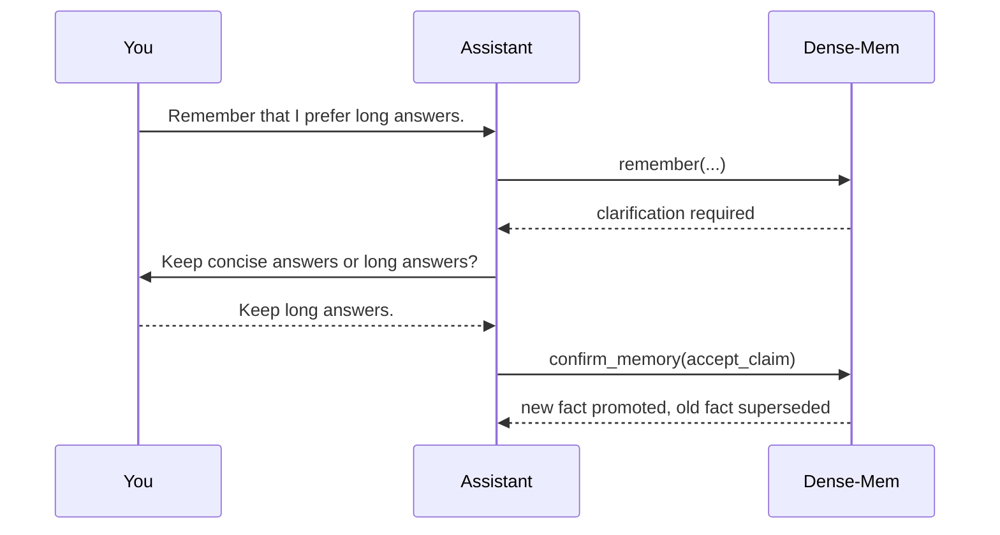

# Conflicts And Corrections

Dense-Mem does not silently overwrite active facts when a new comparable memory
conflicts with an existing one. It returns a clarification so the assistant can
ask which memory to keep.

## Normal Conflict Flow



## What The Assistant Should Do

| Dense-Mem result | Assistant action |
| --- | --- |
| Promoted fact | Use the memory normally. |
| Clarification | Ask the user which memory to keep. |
| Disputed claim | Do not treat it as active truth. |
| Superseded fact | Keep it for history, but do not use it as the current memory. |

## Confirm A Clarification

The high-level MCP tool is:

```text
confirm_memory
```

Supported decisions are:

| Decision | Meaning |
| --- | --- |
| `accept_claim` | Promote the new claim and supersede comparable active facts. |
| `keep_existing` | Keep the active fact and reject the new claim. |
| `reject_claim` | Reject the new claim without changing active facts. |

Example tool arguments:

```json
{
  "claim_id": "claim_123",
  "decision": "accept_claim"
}
```

## Inspect The Evidence

Use `trace_memory` when the user asks why Dense-Mem believes a fact or what
could contradict it:

```json
{
  "type": "fact",
  "id": "fact_123",
  "max_related": 5,
  "include_fragments": true
}
```

Use `reflect_memories` to review current facts, candidate claims, disputed
claims, stale facts, and clarification needs.

## Good Correction Prompt

```text
Replace the old deployment note with this new one: production now deploys from main through Docker Swarm.
```

That gives the assistant enough context to save the new evidence, handle a
clarification if Dense-Mem returns one, and confirm the user's choice when
needed.
