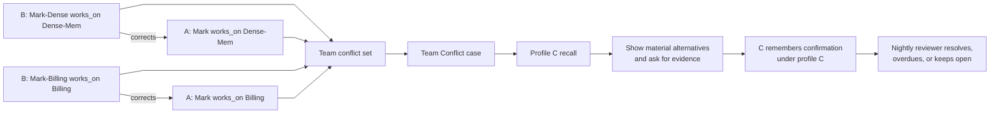

# Conflicts And Corrections

Dense-Mem distinguishes changes in the world, extraction mistakes, Relationship
disagreements, and evidence conflicts. They have different owners and
transactions. Same-team read access does not grant cross-owner mutation.

## Choose The Supported Workflow

| Situation | Workflow |
| --- | --- |
| A fact changed and you have new evidence | Submit a new complete `remember` request. |
| An owned source item is wrong or withdrawn | Use evidence supersession or `retract_evidence`. |
| An owned active Relationship has a misresolved Entity or predicate | Use `correct_relationship` with current version and complete support. |
| Different authors support incompatible shared positions | Preserve authorship and use the governed Relationship conflict workflow. |
| Submitted/current evidence quotes conflict | Inspect the separate evidence-conflict case and exact occurrence citations. |

Remember returns a terminal completed or failed result. Safe evidence can be
stored even when a proposed Relationship is unsupported. A correction may
return one explicit `awaiting_confirmation` result when it needs an owner
choice among returned Entity candidates.

## Cross-Profile Corrections

Profiles A, B, and C may all read same-team knowledge. Each authors only the
Relationships and observations created under its profile. Ordinary profile
writes can change only caller-owned lifecycle state.

Assume profile A has two Relationships based on an identity that later appears
to combine two people:

```text
A: ent_mark -> works_on -> Dense-Mem
A: ent_mark -> works_on -> Billing
```

Profile B obtains distinguishing evidence. B creates its own Entity resolutions
and Relationships through normal `remember` processing:

```text
B: ent_mark_dense   -> works_on -> Dense-Mem
B: ent_mark_billing -> works_on -> Billing
```

In the same transaction, Dense-Mem appends `corrects` or `challenges`
cross-references from B's new Relationships to A's related Relationships and
opens or updates the durable team Conflict case. A's status, supports,
validity, and Entity resolutions do not change during B's write.



Profile C sees both material positions while the case is open. C may submit new
evidence through normal `remember`; any confirmation C remembers belongs to C and
may `confirm` B or `challenge` A. It does not directly edit either record.

If A later obtains independent evidence for the correction, A submits it
through Remember. Explicit known-evidence context can assist assessment but
cannot substitute for submitted support. A's resulting Relationship remains
A-owned. Separately, the system Conflict reviewer may close A's losing episode
after governed case resolution.

The canonical ownership and cross-reference fields are defined in
[Relationship Model And Lifecycle](Relationship-Model-And-Lifecycle#profile-ownership-and-team-visibility).
Conflict grouping and preference ranking are defined in
[Vector Search And Ranking](Vector-Search-And-Ranking#cross-profile-conflict-reranking).

### Stale team knowledge example

Assume A recorded an accurate business rule six months ago. The business
changed the rule five months ago, but Dense-Mem learned about the change only
when B later submitted exact evidence:

```text
t0  A owns Relationship A1: production deploys_from main
t1  the business changes production to release
t2  B owns Relationship B1: production deploys_from release
    B1 corrects A1, with valid_from=t1 supported by B's evidence
```

At `t2`, B's write creates B1, the `corrects` cross-reference, and an open
team Conflict case. A1, A's evidence, support, status, and validity remain
unchanged during the write. The AI assessor does not decide that a conflict
exists; server policy detects the incompatible single-current state after B's
submitted evidence verifies.

While the case is open, C receives both material positions plus an explicit
conflict question. C may submit new exact evidence through normal `remember`; any
resulting Relationship belongs to C and is grouped with the matching or new
position. A bare vote, profile count, or unsupported "B is right" assertion
changes no disposition.

The nightly Conflict reviewer owns automatic resolution. If B's side becomes the
unique winner under the deterministic policy, one PostgreSQL transaction marks
the case resolved, sets A1 `status=superseded`, writes A1 `valid_to` to the
resolved cutoff, appends Relationship and Conflict ledger events with
`actor=system_conflict_reviewer`, and queues rebuildable search refresh. A's
original evidence fragment and support remain traceable. Current recall at or
after the cutoff returns B-side evidence in primary `results[]`, includes a
compact resolved conflict reference, and keeps A1 available through trace. Recall
with `valid_at` before the cutoff may still return A's position. Recall with
`known_at` before B's correction arrived reconstructs the older system view.

## Durable Team Conflict Cases

An authored conflict set is still derived from Relationships, accepted
cross-references, registered single-current behavior, identity history, scope,
and time. When that set contains a material cross-profile Relationship
disagreement, Dense-Mem also persists one team-scoped conflict case so review,
deadlines, retries, and decisions survive process restarts.

```text
ConflictCase
  conflict_id
  team_id
  kind
  status: open | overdue | resolved | dismissed
  version
  opened_at
  review_due_at
  next_review_at
  claim_token
  lease_expires_at
  review_attempts
  last_evaluated_at
  resolved_at
  effective_at
  effective_time_basis: evidence_time | recorded_fallback
  preferred_position_id
  policy_version

ConflictPosition
  position_id
  member Relationship IDs and versions
  owner profile IDs
  accepted evidence and source-group handles
  distinct effective supporter count and bounded supporter summaries
  at most 20 deterministic supporter summaries

ConflictEvent
  event_id
  prior and resulting case state
  actor profile when client-triggered or system worker when reviewer-triggered
  reason code, policy version, time basis, and referenced versions
  created_at
```

The case row is current materialized workflow state. Case events are
append-only. Position membership never merges authored Relationships or counts
copied evidence more than once. `dismissed` means fewer than two material
positions remain after an owner retraction, source revision, or other normal
lifecycle change; it is not a truth decision.

| Authored knowledge | Team conflict disposition |
| --- | --- |
| A1 and B1 retain immutable author attribution | the case belongs to the team, not A or B |
| each Relationship keeps its own evidence/support ledger | resolution may close losing stale episodes through audited system transitions |
| neither author receives the other's evidence as support | equivalent evidence retains its original source-group identity |
| ordinary profiles cannot rewrite cross-profile validity | `effective_at` is the cutoff used for current-read disposition and losing-episode closure |
| trace returns every authorized position and event | primary current recall omits resolved non-preferred support paths |

### Bounded supporter provenance

Same-team `recall_memory` and `trace_memory` project the same supporter
provenance for each effective position at the requested `known_at`. The
position keeps its existing Relationship, profile, and Evidence ID arrays and
adds:

- `supporter_count`: distinct effective owner profiles that currently vote for
  this position
- `supporters_truncated`: whether the total exceeds the returned summaries
- `supporters`: at most 20 current same-team profile summaries

Each profile appears once. Its summary reports the strongest effective
authority and the most recently accepted Evidence at that authority. Summaries
order by authority rank descending, accepted time descending, then immutable
profile ID. The profile name is hydrated from the current same-team directory
at read time; the immutable profile and Evidence IDs remain the audit identity.

Source-group keys remain immutable provenance and conflict-member identity, but
they do not add votes. If one profile supports multiple positions, only its
uniquely newest accepted position contributes one vote. Equal newest timestamps
across positions abstain that profile. Raw source-group keys, Evidence content,
provider output, and cross-team identities are never included.

A conflict case is created or changed only from committed, schema-valid state.
Vector similarity alone cannot open one. The durable Relationship-case scope is a
cross-profile Relationship disagreement established by a verified
`challenges`/`corrects` reference or by incompatible, comparable
`current_cardinality=one` positions. Identity ambiguity and same-owner writes follow the separate Remember and
owned-correction rules; this case policy does not add a client review tool.

### Deterministic resolution policy

The trust unit is one provisioned same-team profile with effective accepted
support. A profile is never counted twice because it submitted multiple rows,
source groups, copied fragments, adoptions, or revisions. Source groups remain
available for provenance and Dreaming lineage, not for conflict votes.

Before `review_due_at`, no deterministic winner is allowed. At or after
`review_due_at`, one position qualifies only when its distinct supporter count
is strictly greater than half of all non-abstaining effective profile votes.
There is no minimum group threshold, early quorum, unique-authority shortcut, or
authoritative veto. Authority remains visible in provenance and may inform the
bounded fallback paths.

If no strict majority exists, the case becomes `overdue` and uses the existing
bounded AI assessment followed by the existing authority/recency last-write-
wins fallback. The AI receives supporter counts, deterministic supporter
references, authority, accepted/effective time, and evidence content; it never
receives source-group keys or group counts.

The cutoff is the evidence-supported effective time when the assessor confirms
the extracted temporal bound. If no reliable bound exists and no authority
override is needed, the reviewer may use the first accepted contradictory observation time
as `recorded_fallback`. Missing or conflicting time keeps the case open when the
chosen threshold requires evidence time.

Resolution appends case events, appends Relationship transitions for losing
episodes, updates their current `status`/`valid_to`, and queues rebuildable search
refresh. It never edits raw evidence, observations, verification events, support
links, or author attribution. One fragment may support unrelated current
Relationships, so primary-result filtering operates on the relevant Relationship
support path rather than globally hiding the fragment.

### Responding from another profile

Any active same-team profile with `write` scope may respond with new evidence.
The relevant Relationship proposal carries the recall-supplied `conflict_id`
and expected case version. Dense-Mem validates the version and that the verified
proposal materially belongs to the case before committing evidence or case
state. A stale version fails without changing state so the host can recall the
current alternatives and retry. The exact MCP field shape belongs in
[Technical Reference](Technical-Reference#remember).

The same transaction that commits the caller-owned Relationship and validated
cross-reference opens or updates the case, membership, deadline/version, and
search refresh intent. It does not resolve the case. There is no separate
cross-profile `resolve` command; automatic resolution belongs to nightly review.

## Nightly Conflict Review

The nightly job is the Conflict maintainer. It reviews known open or overdue
cases, repairs membership, deterministically resolves qualifying cases, and
closes stale Relationship episodes. It does not scan old Relationships by age.
For an unchanged `overdue` case that still has no deterministic winner, it may
run one bounded AI assessment through the configured verifier; the model only
proposes a supplied position and never writes durable state.

For each case whose `next_review_at` is due, whether before or after
`review_due_at`, the job:

1. claims bounded team-local work with a durable lease
2. reloads current Relationship versions, effective supports, source-group
   lineage, cross-references, scope, and temporal bounds from PostgreSQL
3. repairs stale position membership and recomputes the policy view
4. resolves only when one position has a strict majority of the current
   effective supporter projection after TTL
5. marks the case `overdue`, appends an escalation event, and schedules the next
   nightly check when no unique position qualifies
6. for an overdue case, reserves at most one `(case version, model, policy,
   local date)` assessment, commits that reservation, and then sends the bounded
   current dossier to the verifier outside the database transaction
7. accepts only a closed-schema selection of a supplied position at confidence
   `>= 0.70`; an explicit abstention immediately uses deterministic
   last-write-wins: strongest authority, then latest Dense-Mem accepted support,
   then a stable position-ID tie break
8. records provider, schema, context, or token-bound failures without persisting
   provider text; after five failed local-day attempts for the unchanged
   `(case version, model, policy)` tuple, uses the same last-write-wins fallback
9. dismisses a case only when committed lifecycle/source changes leave no
   material disagreement
10. when resolving, locks and updates the losing Relationship rows, retracts
    only losing evidence fragments that support no Relationship outside the
    active case through audited system-owned lifecycle operations, marks the case
    resolved, appends Conflict/transition events, and queues rebuildable
    search/read-model refresh work in one transaction

An abandoned assessment reservation expires only after its local date ends and
then counts as a failed attempt. A case-version change supersedes reserved work;
a stale completion cannot apply. The assessor receives server-owned position
metadata (supporter counts, bounded supporter references, authority, accepted
and effective time) and effective evidence only. It receives no source-group
keys or group counts and cannot choose an ID that was not in that dossier.
Evidence without a durable Conflict case does not become stale merely because of
its age or lack of a later source revision.

The review deadline comes from the server-owned policy identifier. Reaching it
is not evidence and does not force a winner; it only enables the supporter
majority decision. Duplicate evidence from the same source group does not
extend the deadline. New support updates membership and may resolve on a later
nightly run, but it does not move the original deadline. A later contradictory
business change opens a new conflict episode instead of reopening a resolved
case. Database/worker failure leaves the case due and unresolved.
Multi-instance workers use durable daily run reservation plus team-local `FOR
UPDATE SKIP LOCKED` claims, bounded retries, and lease recovery.

The job may update conflict workflow rows, losing Relationship `status` and
`valid_to`, append Relationship transition events, and embed affected search
documents before the fenced semantic commit. For a successfully resolved
overdue case it may also retract a losing evidence fragment with an audited
system actor and create an inferred, deletion-only replacement through the
bounded derived-evidence retry path, but only when that fragment has no support
path outside the active case. A shared fragment remains searchable and keeps
its unrelated support; the losing Relationship is still suppressed. The
replacement is not searchable and cannot project a Relationship or vote in a
future conflict. If derived-evidence creation fails, the old evidence remains
inactive and the failure is durably visible. The job never rewrites raw evidence
text, observations, verification events, ownership, author attribution, Entity
resolution, or source history. Operators inspect an overdue case or submit new
evidence; they do not repair it with direct SQL.
Defaults and bounded overrides belong in
[Configuration](Configuration#conflict-review).

## Inspect Before Deciding

Use the `relationship_id` from `related_relationships[]` or an earlier
authorized trace result:

```json
{
  "relationship_id": "r_deploy_branch",
  "include_evidence_content": true,
  "include_verification": true,
  "include_transitions": true,
  "max_depth": 1,
  "max_edges": 12
}
```

The client presents:

- current subject, predicate, object, polarity, scope, and validity
- status, effective support, current-cardinality behavior, and source count
- accepted evidence and material verification events
- the new conflicting observation and its evidence verdict
- exact identity, predicate, scope, or temporal ambiguity
- the before/after impact of each allowed decision

An opaque “accept or reject?” prompt is insufficient.

## Server-side ambiguity handling

Remember resolves submitted proposals within a bounded assessor conversation.
Unsupported identity/predicate proposals receive explicit dispositions. The
client cannot select arbitrary IDs or override policy. Correction confirmation
is a separate caller-input step using only returned candidates and a current
token.

## Correct With New Evidence

For a changed fact, submit fresh exact evidence through `remember`. Direct
`supersedes_evidence_ids` replacement and source-revision advancement are
distinct; do not combine them. They apply only in the accepted transaction.

For an extraction mistake, `correct_relationship` accepts `action: submit`,
an owned active Relationship ID, current `expected_version`, supported
Entity/predicate patch, complete effective `supports`, reason, and a retained
idempotency key. The accepted result names the original and successor.

Trace is lineage, not a ready-made support set. For each support, select its
latest grant/reinstate decision and exclude revoke. Map `span_start` and
`span_end` to request `start` and `end`. If trace is truncated or a latest
decision is missing, do not guess.

The correction input permits 1–200 unique support tuples, but public
trace/export readers stop at 100 support rows without pagination. A client
without a previously retained complete set may therefore be unable to form a
valid correction. More than 200 effective supports cannot be represented by
this tool.

If the result requests confirmation, retain its submission/token and choose
exactly one returned Entity for every represented endpoint. Use a distinct
confirmation operation key. Stale versions or support changes require refreshed
state before a deliberate resubmission.

### Typed Values and inactive identities

The correction patch cannot change a typed Value, unit/type, or validity
window. There is no complete public atomic typed-Value replacement workflow.
`remember.correction_target` is lineage context, not a general replacement
operation; cardinality transitions can also make its version stale.

An inactive caller-owned identity collision can reject correction with
`inactive_relationship_collision`. A new Remember proposal may reactivate an
eligible owned identity, but it is a different operation and does not preserve
the correction workflow's complete lineage. Do not present two independent
retract/write calls as one atomic correction.

## Evidence Conflicts

Evidence conflicts are separate from authored Relationship conflicts. Cases
have `open`, `resolved`, or `dismissed` state and versioned events.
Positions cite canonical evidence and exact submitted occurrences, with a
server-derived quote, authority, and whether the evidence was submitted or
context.

Recall exposes authorized `kind: evidence_conflict` positions and a preferred
position for a resolved case. This does not manufacture a new Relationship or
change the truth of the quoted evidence.

The first-party control portal provides version-fenced resolve/dismiss
operations with an explicit reason. They are administrative interfaces, not an
extra public MCP resolution tool. Source/lifecycle changes reconcile stale
positions through server policy.

## Forget And Retraction

The public withdrawal operation is `retract_evidence`. It takes caller-owned
evidence IDs, a reason, and a retained idempotency key. Retraction appends
evidence and support/lifecycle decisions and reports affected, pending, and
retained-active Relationship counts.

A Relationship with another eligible support path can remain active. Do not
promise that withdrawing one evidence item removes every edge it supported.
There is no generic public `forget` or Entity merge/split tool.

Logical withdrawal preserves evidence and decision lineage for authorized
trace and temporal views. Physical private-memory erasure is a separate
acknowledged portal operation. Clients must not emulate either operation with
direct SQL deletion.

## Deterministic Current-State Decisions

Predicate kind/cardinality, evidence eligibility, validity, ownership, and
conflict disposition jointly determine current state. A later timestamp or a
higher model confidence alone cannot bypass those checks. The owning lifecycle
and conflict services revalidate current versions before committing.

## Risks And Mitigations

| Failure mode | Protection |
| --- | --- |
| A reader changes another author's Relationship | Owner-scoped writes; separate bounded authority for system conflict resolution. |
| One profile gains votes from copied sources | Count only its uniquely newest supported position; ties abstain. |
| A deadline is mistaken for proof of a winner | Apply post-TTL majority policy, then the bounded overdue assessment/fallback workflow. |
| A losing fragment also supports unrelated knowledge | Preserve independent support paths and restrict evidence cleanup to the resolved case. |
| A correction uses stale or incomplete support | Current version checks and the complete effective support set; never guess from a truncated trace. |

## Verification

Use real PostgreSQL and A/B/C actors to verify owner boundaries, supporter
voting, temporal views, stale confirmations, evidence-occurrence citations,
shared-support retention, and atomic correction. Inspect the owning capability
tests and registered conflict/queue scenarios in
[Development And Testing](Development-And-Testing).
