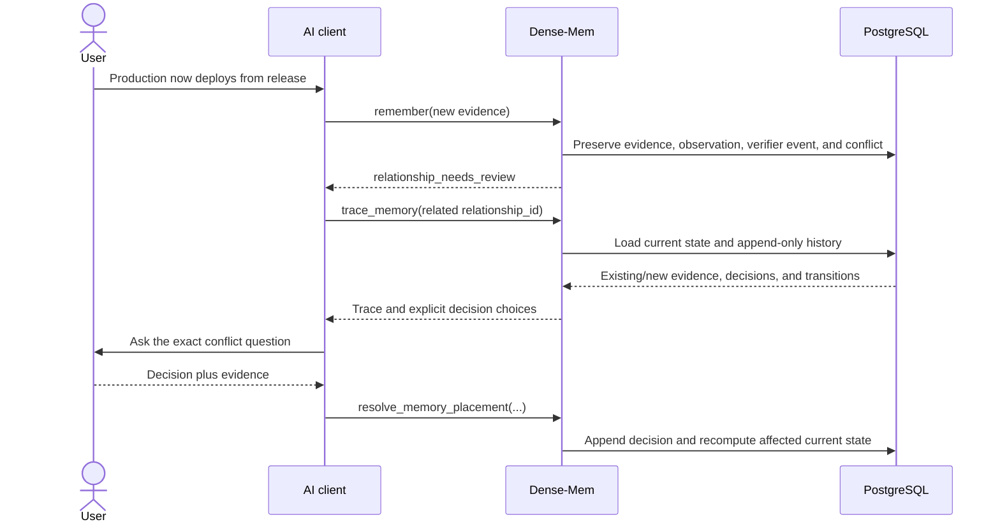
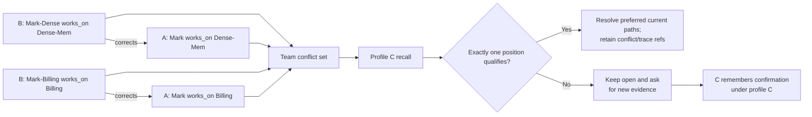
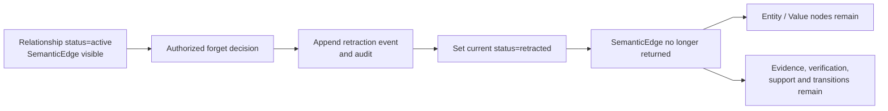
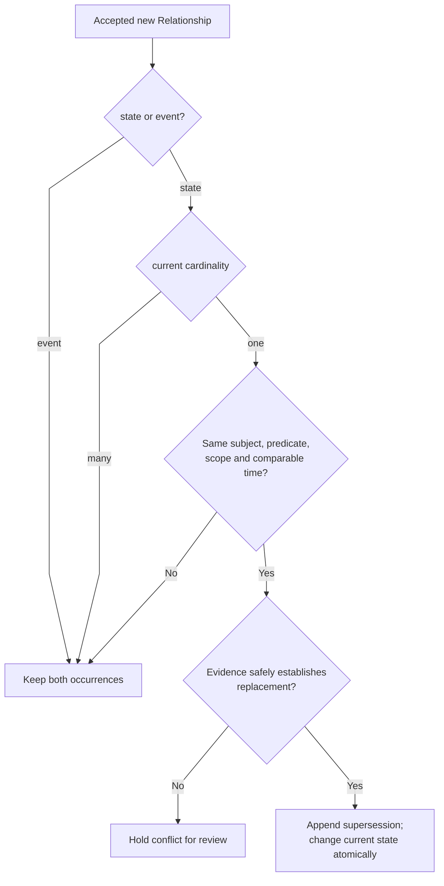

# Conflicts And Corrections

Dense-Mem preserves conflicting evidence. It asks for a client decision when
the caller's identity, predicate, scope, time, or current-state behavior cannot
be resolved safely. A resolved cross-profile disagreement keeps every authored
Relationship and its evidence intact, while a separate team-scoped disposition
controls which position enters primary current recall. No profile may mutate
another profile's Relationship to resolve a team disagreement.

This page is the single source of truth for conflict and correction
interaction. Relationship lifecycle is in
[Relationship Model And Lifecycle](Relationship-Model-And-Lifecycle), identity
merge/split is in
[Entity Identity And Resolution](Entity-Identity-And-Resolution#merge-and-split-corrections),
and orchestration is in [Memory Write Pipeline](Write-Pipeline).

## Same-Owner Conflict Flow



An unresolved same-owner conflicting observation is not an active edge. The
owner's prior eligible Relationship stays current unless accepted evidence and
deterministic predicate behavior permit supersession. A schema-valid, entailed
cross-owner correction can become the caller's active edge and append a
cross-reference to the other profile's record.

## Why Review Is Required

| Cause | Example | Safe result |
| --- | --- | --- |
| Entity ambiguity | context now suggests a different person named Mark | `identity_needs_review`; no guessed split or dependent edge |
| Unknown predicate | “Dense-Mem dogfoods PostgreSQL” maps to no registered predicate | `predicate_needs_review`; preserve wording; create no Relationship |
| Scope ambiguity | “uses PostgreSQL” may mean production or tests | preserve observation and request scope |
| Current-state conflict | production has competing `deploys_from` values | preserve both histories and ask |
| Temporal ambiguity | new evidence may describe past rather than current state | request validity context |
| Insufficient change evidence | weak evidence should not replace a supported current Relationship | retain `candidate/pending_evidence` without an active edge |
| Correction ambiguity | “that is wrong” identifies no Relationship | request `relationship_id` or a disambiguating query |
| Cross-profile disagreement | profile B supplies stronger evidence against profile A's Relationship | preserve A, create B's eligible Relationship, append a challenge/correction cross-reference, and create/update the team Conflict case |

## Cross-Profile Corrections

Profiles A, B, and C may all read same-team knowledge. Each owns only the
Relationships and observations created under its profile.

Assume profile A has two Relationships based on an identity that later appears
to combine two people:

```text
A: ent_mark -> works_on -> Dense-Mem
A: ent_mark -> works_on -> Billing
```

Profile B obtains distinguishing evidence. B creates its own Entity resolutions
and Relationships through normal `remember` processing:

```text
B: ent_mark_dense   -> works_on -> Dense-Mem
B: ent_mark_billing -> works_on -> Billing
```

In the same transaction, Dense-Mem appends `corrects` or `challenges`
cross-references from B's new Relationships to A's related Relationships. A's
status, tier, supports, and Entity resolutions do not change.



Profile C may rely on the preferred position when the case is resolved. When it
is open or overdue, C presents the alternatives or collects new user evidence.
Any confirmation C remembers belongs to C and may `confirm` B or `challenge` A.
It does not edit either record.

If A later accepts the correction, A submits or adopts exact evidence through
the normal verifier. A may then supersede A's old Relationships and create A's
corrected Relationships. Adoption preserves B's evidence author, provenance,
and source-group identity; it does not count the same evidence twice.

The canonical ownership and cross-reference fields are defined in
[Relationship Model And Lifecycle](Relationship-Model-And-Lifecycle#profile-ownership-and-team-visibility).
Conflict grouping and preference ranking are defined in
[Vector Search And Ranking](Vector-Search-And-Ranking#cross-profile-conflict-reranking).

### Stale team knowledge example

Assume A recorded an accurate business rule six months ago. The business
changed the rule five months ago, but Dense-Mem learned about the change only
when B later submitted exact evidence:

```text
t0  A owns Relationship A1: production deploys_from main
t1  the business changes production to release
t2  B owns Relationship B1: production deploys_from release
    B1 corrects A1, with valid_from=t1 supported by B's evidence
```

At `t2`, A1, A's evidence, support, tier, status, and authored validity remain
unchanged. B cannot set A1's `valid_to`, supersede A1, or make A's fragment
ineffective. Dense-Mem creates or updates a team conflict case that groups A1
and B1. The case is workflow and recall-disposition state, not a Relationship,
SemanticEdge, source revision, or new statement of truth.

If B's evidence is authoritative, verified, and temporally clear enough to meet
the deterministic resolution policy, the case resolves to B's position at
write time. Current recall at or after `t1` returns B's evidence in primary
`results[]`, includes a compact resolved conflict reference, and keeps A1
available through trace. Recall with `valid_at` before `t1` may still return A's
position. Recall with `known_at` before `t2` reconstructs what Dense-Mem knew
before B's correction arrived.

If B does not meet the policy, the case remains open. C receives both material
positions plus an explicit conflict question. C may submit new exact evidence
through normal `remember`; any resulting Relationship belongs to C and is
grouped with the matching or new position. A bare vote, profile count, or
unsupported “B is right” assertion changes no disposition.

## Durable Team Conflict Cases

An authored conflict set is still derived from Relationships, accepted
cross-references, registered single-current behavior, identity history, scope,
and time. When that set contains a material cross-profile Relationship
disagreement, Dense-Mem also persists one team-scoped conflict case so review,
deadlines, retries, and decisions survive process restarts.

```text
ConflictCase
  conflict_id
  team_id
  kind
  status: open | overdue | resolved | dismissed
  version
  opened_at
  review_due_at
  next_review_at
  claim_token
  lease_expires_at
  review_attempts
  last_evaluated_at
  resolved_at
  effective_at
  preferred_position_id
  policy_version

ConflictPosition
  position_id
  member Relationship IDs and versions
  owner profile IDs
  accepted evidence and source-group handles

ConflictEvent
  event_id
  prior and resulting case state
  actor profile when client-triggered
  reason code, policy version, and referenced versions
  created_at
```

The case row is current materialized workflow state. Case events are
append-only. Position membership never merges authored Relationships or counts
copied evidence more than once. `dismissed` means fewer than two material
positions remain after an owner retraction, source revision, or other normal
lifecycle change; it is not a truth decision.

| Authored knowledge | Team conflict disposition |
| --- | --- |
| A1 and B1 retain their immutable owners | the case belongs to the team, not A or B |
| each Relationship keeps its own tier/status/support | `preferred_position_id` affects conflict-aware reads only |
| neither author receives the other's evidence as support | equivalent evidence retains its original source-group identity |
| authored validity is not rewritten cross-profile | `effective_at` bounds the team-level current-read disposition |
| trace returns every authorized position and event | primary current recall omits resolved non-preferred support paths |

A conflict case is created or changed only from committed, schema-valid state.
Vector similarity alone cannot open one. The initial durable-case scope is a
cross-profile Relationship disagreement established by a verified
`challenges`/`corrects` reference or by incompatible, comparable
`current_cardinality=one` positions. Identity ambiguity and same-owner placement
review continue to use their existing review workflows.

### Deterministic resolution policy

A position qualifies for automatic current preference only when:

1. every counted support is accepted, entailed, currently effective, and
   applicable to the conflict scope
2. a reliable effective time establishes when the current-state change applies
3. the position has either one allowed authoritative source group or at least
   two independent accepted source groups
4. exactly one material position meets that floor for the applicable interval

Copied, summarized, adopted, or revised evidence from one origin remains one
source group. Author count is not a vote. Tier, verified confirmation/correction
references, and applicable recency may order otherwise eligible evidence, but
recency alone cannot satisfy the floor or break a tie between two qualifying
positions. Missing or conflicting effective-time evidence keeps the case open.

Resolution appends an event and updates the case disposition. It never changes
Relationship tier/status/support, writes `valid_to` onto another owner's record,
or expires an evidence fragment. One fragment may support unrelated current
Relationships, so primary-result filtering operates on the relevant
Relationship support path rather than globally hiding the fragment.

### Responding from another profile

Any active same-team profile with `write` scope may respond with new evidence.
The relevant Relationship proposal carries the recall-supplied `conflict_id`
and expected case version. Dense-Mem validates the version and that the verified
proposal materially belongs to the case before committing evidence or case
state. A stale version fails without changing state so the host can recall the
current alternatives and retry. The exact MCP field shape belongs in
[Technical Reference](Technical-Reference#remember).

The same transaction that places the caller-owned Relationship and validated
cross-reference recomputes the case. A unique qualifying position resolves
immediately; otherwise the case remains or becomes open and returns a fresh
deadline/version. There is no separate cross-profile `resolve` command.

## Nightly Conflict Review

Write-time evaluation is authoritative for new evidence. The nightly job is a
deterministic audit and repair backstop for due cases, missed derived work,
source-revision changes, and service restarts. It uses the same versioned
resolution policy as write-time evaluation and does not call a model.

For each due case, the job:

1. claims bounded team-local work with a durable lease
2. reloads current Relationship versions, effective supports, source groups,
   cross-references, scope, and temporal bounds from PostgreSQL
3. repairs stale position membership and recomputes the disposition
4. resolves only when exactly one position meets the automatic floor
5. marks the case `overdue`, appends an escalation event, and schedules the next
   nightly check when no unique position qualifies
6. dismisses a case only when committed lifecycle/source changes leave no
   material disagreement
7. queues rebuildable search/read-model refresh work after a disposition change

The review deadline comes from the versioned team policy. Reaching it is never
evidence and never forces a winner. Duplicate evidence from the same source
group does not extend the deadline; a materially new position or newly
independent support may reopen a resolved case and start a new review window.
Database/worker failure leaves the case due and unresolved. Multi-instance
workers use durable daily run reservation plus team-local `FOR UPDATE SKIP
LOCKED` claims, bounded retries, and lease recovery.

The job may update conflict workflow rows and rebuildable search state. It may
not edit or delete evidence, observations, verification events,
RelationshipCrossReferences, authored validity, Relationship ownership,
tier/status/support, Entity resolution, or source history. Operators inspect an
overdue case or submit new evidence; they do not repair it with direct SQL.
Defaults and bounded overrides belong in
[Configuration](Configuration#conflict-review).

## Inspect Before Deciding

Use the `relationship_id` from recall discovery paths or from a placement
`relationship_outcomes[]` entry:

```json
{
  "relationship_id": "r_deploy_branch",
  "include_evidence_content": true,
  "include_verification": true,
  "include_transitions": true,
  "max_depth": 1,
  "max_edges": 12
}
```

The client presents:

- current subject, predicate, object, polarity, scope, and validity
- tier, status, current-cardinality behavior, and source count
- accepted evidence and material verification events
- the new conflicting observation and its evidence verdict
- exact identity, predicate, scope, or temporal ambiguity
- the before/after impact of each allowed decision

An opaque “accept or reject?” prompt is insufficient.

## Identity Review

The client may select only a server-supplied same-team candidate:

```json
{
  "ingest_id": "ing_01J...",
  "placement_item_id": "item_identity_1",
  "action": "select_entity",
  "decision": {
    "mention_ref": "mark",
    "entity_id": "ent_mark_huang"
  },
  "evidence": [
    {
      "content": "I mean Mark Huang, the Dense-Mem maintainer.",
      "source_type": "manual",
      "authority": "authoritative",
      "source_group": "user-resolution:ing_01J..."
    }
  ],
  "idempotency_key": "identity-resolution-1"
}
```

`confirm_new_entity` requires evidence that distinguishes a new identity. The
client never allocates the new ID.

A late same-name conflict may require a split. Dense-Mem first shows only the
caller's observations and Relationships that may move. After confirmation, it
creates the new Entity and reassigns only selected caller-owned immutable
observation IDs. It never moves another profile's rows or every row based on
display text.

## Predicate Review

An unknown phrase remains on the observation with no `predicate_key`. Review
may:

- select an existing server-supplied registered predicate when meaning matches
- reject the observation mapping
- route a proposed registry change through a separately authorized,
  versioned vocabulary workflow

The verifier and ordinary review endpoint cannot add a predicate definition.
A Hypothesis is not an unknown predicate; it is an isolated dream output using
an already registered predicate. See [Dreaming](Dreaming).

## Relationship Review Actions

| Action | Meaning |
| --- | --- |
| `accept` | append authoritative client evidence for the pending observation, then rerun normal policy |
| `reject` | append the rejection and preserve observation/history |
| `correct` | append replacement evidence and reprocess affected knowledge |
| `forget` | retract the caller-owned selected Relationship from active reads while retaining its ledger |
| `acknowledge` | mark review consumption; change no semantic state |

`accept` does not bypass verification or directly assign `fact`. Fact promotion
uses the authority and independent-source rules in
[Relationship Model And Lifecycle](Relationship-Model-And-Lifecycle#source-independence-and-fact-promotion).

These actions mutate only a Relationship owned by the authenticated profile.
To address another profile's Relationship, the caller submits new evidence
through `remember`; deterministic post-verification identity and conflict
policy derive the appropriate cross-reference. There is no cross-profile
`accept`, `forget`, `supersede`, merge, or split shortcut.

## Correct With New Evidence

A correction appends evidence; it is not an in-place text edit.

```json
{
  "ingest_id": "ing_01J...",
  "placement_item_id": "item_relationship_1",
  "action": "correct",
  "evidence": [
    {
      "content": "The user confirmed that production now deploys from release.",
      "source_type": "manual",
      "authority": "authoritative",
      "source_group": "user-resolution:ing_01J..."
    }
  ],
  "proposal": {
    "entities": [
      {
        "ref": "production",
        "name": "production",
        "entity_kind": "environment",
        "identity_context": {
          "system": "Dense-Mem"
        }
      },
      {
        "ref": "release",
        "name": "release",
        "entity_kind": "git_branch",
        "identity_context": {
          "repository": "Dense-Mem"
        }
      }
    ],
    "relationships": [
      {
        "proposal_id": "production_deploys_from_release",
        "subject_ref": "production",
        "predicate": "deploys_from",
        "object_ref": "release",
        "polarity": "+",
        "modality": "statement",
        "evidence": [
          {
            "evidence_index": 0,
            "start": 0,
            "end": 60
          }
        ]
      }
    ]
  },
  "idempotency_key": "deployment-correction-1"
}
```

The replacement enters the same extraction, one-call verifier, deterministic
lifecycle, and PostgreSQL transaction as every `remember`. Prior evidence and
transitions remain traceable.

This action corrects the caller's Relationship; it does not declare a shared
source globally obsolete. A source owner that can prove stable lineage instead
uses `source_key`, `source_revision`, and `previous_source_revision`, optionally
with its own `supersedes_fragment_ids`. Source activation occurs at intake,
makes the prior revision ineffective for every profile that adopted it, and
recomputes affected tiers from remaining effective support. The caller cannot
mix a profile-local correction with unowned source-fragment retirement.

## Same-Owner Before And After

| Before decision | After an accepted correction |
| --- | --- |
| supported prior Relationship stays current | prior record is superseded or retracted only when registry behavior and evidence permit |
| new conflict is held and has no active edge | eligible replacement is exposed as one SemanticEdge |
| prior evidence and decisions are append-only | both old and new provenance remain traceable |
| vector search may still represent the prior version | source/full-text/adjacency reads change at commit; version-matched embedding job updates vector search |

For a cross-profile correction, the target record does not enter the right-hand
column. The caller creates a separately owned Relationship and cross-reference;
the team Conflict case preserves both positions and controls their current
recall disposition.

## Forget And Retraction

`forget` removes a caller-owned Relationship from current graph-shaped reads
without deleting its semantic nodes or historical ledger. Same-team visibility
does not authorize forgetting another profile's record.



Because SemanticEdge is a PostgreSQL read rule, the edge disappears from normal
reads in the same transaction that records the retraction. There is no second
graph copy to delete.

This is logical forgetting. A privacy-erasure request is a separate authorized
workflow that may redact payload content while retaining minimal tombstones,
audit proof, and referential integrity required by policy. Clients must not
emulate either operation with direct SQL deletion.

## Deterministic Current-State Decisions

Predicate registry fields `relationship_kind` and `current_cardinality` guide
whether accepted knowledge coexists or may supersede a prior current value
owned by the same profile. They are not model decisions and never authorize
cross-profile supersession.



Canonical behavior belongs in
[Relationship Model And Lifecycle](Relationship-Model-And-Lifecycle#predicate-registry);
this page owns how the client sees and resolves uncertainty.

## Risks And Mitigations

| Risk | Concrete failure mode | Mitigation |
| --- | --- | --- |
| Wrong review target | a decision for one conflict applies to another | require ingest/item/Relationship IDs, idempotency key, and echo an impact summary |
| Accept bypasses policy | a client click writes an active fact directly | append evidence and route through strict verification and deterministic lifecycle |
| Correction erases history | old evidence is edited to match new truth | immutable fragments plus append-only observations, decisions, support, and transitions |
| Homonym split corrupts history | finance-team Mark causes all Mark edges to move | client-confirmed impact preview and caller-owned observation-ID-level reassignment |
| Unknown predicate expands vocabulary | verifier invents `dogfoods` as a durable key | registry allowlist and separate authorized vocabulary workflow |
| Wrong supersession | a many-valued predicate is treated as single-current | explicit `current_cardinality`, scope/time comparison, and before/after preview |
| Forget becomes data loss | deleting an edge also removes source and audit history | transactional retraction status; nodes and append-only ledger remain |
| Stale vector confuses review | vector search surfaces meaning from before correction | source-version checks, exact trace by ID, and explicit search freshness |
| Cross-profile correction becomes mutation | B's correction marks A's Relationship superseded | owner predicate on mutations; B writes its own Relationship plus immutable cross-reference |
| Majority becomes truth | several profiles copy one weak source and outvote stronger evidence | preserve source groups, deduplicate common origins, and rank evidence rather than author count alone |
| Correction impersonates source revision | a profile-local `correct` request invalidates evidence adopted by other owners | reserve team-wide invalidation for the immutable source owner and exact prior-revision contract |
| Deadline becomes truth | an unresolved case automatically chooses B after seven days | require one unique temporally applicable position above the evidence floor; otherwise mark `overdue` and escalate |
| Team disposition rewrites A | resolution sets A's status or authored `valid_to` | keep the disposition in team workflow state and enforce owner predicates on every Relationship mutation |
| Historical recall uses today's winner | a query for six months ago returns only B | evaluate both `valid_at` and `known_at` against conflict events and effective time |
| Fragment-wide suppression hides valid facts | A's fragment supports another still-current Relationship | filter only query-relevant support paths and retain the immutable fragment/search document |
| Stale C response attaches to the wrong case version | C confirms an alternative after the case was reopened or regrouped | require `conflict_id` plus expected version and reject stale context before commit |

## Acceptance Invariants

1. conflict preserves old and new evidence
2. unresolved identity or predicate creates no active dependent edge
3. every decision records actor, provenance, time, target IDs, and idempotency
4. correction never mutates verbatim evidence
5. accept, reject, correct, split, and forget write through normal PostgreSQL
   policy—not a graph side channel
6. a late split moves only explicitly selected caller-owned observations
7. prior current state changes only in the same transaction as its transition
8. forget removes the SemanticEdge but retains Entity/Value nodes and all
   ledger history
9. trace reconstructs conflict, decision, and supersession/retraction lineage
10. a profile cannot accept, forget, supersede, merge, split, or change support
    for another profile's knowledge
11. cross-profile corrections remain independently authored and link both
    Relationships without hiding either from authorized trace
12. adopting cross-profile evidence preserves its original provenance and does
    not create a second independent source group
13. normal correction changes only caller-owned Relationship state, while an
    owned source revision may invalidate its evidence team-wide through system
    recomputation
14. a material cross-profile disagreement has one durable team case with
    append-only events and versioned position membership
15. a resolved case removes only non-preferred current support paths from
    primary recall and keeps every authored Relationship available to trace
16. `valid_at` before the change and `known_at` before the correction reconstruct
    the corresponding historical view
17. another writer's response creates that writer's evidence-backed
    Relationship and cannot act as a bare vote
18. write-time and nightly evaluation produce the same disposition for the same
    committed inputs and policy version
19. deadline expiry without one qualifying position produces `overdue`, not an
    invented winner
20. the nightly job can repair workflow/search state but cannot mutate authored
    evidence, Relationship lifecycle, ownership, validity, or support
