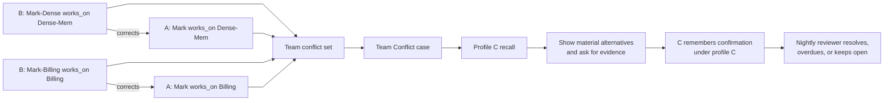
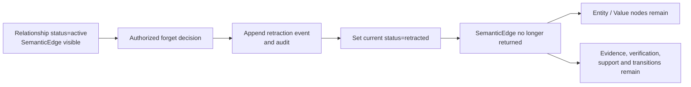
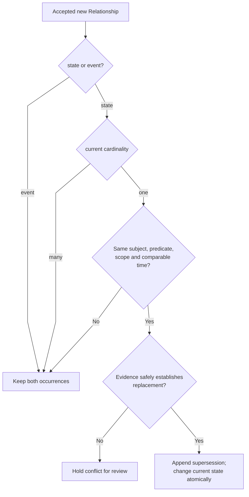

# Conflicts And Corrections

Dense-Mem preserves raw evidence and resolves stale authored state with audited
Relationship lifecycle transitions. It asks for a client decision when the
caller-owned identity, predicate, scope, time, or current-state behavior cannot
be resolved safely. A profile cannot mutate another profile's Relationship, but
the bounded system Conflict reviewer may close a losing team Relationship episode
after an evidence-backed case resolution. Evidence bytes, observations, support
links, and author attribution remain immutable.

This page is the single source of truth for conflict and correction
interaction. Relationship lifecycle is in
[Relationship Model And Lifecycle](Relationship-Model-And-Lifecycle), identity
merge/split is in
[Entity Identity And Resolution](Entity-Identity-And-Resolution#merge-and-split-corrections),
and orchestration is in [Memory Write Pipeline](Write-Pipeline).

## Same-Owner Conflict Flow

```mermaid
%%{init: {"sequence": {"rightAngles": true}}}%%
sequenceDiagram
  actor User
  participant Host as AI client
  participant DM as Dense-Mem
  participant PG as PostgreSQL

  User->>Host: Production now deploys from release
  Host->>DM: remember(new evidence)
  DM->>PG: Preserve evidence, observation, VerificationEvent, and conflict
  DM-->>Host: relationship_needs_review
  Host->>DM: trace_memory(related relationship_id)
  DM->>PG: Load current state and append-only history
  PG-->>DM: Existing/new evidence, decisions, and transitions
  DM-->>Host: Trace and explicit decision choices
  Host->>User: Ask the exact conflict question
  User-->>Host: Decision plus evidence
  Host->>DM: get_submission_status(submission_id)
  DM-->>Host: Bounded terminal/search state; no client review decision
```

An unresolved same-owner conflicting observation is not an active edge. The
owner's prior eligible Relationship stays current unless accepted evidence and
deterministic predicate behavior permit supersession. A schema-valid, entailed
cross-owner correction at or above the team support threshold can become the
caller's active edge and append a
cross-reference to the other profile's record.

## Why Review Is Required

| Cause | Example | Safe result |
| --- | --- | --- |
| Entity ambiguity | context now suggests a different person named Mark | `identity_needs_review`; no guessed split or dependent edge |
| Unknown predicate | “Dense-Mem dogfoods PostgreSQL” maps to no registered predicate | `predicate_needs_review`; preserve wording; create no Relationship |
| Scope ambiguity | “uses PostgreSQL” may mean production or tests | preserve observation and request scope |
| Current-state conflict | production has competing `deploys_from` values | preserve both histories and ask |
| Temporal ambiguity | new evidence may describe past rather than current state | request validity context |
| Insufficient change evidence | weak evidence should not replace a supported current Relationship | retain `pending_evidence` without an active edge |
| Correction ambiguity | “that is wrong” identifies no Relationship | request `relationship_id` or a disambiguating query |
| Cross-profile disagreement | profile B supplies stronger evidence against profile A's Relationship | preserve A, create B's eligible Relationship, append a challenge/correction cross-reference, and create/update the team Conflict case |

## Cross-Profile Corrections

Profiles A, B, and C may all read same-team knowledge. Each authors only the
Relationships and observations created under its profile. Ordinary profile
writes can change only caller-owned lifecycle state.

Assume profile A has two Relationships based on an identity that later appears
to combine two people:

```text
A: ent_mark -> works_on -> Dense-Mem
A: ent_mark -> works_on -> Billing
```

Profile B obtains distinguishing evidence. B creates its own Entity resolutions
and Relationships through normal `remember` processing:

```text
B: ent_mark_dense   -> works_on -> Dense-Mem
B: ent_mark_billing -> works_on -> Billing
```

In the same transaction, Dense-Mem appends `corrects` or `challenges`
cross-references from B's new Relationships to A's related Relationships and
opens or updates the durable team Conflict case. A's status, supports,
validity, and Entity resolutions do not change during B's placement.



Profile C sees both material positions while the case is open. C may submit new
evidence through normal `remember`; any confirmation C remembers belongs to C and
may `confirm` B or `challenge` A. It does not directly edit either record.

If A later accepts the correction directly, A submits or adopts exact evidence
through the normal integrated assessor. A may then supersede A's old
Relationships and create A's corrected Relationships. Separately, the system
Conflict reviewer may
supersede A's stale episode after the team case resolves. Adoption preserves B's
evidence author, provenance, and source-group identity; it does not count the
same evidence twice.

The canonical ownership and cross-reference fields are defined in
[Relationship Model And Lifecycle](Relationship-Model-And-Lifecycle#profile-ownership-and-team-visibility).
Conflict grouping and preference ranking are defined in
[Vector Search And Ranking](Vector-Search-And-Ranking#cross-profile-conflict-reranking).

### Stale team knowledge example

Assume A recorded an accurate business rule six months ago. The business
changed the rule five months ago, but Dense-Mem learned about the change only
when B later submitted exact evidence:

```text
t0  A owns Relationship A1: production deploys_from main
t1  the business changes production to release
t2  B owns Relationship B1: production deploys_from release
    B1 corrects A1, with valid_from=t1 supported by B's evidence
```

At `t2`, B's placement creates B1, the `corrects` cross-reference, and an open
team Conflict case. A1, A's evidence, support, status, and validity remain
unchanged during placement. The AI assessor does not decide that a conflict
exists; server policy detects the incompatible single-current state after B's
submitted evidence verifies.

While the case is open, C receives both material positions plus an explicit
conflict question. C may submit new exact evidence through normal `remember`; any
resulting Relationship belongs to C and is grouped with the matching or new
position. A bare vote, profile count, or unsupported "B is right" assertion
changes no disposition.

The nightly Conflict reviewer owns automatic resolution. If B's side becomes the
unique winner under the deterministic policy, one PostgreSQL transaction marks
the case resolved, sets A1 `status=superseded`, writes A1 `valid_to` to the
resolved cutoff, appends Relationship and Conflict ledger events with
`actor=system_conflict_reviewer`, and queues rebuildable search refresh. A's
original evidence fragment and support remain traceable. Current recall at or
after the cutoff returns B-side evidence in primary `results[]`, includes a
compact resolved conflict reference, and keeps A1 available through trace. Recall
with `valid_at` before the cutoff may still return A's position. Recall with
`known_at` before B's correction arrived reconstructs the older system view.

## Durable Team Conflict Cases

An authored conflict set is still derived from Relationships, accepted
cross-references, registered single-current behavior, identity history, scope,
and time. When that set contains a material cross-profile Relationship
disagreement, Dense-Mem also persists one team-scoped conflict case so review,
deadlines, retries, and decisions survive process restarts.

```text
ConflictCase
  conflict_id
  team_id
  kind
  status: open | overdue | resolved | dismissed
  version
  opened_at
  review_due_at
  next_review_at
  claim_token
  lease_expires_at
  review_attempts
  last_evaluated_at
  resolved_at
  effective_at
  effective_time_basis: evidence_time | recorded_fallback
  preferred_position_id
  policy_version

ConflictPosition
  position_id
  member Relationship IDs and versions
  owner profile IDs
  accepted evidence and source-group handles
  distinct supporter, source-group, and authoritative-group counts
  at most 20 deterministic supporter summaries

ConflictEvent
  event_id
  prior and resulting case state
  actor profile when client-triggered or system worker when reviewer-triggered
  reason code, policy version, time basis, and referenced versions
  created_at
```

The case row is current materialized workflow state. Case events are
append-only. Position membership never merges authored Relationships or counts
copied evidence more than once. `dismissed` means fewer than two material
positions remain after an owner retraction, source revision, or other normal
lifecycle change; it is not a truth decision.

| Authored knowledge | Team conflict disposition |
| --- | --- |
| A1 and B1 retain immutable author attribution | the case belongs to the team, not A or B |
| each Relationship keeps its own evidence/support ledger | resolution may close losing stale episodes through audited system transitions |
| neither author receives the other's evidence as support | equivalent evidence retains its original source-group identity |
| ordinary profiles cannot rewrite cross-profile validity | `effective_at` is the cutoff used for current-read disposition and losing-episode closure |
| trace returns every authorized position and event | primary current recall omits resolved non-preferred support paths |

### Bounded supporter provenance

Same-team `recall_memory` and `trace_memory` project the same supporter
provenance for each effective position at the requested `known_at`. The
position keeps its existing Relationship, profile, and Evidence ID arrays and
adds:

- `supporter_count`: distinct effective owner profiles
- `support_group_count`: distinct effective server-derived source groups
- `authoritative_group_count`: effective source groups with authoritative
  support
- `supporters_truncated`: whether the total exceeds the returned summaries
- `supporters`: at most 20 current same-team profile summaries

Each profile appears once. Its summary reports the strongest effective
authority, the most recently accepted Evidence at that authority, its accepted
time, and the profile's distinct effective source-group count. Summaries order
by authority rank descending, accepted time descending, then immutable profile
ID. The profile name is hydrated from the current same-team directory at read
time; the immutable profile and Evidence IDs remain the audit identity.

Copied support can therefore display several profiles while contributing only
one independent group. Multiple independent groups from one profile increase
group weight but do not duplicate that profile in `supporters`. Raw source-group
keys, Evidence content, provider output, and cross-team identities are never
included.

A conflict case is created or changed only from committed, schema-valid state.
Vector similarity alone cannot open one. The initial durable-case scope is a
cross-profile Relationship disagreement established by a verified
`challenges`/`corrects` reference or by incompatible, comparable
`current_cardinality=one` positions. Identity ambiguity and same-owner placement
review continue to use their existing review workflows.

### Deterministic resolution policy

The counting unit is a current accepted independent source group. Profile count,
Relationship row count, copied fragments, summaries, adoptions, and repeated
source revisions are not votes.

Before `review_due_at`, one position qualifies only when it has at least four
independent source groups and more than 75% of counted support for the material
case. At or after `review_due_at`, one position qualifies when either:

1. it is the unique position with an allowed authoritative source group; or
2. it has at least two independent source groups and more than 50% of counted
   support.

In all cases, every counted support must be accepted, entailed, currently
effective, and applicable to the conflict scope. A source group that currently
supports incompatible positions counts toward neither side until its support is
cleaned up.

Authoritative opposition normally blocks automatic replacement. A timed strong
override is allowed only when the proposed winner has at least four independent
source groups, more than 75% of counted support, and assessor-confirmed evidence
that the replacement became effective after the losing authoritative position.
`recorded_fallback` time cannot override authoritative opposition.

The cutoff is the evidence-supported effective time when the assessor confirms
the extracted temporal bound. If no reliable bound exists and no authority
override is needed, the reviewer may use the first contradictory placement time
as `recorded_fallback`. Missing or conflicting time keeps the case open when the
chosen threshold requires evidence time.

Resolution appends case events, appends Relationship transitions for losing
episodes, updates their current `status`/`valid_to`, and queues rebuildable search
refresh. It never edits raw evidence, observations, verification events, support
links, or author attribution. One fragment may support unrelated current
Relationships, so primary-result filtering operates on the relevant Relationship
support path rather than globally hiding the fragment.

### Responding from another profile

Any active same-team profile with `write` scope may respond with new evidence.
The relevant Relationship proposal carries the recall-supplied `conflict_id`
and expected case version. Dense-Mem validates the version and that the verified
proposal materially belongs to the case before committing evidence or case
state. A stale version fails without changing state so the host can recall the
current alternatives and retry. The exact MCP field shape belongs in
[Technical Reference](Technical-Reference#remember).

The same transaction that places the caller-owned Relationship and validated
cross-reference opens or updates the case, membership, deadline/version, and
search refresh intent. It does not resolve the case. There is no separate
cross-profile `resolve` command; automatic resolution belongs to nightly review.

## Nightly Conflict Review

The nightly job is the Conflict maintainer. It reviews known open or overdue
cases, repairs membership, deterministically resolves qualifying cases, and
closes stale Relationship episodes. It does not scan old Relationships by age.
For an unchanged `overdue` case that still has no deterministic winner, it may
run one bounded AI assessment through the configured verifier; the model only
proposes a supplied position and never writes durable state.

For each case whose `next_review_at` is due, whether before or after
`review_due_at`, the job:

1. claims bounded team-local work with a durable lease
2. reloads current Relationship versions, effective supports, source groups,
   cross-references, scope, and temporal bounds from PostgreSQL
3. repairs stale position membership and recomputes the policy view
4. resolves only when exactly one position meets the automatic floor for the
   current pre-TTL or post-TTL phase
5. marks the case `overdue`, appends an escalation event, and schedules the next
   nightly check when no unique position qualifies
6. for an overdue case, reserves at most one `(case version, model, policy,
   local date)` assessment, commits that reservation, and then sends the bounded
   current dossier to the verifier outside the database transaction
7. accepts only a closed-schema selection of a supplied position at confidence
   `>= 0.70`; an explicit abstention immediately uses deterministic
   last-write-wins: strongest authority, then latest Dense-Mem accepted support,
   then a stable position-ID tie break
8. records provider, schema, context, or token-bound failures without persisting
   provider text; after five failed local-day attempts for the unchanged
   `(case version, model, policy)` tuple, uses the same last-write-wins fallback
9. dismisses a case only when committed lifecycle/source changes leave no
   material disagreement
10. when resolving, locks and updates the losing Relationship rows, retracts
    only losing evidence fragments that support no Relationship outside the
    active case through audited system-owned lifecycle operations, marks the case
    resolved, appends Conflict/transition events, and queues rebuildable
    search/read-model refresh work in one transaction

An abandoned assessment reservation expires only after its local date ends and
then counts as a failed attempt. A case-version change supersedes reserved work;
a stale completion cannot apply. The assessor receives server-owned position
metadata (authority, independent source groups, distinct-owner counts, accepted
and effective time) and effective evidence only. It receives neither profile
identities nor authority to choose an ID that was not in that dossier.
Evidence without a durable Conflict case does not become stale merely because of
its age or lack of a later source revision.

The review deadline comes from the versioned team policy. Reaching it is not
evidence and does not force a winner; it only enables the lower automatic
threshold. Duplicate evidence from the same source group does not extend the
deadline. New independent support updates membership and may resolve on a later
nightly run, but it does not move the original deadline. A later contradictory
business change opens a new conflict episode instead of reopening a resolved
case. Database/worker failure leaves the case due and unresolved.
Multi-instance workers use durable daily run reservation plus team-local `FOR
UPDATE SKIP LOCKED` claims, bounded retries, and lease recovery.

The job may update conflict workflow rows, losing Relationship `status` and
`valid_to`, append Relationship transition events, and enqueue rebuildable search
state. For a successfully resolved overdue case it may also retract a losing
evidence fragment with an audited system actor and stage an inferred,
deletion-only replacement through the normal placement queue, but only when that
fragment has no support path outside the active case. A shared fragment remains
searchable and keeps its unrelated support; the losing Relationship is still
suppressed. The replacement is not searchable and cannot project a Relationship
or vote in a future conflict. If staging it fails, the old evidence remains
inactive and the failure is durably visible. The job never rewrites raw evidence
text, observations, verification events, ownership, author attribution, Entity
resolution, or source history. Operators inspect an overdue case or submit new
evidence; they do not repair it with direct SQL.
Defaults and bounded overrides belong in
[Configuration](Configuration#conflict-review).

## Inspect Before Deciding

Use the `relationship_id` from `related_relationships[]` or from a placement
`relationship_outcomes[]` entry:

```json
{
  "relationship_id": "r_deploy_branch",
  "include_evidence_content": true,
  "include_verification": true,
  "include_transitions": true,
  "max_depth": 1,
  "max_edges": 12
}
```

The client presents:

- current subject, predicate, object, polarity, scope, and validity
- status, effective support, current-cardinality behavior, and source count
- accepted evidence and material verification events
- the new conflicting observation and its evidence verdict
- exact identity, predicate, scope, or temporal ambiguity
- the before/after impact of each allowed decision

An opaque “accept or reject?” prompt is insufficient.

## Server-side ambiguity handling

Entity, predicate, scope, and temporal ambiguity remain isolated in the
assessment ledger. The client receives only the bounded submission state from
`get_submission_status`; it cannot select a candidate, release a quarantine,
acknowledge a review task, or append a decision to an existing submission.

When new source material resolves the ambiguity, submit one complete,
authenticated `remember` request with exact evidence and proposal spans. The
server re-runs the integrated assessor and applies owner, team, conflict, and
support policy atomically. Historical assessment and conflict records remain
append-only and are available through authorized trace/audit paths.

The server never allocates a destination ID from client text, moves another
profile's rows, or treats a same-team candidate as canonical without its own
assessment. A Hypothesis is not an unknown predicate; it remains an isolated
dream output using an already registered predicate. See [Dreaming](Dreaming).

## Correct With New Evidence

A correction appends evidence; it is not an in-place text edit. Submit a fresh
complete request and poll its returned `submission_id`:

```json
{
  "evidence": [{
    "content": "The user confirmed that production now deploys from release.",
    "source_type": "manual",
    "authority": "authoritative",
    "source_group": "user-resolution:deployment"
  }],
  "relationships": [{
    "ref": "production_deploys_from_release",
    "subject": {"name": "production", "entity_kind": "environment", "span": {"evidence_index": 0, "start": 0, "end": 10}},
    "predicate": {"proposed_key": "deploys_from", "surface": "deploys from", "span": {"evidence_index": 0, "start": 11, "end": 22}},
    "object": {"entity": {"name": "release", "entity_kind": "git_branch", "span": {"evidence_index": 0, "start": 23, "end": 30}}},
    "polarity": "+",
    "modality": "statement",
    "supports": [{"evidence_index": 0, "start": 0, "end": 30}]
  }],
  "idempotency_key": "deployment-correction-1"
}
```

The replacement enters the same integrated assessor, deterministic
lifecycle, and PostgreSQL transaction as every `remember`. Prior evidence and
transitions remain traceable.

This submission corrects the caller's Relationship; it does not declare a
shared source globally obsolete. A source owner that can prove stable lineage instead
uses `source_key`, `source_revision`, and `previous_source_revision`. Source
activation occurs at intake, makes the prior revision ineffective for every
profile that adopted it, and recomputes affected statuses from remaining
effective support. Direct evidence supersession instead uses
`supersedes_evidence_ids` on new caller-owned evidence and cannot be combined
with `previous_source_revision`. The caller cannot mix a profile-local
correction with unowned evidence retirement.

## Same-Owner Before And After

| Before decision | After an accepted correction |
| --- | --- |
| supported prior Relationship stays current | prior record is superseded or retracted only when registry behavior and evidence permit |
| new conflict is held and has no active edge | eligible replacement is exposed as one SemanticEdge |
| prior evidence and decisions are append-only | both old and new provenance remain traceable |
| vector search may still represent the prior version | source/full-text/adjacency reads change at commit; version-matched embedding job updates vector search |

For a cross-profile correction, the target record does not enter the right-hand
column during placement. The caller creates a separately owned Relationship and
cross-reference; the team Conflict case preserves both positions until the
nightly reviewer resolves or escalates the case.

## Forget And Retraction

`forget` removes a caller-owned Relationship from current graph-shaped reads
without deleting its semantic nodes or historical ledger. Same-team visibility
does not authorize forgetting another profile's record.



Because SemanticEdge is a PostgreSQL read rule, the edge disappears from normal
reads in the same transaction that records the retraction. There is no second
graph copy to delete.

This is logical forgetting. A privacy-erasure request is a separate authorized
workflow that may redact payload content while retaining minimal tombstones,
audit proof, and referential integrity required by policy. Clients must not
emulate either operation with direct SQL deletion.

## Deterministic Current-State Decisions

Predicate registry fields `relationship_kind` and `current_cardinality` guide
whether accepted knowledge coexists or may supersede a prior current value owned
by the same profile. They are not model decisions and never authorize
cross-profile ordinary writes. Cross-profile stale-state closure is limited to
the nightly Conflict reviewer and the deterministic case policy above.



Canonical behavior belongs in
[Relationship Model And Lifecycle](Relationship-Model-And-Lifecycle#predicate-registry);
this page owns how the client sees and resolves uncertainty.

## Risks And Mitigations

| Risk | Concrete failure mode | Mitigation |
| --- | --- | --- |
| Wrong review target | a decision for one conflict applies to another | require ingest/item/Relationship IDs, idempotency key, and echo an impact summary |
| Accept bypasses policy | a client click writes an active Relationship directly | require exact new evidence and route its new placement item through one assessment plus deterministic lifecycle |
| Correction erases history | old evidence is edited to match new truth | immutable evidence plus append-only observations, decisions, support, and transitions |
| Homonym split corrupts history | finance-team Mark causes all Mark edges to move | client-confirmed impact preview and caller-owned observation-ID-level reassignment |
| Unknown predicate expands vocabulary | assessor invents `dogfoods` as a durable key | structured registry allowlist and separate authorized vocabulary workflow |
| Wrong supersession | a many-valued predicate is treated as single-current | explicit `current_cardinality`, scope/time comparison, and before/after preview |
| Forget becomes data loss | deleting an edge also removes source and audit history | transactional retraction status; nodes and append-only ledger remain |
| Stale vector confuses review | vector search surfaces meaning from before correction | source-version checks, exact trace by ID, and explicit search freshness |
| Cross-profile correction becomes immediate mutation | B's placement marks A's Relationship superseded before review | placement can write only B's Relationship, cross-reference, and open/update case; non-owner supersession is allowed only in the nightly reviewer transaction |
| Majority becomes truth | several profiles copy one weak source and outvote stronger evidence | preserve source groups, deduplicate common origins, and rank evidence rather than author count alone |
| Correction impersonates source revision | a profile-local `correct` request invalidates evidence adopted by other owners | reserve team-wide invalidation for the immutable source owner and exact prior-revision contract |
| Deadline becomes truth | an unresolved case automatically chooses B after seven days | TTL only switches thresholds; require one unique temporally applicable position above the applicable evidence floor, otherwise mark `overdue` and escalate |
| Reviewer closes the wrong episode | B's branch change supersedes an unrelated A Relationship sharing text | lock case membership by Relationship ID/version, revalidate scope/predicate/cardinality/time, and update case plus losing Relationships in one transaction |
| Historical recall uses today's winner | a query for six months ago returns only B | evaluate both `valid_at` and `known_at` against conflict events and effective time |
| Evidence-wide suppression hides valid Relationships | A's evidence supports another still-current Relationship | filter only query-relevant support paths and retain the immutable evidence/search document |
| Stale C response attaches to the wrong case version | C confirms an alternative after the case was reopened or regrouped | require `conflict_id` plus expected version and reject stale context before commit |

## Acceptance Invariants

1. conflict preserves old and new evidence
2. unresolved identity or predicate creates no active dependent edge
3. every decision records actor, provenance, time, target IDs, and idempotency
4. correction never mutates verbatim evidence
5. accept, reject, correct, split, and forget write through normal PostgreSQL
   policy—not a graph side channel
6. a late split moves only explicitly selected caller-owned observations
7. prior current state changes only in the same transaction as its transition
8. forget removes the SemanticEdge but retains Entity/Value nodes and all
   ledger history
9. trace reconstructs conflict, decision, and supersession/retraction lineage
10. a profile cannot accept, forget, supersede, merge, split, or change support
    for another profile's knowledge
11. cross-profile corrections remain independently authored and link both
    Relationships without hiding either from authorized trace
12. adopting cross-profile evidence preserves its original provenance and does
    not create a second independent source group
13. normal correction changes only caller-owned Relationship state, while an
    owned source revision may invalidate its evidence team-wide through system
    recomputation
14. a material cross-profile disagreement has one durable team case with
    append-only events and versioned position membership
15. a resolved case removes only non-preferred current support paths from
    primary recall and keeps every authored Relationship available to trace
16. `valid_at` before the change and `known_at` before the correction reconstruct
    the corresponding historical view
17. another writer's response creates that writer's evidence-backed
    Relationship and cannot act as a bare vote
18. placement creates or updates Conflict cases but does not resolve them
19. nightly review is the only automatic Conflict resolver; it uses a bounded
    verifier proposal only for unchanged overdue cases and server policy remains
    the durable authority
20. deadline expiry without one qualifying position produces `overdue`; an
    explicit AI abstention or five failed local-day assessments uses the audited
    authority-then-accepted-time last-write-wins fallback
21. the nightly job may close losing Relationship episodes with audited
    `status=superseded` and `valid_to` updates, retract only case-exclusive
    losing evidence through the lifecycle ledger, and atomically persist one
    leased, retryable deletion-only derivation task for each retracted fragment;
    the task stages the inferred replacement through normal placement. It cannot
    rewrite raw evidence, ownership, author attribution, Entity resolution, or
    source history
22. selecting a server-supplied Entity or predicate option reuses the persisted
    assessment and makes zero assessor calls
23. accept, correct, and confirm-new-Entity actions require exact new evidence;
    each creates one new placement item with one bounded assessor conversation
