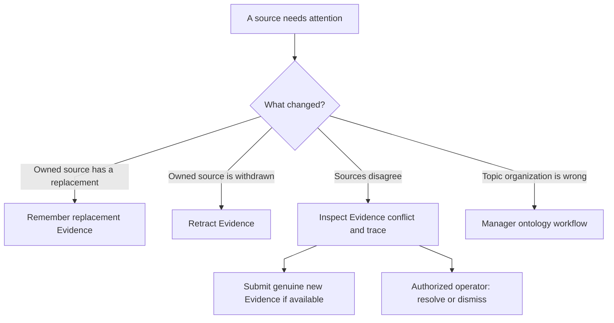
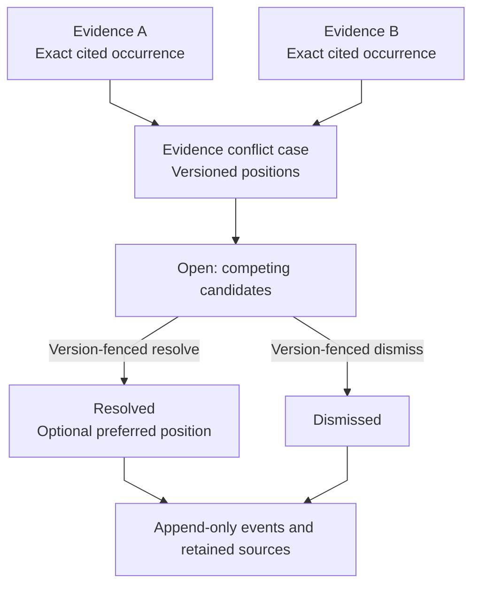

# Conflicts And Corrections

Correct memory by submitting exact replacement Evidence or retracting an owned source. Evidence conflicts preserve disagreement through exact quoted positions and append-only decisions.

## Choose The Workflow

Request fields and complete examples are in [Technical Reference](Technical-Reference). Lifecycle meaning is defined in [Evidence Model And Lifecycle](Evidence-Model-And-Lifecycle#lifecycle).

## Replace Owned Evidence

1. Trace the authorized Evidence ID and verify the current source and ownership.
2. Retain a fresh operation key and the exact replacement request.
3. Submit replacement text through `remember`, using either `supersedes_evidence_ids` or source revision advancement.
4. Inspect the terminal result and `superseded_evidence_ids`; trace the replacement when needed.

| Mechanism | Use when |
| --- | --- |
| Direct supersession | Replacing specific caller-owned Evidence IDs. |
| Source revision advancement | Updating a stable owner-scoped `source_key` using the expected previous revision token. |

Do not combine these mechanisms on one item. The accepted replacement, lifecycle history, search changes, and receipt commit together. Two independent retract/write calls do not provide atomic replacement.

A team reader can submit its own exact source but cannot supersede another owner's Evidence. A manager role does not transfer ordinary lifecycle ownership.

## Retract Owned Evidence

Use `retract_evidence` with owned Evidence IDs, a reason, and a retained operation key. It appends lifecycle history and removes current eligibility while retaining provenance. Resend only the unchanged original request when recovery permits.

Physical private erasure is a separate operation with generation fencing and legal-hold checks. See [Portals And API Keys](Portals-And-API-Keys#private-memory-erasure).

## Evidence Conflicts

Positions retain canonical Evidence IDs, exact occurrence IDs, original Unicode spans, server-derived quotes, and authority. A resolved preference is a conflict decision, not proof that source content is true. Resolving or dismissing does not rewrite Evidence text.

Recall exposes authorized open/resolved `kind: evidence_conflict` cases associated with eligible results. It reports bounded positions and truncation. A case is not exposed through a position whose source is outside the authorized eligible view. Source/lifecycle changes reconcile stale positions through server policy.

## Operator Inspection And Decision

The control portal's Evidence-conflict workspace uses these private first-party interfaces:

| Method and path | Purpose |
| --- | --- |
| `GET /control/api/teams/{teamId}/evidence-conflicts` | List cases by `open`, `resolved`, or `dismissed` status; default `open`. |
| `GET /control/api/teams/{teamId}/evidence-conflicts/{conflictId}` | Read one case and bounded event history. |
| `POST /control/api/teams/{teamId}/evidence-conflicts/{conflictId}/resolution` | Resolve or dismiss an open case. |

Lists use opaque keyset cursors and a limit of 1–100. Details support bounded event pagination. A resolution requires `expected_version`, `decision: resolve|dismiss`, and a nonempty reason of at most 512 characters; an optional preferred-position ID must be valid for the case.

Inspect exact quotes and provenance before deciding. A stale version or closed case returns conflict: reload before another deliberate action. This administrative workflow is not an additional public MCP resolution tool. There is no nightly authored-Relationship voting or last-write-wins workflow.

## Failure And Recovery

| Failure | Next step |
| --- | --- |
| Wrong owner or denied destination | Obtain the correct authority; do not bypass it with another ID. |
| Stale source revision | Refresh the source state before preparing a new request. |
| Unknown mutation outcome | Retry only the unchanged request/key when instructed. |
| Truncated trace | Report the missing history; do not invent a complete provenance chain. |

[Operations Runbook](Operations-Runbook) covers service failures; [Request Lifecycle And Security](Request-Lifecycle-And-Security) owns authorization.
