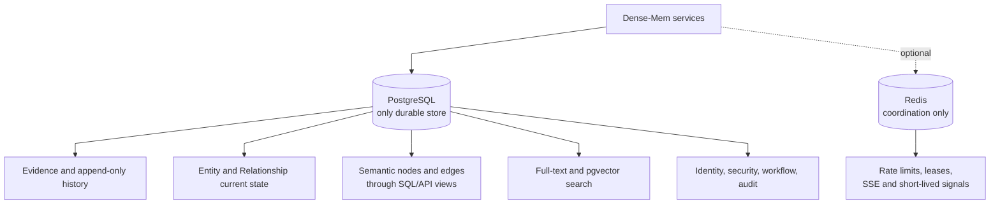
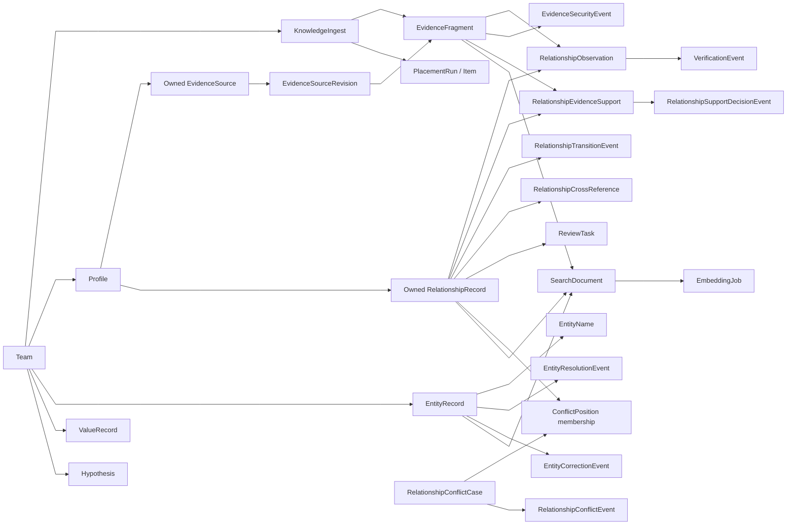
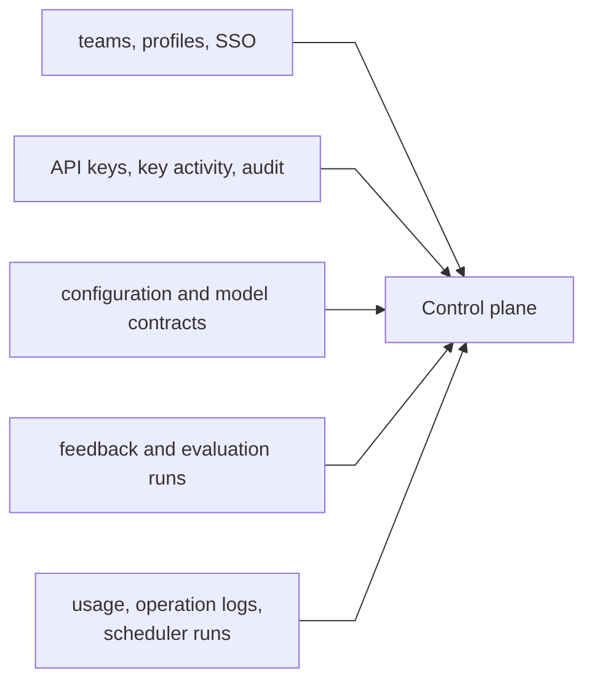
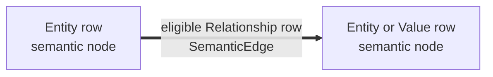
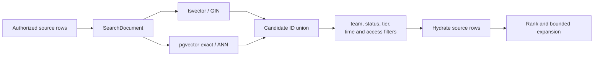
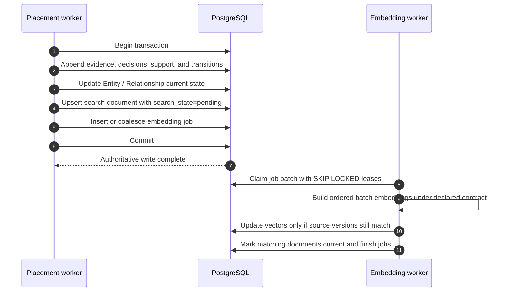
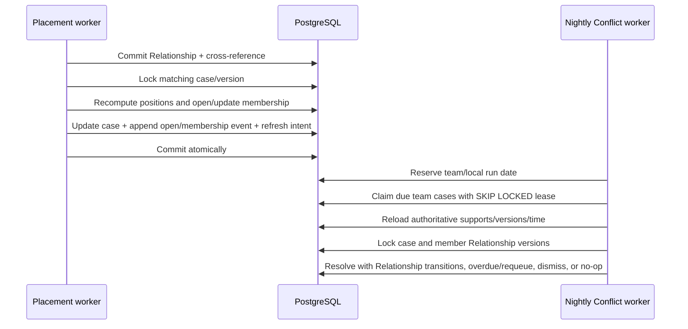
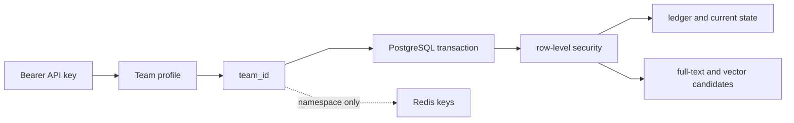
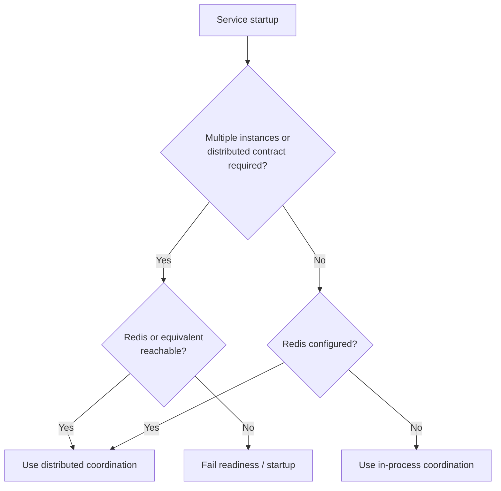

# Data Model And Storage

This page is the single source of truth for Dense-Mem's current storage
architecture. It defines the PostgreSQL and `pgvector` design for semantic
memory.

Tenant-owned primary/unique keys, composite foreign keys, table-placement
classes, team-local repository queries, RLS worker context, and future sharding
readiness belong only in
[PostgreSQL Cluster-Safe Schema](PostgreSQL-Cluster-Safe-Schema).

PostgreSQL is the only required database. It owns durable knowledge, workflow,
security state, graph-shaped reads, full-text search, and vector search.
`pgvector` is a PostgreSQL extension, not another source of truth. Redis is an
optional coordination layer and stores no memory.

## Store Responsibilities



| Component | Authoritative for | Must not own |
| --- | --- | --- |
| PostgreSQL | every durable knowledge, control, audit, and search record | nothing outside its tenant and authorization scope |
| `pgvector` | vector column types and indexes inside PostgreSQL | separate entity, Relationship, evidence, or lifecycle truth |
| Redis | bounded coordination state when configured | entities, Values, Relationships, evidence, verification, reviews, keys, or audit |
| In-process memory | the same coordination contracts for one process | anything required after restart or by another replica |

One process may use in-memory coordination. Multiple service instances require
Redis or another distributed implementation of the same coordination
interfaces. PostgreSQL remains the source of truth in either mode.

## Logical Planes


These are data responsibilities, not separate databases. Their canonical
Relationship terminology and lifecycle are defined in
[Relationship Model And Lifecycle](Relationship-Model-And-Lifecycle).

## PostgreSQL Model

The names below are the logical schema. Physical migrations may use
equivalent names, but must preserve each responsibility.



### Knowledge and workflow tables

| Logical table | One responsibility |
| --- | --- |
| `knowledge_ingests` | one accepted `remember` submission, idempotency identity, provenance, and processing state |
| `evidence_sources` | one stable team/source-owner-scoped source identity and its current revision pointer |
| `evidence_source_revisions` | append-only immutable source snapshots linked by expected previous-revision tokens |
| `evidence_fragments` | immutable verbatim evidence slices and their source envelope |
| `evidence_security_events` | append-only deterministic scan, model signal, quarantine, and authorized release history |
| `entity_records` | canonical team-scoped identities and current identity state |
| `entity_names` | canonical, alias, and former names attached to an Entity |
| `value_records` | canonical typed scalar endpoints |
| `entity_resolution_events` | append-only verifier and server decisions for evidence-local mentions |
| `entity_correction_events` | append-only merge, split, and reassignment decisions |
| `relationship_observations` | immutable extracted statements tied to exact evidence spans |
| `verification_events` | append-only schema-valid verifier judgments |
| `relationship_records` | one authored Relationship episode's current tier, status, validity, author, and version |
| `relationship_evidence_supports` | accepted, deduplicated evidence-span and source-group links |
| `relationship_support_decision_events` | append-only grant/revoke/reinstate decisions controlling effective support |
| `relationship_transition_events` | append-only tier/status/validity-bound history |
| `relationship_cross_references` | append-only same-team confirmation, challenge, correction, and evidence-adoption links between profile-owned Relationships |
| `review_tasks` | identity, predicate, same-owner Relationship conflict, correction, and policy decisions needing a client |
| `relationship_conflict_cases` | current team-scoped status, version, deadline, due/lease metadata, effective time, and preferred-position disposition for material cross-profile Relationship conflicts |
| `relationship_conflict_positions` | current bounded grouping of authored Relationship IDs/versions into equivalent case positions without merging ownership |
| `relationship_conflict_events` | append-only open, membership, evaluation, resolve, reopen, overdue, and dismiss history |
| `relationship_conflict_review_runs` | durable per-team/local-date nightly reservation, lease, retry, and bounded outcome counts |
| `hypotheses` | dream output isolated from active knowledge |
| `search_documents` | rebuildable compact text and vector-ready metadata for authorized retrieval |
| `embedding_jobs` | durable, leased work to bring a search document to the current embedding contract |
| `embedding_contracts` | versioned provider/model/dimension/document/normalization meaning for query and document vectors |
| `search_index_generations` | versioned pgvector physical index compatibility, build state, and active pointer |
| `placement_runs` / `placement_items` | observable processing workflow, retry, and failure state |

The exact Relationship identity, fields, and lifecycle belong only in
[Relationship Model And Lifecycle](Relationship-Model-And-Lifecycle). Entity
creation, reuse, ambiguity, merge, and split belong only in
[Entity Identity And Resolution](Entity-Identity-And-Resolution).

### Control-plane tables



Security and control records remain durable PostgreSQL rows. Tenant-owned
control/workflow rows use the same team contract as knowledge; authentication
discovery and other records needed before team resolution stay coordinator-
local as classified in
[PostgreSQL Cluster-Safe Schema](PostgreSQL-Cluster-Safe-Schema#table-placement-classes).
Redis never substitutes for either class.

## Semantic Nodes And Edges

The graph is a domain view over relational rows:



- Entity and typed Value are the only semantic-node kinds.
- An active `validated_claim` or `fact` Relationship is exposed as one
  `SemanticEdge`.
- Candidate Relationships, names, evidence, observations, verification events,
  reviews, transitions, and Hypotheses are not nodes or active edges.
- An alias is an `entity_names` row, not a Relationship.

The edge is an API/query shape, not another stored copy. For example:

```sql
CREATE VIEW semantic_edges AS
SELECT relationship_id, team_id, owner_profile_id, semantic_group_key,
       subject_entity_id, predicate_key,
       object_entity_id, object_value_id, polarity, valid_from, valid_to,
       tier, version
FROM relationship_records
WHERE status = 'active'
  AND tier IN ('validated_claim', 'fact');
```

The migration may implement this as a view, a reusable query, or a
security-barrier view. It must not materialize a second authoritative edge.

### Bounded graph expansion

Traversal is implemented with indexed adjacency queries or bounded recursive
CTEs. The hot recall path expands only configured seeds, fan-out, and depth; it
does not run arbitrary unbounded graph queries.

Representative indexes are:

```sql
CREATE INDEX relationship_active_subject_idx
  ON relationship_records (team_id, subject_entity_id, predicate_key)
  WHERE status = 'active'
    AND tier IN ('validated_claim', 'fact');

CREATE INDEX relationship_active_object_entity_idx
  ON relationship_records (team_id, object_entity_id, predicate_key)
  WHERE status = 'active'
    AND tier IN ('validated_claim', 'fact')
    AND object_entity_id IS NOT NULL;
```

The concrete schema must also enforce exactly one object kind and the canonical
Relationship-identity uniqueness rules.

## Search In PostgreSQL

`search_documents` contains compact, reconstructible text for eligible
Entities, Relationships, and evidence fragments. The source records remain
authoritative. A search hit is only a candidate ID and never evidence.



Search documents may retain a denormalized display string, but cannot own
semantic state. Deleting and rebuilding all search documents must not lose
knowledge.

Embedding/distance meaning, RRF, and final reranking belong only in
[Vector Search And Ranking](Vector-Search-And-Ranking). Exact/ANN execution,
HNSW, `halfvec`, and index topology belong only in
[ANN, HNSW, And Halfvec](ANN-HNSW-And-Halfvec).

### Embedding contract, search index, and freshness

The embedding provider adapter, model, dimensions, normalization, and document
format form one versioned embedding contract. Vector rows reference that
contract and carry a database-enforced matching dimension. A different active
contract is never compared with those rows.

A separate search-index generation references the embedding contract and owns
the cosine operator class, indexed cast, HNSW construction parameters, physical
index state, and active pointer. Issue #85 owns query-time ranking contracts for
exact/ANN thresholds and scan budgets. This separation allows reindexing without
provider calls and query tuning without reindexing. Field ownership and change
impact belong in
[ANN, HNSW, And Halfvec](ANN-HNSW-And-Halfvec#separate-versioned-contracts).

Each source aggregate exposes:

```text
search_state: not_required | pending | current | failed
search_document_version
embedding_contract_version
```

`search_state` describes derived retrieval readiness, not whether the knowledge
write committed. A Relationship can be authoritative and immediately
available to exact/full-text/adjacency reads while its new embedding is
pending.

### Write and embedding sequence



An older embedding job cannot overwrite a newer source version. A provider
failure records `failed` plus retry state; it does not roll back committed
knowledge or get hidden behind an in-memory fallback.

Embedding workers prefer bounded batching before worker parallelism. A batch
claim selects queued jobs for one team/work profile with `FOR UPDATE SKIP
LOCKED`, marks them processing with renewable leases, calls the provider's
ordered batch embedding API, and completes vector/document/job state in one
transaction. If a batch fails, the worker recursively splits the batch to
isolate bad or oversized documents instead of retrying every good document
together. Upserting an unchanged search document must not clear an existing
current vector or enqueue another embedding job.

### Vector storage consequence

Every search document carries `team_id`, source/document version, embedding
contract version, dimensions, and freshness state. Exact and approximate paths
must select candidate IDs under the same actor/team eligibility. Physical
index strategy, tenant filtering, partitioning/sharding, and single/cluster
behavior belong only in
[ANN, HNSW, And Halfvec](ANN-HNSW-And-Halfvec#single-database-and-cluster-topologies).
Relational tenant keys and query locality belong in
[PostgreSQL Cluster-Safe Schema](PostgreSQL-Cluster-Safe-Schema).
The release gate belongs in [Evaluation](Evaluation).

## Conflict Case And Nightly Review Storage

PostgreSQL owns durable Conflict workflow state. A case is team-scoped and has
no `owner_profile_id`; member Relationships remain profile-owned. Profile-mode
transactions may create caller-owned Relationships and cross-references, but
only the Conflict service may insert/update case materialization under the same
team transaction. Every material case change appends an immutable event with
the actor profile when client-triggered.



The due index begins with `(team_id, status, next_review_at)` and covers only
`open`/`overdue` rows. A material new position or newly independent support
increments the case version; duplicate evidence from an existing source group
does not extend the deadline. A nightly run reserves `(team_id,
local_run_date)` durably, claims bounded team-local batches with `FOR UPDATE
SKIP LOCKED`, and recovers expired leases. A stale claimed version becomes a
no-op and is re-evaluated from the current row rather than overwriting it.

The worker invokes the versioned deterministic resolver and calls no
model/provider. Failure leaves the case due and unresolved. A resolved case
updates the case row, appends the case event, sets losing Relationship
`status=superseded` and `valid_to`, appends Relationship transition events, and
enqueues rebuildable search/read-model work in one transaction. Final recall
checks current Relationship eligibility and the current Conflict case during
support-path hydration so a stale vector cannot reintroduce a suppressed current
path. The job never deletes evidence or changes support links, ownership, author
attribution, Entity resolution, or source history.

Conflict-case lifecycle and evidence policy belong in
[Conflicts And Corrections](Conflicts-And-Corrections#durable-team-conflict-cases).
Team/shard claim rules belong in
[PostgreSQL Cluster-Safe Schema](PostgreSQL-Cluster-Safe-Schema#durable-queue-and-scheduler-shape).

## Atomicity And Append-Only History

One PostgreSQL transaction commits each accepted semantic change:

1. the ingest and exact evidence
2. schema-valid verifier decisions
3. Entity/Value resolution events
4. Relationship observations, immutable support links, and support decisions
5. Relationship current-state changes and transition events
6. Conflict case/case-event changes when placement opens or updates a material
   disagreement
7. review work, search-document intent, and durable embedding jobs

If that transaction fails, none of the semantic change commits. Embedding
generation remains asynchronous because it is derived and can be retried.

A source-revision activation is a separate authoritative transaction. It
validates immutable source ownership and the exact prior-revision token, appends
the new revision, advances the current pointer, stages new fragments and their
scan assessment, revokes supports from the previous revision, recomputes every
affected Relationship tier/status and transition, supersedes outstanding prior
revision placement/search intent, and updates current search intent. The new
evidence may remain queued or quarantined after commit; the prior revision is
already ineffective. Placement and search writes require a matching current
source revision so an in-flight stale worker cannot restore it.

Source activation discovers affected Relationships through indexed
fragment/support dependencies. The service precomputes a server-defined hard
fanout bound and aborts before changing the current pointer when the bound would
be exceeded. It never batches one source activation into partially visible
semantic states.

Evidence source revisions, evidence fragments, security events, material
verification events, support links, support decision events, resolution events,
correction events, and Relationship transitions are append-only.
Corrections append decisions and update current-state rows in the same
transaction; they do not rewrite the original evidence.

Database permissions, constraints, or triggers must prevent application roles
from mutating records designated append-only.

## Entity And Relationship Constraints

`entity_records.entity_id` is opaque and stable. It is neither display text nor
a hash of a name. `(team_id, normalized_name)` is a lookup key, never a
uniqueness rule, because homonyms are valid.

Repeated accepted evidence from one profile attaches to that owner's canonical
Relationship identity. It does not insert a parallel semantic edge for the same
owner. Equivalent Relationships from another profile remain separately owned
and are grouped by `semantic_group_key` during recall. Compact current counts
may live on the Relationship row; exact evidence and verifier history remain
normalized and are fetched only for trace.

Representative constraints include:

```text
Entity identity       UNIQUE (team_id, entity_id)
Value identity        UNIQUE (team_id, value_id)
Value canonical       UNIQUE NULLS NOT DISTINCT (team_id, value_type, canonical_value, unit, normalization_version)
Stable external ID    UNIQUE (team_id, namespace, external_id)
Source identity       UNIQUE (team_id, source_owner_profile_id, source_key)
Source revision       UNIQUE (team_id, source_id, source_revision)
Support identity      UNIQUE (team_id, relationship_id, fragment_id, start_offset, end_offset)
Relationship identity UNIQUE NULLS NOT DISTINCT (team_id, owner_profile_id, subject_entity_id, predicate_key, object_entity_id, object_value_id, polarity, valid_from, scope_key)
Cross-reference       UNIQUE (team_id, author_profile_id, source_relationship_id, target_relationship_id, kind, verification_event_id)
```

The Relationship uniqueness key is defined in
[Relationship Model And Lifecycle](Relationship-Model-And-Lifecycle#relationship-identity).
`valid_to` is mutable episode-closure state and is excluded from uniqueness.
Cross-reference constraints additionally require both Relationships to share
the row's team and the source Relationship owner to equal `author_profile_id`.
An Evidence source has one immutable owner and one current-revision pointer.
Advancement uses compare-and-set against `previous_source_revision`; explicit
fragment supersession may name only fragments owned by that source principal.

## Predicate Registry Storage

Predicate definitions are versioned PostgreSQL records. The registry owns
canonical keys, aliases, allowed endpoint kinds, `relationship_kind`,
`current_cardinality`, lifecycle state, and version.

Global built-ins seed per-team `team_predicate_definitions`. Provider-backed
extraction may propose team-local predicate candidates, but PostgreSQL
normalization, RLS, append-only versioning, and the strict verifier contract
decide whether a candidate can be referenced. Providers cannot directly mutate
Relationship lifecycle or active graph state.

The registry may grow without a fixed vocabulary ceiling. Extraction receives
only a bounded evidence-relevant subset. Commit resolution checks the complete
team registry under a team/key transaction lock. A compatible existing
definition is reused; a safe novel definition and its Relationship commit
atomically. Alias/key ambiguity or kind incompatibility produces task-backed
review without expanding an existing definition's endpoint allowlist.

The registry does not contain `policy_family`. The
canonical contract and unknown-predicate behavior are defined in
[Relationship Model And Lifecycle](Relationship-Model-And-Lifecycle#predicate-registry).

## Tenant And Actor Isolation

The team is the durable visibility boundary. A team profile is an authenticated
actor with roles and scopes inside that team. Same-team reads may see every
profile's eligible knowledge; ordinary lifecycle/support mutations require
`owner_profile_id = app.current_profile_id`. The system Conflict reviewer uses a
separate transaction-local actor and may update only losing member Relationship
`status`/`valid_to` fields selected by a locked resolved case.



Application queries run in explicit transactions with transaction-local values
such as:

```text
app.current_team_id = <authenticated team UUID>
app.current_profile_id = <authenticated profile UUID>
app.tx_mode = team
```

System workers use a separate, non-request-selectable transaction mode.
Payloads and headers cannot replace the authenticated team. RLS applies to
search documents and vector queries as well as source tables.

Redis namespacing prevents accidental key collisions; it is not an
authorization boundary. Authorization occurs before a coordination operation.

## Redis Availability



Redis may hold rate-limit counters, short leases, cleanup signals, and SSE
concurrency state. Losing Redis may reset or reacquire those operations, but
must never lose or change memory.

Redis-backed and process-local coordination are alternative implementations of
one contract; a replica must not apply both independent counters or leases.
When Redis is selected, every replica uses it for the distributed operation.
Small process-local caches of immutable/versioned predicate or configuration
lookups may still exist, but they cannot cache canonical Entity/Relationship
writes or bypass PostgreSQL version and authorization checks.

## Backup, Recovery, And Maintenance

PostgreSQL backups plus write-ahead-log archiving are the complete durable
recovery source. `pgvector` columns and indexes participate in the same
database backup and recovery process. Redis is excluded from memory recovery.

Recovery order:

1. restore PostgreSQL, WAL, and encryption material
2. validate migrations, extensions, RLS, embedding contracts, and active
   search-index generations
3. verify append-only and semantic uniqueness constraints
4. resume or rebuild search documents and vectors when required
5. compare approximate Recall@K with exact filtered search
6. restore distributed coordination before enabling multiple instances
7. enable traffic after write, recall, and tenant-isolation smoke tests pass

Operational maintenance includes PostgreSQL vacuum/analyze, vector-index
health, job backlog, failed embeddings, query latency, and backup restore
drills. Runbook commands belong in
[Operations Runbook](Operations-Runbook), not here.

## Risks And Mitigations

| Risk | Concrete failure mode | Mitigation |
| --- | --- | --- |
| Filtered ANN misses | a storage/index plan returns global neighbors before the team filter and omits relevant team rows | enforce team-shaped exact/ANN and topology contracts from [ANN, HNSW, And Halfvec](ANN-HNSW-And-Halfvec) |
| Hot adjacency query | a high-degree Entity produces too many rows and exhausts latency or memory | partial adjacency indexes plus strict seed, fan-out, depth, and result caps |
| Duplicate identity | two people named Mark are merged because name text is treated as an ID | opaque IDs, non-unique name lookup, contextual verification, ambiguity review, and client-confirmed split |
| Duplicate Relationship | repeated same-owner evidence inserts parallel semantic edges | owner-scoped canonical identity uniqueness plus transactional upsert and deduplicated support |
| Async search gap | a committed correction is missing from vector recall while embedding is pending | exact/full-text/adjacency eligibility immediately, explicit `search_state`, job SLOs, and version checks |
| Tenant leak | a shared vector or adjacency query returns another team's row | RLS, team-leading indexes, transaction-local actor context, and authorization again on hydration |
| Redis becomes hidden storage | a restart loses an identity decision held only in cache | coordination-only interfaces and restart tests proving all memory survives Redis loss |
| Source owner invalidates another profile's basis | an unowned source key or fragment ID revokes adopted support | immutable source ownership, composite source/fragment checks, exact prior-revision compare-and-set, and append-only audit |
| Source activation partially demotes knowledge | a large dependency set commits some revocations before failure | precompute indexed dependencies, enforce a fanout bound, and advance the source pointer only in the all-or-nothing transaction |
| Stale placement resurrects an old revision | an in-flight provider result commits after a newer source pointer advances | supersede prior placement/search intent atomically and predicate later commits on the current source revision |
| Security audit leaks detector internals | public placement or metrics reveal exact rules and attacker payloads | keep detailed signals in authorized audit rows and expose only bounded categories externally |
| Conflict lease decides truth | a timed-out worker marks B preferred while its lease/version is stale | lease/version predicates, deterministic recomputation, and append event only with the matching current case |
| Search refresh races disposition | an older vector job makes A primary after B resolves | authoritative Conflict filtering at hydration plus versioned rebuildable refresh work |

## Storage Invariants

1. PostgreSQL contains every durable knowledge and control record.
2. `pgvector` is an indexed column capability inside that source of truth.
3. Redis and process memory contain no canonical memory.
4. Entity and typed Value are the only semantic-node kinds.
5. One eligible profile-owned Relationship is returned as at most one
   SemanticEdge.
6. Candidates and Hypotheses are not active edges.
7. Search hits and graph context never count as source evidence.
8. Append-only evidence and decision history cannot be rewritten by normal
   application code.
9. Every source and search query is actor-authorized and team-scoped.
10. Embedding mismatch or failure is explicit and cannot corrupt semantic
    state.
11. Losing all derived search documents does not lose knowledge.
12. Embedding contracts and search-index generations have separate versions and
    rebuild lifecycles.
13. Runtime has no secondary durable knowledge-store dependency.
14. Same-team reads can see eligible knowledge from every profile, while normal
    mutations require the caller to own the target record.
15. One Evidence source has one immutable owner and one current revision.
16. A source revision advances only when its expected prior token matches.
17. Every revision of one Evidence source retains one server-derived source
    group for independence counting.
18. Source activation, prior-support revocation, affected lifecycle transitions,
    and search intent commit atomically or not at all.
19. Evidence security history is append-only, and quarantined evidence has no
    semantic or search document.
20. A non-current source revision cannot commit placement or search state after
    a newer revision activates.
21. Conflict cases are team-scoped workflow state and never own or mutate a
    member Relationship's evidence/lifecycle.
22. Every case materialization change has one append-only event and matching
    case-version compare-and-set.
23. Nightly review claims only bounded team-local due work, recovers leases, and
    cannot resolve from a deadline or provider/model output.
24. Stale search state cannot bypass the current Conflict disposition applied at
    final support-path hydration.
