# Data Model And Storage

This page is the single source of truth for Dense-Mem's current storage
architecture. It defines the PostgreSQL and `pgvector` design for semantic
memory.

Tenant-owned primary/unique keys, composite foreign keys, table-placement
classes, team-local repository queries, RLS worker context, and future sharding
readiness belong only in
[PostgreSQL Cluster-Safe Schema](PostgreSQL-Cluster-Safe-Schema).

PostgreSQL is the only required database. It owns durable knowledge, workflow,
security state, graph-shaped reads, full-text search, and vector search.
`pgvector` is a PostgreSQL extension, not another source of truth. Redis is an
optional coordination layer and stores no memory.

## Store Responsibilities

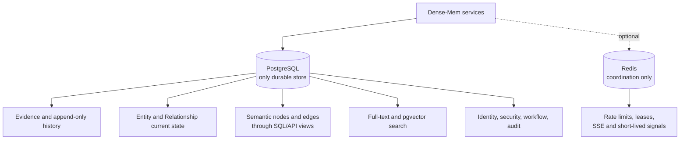

| Component | Authoritative for | Must not own |
| --- | --- | --- |
| PostgreSQL | every durable knowledge, control, audit, and search record | nothing outside its tenant and authorization scope |
| `pgvector` | vector column types and indexes inside PostgreSQL | separate entity, Relationship, evidence, or lifecycle truth |
| Redis | bounded coordination state when configured | entities, Values, Relationships, evidence, verification, reviews, keys, or audit |
| In-process memory | the same coordination contracts for one process | anything required after restart or by another replica |

One process may use in-memory coordination. Multiple service instances require
Redis or another distributed implementation of the same coordination
interfaces. PostgreSQL remains the source of truth in either mode.

## Logical Planes

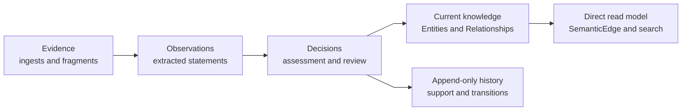

These are data responsibilities, not separate databases. Their canonical
Relationship terminology and lifecycle are defined in
[Relationship Model And Lifecycle](Relationship-Model-And-Lifecycle).

## PostgreSQL Model

The names below are the logical schema. Physical migrations may use
equivalent names, but must preserve each responsibility.

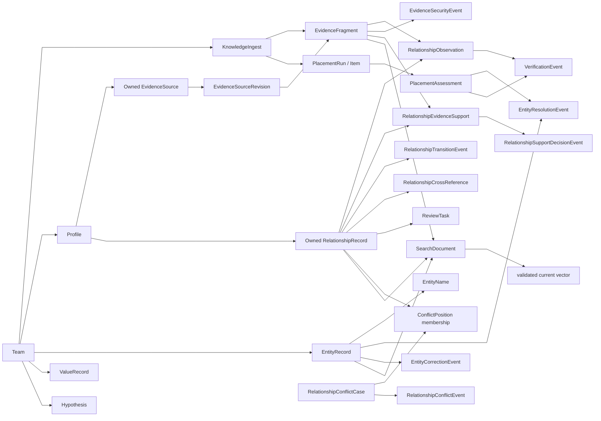

### Knowledge and workflow tables

| Logical table | One responsibility |
| --- | --- |
| `knowledge_ingests` | historical ingest lineage retained for migration and canonical provenance |
| `remember_attempts` | append-only terminal Remember outcome, idempotency identity, safe replay result, counts, and failure metadata |
| `remember_attempt_events` | append-only chronological validation, assessor, embedding, and commit events |
| `remember_failure_artifacts` | failure-only control artifacts with seven-day physical retention |
| `evidence_sources` | one stable team/source-owner-scoped source identity and its current revision pointer |
| `evidence_source_revisions` | append-only immutable source snapshots linked by expected previous-revision tokens |
| `evidence_fragments` | immutable verbatim evidence slices and their source envelope |
| `evidence_security_events` | append-only scan and assessor-signal metadata for accepted or quarantined request-local evidence; deterministic pre-provider rejection records only a bounded safe audit event and there is no raw quarantine payload or release path |
| `entity_records` | canonical team-scoped identities and current identity state |
| `entity_names` | canonical, alias, and former names attached to an Entity |
| `value_records` | canonical typed scalar endpoints |
| `entity_resolution_events` | append-only assessor and server decisions for evidence-local mentions |
| `entity_correction_events` | append-only merge, split, and reassignment decisions |
| `relationship_observations` | immutable extracted statements tied to exact evidence spans |
| `semantic_assessments` | append-only complete assessor response history keyed by a terminal Remember attempt |
| `predicate_registration_events` | append-only provenance for server-controlled predicate creation or reuse during a submission-wide semantic transaction |
| `verification_events` | append-only Relationship judgments derived from persisted schema-valid assessor results |
| `relationship_records` | one authored Relationship episode's current status, effective support, validity, author, and version |
| `relationship_evidence_supports` | accepted, deduplicated evidence-span and source-group links |
| `relationship_support_decision_events` | append-only grant/revoke/reinstate decisions controlling effective support |
| `relationship_transition_events` | append-only status/validity-bound history |
| `relationship_cross_references` | append-only same-team confirmation, challenge, correction, and evidence-adoption links between profile-owned Relationships |
| `review_tasks` | inert historical audit rows for retired placement decisions and older policy/correction records; v2.6 Remember creates no review task or client approval state |
| `relationship_conflict_cases` | current team-scoped status, version, deadline, due/lease metadata, effective time, and preferred-position disposition for material cross-profile Relationship conflicts |
| `relationship_conflict_positions` | current bounded grouping of authored Relationship IDs/versions into equivalent case positions without merging ownership |
| `relationship_conflict_events` | append-only open, membership, evaluation, resolve, reopen, overdue, and dismiss history |
| `relationship_conflict_review_runs` | durable per-team/local-date nightly reservation, lease, retry, and bounded outcome counts |
| `relationship_conflict_ai_assessment_attempts` / `_events` | durable reservation/completion state plus append-only audit for one bounded overdue verifier assessment per case version, model, policy, and local date; stores only safe outcome metadata and a response hash |
| `relationship_conflict_resolution_plans` | version-CAS resolution intent, method, effective-time basis, and `resolution_pending`/applied state so a high-fanout case has no partial lifecycle changes |
| `relationship_conflict_evidence_derivations` | immutable lineage from a retracted losing fragment to its system-owned deletion-only replacement fragment |
| `relationship_conflict_derived_evidence_tasks` | durable leased retry state, atomically created with a resolution for each retracted losing fragment before its deletion-only replacement is staged |
| `hypotheses` | dream output isolated from active knowledge |
| `search_documents` | rebuildable compact text and vector-ready metadata for authorized retrieval |
| `embedding_contracts` | versioned provider/model/dimension/normalization/query meaning shared by compatible query and document vectors |
| `search_projection_generations` | per-team, per-source-kind text projection convergence and vector activation state |
| `search_index_generations` | versioned pgvector physical index compatibility, build state, and active pointer |
| `placement_runs` / `placement_items` | historical migration input only; never created by current Remember |
| `remember_attempts` / `remember_attempt_events` | append-only terminal Remember outcome and safe chronological event history |
| `semantic_assessments` | immutable accepted assessor response history keyed by the request ingest |
| `submission_relationship_results` | one stored/not_stored disposition per submitted Relationship ref, including canonical split mappings |

Current writes do not create embedding jobs. Search documents and their
validated vectors are committed together with canonical semantics. The retained
document-centric reconciliation history compares expected/current hashes and
versions for legacy drift without restoring a normal queue or worker.

Failure artifacts are isolated from normal profile reads. Only audited control
or migration transactions may read or purge their bytes after seven days;
attempt/event metadata and hashes remain. This path never exposes raw provider,
credential, or evidence payloads to a normal profile request.

### Persisted assessment and semantic review shape

`semantic_assessments` is the current append-only boundary between provider
work and authoritative commit. The older `placement_assessments` shape is
retained only as migration input. The current row is keyed by the request
ingest and stores the complete validated response history:

```text
team_id
semantic_assessment_id
attempt_id = ingest_id
owner_profile_id
response_history: JSON array of complete validated responses
accepted_revision
provider_turns
model
tokenizer
input_tokens / output_tokens / candidate_context_tokens
candidate_context_truncated
response_hash
validated_at
created_at

UNIQUE (team_id, attempt_id)
```

Each history entry contains only fields accepted by the closed assessor
schema. It does not repeat request evidence, provider transport metadata, or
secrets. One response history covers every evidence item and relationship ref
in the request, including multiple relationships that cite the same evidence
index. The terminal commit verifies immutable team/profile/ingest and search
fences before writing semantic rows; no placement worker or public status reader
is involved. Historical placement assessments and response revisions are copied
into this shape by the stopped-service cutover and are never reinterpreted by
the current write path.

V2.4 adds nullable audit fields to `verification_events` for
`assessment_id`, `assessment_policy_version`, `threshold_used`, and
`gate_result`. They remain null on legacy rows. `gate_result` is one of
`meets_write_threshold`, `below_write_threshold`, or `not_applicable`.

Historical `review_tasks` rows may contain public-safe questions, bounded
options, guidance, old task types, and expiry metadata. They are retained only
for audit and are not a current client workflow: v2.6 has no task expiry worker,
approval action, or Remember writer for this table. Security quarantine,
caller-owned correction, and cross-profile Conflict cases use their dedicated
workflows. The v2.6 `remember` path stores the complete assessor response and
per-ref dispositions, then either promotes accepted effects atomically or ends
as `rejected` (`no_supported_memory` or `stale_input`) or a typed operational
`failed` outcome. There is no `submission_holds` table, hold projection,
approval state, replacement slot, or successor link.

### Historical v2.5 restart and pre-v2.6.1 staging boundary

Migration `20260821160001_remember_normalizer` and the pre-v2.6.1 staging
boundary are historical upgrade archaeology. They terminalized unfinished old
Remember work and preserved completed canonical state; the current release does
not resume those rows. The old implementation inserted evidence plus source and
supersession intent before provider work, then deferred lifecycle, Relationship,
search, and embedding effects. v2.6.1 removes those intent tables and performs
the complete provider/plan/embed/fenced-commit sequence in the originating
request.

The exact Relationship identity, fields, and lifecycle belong only in
[Relationship Model And Lifecycle](Relationship-Model-And-Lifecycle). Entity
creation, reuse, ambiguity, merge, and split belong only in
[Entity Identity And Resolution](Entity-Identity-And-Resolution).

### Control-plane tables

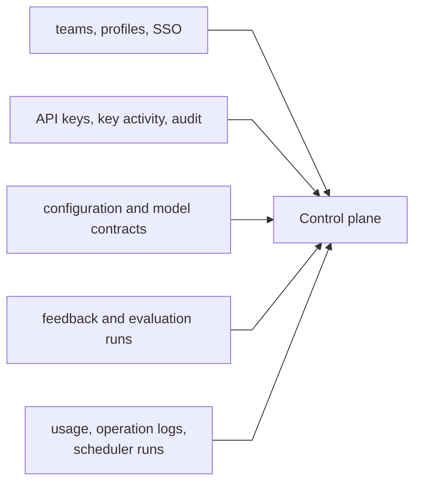

Security and control records remain durable PostgreSQL rows. Tenant-owned
control/workflow rows use the same team contract as knowledge; authentication
discovery and other records needed before team resolution stay coordinator-
local as classified in
[PostgreSQL Cluster-Safe Schema](PostgreSQL-Cluster-Safe-Schema#table-placement-classes).
Redis never substitutes for either class.

## Semantic Nodes And Edges

The graph is a domain view over relational rows:

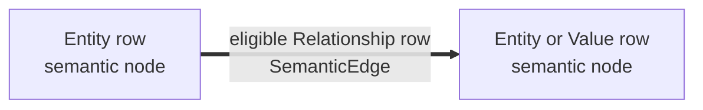

- Entity and typed Value are the only semantic-node kinds.
- An active Relationship with effective support is exposed as one
  `SemanticEdge`.
- Inactive Relationships, names, evidence, observations, verification events,
  reviews, transitions, and Hypotheses are not nodes or active edges.
- An alias is an `entity_names` row, not a Relationship.

The edge is an API/query shape, not another stored copy. For example:

```sql
CREATE VIEW semantic_edges AS
SELECT relationship_id, team_id, owner_profile_id, semantic_group_key,
       subject_entity_id, predicate_key,
       object_entity_id, object_value_id, polarity, valid_from, valid_to,
       effective_support_count, version
FROM relationship_records
WHERE status = 'active'
  AND effective_support_count > 0;
```

The migration may implement this as a view, a reusable query, or a
security-barrier view. It must not materialize a second authoritative edge.

### Bounded graph expansion

Traversal is implemented with indexed adjacency queries or bounded recursive
CTEs. The hot recall path expands only configured seeds, fan-out, and depth; it
does not run arbitrary unbounded graph queries.

Representative indexes are:

```sql
CREATE INDEX relationship_active_subject_idx
  ON relationship_records (team_id, subject_entity_id, predicate_key)
  WHERE status = 'active'
    AND effective_support_count > 0;

CREATE INDEX relationship_active_object_entity_idx
  ON relationship_records (team_id, object_entity_id, predicate_key)
  WHERE status = 'active'
    AND effective_support_count > 0
    AND object_entity_id IS NOT NULL;
```

The concrete schema must also enforce exactly one object kind and the canonical
Relationship-identity uniqueness rules.

## Search In PostgreSQL

`search_documents` contains compact, reconstructible text for eligible
Entities, Relationships, and evidence fragments. The source records remain
authoritative. A search hit is only a candidate ID and never evidence.

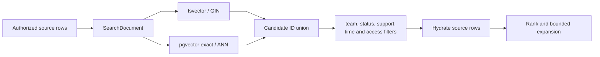

Search documents may retain a denormalized display string, but cannot own
semantic state. Deleting and rebuilding all search documents must not lose
knowledge.

Embedding/distance meaning, RRF, and final reranking belong only in
[Vector Search And Ranking](Vector-Search-And-Ranking). Exact/ANN execution,
HNSW, `halfvec`, and index topology belong only in
[ANN, HNSW, And Halfvec](ANN-HNSW-And-Halfvec).

### Embedding contract, search index, and freshness

The embedding provider adapter, model, dimensions, normalization, and query
construction form one versioned numerical embedding contract. Vector rows
reference that contract and carry a database-enforced matching dimension. A
different active contract is never compared with those rows.

Text projection meaning is versioned separately per `source_kind`.
`search_documents.projection_format_version` identifies the renderer that
produced the indexed text. This separation permits a Relationship-only semantic
text rewrite without changing Evidence text, query construction, vector
dimensions, distance meaning, or the active HNSW index generation.

A separate search-index generation references the embedding contract and owns
the cosine operator class, indexed cast, HNSW construction parameters, physical
index state, and active pointer. The query-time ranking contract defines
exact/ANN thresholds and scan budgets. This separation allows reindexing without
provider calls and query tuning without reindexing. Field ownership and change
impact belong in
[ANN, HNSW, And Halfvec](ANN-HNSW-And-Halfvec#separate-versioned-contracts).

Each source aggregate exposes:

```text
search_state: not_required | current
search_document_version
projection_format_version
embedding_contract_version
```

`search_state` is part of the canonical write fence. A completed Remember or
correction never exposes a required document as pending or failed; a late fence
race returns `commit_conflict` with zero semantic commit.

### Write and embedding sequence

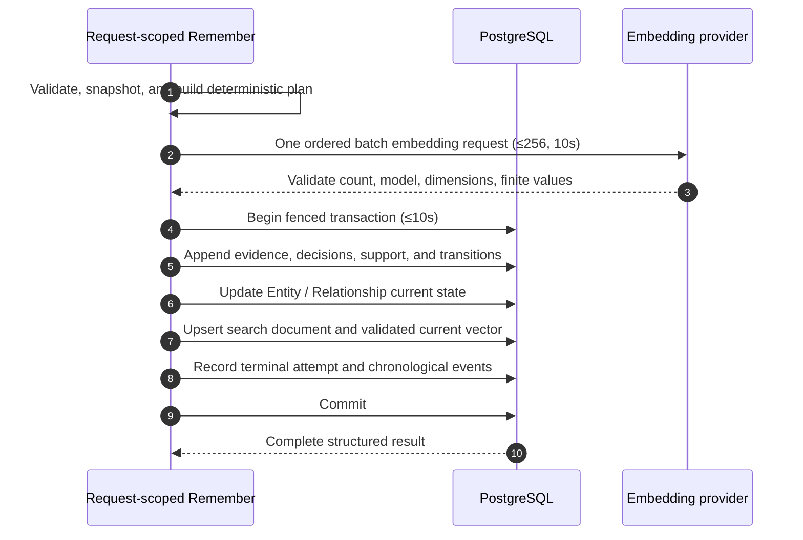

Provider failure prevents canonical commit and is returned as a structured
operational error. Version fences ensure a concurrent writer cannot overwrite a
newer source or vector. Reconciliation is document-centric and repairs legacy
drift only; it does not recreate a normal embedding queue.

### Relationship projection generation

Relationship projection format `2` makes Relationship text semantic instead of
identifier-heavy:

```text
relationship
subject: Mark Huang
predicate: works on
object: Dense-Mem
polarity: positive
scope: dense-mem project
valid_from: 2026-07-01T00:00:00Z
```

The renderer uses canonical Entity names, registered predicate wording and
aliases, canonical typed Value display and unit, polarity, supported scope, and
validity. It omits absent optional lines. It does not include database IDs,
profile or owner identity, `semantic_group_key`, support/source counts,
authority, lifecycle status, verification rationale, or Evidence text.

Each Relationship search document stores at least:

```text
team_id
source_kind = relationship
source_id = relationship_id
projection_format_version = 2
search_text
search_text_hash
document_version
search_state
embedding_contract_version
vector
```

`search_projection_generations` records the release convergence boundary:

```text
generation_id
team_id
source_kind
projection_format_version
state: projecting_text | embedding | current | failed
eligible_count
projected_count
current_vector_count
drifted_count
last_projected_relationship_id
last_error
started_at
activated_at
```

Current writes do not create `embedding_jobs`. Historical projection generations
may retain migration metadata, but current convergence compares document hashes,
source versions, vector presence, and dimensions directly.

#### Historical upgrade sequence

The following V2.4 projection migration is retained for historical recovery
and does not describe current v2.6.1 writes. Current writes use the inline
plan → embed → fenced-commit boundary above; they do not enqueue jobs.

The migration is text-first and vector-async:

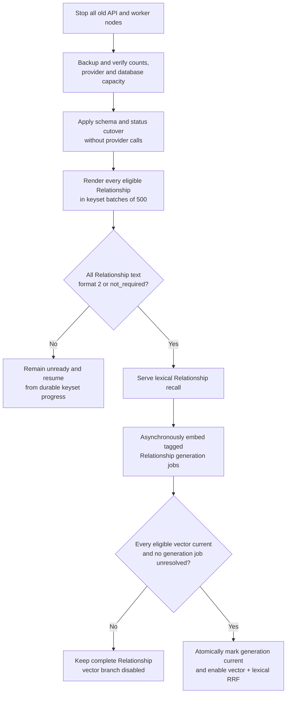

1. **Exclusive restart.** Stop every node that can write Relationship,
   search-document, or embedding state. Take a restorable PostgreSQL backup.
   Record per-team Relationship eligibility counts, Relationship search-state
   counts, Evidence document/vector counts and hashes, active embedding
   contract, active search-index generation, and outstanding job counts.
   Confirm embedding-provider quota and PostgreSQL headroom for the backfill.
2. **Schema and lifecycle cutover.** Apply the Relationship schema/status
   migration, add projection-version and generation fields, and create one
   format-2 Relationship generation per team. This phase makes no embedding
   provider call and changes no Evidence search document or vector.
3. **Pre-serve text projection.** A single release migrator holds the
   application-level projection lock. It scans Relationships with the durable
   keyset `(team_id, relationship_id)` in batches of `500`.
   `status=active` plus effective support renders and upserts format `2`; a
   changed text hash increments `document_version`, sets `search_state=pending`,
   clears vector eligibility, and inserts or coalesces one generation-tagged
   embedding job. An ineligible Relationship becomes `not_required`, and stale
   jobs for its prior document version cannot complete.
4. **Resume safely.** The generation row stores projected counts and the last
   completed keyset. Restarting the migrator repeats the last bounded batch
   safely through hash comparison and job coalescing. Any renderer, constraint,
   or batch failure records the error and keeps readiness closed.
5. **Open traffic after text convergence.** Readiness opens only when every
   Relationship is either a valid format-2 searchable document or
   `not_required`. The convergence transaction changes generation state to
   `embedding`. Relationship lexical recall is then complete. Evidence lexical
   and vector recall remains under its existing freshness rules.
6. **Drain vectors asynchronously.** Existing embedding workers process the
   tagged Relationship jobs with their normal leases, retry limits, ordered
   provider batches, recursive failure isolation, and document-version fence.
   They use the unchanged provider/model/dimensions/normalization/query
   contract and write into the existing active vector column and index.
7. **Activate as one team-wide gate.** A generation becomes `current` only
   when every eligible format-2 Relationship document has a current vector,
   every ineligible Relationship is `not_required`, and no tagged job is
   queued, processing, or failed. The final count check and state transition
   occur in one transaction. Until then, the entire Relationship vector branch
   for that team is disabled; recall reports lexical-only degradation.

Foreground Relationship changes can occur after traffic resumes. They create
ordinary pending jobs and use lexical recall while their individual vectors are
pending or failed. They do not reopen or redefine the completed release
generation. A new release projection format requires a new generation.

#### Queue fairness

Release backfill shares the durable queue with normal embedding work. A claim
reserves at least one available slot for each non-empty class, then fills the
remaining batch foreground-first. This prevents the generation from starving
live writes and prevents continuous live writes from blocking convergence.
Workers immediately claim another batch while backlog remains; the idle poll
interval applies only when no claimable work exists.

#### Index and maintenance consequence

The Relationship renderer changes document text, not the numerical embedding
contract or physical search-index contract. The migration therefore creates no
new HNSW generation and never re-embeds Evidence or Entity documents. Setting a
Relationship document to `pending` removes its old vector from vector
eligibility; completing the matching job inserts the replacement under the same
active contract.

After convergence, run `VACUUM (ANALYZE)` on affected search/job tables.
`REINDEX CONCURRENTLY` is conditional on measured index bloat or degraded ANN
quality; it is not a required part of the projection migration.

#### Rollback boundary

The old application and the pre-migration PostgreSQL backup are one rollback
unit. Do not start old binaries against the migrated schema, start new binaries
against a restored old schema, or run old and new workers together. A rollback
restores the backup and the matching application release before traffic opens.

### V2.4 integrated-assessor placement migration

V2.4 follows the Relationship/search cutover. It changes
write-time assessment and review workflow, not stored Relationship meaning,
search projection text, or the numerical embedding contract. This section is
historical migration context only: the V2.5 restart boundary below does not
resume its semantic review workflow or expiry behavior.

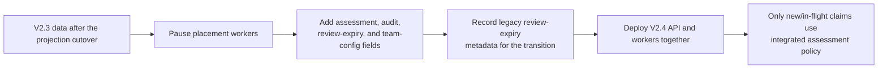

The release migration must:

1. verify the projection cutover is complete and record counts for ingests, placement items,
   VerificationEvents, Relationship statuses/supports, review tasks, search
   documents, vectors, and embedding jobs
2. pause placement workers and prevent mixed V2.3/V2.4 placement execution
3. add `placement_assessments`, stable claim keys, nullable assessment audit
   fields, the bounded team threshold override, and semantic review expiry
   fields without rewriting existing semantic rows
4. record the historical seven-day expiry metadata for unresolved semantic
   reviews (`open` or `acknowledged`); leave resolved/canceled/expired tasks,
   security quarantine, and Conflict cases unchanged
5. deploy the API and workers using the integrated-assessor contract, then
   resume claims; an in-flight item with no persisted valid assessment opens
   one bounded conversation per durable provider attempt, while one with a
   valid persisted assessment resumes from that row
6. reconcile the before/after counts and prove that Relationship
   status/support, evidence, search-document hashes, vectors, embedding jobs,
   and active embedding/index contracts did not change

The migration makes no model call, recomputes no confidence, changes no
Relationship status or support, and does not reinterpret legacy
VerificationEvents. It does not enqueue embedding jobs or re-embed
Relationships, Evidence, or Entities. V2.4 leaves
`projection_format_version`, rendered search text, and embedding inputs
unchanged; therefore any re-embedding performed for the projection migration
belongs to that migration, not this migration.

Rollback is valid only before V2.4 writes are admitted. After traffic resumes,
restore the pre-cutover database and matching application release together
rather than running V2.3 workers against persisted V2.4 claims.

### Vector storage consequence

Every search document carries `team_id`, source/document version, embedding
contract version, dimensions, and freshness state. Exact and approximate paths
must select candidate IDs under the same actor/team eligibility. Physical
index strategy, tenant filtering, partitioning/sharding, and single/cluster
behavior belong only in
[ANN, HNSW, And Halfvec](ANN-HNSW-And-Halfvec#single-database-and-cluster-topologies).
Relational tenant keys and query locality belong in
[PostgreSQL Cluster-Safe Schema](PostgreSQL-Cluster-Safe-Schema).
The release gate belongs in [Evaluation](Evaluation).

## Conflict Case And Nightly Review Storage

PostgreSQL owns durable Conflict workflow state. A case is team-scoped and has
no `owner_profile_id`; member Relationships remain profile-owned. Profile-mode
transactions may create caller-owned Relationships and cross-references, but
only the Conflict service may insert/update case materialization under the same
team transaction. Every material case change appends an immutable event with
the actor profile when client-triggered.

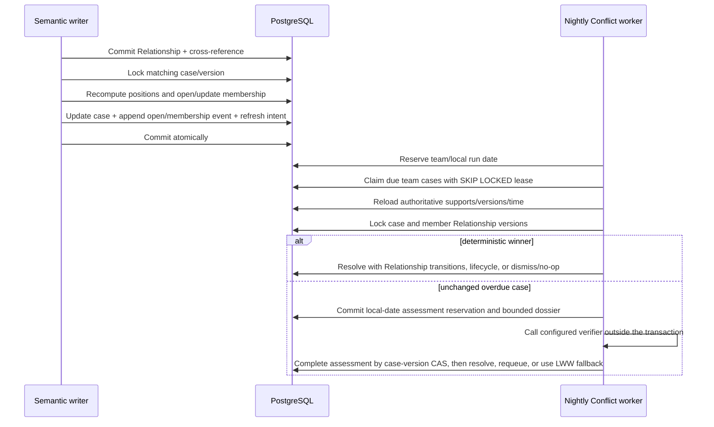

The due index begins with `(team_id, status, next_review_at)` and covers only
`open`/`overdue` rows. A material new position or newly independent support
increments the case version; duplicate evidence from an existing source group
does not extend the deadline. A nightly run reserves `(team_id,
local_run_date)` durably, claims bounded team-local batches with `FOR UPDATE
SKIP LOCKED`, and recovers expired leases. A stale claimed version becomes a
no-op and is re-evaluated from the current row rather than overwriting it.

The worker invokes the versioned deterministic resolver first. An unchanged
overdue case may reserve one bounded AI assessment for its local date, commit,
then call the configured verifier outside the authoritative transaction. The
closed schema permits only a supplied position or abstention; server policy
accepts a selection at confidence `>= 0.70`. Abstention, or five failed local
days for the same case version/model/policy tuple, uses authority-then-accepted-
time last-write-wins. Failure leaves the case due and unresolved until that
bounded fallback applies. A resolved case updates the case row, appends the case
event, sets losing Relationship `status=superseded` and `valid_to`, retracts a
losing fragment through the lifecycle ledger only when it has no support path
outside the active case, and embeds affected search documents before the fenced
semantic commit. The deletion-only derivation task remains a bounded retry
boundary for derived evidence, but it does not enter a placement or embedding
queue. A shared fragment remains in its existing search/support paths while the
losing Relationship is suppressed. Final recall checks current Relationship
eligibility and the current Conflict case during support-path hydration so a
stale vector cannot reintroduce a suppressed current path. The task never
rewrites raw evidence, ownership, author attribution, Entity resolution, or
source history.

Conflict-case lifecycle and evidence policy belong in
[Conflicts And Corrections](Conflicts-And-Corrections#durable-team-conflict-cases).
Team/shard claim rules belong in
[PostgreSQL Cluster-Safe Schema](PostgreSQL-Cluster-Safe-Schema#durable-queue-and-scheduler-shape).

## Atomicity And Append-Only History

One PostgreSQL transaction commits each accepted semantic change:

1. the ingest and exact evidence
2. references to the first schema-valid persisted assessment and its
   assessor-derived decisions
3. Entity/Value resolution events
4. Relationship observations, immutable support links, and support decisions
5. Relationship current-state changes and transition events
6. Conflict case/case-event changes when a semantic write opens or updates a
   material disagreement
7. search documents and their validated vectors

If that transaction fails, none of the semantic change commits. The one
request-owned embedding batch has already completed before this transaction;
there is no normal write queue to retry.

A source-revision activation is a separate authoritative transaction. It
validates immutable source ownership and the exact prior-revision token, appends
the new revision, advances the current pointer, records new fragments and their
scan assessment, revokes supports from the previous revision, recomputes every
affected Relationship status/effective-support state and transition, and updates
the current search projection. The new evidence is either committed with its
required vector or quarantined; no placement/search intent or background write
remains that could restore a stale revision.

Source activation discovers affected Relationships through indexed
fragment/support dependencies. The service precomputes a server-defined hard
fanout bound and aborts before changing the current pointer when the bound would
be exceeded. It never batches one source activation into partially visible
semantic states.

Evidence source revisions, evidence fragments, security events, persisted
placement assessments, material verification events, support links, support
decision events, resolution events, correction events, and Relationship
transitions are append-only.
Corrections append decisions and update current-state rows in the same
transaction; they do not rewrite the original evidence.

Database permissions, constraints, or triggers must prevent application roles
from mutating records designated append-only.

## Entity And Relationship Constraints

`entity_records.entity_id` is opaque and stable. It is neither display text nor
a hash of a name. `(team_id, normalized_name)` is a lookup key, never a
uniqueness rule, because homonyms are valid.

Repeated accepted evidence from one profile attaches to that owner's canonical
Relationship identity. It does not insert a parallel semantic edge for the same
owner. Equivalent Relationships from another profile remain separately owned
and are grouped by `semantic_group_key` during recall. Compact current counts
may live on the Relationship row; exact evidence and assessor history remain
normalized and are fetched only for trace.

Representative constraints include:

```text
Entity identity       UNIQUE (team_id, entity_id)
Value identity        UNIQUE (team_id, value_id)
Value canonical       UNIQUE NULLS NOT DISTINCT (team_id, value_type, canonical_value, unit, normalization_version)
Stable external ID    UNIQUE (team_id, namespace, external_id)
Source identity       UNIQUE (team_id, source_owner_profile_id, source_key)
Source revision       UNIQUE (team_id, source_id, source_revision)
Support identity      UNIQUE (team_id, relationship_id, fragment_id, start_offset, end_offset)
Relationship identity UNIQUE NULLS NOT DISTINCT (team_id, owner_profile_id, subject_entity_id, predicate_key, object_entity_id, object_value_id, polarity, valid_from, scope_key)
Cross-reference       UNIQUE (team_id, author_profile_id, source_relationship_id, target_relationship_id, kind, verification_event_id)
```

The Relationship uniqueness key is defined in
[Relationship Model And Lifecycle](Relationship-Model-And-Lifecycle#relationship-identity).
`valid_to` is mutable episode-closure state and is excluded from uniqueness.
Cross-reference constraints additionally require both Relationships to share
the row's team and the source Relationship owner to equal `author_profile_id`.
An Evidence source has one immutable owner and one current-revision pointer.
Advancement uses compare-and-set against `previous_source_revision`. Direct
evidence supersession uses `supersedes_evidence_ids` and may name only current
evidence owned by the authenticated profile; it is separate from source
revision advancement.

## Predicate Registry Storage

Predicate definitions are versioned PostgreSQL records. The registry owns
canonical keys, aliases, allowed endpoint kinds, `relationship_kind`,
`current_cardinality`, lifecycle state, and version.

Global built-ins seed per-team `team_predicate_definitions`. The assessor
receives every exact active key/alias match plus bounded evidence-relevant
options within `AI_VERIFIER_MAX_PREDICATE_OPTIONS` (100 by default, at most
2,000). PostgreSQL normalization, RLS, append-only versioning, and the
[server-owned assessor contract](Write-Pipeline#server-owned-assessment) decide
whether a returned option can be referenced. Providers cannot create registry
vocabulary or directly mutate Relationship lifecycle or active graph state.

The registry may grow without a fixed vocabulary ceiling. If exact matches
alone exceed the bound, assessment ends as `predicate_options_overflow` before
a provider call; exact matches are never dropped in favor of relevance.
Commit resolution checks the complete team registry under a team/key advisory
transaction lock. A compatible existing definition is reused; an absent key may
be created with only the submitted endpoint kinds and an append-only
registration event. An inactive, ambiguous, colliding, or kind-incompatible key
fails the whole run with zero semantic commit and complete resubmission guidance;
it does not create a client review task.

The registry does not contain `policy_family`. The
canonical contract and unknown-predicate behavior are defined in
[Relationship Model And Lifecycle](Relationship-Model-And-Lifecycle#predicate-registry).

## Tenant And Actor Isolation

The team is the durable visibility boundary. Authentication resolves an actor
identity, membership, permanent owner alias, role/grants, and optional
credential inside that team. Same-team reads may see every owner's eligible
knowledge; ordinary lifecycle/support mutations require
`owner_profile_id = app.current_profile_id`. The system Conflict reviewer uses a
separate transaction-local actor and may update only losing member Relationship
`status`/`valid_to` fields selected by a locked resolved case.

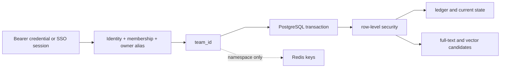

Application queries run in explicit transactions with transaction-local values
such as:

```text
app.current_team_id = <authenticated team UUID>
app.current_profile_id = <authenticated permanent owner alias UUID>
app.tx_mode = team
```

System workers use a separate, non-request-selectable transaction mode.
Payloads and headers cannot replace the authenticated team. RLS applies to
search documents and vector queries as well as source tables.

Redis namespacing prevents accidental key collisions; it is not an
authorization boundary. Authorization occurs before a coordination operation.

## Redis Availability

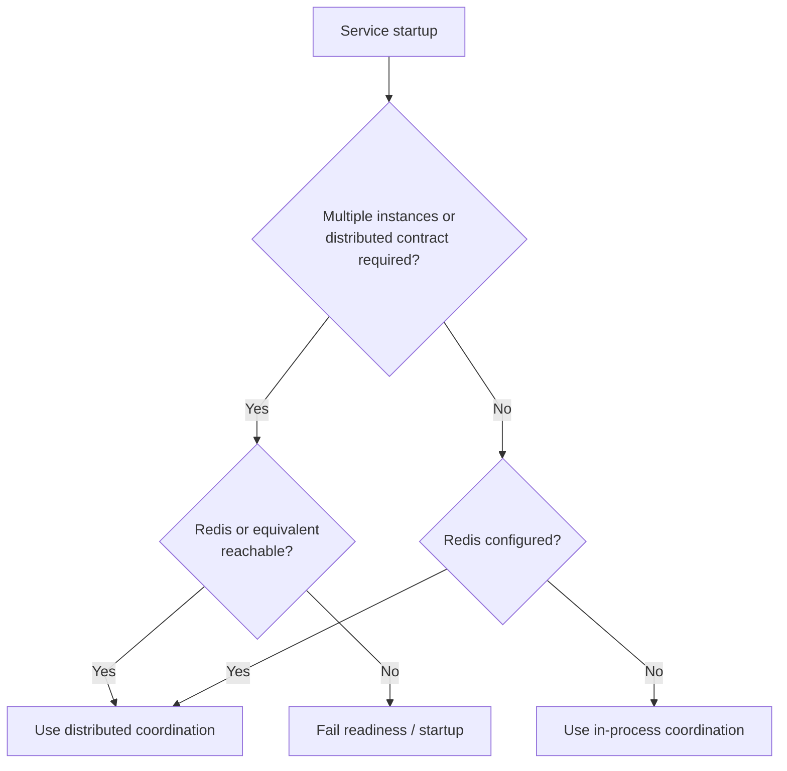

Redis may hold rate-limit counters, short leases, cleanup signals, and SSE
concurrency state. Losing Redis may reset or reacquire those operations, but
must never lose or change memory.

Redis-backed and process-local coordination are alternative implementations of
one contract; a replica must not apply both independent counters or leases.
When Redis is selected, every replica uses it for the distributed operation.
Small process-local caches of immutable/versioned predicate or configuration
lookups may still exist, but they cannot cache canonical Entity/Relationship
writes or bypass PostgreSQL version and authorization checks.

## Backup, Recovery, And Maintenance

PostgreSQL backups plus write-ahead-log archiving are the complete durable
recovery source. `pgvector` columns and indexes participate in the same
database backup and recovery process. Redis is excluded from memory recovery.

Recovery order:

1. restore PostgreSQL, WAL, and encryption material
2. validate migrations, extensions, RLS, embedding contracts, and active
   search-index generations
3. verify append-only and semantic uniqueness constraints
4. resume or rebuild search documents and vectors when required
5. compare approximate Recall@K with exact filtered search
6. restore distributed coordination before enabling multiple instances
7. enable traffic after write, recall, and tenant-isolation smoke tests pass

Operational maintenance includes PostgreSQL vacuum/analyze, vector-index
health, document drift, query latency, and backup restore
drills. Runbook commands belong in
[Operations Runbook](Operations-Runbook), not here.

## Risks And Mitigations

| Risk | Concrete failure mode | Mitigation |
| --- | --- | --- |
| Filtered ANN misses | a storage/index plan returns global neighbors before the team filter and omits relevant team rows | enforce team-shaped exact/ANN and topology contracts from [ANN, HNSW, And Halfvec](ANN-HNSW-And-Halfvec) |
| Hot adjacency query | a high-degree Entity produces too many rows and exhausts latency or memory | partial adjacency indexes plus strict seed, fan-out, depth, and result caps |
| Duplicate identity | two people named Mark are merged because name text is treated as an ID | opaque IDs, non-unique name lookup, contextual verification, ambiguity review, and client-confirmed split |
| Duplicate Relationship | repeated same-owner evidence inserts parallel semantic edges | owner-scoped canonical identity uniqueness plus transactional upsert and deduplicated support |
| Historical search drift | a migrated document lacks the active-contract vector or has a stale hash | document-centric convergence, source/document/contract fences, and bounded repair before vector recall is enabled |
| Tenant leak | a shared vector or adjacency query returns another team's row | RLS, team-leading indexes, transaction-local actor context, and authorization again on hydration |
| Redis becomes hidden storage | a restart loses an identity decision held only in cache | coordination-only interfaces and restart tests proving all memory survives Redis loss |
| Caller invalidates another profile's basis | an unowned source key or evidence ID revokes adopted support | immutable source/profile ownership, composite evidence checks, exact prior-revision compare-and-set, and append-only audit |
| Source activation partially demotes knowledge | a large dependency set commits some revocations before failure | precompute indexed dependencies, enforce a fanout bound, and advance the source pointer only in the all-or-nothing transaction |
| Stale provider result resurrects an old revision | an embedding result arrives after a newer source pointer advances | revalidate source/document fences immediately before the single semantic transaction and reject stale commits |
| Security audit leaks detector internals | public placement or metrics reveal exact rules and attacker payloads | keep detailed signals in authorized audit rows and expose only bounded categories externally |
| Conflict lease decides truth | a timed-out worker marks B preferred while its lease/version is stale | lease/version predicates, deterministic recomputation, and append event only with the matching current case |
| Search refresh races disposition | a historical repair uses an older document version after B resolves | source/document version predicates and authoritative Conflict filtering at hydration |
| Partial historical vector convergence biases RRF | some migrated Relationships have current vectors while others do not | keep the affected vector branch gated until document-centric convergence activates it transactionally |
| Projection migration re-embeds Evidence | a broad document-format version bump changes primary recall during rollout | keep projection format per source kind; compare Evidence counts/hashes before and after; repair only the selected document set |
| Reconciliation starves foreground writes | a large historical repair occupies every provider slot | bound repair batches, preserve request-scoped provider capacity, and alert on repair age |
| Stale repair completes an old projection | a repair result arrives for an earlier document after format-2 text commits | source/document/contract version predicates on completion |
| Mixed-version rollback corrupts search state | old workers interpret new generation fields or new workers run against restored old schema | treat application release and database backup as one rollback unit and prohibit mixed-version operation |
| Retry repeats provider work | the caller retries after an operational failure | terminal attempt idempotency and request-hash fences replay a matching result without another provider call |
| V2.4 migration silently changes existing knowledge | a backfill applies the new threshold to legacy events and demotes active Relationships | keep new audit fields nullable, prohibit rescoring/status/support updates, and reconcile lifecycle counts before opening traffic |
| Retired review metadata is treated as current approval | an operator or new worker interprets an old expiry field as permission to promote | v2.6 creates no review task or expiry worker; historical unfinished work remains internal audit data and any new work starts as an independent v2.6 submission |

## Storage Invariants

1. PostgreSQL contains every durable knowledge and control record.
2. `pgvector` is an indexed column capability inside that source of truth.
3. Redis and process memory contain no canonical memory.
4. Entity and typed Value are the only semantic-node kinds.
5. One eligible profile-owned Relationship is returned as at most one
   SemanticEdge.
6. Inactive Relationships and Hypotheses are not active edges.
7. Search hits and graph context never count as source evidence.
8. Append-only evidence and decision history cannot be rewritten by normal
   application code.
9. Every source and search query is actor-authorized and team-scoped.
10. Embedding mismatch or failure is explicit and cannot corrupt semantic
    state.
11. Losing all derived search documents does not lose knowledge.
12. Embedding contracts and search-index generations have separate versions and
    rebuild lifecycles.
13. Runtime has no secondary durable knowledge-store dependency.
14. Same-team reads can see eligible knowledge from every profile, while normal
    mutations require the caller to own the target record.
15. One Evidence source has one immutable owner and one current revision.
16. A source revision advances only when its expected prior token matches.
17. Every revision of one Evidence source retains one server-derived source
    group for independence counting.
18. Source activation, prior-support revocation, affected lifecycle transitions,
    and search intent commit atomically or not at all.
19. Evidence security history is append-only, and quarantined evidence has no
    semantic or search document.
20. A non-current source revision cannot commit canonical or search state after
    a newer revision activates.
21. Conflict cases are team-scoped workflow state and never own or mutate a
    member Relationship's evidence/lifecycle.
22. Every case materialization change has one append-only event and matching
    case-version compare-and-set.
23. Nightly review claims only bounded team-local due work, recovers leases, and
    cannot resolve from a deadline or provider/model output.
24. Stale search state cannot bypass the current Conflict disposition applied at
    final support-path hydration.
25. Relationship projection format is versioned independently from the
    numerical embedding and physical search-index contracts.
26. A format-2 Relationship migration changes no Evidence document/vector and
    creates no HNSW generation.
27. Relationship lexical recall opens only after complete text convergence;
    vector RRF opens only after the team generation is transactionally current.
28. Document-centric reconciliation and foreground write embedding use bounded
    selection, version/hash fences, and starvation-free capacity without a
    normal embedding queue.
29. One Remember attempt stores at most one complete validated assessment
    history; retrying a failed request reuses the idempotency key but never
    starts a background lease or worker.
30. The historical V2.4 migration makes no model or embedding call and changes
    no existing Relationship status, support, search text, vector, or current
    search contract.
31. Retained legacy review rows are audit-only and never grant support or create
    active knowledge.

## Canonical Identity And Permanent Ownership Aliases

The v2.5 model separates identity, membership, and durable credentials:

```text
actor_identities ──< team_memberships ──< membership_grants
        │                    │
        └────────────── credentials

identity_external_links   ownership_aliases(team_id, legacy_owner_id)
```

Legacy profile and credential IDs, key hashes/prefixes, teams, and semantic
owner IDs remain unchanged. A legacy `manager` role backfills to
`team_admin=true`; legacy scopes populate both membership maximums and
credential scopes. An alias is permanent and authorizes historical owner
references without rewriting accepted evidence, relationship history, or audit
lineage. Semantic tables now reference `teams(id)` and
`ownership_aliases(team_id, legacy_owner_id)` directly. The removed
`semantic_team_refs` and `semantic_profile_refs` mirrors are not runtime
authorities or compatibility views. `usage_metric_buckets` uses the same
composite ownership-alias key, so API-key and SSO usage history remains valid
after cleanup while cross-team owner pairs are rejected.

SSO memberships retain their legacy profile ID only as the permanent alias key.
Their stable SSO actor owns the canonical team membership and
`membership_grants`, so
an external identity remains connected to team authorization after legacy
cleanup. `team_memberships.sso_profile_name` retains the generated per-team
SSO label and is backfilled from `team_profiles.name` before the legacy table is
dropped; profile reads and usage labels prefer it over the actor's IdP display
name. System profiles retain the `system` actor kind.

`team_profiles`, `identity_compatibility_state`, `semantic_team_refs`,
`semantic_profile_refs`, and `embedding_config` are absent from the current
catalog. Credentials authenticate, memberships plus grants authorize, actor
identities anchor SSO and system actors, ownership aliases preserve old IDs,
and `embedding_contracts` is the sole embedding authority.
Revoking or deleting a credential only deactivates its actor when no active
membership remains, so a shared actor stays usable for another team.

## Memory Spaces And Catalog Coverage

`memory_spaces` is the durable catalog. It has one active `team_shared` row per
team and optional `profile_private` or `credential_private` rows owned by the
corresponding identity or credential. Every memory-owned canonical and derived
row stores `space_id` with a team/space composite foreign key. Coverage includes
source fragments, evidence, entities, values, relationships and supports,
conflicts and lifecycle decisions, search documents and vectors,
communities, hypotheses, trace references, and deletion metadata. Existing rows
and writes from an older binary are placed in the team-shared row by an
idempotent compatible migration.

Space ownership is not inferred from a profile or credential at query time.
The authenticated context supplies an allowed-space set before a transaction
starts, and adapters retain the space predicate through hydration. Cross-space
deduplication and identity resolution are not valid operations.

### Private-memory lifecycle and erasure

Private spaces add an explicit generation and lifecycle:

```text
active generation N
  -> accepted erasure seals space and advances catalog generation to N+1
  -> fenced worker deletes rows stamped with N
  -> profile/private purge: active generation N+1
  -> credential deletion: retired generation N+1
```

Every new or updated memory-owned row carries both `space_id` and the generation
captured at write time. The migration backfills `space_generation` for every
existing row that already has a `space_id` in bounded, resumable batches; rows
without a space remain unscoped. A database trigger takes a key-share lock on
the catalog row, verifies the row team and active lifecycle, and supplies or
checks `space_generation` for subsequent writes. This prevents a writer that
started before sealing from committing after the erasure fence. `team_shared`
rows are constrained to stay active and are never private-erasure targets.
Semantic trace, graph, node-detail, lifecycle, search-document, and embedding
job reads, semantic assessment/review candidate catalogs, and lifecycle
telemetry retain the same active-space-generation predicate. Placement runs and
their outcomes carry the run's `space_id` and `space_generation`; placement
claims require the catalog generation to be active and skip sealed or stale
runs. Rows from a sealed private space may remain physically present until the
fenced worker finishes, but they are not readable through those paths; a retired
space is only reached after the worker has verified zero remaining rows.
Recall-feedback snapshots also persist the team, space, and generation. Feedback
updates require an exact team/space/generation match, and listing/getting filters
to active current generations.

The durable control tables are:

| Table | Authority |
| --- | --- |
| `private_memory_legal_holds` | durable placement/release history; at most one active hold per space |
| `private_memory_erasure_operations` | idempotent target, requested generation, action, lease/fence, manifest position, counts, and terminal state |
| `private_memory_erasure_idempotency_keys` | system-only canonical and retirement-alias idempotency mappings to one erasure operation |
| `private_memory_retention_runs` | cutoff, configured retention days, queued count, actor class, and completed run receipt |

An erasure request and its space seal commit together. Workers claim with an
expiring lease and monotonic fence, lock and revalidate the operation, space,
generation, legal hold, and disabled credential when retirement applies, then
delete in foreign-key-safe manifest order. Failed work is retried after 1, 2,
4, and 8 seconds; the fifth failed claim becomes terminal `failed` with bounded
error metadata. A later authorized intent uses a fresh operation while
preserving the failed operation and its sealed generation, action, credential
target, and retirement outcome. Completion is allowed only after every manifest
table reports zero rows for the space. Audit rows retain their identity,
operation, actor, and time, but private before/after payloads are set to null
and metadata becomes `{"private_content_erased":true}`. Credential deletion
writes its safe `DELETE` or `REVOKE` audit row in the same transaction before
exposing the erasure operation; an audit failure rolls back disablement and
queueing. When an SSO credential deletion arrives while an erase is active, its
second idempotency mapping can upgrade that same operation to credential
retirement without changing the sealed target generation or worker fence.
Replaying either mapping with a different request hash remains a conflict.

Team hard-delete retains append-only audit rows. Removing a memory-space catalog
row sets `audit_log.memory_space_id` to `NULL` through its foreign key rather
than deleting the audit record.

Boot scans PostgreSQL for every table that owns or references a `space_id` and
compares it with the compiled erasure manifest. An unknown or missing table,
unsafe foreign-key edge, or incomplete ordering blocks startup instead of
allowing a partial erasure. Completed private content is not recoverable from
the live schema; recovery requires an authorized backup/PITR workflow in an
isolated environment.
