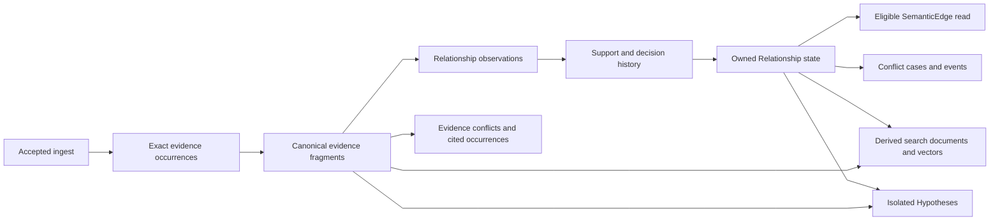

# Data Model And Storage

PostgreSQL with pgvector owns all durable knowledge, workflow, security, audit,
and search state. Redis and process memory are coordination only.

## Store Responsibilities

| Store | Responsibility |
| --- | --- |
| PostgreSQL | Exact evidence, canonical semantic state, append-only lineage, identity/access, workflow, diagnostics, and derived search state. |
| pgvector | Vector storage, distance calculation, and index execution inside PostgreSQL. |
| Redis | Shared rate/stream limits, coordination, and signals when configured. |
| Process memory | Coordination for a single process and bounded request-local work. |

Losing Redis does not erase knowledge. Multiple server instances must share
coordination; they cannot silently use independent local limits.

## PostgreSQL Model



Entity and typed Value are semantic nodes. Relationships reference those
endpoints and own lifecycle under a permanent author alias. Evidence,
observations, decisions, conflicts, and Hypotheses have their own records;
they do not become semantic nodes.

## Evidence, Occurrences, And Support

`evidence_fragments` stores canonical evidence. `evidence_occurrences`
preserves exact submitted content, content hash, ingest/index, source lineage,
owner, space, and generation. Duplicate reuse can point several occurrences at
one canonical fragment without rewriting their original text.
`evidence_exact_aliases` preserves exact-equivalence mappings.

Source records and revisions govern current-source visibility. Direct evidence
supersession and source-revision advancement are distinct operations. Their
accepted effects, support updates, lifecycle history, and search changes commit
with the accepted write, not as a later partial activation.

A support link cites exact evidence/occurrence ranges. Decision history records
grants, reinstatements, and revocations. Stored graph context and Hypothesis
text cannot grant support.

Evidence conflicts have cases, positions, and events. Positions retain canonical
evidence, exact occurrence, quote, authority, and submitted/context disposition.
Relationship conflicts retain authored positions and supporter history
separately. See [Conflicts And Corrections](Conflicts-And-Corrections).

## Atomicity And Append-Only History

Remember performs provider work outside its canonical transaction. It then
rechecks idempotency, source, ownership, space-generation, evidence, and search
contract fences and commits all accepted effects together.

The commit includes exact evidence/occurrences, semantic decisions, controlled
predicate registration, support/lifecycle history, search documents, required
current vectors, and the terminal result. Required failure yields no partial
accepted knowledge. Failure and invocation diagnostics have their own bounded
persistence paths.

Normal corrections append lineage and update current state. They do not rewrite
accepted source text. Explicit private-memory erasure is a separate authorized
physical deletion workflow; its restrictions and audit treatment are below.

## Identity And Ownership

`actor_identities` anchors identities; `team_memberships` and
`membership_grants` authorize team access; `credentials` authenticates keys.
`ownership_aliases` preserves stable authored-memory ownership. Its
`legacy_owner_id` column is a current schema identifier, not a user-selected
identity.

Name matching is scoped metadata lookup, not an Entity primary key.
Homonyms are valid. Same-owner canonical Relationships converge under their
semantic identity; equivalent cross-profile Relationships remain separately
owned and are grouped during recall.

See [Entity Identity And Resolution](Entity-Identity-And-Resolution) and
[Relationship Model And Lifecycle](Relationship-Model-And-Lifecycle).

## Search In PostgreSQL

`search_documents` is derived state. Each document identifies its source,
source/document versions, text/hash, source-kind projection format, embedding
contract/dimensions, index generation, and search state. Full-text and vector
queries use PostgreSQL; hydration reloads canonical state and authorization.

Evidence and Relationship projections are distinct. Default evidence recall
requires an eligible active Relationship support path even when a standalone
evidence document is stored and indexed.

### Relationship projection generation

Relationship projection format 2 renders semantic identity and current
descriptors. Per-team projection generations govern compatible text/vector
readiness. A stale or incomplete Relationship vector frontier is explicitly
degraded; it does not silently mix generations.

### Embedding contract and reconciliation

`embedding_contracts` owns vector-space compatibility.
`search_index_generations` owns index strategy and parameters.
`search_projection_generations` owns source-kind projection readiness.

Remember and correction complete required embeddings before their accepted
commit. Maintenance reconciliation compares current source/document versions
and hashes, embeds selected missing or failed documents, and applies only
results whose fences still match. A stale result cannot overwrite a newer
source. See [ANN, HNSW, And Halfvec](ANN-HNSW-And-Halfvec) and
[Operations Runbook](Operations-Runbook).

## Workflow And Operator Records

PostgreSQL owns Dream cycles, evidence-discovery target attempts/evaluations,
community runs/snapshots, conflict review leases, and private-memory erasure
operations. Worker claims and completion use durable version, lease, or
generation fences as appropriate.

`remember_attempts` and events retain terminal replay/diagnostic state.
`remember_invocation_diagnostics` distinguishes individual admitted calls,
including replay and conflict, from their canonical attempts.
`remember_attempt_diagnostics`, protected body artifacts, operation logs,
and `dream_diagnostic_captures` support authorized operator investigation.
Diagnostic capture is not evidence and does not prove that a response reached
the caller.

Capture retention, legal holds, truncation/unavailability, and private erasure
are enforced independently of public result schemas. See [Telemetry](Telemetry).

## Memory Spaces And Catalog Coverage

`memory_spaces` is the durable catalog. A team has a shared space and may
have identity-private or credential-private spaces. Memory-owned rows and
derived state carry the applicable space and generation.

Authentication supplies allowed spaces. Remember selects the authenticated
private space when present; otherwise it uses the shared space. Reads retain
space predicates through search and hydration. Deduplication and identity
resolution do not cross spaces.

### Private-memory lifecycle and erasure

Private spaces add an explicit generation and lifecycle:

```text
active generation N
  -> accepted erasure seals space and advances catalog generation to N+1
  -> fenced worker deletes rows stamped with N
  -> profile/private purge: active generation N+1
  -> credential deletion: retired generation N+1
```

Every new or updated memory-owned row carries both `space_id` and the generation
captured at write time. A database trigger takes a key-share lock on
the catalog row, verifies the row team and active lifecycle, and supplies or
checks `space_generation` for subsequent writes. This prevents a writer that
started before sealing from committing after the erasure fence. `team_shared`
rows are constrained to stay active and are never private-erasure targets.
Semantic reads, search, assessment catalogs, feedback, and mutations enforce
active-space-generation predicates. Rows from a sealed private space may remain physically present until the
fenced worker finishes, but they are not readable through those paths; a retired
space is only reached after the worker has verified zero remaining rows.
Recall-feedback snapshots also persist the team, space, and generation. Feedback
updates require an exact team/space/generation match, and listing/getting filters
to active current generations.

The durable control tables are:

| Table | Authority |
| --- | --- |
| `private_memory_legal_holds` | durable placement/release history; at most one active hold per space |
| `private_memory_erasure_operations` | idempotent target, requested generation, action, lease/fence, manifest position, counts, and terminal state |
| `private_memory_erasure_idempotency_keys` | system-only canonical and retirement-alias idempotency mappings to one erasure operation |
| `private_memory_retention_runs` | cutoff, configured retention days, queued count, actor class, and completed run receipt |

An erasure request and its space seal commit together. Workers claim with an
expiring lease and monotonic fence, lock and revalidate the operation, space,
generation, legal hold, and disabled credential when retirement applies, then
delete in foreign-key-safe manifest order. Failed work is retried after 1, 2,
4, and 8 seconds; the fifth failed claim becomes terminal `failed` with bounded
error metadata. A later authorized intent uses a fresh operation while
preserving the failed operation and its sealed generation, action, credential
target, and retirement outcome. Completion is allowed only after every manifest
table reports zero rows for the space. Audit rows retain their identity,
operation, actor, and time, but private before/after payloads are set to null
and metadata becomes `{"private_content_erased":true}`. Credential deletion
writes its safe `DELETE` or `REVOKE` audit row in the same transaction before
exposing the erasure operation; an audit failure rolls back disablement and
queueing. When an SSO credential deletion arrives while an erase is active, its
second idempotency mapping can upgrade that same operation to credential
retirement without changing the sealed target generation or worker fence.
Replaying either mapping with a different request hash remains a conflict.

Team hard-delete retains append-only audit rows. Removing a memory-space catalog
row sets `audit_log.memory_space_id` to `NULL` through its foreign key rather
than deleting the audit record.

Boot scans PostgreSQL for every table that owns or references a `space_id` and
compares it with the compiled erasure manifest. An unknown or missing table,
unsafe foreign-key edge, or incomplete ordering blocks startup instead of
allowing a partial erasure. Completed private content is not recoverable from
the live schema; recovery requires an authorized backup/PITR workflow in an
isolated environment.

## Risks And Verification

Cross-team/owner/space references, concurrent erasure and write, stale vector
updates, and partial source replacement require real PostgreSQL regression
tests. Mocked adapter calls cannot establish these guarantees.

Exact table constraints and RLS are defined by the current migrations and
capability adapters. [PostgreSQL Cluster-Safe Schema](PostgreSQL-Cluster-Safe-Schema)
explains the enforced query and transaction boundaries.
