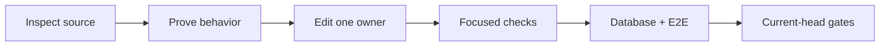

# Development And Testing

Follow the current module and toolchain files and browser manifests. For non-trivial changes, identify the decision owner, check for reusable code and dependencies, and cover supported success and an adverse case. [Code Ownership And Design Review](Architecture#code-ownership-and-design-review)

## Change Workflow



Keep unrelated worktree/staged changes intact. Reuse existing owners rather than adding duplicate defaults, validators, or wrappers. Similar syntax is not sufficient evidence of shared policy.

## Local Checks

From the application repository:

```bash
go test ./internal/remember/... ./internal/recall/... ./internal/tools/registry/... -count=1
npm test --prefix web
```

The repository script `./scripts/ci-check.sh` lists the expanded Python, browser, proxy, Go, static analysis, and coverage checks. During Dense-Mem delivery, run the assigned focused checks locally. Full suites and coverage run through remote PR CI after the review phase.

## PostgreSQL And Production-Entry Tests

| Behavior | Required proof |
| --- | --- |
| Domain validation and deterministic policy | Real logic at its owning boundary. |
| RLS, SQL constraints, migrations, transactions, locks, idempotency, pgvector, concurrency | Real PostgreSQL/service integration tests. |
| New/changed supported public behavior | Positive and distinct adverse production-entry cases. |
| Retrieval quality, placement, ranking, assessment, embeddings, search documents, or performance | Applicable deterministic comparison under [Evaluation](Evaluation). |
| Documentation-only changes | Source/example/link/diagram validation; no new runtime E2E scenario solely for prose. |

Tagged `*_integration_test.go` files have registrations under `scripts/e2e-db-cases/`. Native capability adapters own their fixtures. Use the registered scenario or corresponding remote PostgreSQL shard; mocked method calls do not prove database guarantees.

```bash
scripts/e2e.sh synchronous_write_primitives
scripts/e2e.sh session_ingest
scripts/e2e.sh ontology_management
```

The [scenario registry](https://github.com/markhuangai/dense-mem/blob/152448a4c4c4192a7492ad3ae2ca311fcb82851a/scripts/e2e-scenarios.json) owns selections. Remote proof must name source SHA, image digest, selected scenarios/shards, and run URL. A passing run proves its exact source, not later worktree edits.

## Behavioral Acceptance

| Path | Include an adverse case |
| --- | --- |
| Remember | Retired/unknown fields, security rejection, invalid complete assessment, provider/embedding failure, unchanged replay, changed-key payload conflict, and bounded request-isolated progress before the terminal response. |
| Session intake | Changed event, exact Unicode/whitespace offsets, prior-context exclusion, explicit empty extraction, and private erasure fences. |
| Recall/topics | Private/team isolation, unavailable or stale topics, direct membership without descendant expansion, and visible optional degradation. |
| Lifecycle/conflicts | Different owners, stale versions/revisions, exact conflict positions, and rollback preserving source history. |
| Trace/export | Unauthorized targets, bounded history/content, canonical hashes, and explicit omissions. |

Isolation-sensitive cross-profile behavior needs real A/B/C actors, including different read-visible and mutation-owning profiles.

## Staging Validation

| Path | Verification boundary |
| --- | --- |
| Prerelease rehearsal | Restore a production copy, run migrations from the selected source, and verify state before image publication. Application startup is separate. |
| Deploy staging | The manually installed host helper restores through `sync.sh`, migrates with the pinned image, runs read-only checks, and starts that image. Follow [Operations Runbook](Operations-Runbook#staging-deployment). |
| Repository checks | Exercise image/source/digest policy and real PostgreSQL migration preservation. Live host-helper installation and execution require their own evidence. |
| Evidence-only cutover | Cover reset counts, retained Evidence, holds, unexpected dependencies, rollback, saved controls/accounting, enabled/paused rebuild, private/generation isolation, and skipping an already-applied migration. |

Record exact source, image digest, scenario selections, and outcome. A successful rehearsal does not establish a running application or completed background organization rebuild.

## Python Package And Frameworks

```bash
bash packages/python/scripts/check.sh
scripts/e2e.sh python_client
scripts/e2e.sh google_adk_memory
scripts/e2e.sh langchain_retriever
```

The package check builds reproducible wheel/sdist artifacts, verifies installed-core/extra behavior, types, audit/SBOM, and existing tests. The Python matrix script covers supported Python versions and minimum/latest compatible MCP SDK. Use a fresh ignored output directory for retained artifacts.

Runnable examples are under `packages/python/examples/`. They require the documented endpoint/token and retained operation identity. Runtime use belongs to [Framework Integrations](Framework-Integrations).

Python publication follows the shared `vX.Y.Z` / `vX.Y.Z-rc.N` server release identity and trusted merged source. Never overwrite a published version. Workflow provenance and artifact checks remain publication gates; an implementation or fixture pass does not establish that a package has been published.

## Review And CI Phases

| Phase | Requirement |
| --- | --- |
| Review-first, when `REVIEW_GATED_CI=true` | Current-head reviewers, complete finding dispositions, CodeQL/analysis, and focused local regressions. |
| Deferred validation | Only the exact trusted pending statuses permitted by repository policy can be deferred. Started/failed checks remain blocking. |
| Full validation | Actual successful Repository CI, CodeQL, CodeQL analysis, Production image E2E, and all other applicable checks on the final head. |
| After a push | Prior head/activity receipts are invalid; repeat required gates. |

Owner, other-author, and fork validation paths differ. Consult the governing [repository instructions](https://github.com/markhuangai/dense-mem/blob/152448a4c4c4192a7492ad3ae2ca311fcb82851a/AGENTS.md) and workflows before requesting validation. Never treat skipped, missing, or pending full-matrix E2E as a pass.

## Data, Migrations, And Artifacts

Deployed migrations are immutable. Add an ordered migration with lock/rewrite analysis, RLS impact, constraints, recovery, and required PostgreSQL tests. The [schema migration rules](PostgreSQL-Cluster-Safe-Schema#migrations-and-proof) identify the exact approved Evidence-only cutover hash transition. Stop incompatible writers before destructive boundaries.

Generated seeds, downloaded data, runtime databases, full runs/comparisons, and protected captures stay ignored. Keep reproducible generators, locks, scoring/validation, and required safe fixtures. Only the latest overall measured result belongs in `tests/eval/baseline.json`; keep limitations and unavailable measurements intact.

## Remote Development Tests


Commit and push a worktree branch, then open **Actions → Development E2E → Run
workflow**. Select `main` for the workflow and enter the branch or full commit
SHA in `source_ref`. This route requires repository-admin permission and works
before a pull request exists.

Enter registered scenario names in `scenarios`, separated by commas, or `all`
for the entire scenario registry. Leave it blank for PostgreSQL-only testing.
For `postgres_shards`, enter `0` through `6`, a comma-separated subset, or `all`;
leave it blank for E2E-only testing. Select at least one group. The scenario
named `full` runs Evidence lifecycle, telemetry, and portal coverage; `all` runs
every registered scenario. Available names live in
[scenario registry](https://github.com/markhuangai/dense-mem/blob/main/scripts/e2e-scenarios.json).

```bash
gh workflow run development-e2e.yml --ref main \
  -f source_ref=issue/my-change \
  -f scenarios=conflict,mcp_oauth \
  -f postgres_shards=all
```

The workflow resolves one commit, builds one native production image in the
dedicated `dense-mem-e2e` GHCR package, and gives every selected job the same
image digest and source SHA. E2E and PostgreSQL groups run independently, with
bounded scenario parallelism and selected PostgreSQL shards. The backlog
regression has a dedicated shard; shard selections cover every registered case
exactly once. Execution jobs are capped at 30 minutes, with bounded test time
before cleanup. Production validation starts scenarios after the rootless
controller check while PostgreSQL shards continue independently, and its final
gate requires every group to pass. The Actions
summary records the exact SHA, digest, selections, and results. Inspect the
matching **Clean development E2E images** run as well: it removes eligible owned
images after completion, including failures and cancellations. GitHub prevents
deleting a package's final version, so cleanup retains that verified completed
image and reports its version, digest, and run identity. An hourly sweep recovers
missed cleanup and preserves active runs or unexpected image ownership.

Start a fresh dispatch for retries. Each privileged job rechecks the acting
accounts and rejects job reruns, which can reuse cached authorization or an
image that has already been deleted.
Successful remote results can satisfy the corresponding focused E2E and real
PostgreSQL checks for their exact commit. Keep lightweight local checks and
attach the run URL and summary to the PR. Every PR still requires its current-head
full production-image E2E gate through the ordinary validation route.

New manual workflows become dispatchable after their workflow files reach the
default branch. Live rollout must verify E2E-only, PostgreSQL-only, combined,
failed, and cancelled runs together with GHCR cleanup.

Shared CI runs repository/browser checks, Go tests and analysis, and core and
PostgreSQL coverage producers independently. Its required merge gate verifies
that all seven raw Go profiles belong to the same source commit and workflow
attempt, then applies the unchanged deduplicated coverage threshold above 90%.
PR validation and post-merge CI use the same shared workflow. Full coverage is a remote CI requirement during delivery; do not duplicate it locally.

Repository admins can benchmark changes to CI/E2E workflows before merge using
`production-image-e2e.yml` on their own current PR branch with `pr_number`.
The manual trial requires the trusted preview receipt and runs candidate shared
CI alongside every database shard and registered scenario. It does not replace
the normal required PR checks. Record the exact source SHA, image digest,
workflow attempt, preview-build duration, queue and execution times, and cleanup
results; accept the latency change only when all execution jobs finish below
30 minutes and the trial plus preview-build allowance finishes within 60 minutes.


## Fork Pull-Request Validation


Public fork PRs use contributor-owned Cloudflare credentials for production
E2E. The upstream repository never forwards its Cloudflare token to a fork.

1. In your public fork, enable Actions and configure the repository variable
   `CLOUDFLARE_ACCOUNT_ID` and secret `CLOUDFLARE_API_TOKEN`. The token needs
   Workers AI access. Keep the token out of workflow inputs and PR comments.
2. Ask a repository administrator to apply `deploy-test-image` to the upstream
   PR. After the preview finishes, its comment contains the approved source
   SHA, image digest, preview run ID/attempt, and trusted upstream revision.
3. In your fork's Actions page, manually run **Contributor fork E2E request**
   on the branch at that exact PR head. Enter the upstream PR number,
   `source_sha`, `preview_run_id`, `preview_run_attempt`, and `trusted_revision`
   from the current preview receipt. The workflow must already be present on
   your fork's default branch for GitHub to offer manual dispatch.
4. Keep the PR head unchanged while every registered scenario and required PostgreSQL
   precheck, rootless-controller checks, and cleanup finish. The upstream
   verifier waits up to 120 minutes and automatically verifies the signed
   receipt before reporting `Production image E2E` success.

The trusted upstream workflow signs in a separate job that runs no candidate
code and receives no Cloudflare secret. Verification binds the signer revision,
PR head, image digest, both run attempts, and complete results. Missing
credentials, failed/skipped jobs, forged signatures, stale approvals, and
timeouts fail validation. If the head or approved upstream workflow changes,
request a fresh administrator-approved preview and start its matching run.
Same-repository PRs retain the ordinary production E2E route.

Issue #508's live public-fork acceptance run is deferred by maintainer direction.
Signed-fixture, receipt-policy, and workflow tests cover the bridge locally and
in CI; they do not establish that live fork acceptance has completed.


## Documentation Changes

The [scripts guide](https://github.com/markhuangai/dense-mem/blob/main/scripts/README.md) identifies executable entry points. Feature PRs update affected directory guides and link a companion PR targeting `wiki`, or explain why no wiki update is needed. [Documentation Maintenance](Documentation-Maintenance#repository-documentation-and-publication) owns branch, publication, and recovery instructions. Wiki PRs do not inherit the product review/CI gates on `main`.
