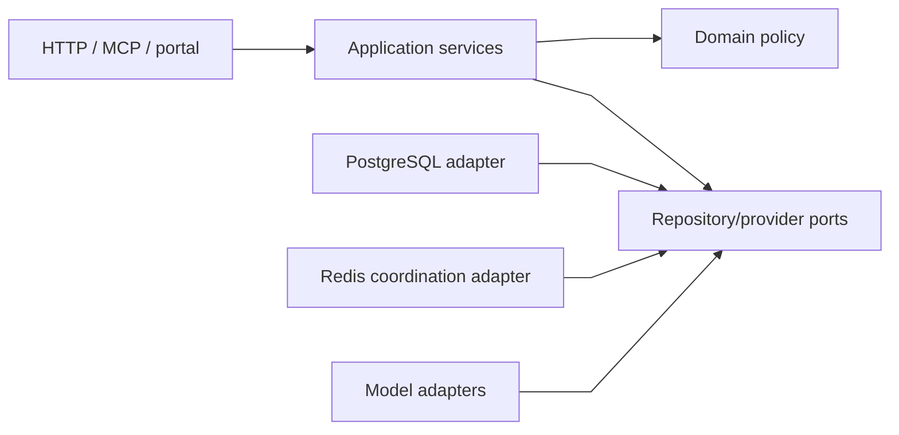
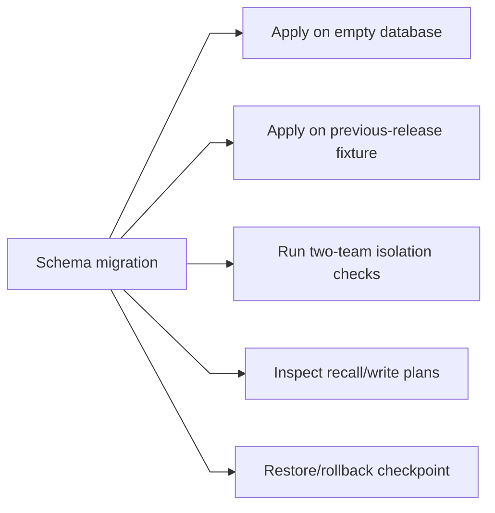

# Development And Testing

This page defines the current development workflow and test gates. Runtime
inspection results belong in project memory or a dated evaluation report, not
in this architecture page.

## Baseline Assumptions

- Go module: `github.com/markhuangai/dense-mem` using Go 1.26
- HTTP: Echo; PostgreSQL: pgx/GORM/goose; Redis: go-redis
- browser apps: React/Vite with Vitest and Playwright
- checks: `scripts/ci-check.sh` runs line lint, Go tests, and a 90% unit coverage
  gate for selected internal packages
- CI supply-chain gates: the module-pinned `govulncheck` tool scans all Go
  packages, and npm audit fails on high or critical findings in the repository
  lint, browser, and MCP proxy dependency trees
- Dependabot checks Go modules, npm lockfiles, container bases, and GitHub
  Actions weekly; security fixes are grouped by ecosystem

## API-Key Portal Cookie E2E

Run `scripts/e2e-compose.sh` with `DENSE_MEM_E2E_SCENARIO=portal` against the
local Compose file and environment used for the instance. This mode boots the
real PostgreSQL/Redis/server stack, seeds a real API key, sets
`SSO_COOKIE_SECURE=false` through the private control API for its HTTP browser
test, and runs the remembered API-key portal session scenario in desktop and
mobile Playwright projects. It does not edit the boot environment; HTTPS
deployments must keep the runtime setting `true` and preserve the original
`/ui` path through the ingress.

## Architecture Boundaries

| Retired pattern | Current requirement |
| --- | --- |
| PostgreSQL control plus a second semantic store | PostgreSQL owns ledger, current semantic state, graph reads, full text, and `pgvector` |
| mixed semantic-object services and graph records | Entity, Value, RelationshipObservation, VerificationEvent, profile-authored RelationshipRecord, Support, CrossReference, Transition, Hypothesis |
| graph-store startup/bootstrap | server requires PostgreSQL + `pgvector` |
| separate structure/support provider contracts or alternate claim-decision vocabulary | one closed assessor response with bounded `security_signals`, `entity_results`, and `relationship_results`; no model schema-version field or stored-Relationship context |
| graph-specific adapters define behavior | repository ports expose bounded semantic-edge/search/trace operations |
| Redis optional rate/SSE backend | same coordination-only role; mandatory when distributed contracts require it |

## Responsibility Tree

The exact package split should follow existing Go patterns and remain
reviewable:

```text
cmd/
  server/                       # composition root
  migrate/                      # PostgreSQL migrations

internal/
  domain/
    evidence/
    entity/
    relationship/
    verification/
    hypothesis/
  service/
    remember/
    recall/
    trace/
    correction/
    dreaming/
  repository/
    knowledge.go
    search.go
    control.go
  storage/
    postgres/
      migrations and repositories
    redis/
      coordination only
  provider/
    assessor/
    embedding/
    dream/
  transport/
    mcp/
    http/

migrations/postgres/
tests/
  integration/
  contract/
  eval/
  uat/
web/
```



Forbidden dependencies:

- domain packages importing HTTP, PostgreSQL, Redis, or provider SDKs
- PostgreSQL repositories calling model providers
- Redis interfaces accepting Entity, Relationship, evidence, or review records
- transport or provider adapters assigning lifecycle status/support
- recall reconstructing truth from search-document text
- compatibility types leaking into canonical domain APIs

## Implementation Boundaries

- PostgreSQL migrations live under `migrations/postgres/` and use
  `internal/storage/postgres/migrator.go`.
- MCP tool input/output schemas and provider JSON contracts are versioned
  fixtures.
- Every tenant-owned table, key, hot lookup, queue, and idempotency key carries
  `team_id`.
- Assessor output is an immutable persisted result; deterministic server policy owns
  identity, lifecycle, status, effective support, and durable commit.
- Recall and trace use team-scoped PostgreSQL full-text, vector, and adjacency
  paths.
- Dreaming and community analysis consume eligible current state and cannot
  become an alternate authority.

## Change Workflow

For each implementation change:

1. inspect the current package, interfaces, tests, migrations, and callers
2. state current behavior and target invariant
3. add/adjust the smallest contract or integration test that proves the
   behavior
4. implement one responsibility without unrelated cleanup
5. run focused real-logic tests
6. run repository checks
7. inspect migration/query plans and the diff
8. record schema/config/API/migration implications

If the change may affect retrieval quality, ranking, placement accuracy,
assessor behavior, embeddings, search documents, or performance, run
the deterministic 1k evaluation/comparison and put the result in the PR. Reuse
a prior successful import only when import logic, schema, seed identity,
placement terminality, and search/vector freshness are unchanged.

For build/catalog/lifecycle changes that do not alter retrieval logic, run the
`local_eval_100_v2` smoke through
`examples/docker-compose.evaluation.yml`. This proves the build-tagged eval
surface and live harness path but is not release-quality evidence. The compose
E2E scenarios `mcp_boundaries` and `submission_status` cover production catalog
exclusion, conditional feedback/Dreaming discovery, recall hints, and
owner-only Relationship correction.

Example focused commands, verified against the current Go/npm layout:

```bash
go test ./internal/service/... -count=1
go test ./internal/storage/postgres/... -count=1
go test ./tests/integration/... -count=1
go tool govulncheck ./...
npm audit --prefix .lint --audit-level=high
npm audit --prefix packages/mcp-proxy --audit-level=high
npm audit --prefix web --audit-level=high
npm test --prefix web
./scripts/ci-check.sh
```

Exact targets may change during the refactor; update this page and CI together.

## Database Change Rules

Every PostgreSQL migration includes:

- explicit up/down or documented irreversible boundary
- lock and rewrite analysis on representative data
- RLS policy and role impact
- constraints for tenant ownership, object union, identity, and append-only rows
- index/query-plan evidence for hot paths
- backfill that is resumable/idempotent where large
- backup/restore and rollback checkpoint

### Migration history and schema catalog

Goose migrations are the only executable schema authority. Treat every
migration already present on the merge base as immutable and add one forward
migration for each logical change. Create migrations through the repository
helper so the version is a 14-digit UTC value greater than the current maximum:

```bash
./scripts/new-postgres-migration.sh <snake_case_name>
./scripts/check-postgres-migrations.sh [base-ref]
```

The checker derives the current merge base rather than using a stored cutoff
for pull requests. Main-push CI compares the new tree directly with the prior
tip so rewritten history cannot discard a deployed migration unnoticed. It
rejects edits, mode changes, renames, or deletions of existing migrations;
duplicate, malformed, or out-of-order additions; unresolved review markers;
and Goose validation failures. A branch with a lower version must rebase and
create a correctly ordered migration. Do not enable out-of-order execution.

Regenerate the read-only schema catalog after any migration change:

```bash
./scripts/postgres-schema-catalog.sh write
./scripts/postgres-schema-catalog.sh check
```

The generator uses the repository's PostgreSQL/pgvector image, records its
immutable digest, migrates a disposable database, and proves `current.sql`
through a restore and second dump. `global.sql` and the relation files are
inspection views, not another migration source or an ordered restore set.
Production never applies the catalog.

CI does not provision PostgreSQL. It verifies migration history and Goose
syntax plus catalog image/version/latest-migration metadata, a digest of the
migration filenames and contents, and generated-file checksums. Before
committing a migration or catalog change, run catalog generation and the full
migration integration suites against disposable PostgreSQL locally.



Do not build a unique name constraint to prevent duplicate people. Name is a
candidate key; stable external IDs and canonical Relationship identity receive
the relevant uniqueness constraints.

## Test Layers

| Layer | Must prove |
| --- | --- |
| pure domain | owner-scoped Relationship identity, lifecycle transitions, source independence/currentness, automatic pending-state transition, cross-profile references, predicate behavior, no pending-state activation |
| JSON contract | closed schemas, conditionals, bounds, exact enums, bounded security signals, and no removed/unknown fields |
| PostgreSQL integration | migrations, RLS, constraints, atomic source activation, append-only security/support history, queues/leases, partial indexes, vector operators |
| repository/service integration | actual transactions, concurrent create recheck, idempotency, current-state/transition consistency |
| provider-adapter protocol | malformed JSON, full-history correction messages, five-turn exhaustion, extra/missing/duplicate results, wrong IDs/spans, model security signals, provider protocol failures, timeouts, 429/`Retry-After`, durable claim retry, and persisted-result reuse |
| recall evaluation | exact/full-text/vector/adjacency relevance, RRF/priority profiles, deterministic reranking, exact-vs-HNSW Recall@K, temporal/tenant/profile-conflict slices |
| MCP contract | `tools/list` visibility, `tools/call` schema/scope enforcement, current contract semantics, and safe errors |
| browser UAT | ambiguity, trace, correction, forget, quarantine release, Hypothesis styling, role/scope behavior |
| recovery/load | PITR/restore, vector rebuild, worker restart, high concurrency, hub traversal bounds |

Mocks may isolate an outbound provider transport error or pure query-building
unit. They cannot prove RLS, migrations, locks, `pgvector` behavior,
transactional atomicity, idempotency, or real domain policy. Those gates use a
real PostgreSQL/`pgvector` instance and actual service logic.

## Required Domain Cases

### Entity identity

- repeated mention and alias reuse one Entity
- exactly one plausible same-name candidate is reused without contradiction
- several plausible same-name candidates create review
- later conflict produces an impact preview and selected-observation split
- caller-owned split/merge leaves other profiles' observations unchanged
- concurrent equivalent creates converge
- a cross-team/non-candidate ID invalidates the whole assessor response

### Relationship lifecycle

- repeated same-owner evidence attaches to one Relationship
- another profile's equivalent/correcting evidence creates its own Relationship
  and cross-reference
- `insufficient` produces `pending_evidence` and no SemanticEdge
- one accepted entailed support at or above the effective team threshold
  activates the Relationship
- entailed support below the threshold remains pending with a seven-day
  support-confidence review; confidence equal to the threshold passes
- a threshold change affects future/in-flight commits and never rescores a
  completed or held assessment
- additional independent accepted sources improve provenance but do not change
  lifecycle class or correlation rank
- two stored Relationships do not automatically prove a third Relationship
- advancing a stable source revision revokes prior effective support team-wide
  and moves unsupported affected Relationships to `pending_evidence`
- a stale/unowned revision or fanout-bound failure changes no source pointer or
  semantic state
- a quarantined or later failed replacement never reactivates the prior revision
- existing predicate aliases resolve to one canonical team definition
- an incomplete Entity or predicate catalog fails before a provider call and
  creates no semantic state
- unmatched predicate wording uses server-controlled registration; alias/key
  ambiguity, endpoint-kind mismatch, and Relationship-kind collision hold the
  complete submission with no semantic subset
- assessor output never creates or edits a predicate definition
- forget retracts the edge while preserving nodes/history

### Strict assessor

Use table-driven fixtures for:

```text
invalid JSON
unknown top-level field
model-supplied schema_version
missing entity_results
missing security_signals
extra predicate_results
duplicate or unknown ref
reuse ID outside per-ref allowlist
non-null ID for create/ambiguous
unknown predicate_key
ambiguous predicate alias
novel predicate candidate outside the submitted set
removed knowledge_alignment or related_relationship_ids field
security signal with unknown evidence ID or invalid span
out-of-range confidence
oversized rationale/array/response
cross-array unresolved endpoint
valid complete response
```

Assert that every malformed-content case appends the invalid assistant response
and exact validation errors to the same in-memory history, requests a complete
replacement, and causes zero semantic commit until a valid whole response
exists. Assert five total turns at most, terminal failure after the fifth
malformed response, and token-budget failure before an oversized next turn.

Separately assert that every HTTP status, timeout, transport error, invalid
provider envelope, missing choice, or empty assistant message makes no
same-history correction. It must release the reservation transactionally,
persist only bounded failure class/status, and requeue through placement
`max_attempts`; 429 honors bounded `Retry-After`. A valid non-empty
security-signal array quarantines the complete submission and creates no
`VerificationEvent` or other semantic subset.

Persist a valid response, then force process exit, lease loss, pause/resume, and
semantic transaction failure before commit. Each resumed path must load the
same run-scoped assessment row, create the same material decisions, and make
zero further assessor calls. A unique stable run identity must prevent two
workers from persisting different valid responses.

### Submission-wide assessment

- two or more evidence items and every distinct relationship ref are sent in
  one logical assessor conversation, including two relationships that cite the
  same evidence index
- one invalid, low-confidence, unresolved, or incompatible result leaves every
  sibling without semantic state; #151 records the existing `awaiting_review`
  compatibility hold without a review task
- complete entity/predicate catalogs are preflighted with a limit-plus-one
  query; overflow and token-budget failures make zero provider call
- controlled predicate registration takes a team/key transaction lock, rechecks
  the latest definition, and records created/reused append-only provenance
- real PostgreSQL A/B/C tests cover catalog isolation, run binding, all-or-zero
  commit, rollback after a later sibling failure, and registration races
- real PostgreSQL tests cover the semantic-hold expiry boundary, immutable hold
  facts, concurrent expiry idempotency, cross-profile/team replacement denial,
  failed-successor release, and successful atomic supersession
- a live Compose MCP E2E uses an actual credential and proves one request over
  multiple evidence/relationships promotes atomically

### Semantic holds and replacement submissions

- a policy-held submission has one append-only hold fact, no review task, no
  semantic/search writes, and an exact 24-hour expiry
- expiry immediately before, at, and after the boundary is state-only and one
  of two concurrent workers records the transition
- an optional `replaces_submission_id` accepts only an owned active/expired hold;
  absent, cross-profile, cross-team, and superseded targets are bounded
- a staged/processing/held/rejected/quarantined/failed successor leaves the
  target unchanged, while the first successful successor atomically supersedes
  it and records both audit outcomes

### Semantic review expiry

Use an injected virtual clock; do not sleep for seven days. Cover every semantic
kind (`support_confidence`, `identity`, `predicate`, `scope`, and `time`) at one
instant before, exactly at, and one instant after `expires_at`.

- only `open` or `acknowledged` tasks become `expired`
- expiry is idempotent under two workers and lease recovery
- expiry grants no support and creates no active Relationship or Hypothesis
- a structurally complete pending Relationship becomes Dream-eligible only
  after expiry
- unresolved identity, predicate, scope, or time remains Evidence plus
  Observation only
- selecting a supplied Entity/predicate option reuses the persisted assessment
  and makes zero assessor calls
- accept/correct with exact new evidence creates one new placement claim and
  one bounded assessor conversation
- security quarantine and cross-profile Conflict cases are unaffected

### Injection boundary

- the same scanner rules and bytes produce the same bounded signals/decision
- intake rejection appends safe audit metadata only and reaches no staging or
  model
- worker-time deterministic and assessor signals quarantine staged evidence and
  retain exact original spans
- quarantine release follows the separately authorized staged-data workflow
- Windows paths, harmless escape notation, quotes, and brackets pass unchanged
- descriptive quoted attacks and direct quoted/bracketed directives measure
  false positives and bypasses separately
- new audit and security-event fixtures contain bounded rule metadata without a
  scanner version or policy hash

### Recall/search

- pending Relationships/Hypotheses never enter primary results
- exact filtered search is the quality oracle
- HNSW meets Recall@K and latency gates at representative tenant skew
- 3,072-dimensional full-precision storage creates the halfvec HNSW expression
  index and exact-reranks candidates without returning vectors to the service
- source/document/contract version mismatch excludes a vector
- one Relationship from lexical/vector/adjacency candidates appears once
- equivalent authored positions group without losing author handles
- one qualifying cross-profile correction supplies resolved primary paths plus
  conflict refs, or unresolved policy returns alternatives/clarification
- hub/cycle traversal stops at configured bounds
- compact recall reads no evidence/verification history
- incomplete Relationship projection text fails readiness
- incomplete Relationship vector generation uses complete lexical-only
  discovery and reports degradation

### Conflict case and nightly review

Use three real same-team profiles and PostgreSQL-backed services. Seed A's
earlier authoritative single-current position, then submit B's correction and
C's follow-up through the public MCP `remember` contract. Assert the durable
case/event rows and recall/trace behavior, not that a mocked resolver method was
called.

Run the deterministic Compose-backed matrix with:

```bash
DENSE_MEM_E2E_SCENARIO=conflict \
DENSE_MEM_E2E_RUN_ID=conflict-local-1 \
./scripts/e2e-compose.sh
```

The scenario uses the real MCP transport, application services, PostgreSQL/RLS,
submission-wide assessor, conflict repository, recall, and trace. It stubs only
the outbound OpenAI-compatible assessment and embedding transports. Explicit
review times exercise five eligible failed assessment days without wall-clock
waits. `DENSE_MEM_E2E_SCENARIO=all` includes this matrix; `full` does not run it
implicitly. Repeat the scenario with a fresh run ID when changing conflict
policy or projections.

- B's placement creates B-owned knowledge, a cross-reference, and an open case;
  A's Relationship row/version/status/support/validity remains unchanged
  until nightly review
- weak B, missing required effective time, two qualifying positions, or copied
  evidence from one source group remains `open` or becomes `overdue`
- C with independent evidence creates C-owned knowledge and joins/creates the
  correct position; a bare assertion gains no weight and does not extend the
  deadline
- stale, wrong-team, dismissed, or semantically unrelated `conflict_context`
  rejects the complete intake with zero durable writes
- current recall before resolution returns bounded material alternatives; after
  nightly resolution it returns preferred support paths plus the bounded resolved
  case, while trace returns A/B/C positions and events
- `valid_at` before the business change returns the prior applicable position;
  `known_at` before B/C/resolution excludes later case events
- one fragment supporting suppressed A and an unrelated current Relationship
  remains eligible through the unrelated support path
- before TTL, a case resolves only with at least four independent source groups
  and more than 75% support; at/after TTL, a unique authority or at least two
  independent source groups with more than 50% support may resolve
- authoritative opposition blocks ordinary resolution unless the timed strong
  override has assessor-confirmed later replacement time; recorded fallback
  cannot override authority
- nightly resolution atomically sets losing stale Relationships to
  `status=superseded`, writes `valid_to`, appends Relationship and Conflict
  events, marks the case resolved, and queues search refresh
- repeated nightly runs, duplicate source-group evidence, and stale claimed
  versions are idempotent and do not extend the original deadline
- exact early quorum, due unique-authoritative, due majority, AI selection, AI
  abstention fallback, and fifth-failed-day fallback each assert one terminal
  stage and preferred position
- recall and trace return identical supporter counts and summaries; 21 effective
  profiles return 20 summaries with `supporters_truncated=true`, current renamed
  profile names, and copied versus independent source-group behavior
- a fresh `conflict_context` advances support, while a stale version reaches a
  bounded rejected submission state without changing semantic counts
- same-team A/B/C reads, owner-only mutation, separate-team non-disclosure, and
  the absence of the retired placement tools are asserted through MCP
- two replicas claim team-local batches without duplicate events; expired leases
  recover after restart and no cross-team row is read or written
- semantic memory tools appear in MCP `tools/list`/`tools/call` only and no
  generic HTTP discovery or execution route exposes them

## Concurrency And Failure Tests

Run real concurrent tests for:

- two `remember` retries with the same idempotency key
- two different ingests introducing the same identity/Relationship
- profile B correcting profile A while profile C recalls the conflict
- two profiles attempting identity correction on their own observations at once
- source owner advancing a revision while another profile adopts the old one
- old-revision placement completion racing a newer source activation
- duplicate/current-token revision retries with equal and conflicting content
- source activation at, below, and above the server-defined hard dependency
  fanout bound
- quarantine release racing a repeated model security signal
- valid assessor response persistence followed by placement lease loss; the
  reclaimed worker must not call again
- correction racing recall and embedding work
- C's conflict response racing a nightly claim and a newer case version
- two nightly workers claiming the same due case and one losing/recovering lease
- old embedding job racing a newer source version
- Redis failure in one-process and multi-instance modes
- PostgreSQL deadlock/serialization retry boundaries
- process restart at each placement and embedding state
- standby replay lag/cancellation and primary failover without stale
  freshness-sensitive reads
- distributed-by-team routing with one shard missing or lagging the active
  search-index profile
- stale team placement epoch during shard move/failover; the write must fail
  without alternate-shard fallback

The test oracle is the durable outcome—not that a mocked method was called.

## Performance Gates

Measure at representative team sizes and concurrency:

| Path | Required evidence |
| --- | --- |
| remember intake | p50/p95/p99 latency, transaction/lock time, throughput |
| placement | stage latency, assessor calls/claim, input/output tokens, model time, persisted-result reuse, commit time, queue age |
| full text | plan, rows, buffers, p95/p99 |
| exact vector | eligible row count and latency |
| HNSW vector | Recall@K versus exact, tuples scanned, p95/p99 |
| topology | connection total, replica lag/cancel/failover, shard routing/profile parity |
| RRF/rerank | enabled/disabled profiles, nDCG/MRR, conflict preference/clarification accuracy |
| adjacency | seed/degree/depth distributions, stopped reason, p95/p99 |
| trace | joins/bytes versus support/history size |
| embedding jobs | throughput, oldest age, stale-job ratio |
| Relationship projection | text-batch resume, foreground/generation fairness, vector-gate activation, and Evidence hash parity |
| Conflict resolver/job | preference/overdue accuracy, false-suppression rate, case age, throughput, lease recovery, and current/historical recall parity |

Do not approve a graph/vector change on a synthetic single-tenant latency
number alone. Include concurrent reads/writes and tenant-filter selectivity.

## Review Checklist

- domain term has one canonical owner in the wiki
- no active pending Relationship or Hypothesis path
- assessor response remains closed and atomic; malformed correction stays in
  one history for at most five turns, while provider failures use durable retry
- first valid assessment is persisted and reused before semantic policy/commit
- positive-support confidence gates only entailed Relationships; it cannot
  override identity, predicate, scope, time, security, or conflict holds
- semantic review expiry never grants support or creates a Hypothesis directly
- scanner decisions and model signals can only restrict semantic processing
- source currentness, support revocation, status transition, and search intent commit
  atomically
- RLS/team predicate applies before ID leaves adapter
- tenant-owned keys/FKs/joins and worker claims include the same `team_id`
- owner predicate applies before any lifecycle/support/identity mutation
- old jobs/requests cannot overwrite newer versions
- append-only history remains immutable
- error is visible and bounded; no silent fallback
- integration test exercises real PostgreSQL behavior
- schema and rollback impact is stated
- no unrelated refactor or speculative abstraction is mixed in

## Risks And Mitigations

| Risk | Concrete failure mode | Mitigation |
| --- | --- | --- |
| Package cleanup becomes a big-bang rewrite | contributors rename all services before one vertical path works | small changes, adapters at boundaries, and deployable test gates |
| Unit mocks hide storage bugs | mocked repository passes while RLS or unique identity fails | real PostgreSQL/`pgvector` integration is required |
| Assessor accommodation returns | adapter accepts old/alternate field names to keep tests green | one committed schema, negative fixtures, same-history complete regeneration, and no local coercion |
| Restart breaks assessment reuse | a valid response is lost before semantic commit and the next worker starts another conversation | append-once assessment row, stable claim key, and crash/lease/transaction integration fixtures |
| Seven-day tests become slow or flaky | tests use wall-clock sleeps or race the expiry scheduler | injected clock with exact boundary cases and two-worker idempotency checks |
| V2.4 migration triggers unnecessary vectors | a broad version bump rewrites search documents and queues embeddings | populated #129 fixture, before/after search hashes/job counts, and a hard zero-provider-call assertion |
| ANN benchmark is misleading | global unfiltered test passes while small tenants lose results | tenant-filtered exact baseline under representative skew/concurrency |
| Cross-profile tests collapse to one actor | ownership bugs pass because every fixture uses one profile | mandatory A/B/C read, correct, split, adopt, and forget integration cases |
| Scanner fixtures test keywords only | ordinary security documentation is rejected while obfuscated control text passes | quoted/adversarial minimal pairs plus intake reject/pass and worker-quarantine bypass gates |
| Source revision test checks only the pointer | pointer advances while adopted Relationships and search state remain stale | real A/B/C dependency fixtures and transaction-state assertions for support, status, transitions, and search intent |
| Projection migration test starts only from empty data | resumability, Evidence isolation, and partial-vector bias are never exercised | populated pre-upgrade fixture, forced batch/job failures, hash parity, and whole-team gate assertions |

## Completion Criteria

The implementation is release-ready only when:

1. every target domain/storage/API acceptance invariant passes
2. PostgreSQL and `pgvector` integration tests run in CI
3. strict assessor fixtures prove zero partial commits, exact same-history
   correction with five-turn exhaustion, and separate durable provider retry
4. exact-vs-ANN recall and concurrent load meet release gates
5. server, Compose, configuration, readiness, documentation, and dependencies
   contain no secondary durable knowledge-store path
6. PostgreSQL backup/PITR and vector rebuild are proven
7. MCP discovery/execution, first-party portal, and evaluation fixtures agree
   on current contract semantics where their bounded use cases overlap
8. populated-database migration tests prove Relationship-only re-embedding,
   resumable text convergence, fair queue drain, whole-team vector activation,
   and unchanged Evidence/index contracts
9. V2.4 migration tests start after #129 and prove zero model calls, rescoring,
   lifecycle/search mutation, embedding jobs, or re-embedding
10. virtual-clock tests prove seven-day semantic review expiry and the
    pending-to-Dream boundary without promotion
11. paired multi-round scripted and real-host evaluation reports placement
    quality, confidence reliability, call/token/latency savings, and review
    burden
