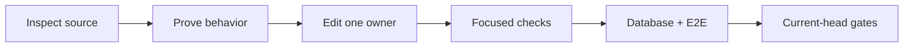

# Development And Testing

Follow the current module/toolchain files, browser manifests, and checked capability inventory. Application services own policy; storage/provider adapters implement ports. [Architecture](Architecture#architecture-checks) explains dependency enforcement.

## Change Workflow



Keep unrelated worktree/staged changes intact. Reuse existing owners rather than adding duplicate defaults, validators, or wrappers. Similar syntax is not sufficient evidence of shared policy.

## Local Checks

From the application repository:

```bash
go test ./internal/remember/... ./internal/recall/... ./internal/tools/registry/... -count=1
npm test --prefix web
node scripts/check-architecture.mjs
node --test tests/uat/architecture_conformance.test.mjs
```

The full local gate is:

```bash
./scripts/ci-check.sh
```

That script owns the complete Python, browser, proxy, Go, static-analysis, architecture, and coverage checks. Do not maintain a second expanded command inventory here. Run focused checks first and the required broader gate for the change.

## PostgreSQL And Production-Entry Tests

| Behavior | Required proof |
| --- | --- |
| Domain validation and deterministic policy | Real logic at its owning boundary. |
| RLS, SQL constraints, migrations, transactions, locks, idempotency, pgvector, concurrency | Real PostgreSQL/service integration tests. |
| New/changed supported public behavior | Positive and distinct adverse production-entry cases. |
| Retrieval quality, placement, ranking, assessment, embeddings, search documents, or performance | Applicable deterministic comparison under [Evaluation](Evaluation). |
| Documentation-only changes | Source/example/link/diagram validation; no new runtime E2E scenario solely for prose. |

Tagged `*_integration_test.go` files have registrations under `scripts/e2e-db-cases/`. Native capability adapters own their fixtures. Use the registered scenario or corresponding remote PostgreSQL shard; mocked method calls do not prove database guarantees.

```bash
scripts/e2e.sh synchronous_write_primitives
scripts/e2e.sh session_ingest
scripts/e2e.sh ontology_management
```

The [scenario registry](https://github.com/markhuangai/dense-mem/blob/152448a4c4c4192a7492ad3ae2ca311fcb82851a/scripts/e2e-scenarios.json) owns selections. Remote proof must name source SHA, image digest, selected scenarios/shards, and run URL. A passing run proves its exact source, not later worktree edits.

## Behavioral Acceptance

| Path | Include an adverse case |
| --- | --- |
| Remember | Retired/unknown fields, security rejection, invalid complete assessment, provider/embedding failure, unchanged replay, and changed-key payload conflict. |
| Session intake | Changed event, exact Unicode/whitespace offsets, prior-context exclusion, explicit empty extraction, and private erasure fences. |
| Recall/topics | Private/team isolation, unavailable or stale topics, direct membership without descendant expansion, and visible optional degradation. |
| Lifecycle/conflicts | Different owners, stale versions/revisions, exact conflict positions, and rollback preserving source history. |
| Trace/export | Unauthorized targets, bounded history/content, canonical hashes, and explicit omissions. |

Isolation-sensitive cross-profile behavior needs real A/B/C actors, including different read-visible and mutation-owning profiles.

## Python Package And Frameworks

```bash
bash packages/python/scripts/check.sh
scripts/e2e.sh python_client
scripts/e2e.sh google_adk_memory
scripts/e2e.sh langchain_retriever
```

The package check builds reproducible wheel/sdist artifacts, verifies installed-core/extra behavior, types, audit/SBOM, and existing tests. The Python matrix script covers supported Python versions and minimum/latest compatible MCP SDK. Use a fresh ignored output directory for retained artifacts.

Runnable examples are under `packages/python/examples/`. They require the documented endpoint/token and retained operation identity. Runtime use belongs to [Framework Integrations](Framework-Integrations).

Python publication follows the shared `vX.Y.Z` / `vX.Y.Z-rc.N` server release identity and trusted merged source. Never overwrite a published version. Workflow provenance and artifact checks remain publication gates; an implementation or fixture pass does not establish that a package has been published.

## Review And CI Phases

| Phase | Requirement |
| --- | --- |
| Review-first, when `REVIEW_GATED_CI=true` | Current-head reviewers, complete finding dispositions, CodeQL/analysis, and focused local regressions. |
| Deferred validation | Only the exact trusted pending statuses permitted by repository policy can be deferred. Started/failed checks remain blocking. |
| Full validation | Actual successful Repository CI, CodeQL, CodeQL analysis, Production image E2E, and all other applicable checks on the final head. |
| After a push | Prior head/activity receipts are invalid; repeat required gates. |

Owner, other-author, and fork validation paths differ. Consult the governing [repository instructions](https://github.com/markhuangai/dense-mem/blob/152448a4c4c4192a7492ad3ae2ca311fcb82851a/AGENTS.md) and workflows before requesting validation. Never treat skipped, missing, or pending full-matrix E2E as a pass.

## Data, Migrations, And Artifacts

Deployed migrations are immutable. Add an ordered migration with lock/rewrite analysis, RLS impact, constraints, recovery, and required PostgreSQL tests. Stop incompatible writers before destructive boundaries.

Generated seeds, downloaded data, runtime databases, full runs/comparisons, and protected captures stay ignored. Keep reproducible generators, locks, scoring/validation, and required safe fixtures. Only the latest overall measured result belongs in `tests/eval/baseline.json`; keep limitations and unavailable measurements intact.
