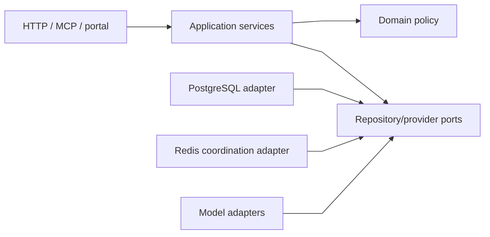
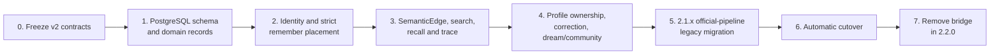
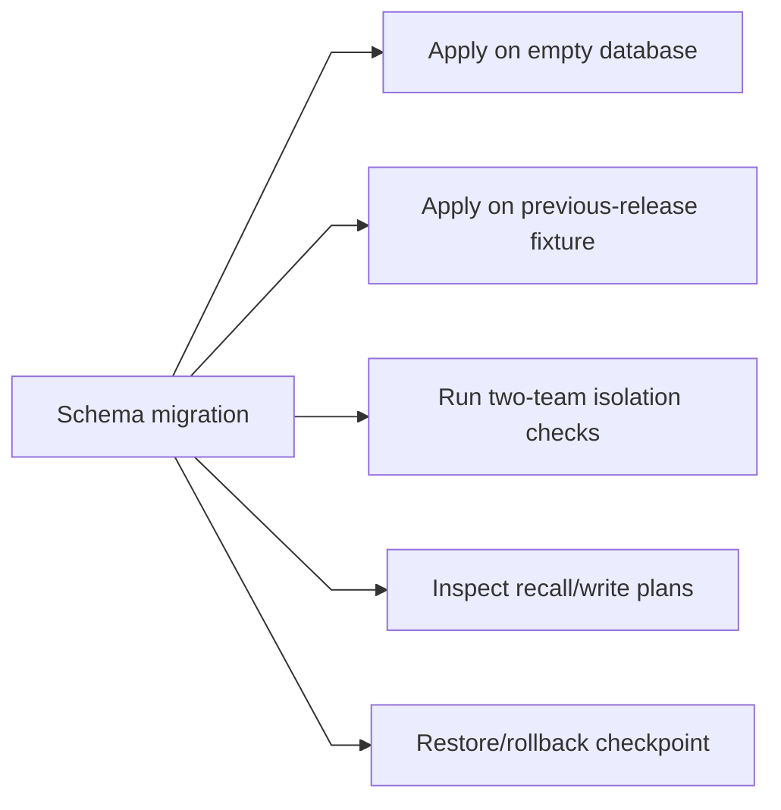

# Development And Testing

This page defines the v2 refactor workflow and test gates. Runtime inspection
results belong in project memory or a dated evaluation report, not in this
architecture page.

## Baseline Assumptions

- Go module: `github.com/markhuangai/dense-mem` using Go 1.26
- HTTP: Echo; PostgreSQL: pgx/GORM/goose; Redis: go-redis
- browser apps: React/Vite with Vitest and Playwright
- checks: `scripts/ci-check.sh` runs line lint, Go tests, and a 90% unit coverage
  gate for selected internal packages

## Current And Target

| Current pre-refactor state | Target state |
| --- | --- |
| PostgreSQL control/placement plus Neo4j semantic/search data | PostgreSQL owns ledger, current semantic state, graph reads, full text, and `pgvector` |
| claim/fact/fragment services and mixed graph records | Entity, Value, RelationshipObservation, VerificationEvent, profile-authored RelationshipRecord, Support, CrossReference, Transition, Hypothesis |
| server requires Neo4j startup/bootstrap | normal server requires PostgreSQL + `pgvector`; temporary `2.1.x` boot gate owns read-only legacy access |
| verifier surfaces legacy claim decisions | one closed response with bounded `security_signals`, `entity_results`, and `relationship_results`; no model schema-version field or stored-Relationship context |
| graph query adapters expose Neo4j behavior | repository ports expose bounded semantic-edge/search/trace operations |
| Redis optional rate/SSE backend | same coordination-only role; mandatory when distributed contracts require it |

## Target Responsibility Tree

The exact package split should follow existing Go patterns and remain
reviewable. This is a target responsibility map, not an instruction to rename
every package at once:

```text
cmd/
  server/                       # composition root
  migrate/                      # PostgreSQL migrations
  migrate-legacy-graph/         # temporary 2.1.x boot-gated adapter; remove in 2.2.0

internal/
  domain/
    evidence/
    entity/
    relationship/
    verification/
    hypothesis/
  service/
    remember/
    recall/
    trace/
    correction/
    dreaming/
  repository/
    knowledge.go
    search.go
    control.go
  storage/
    postgres/
      migrations and repositories
    redis/
      coordination only
  provider/
    reviewer/
    verifier/
    embedding/
    dream/
  transport/
    mcp/
    http/

migrations/postgres/
tests/
  integration/
  contract/
  eval/
  uat/
web/
```



Forbidden dependencies:

- domain packages importing HTTP, PostgreSQL, Redis, or provider SDKs
- PostgreSQL repositories calling model providers
- Redis interfaces accepting Entity, Relationship, evidence, or review records
- transport or provider adapters assigning tier/status
- recall reconstructing truth from search-document text
- migration compatibility types leaking into canonical domain APIs

## Refactor Slices

Each slice must compile, migrate, test, and leave a usable checkpoint.
The active GitHub roadmap breaks these slices into ordered issues #74 through
#95. `v2.1.0` is only a release bootstrap, `v2.1.1` is the planned
Neo4j-to-PostgreSQL cutover release, later `v2.1.x` releases are reserved for
bug fixes, and `v2.2.0` removes the bridge.



### Slice 0: contract fixtures

- commit V2 MCP tool input/output schemas
- commit the verifier JSON Schema from
  [Memory Write Pipeline](Write-Pipeline#strict-verifier-contract)
- create domain fixture tables for Entity, Value, observation, verification,
  Relationship, support, transition, and Hypothesis
- add forbidden-term checks for retired vocabulary, public projection fields,
  and active candidates
- generate current interface/data samples locally under ignored evaluation
  runtime paths for migration comparison; never commit generated samples

### Slice 1: PostgreSQL foundation

- enable/version `pgvector` through migration
- add target normalized tables, constraints, RLS, append-only enforcement,
  partial adjacency indexes, full-text documents, vector columns, and jobs
- add separate embedding-contract and search-index-profile metadata, validated
  dimension/operator strategy, and atomic index activation
- make every new tenant-owned table, primary/unique key, foreign key, hot join,
  queue/idempotency key, and repository lookup carry `team_id` as defined in
  [PostgreSQL Cluster-Safe Schema](PostgreSQL-Cluster-Safe-Schema)
- add authored Relationship episode identity, owner-only placement constraints,
  semantic grouping, cross-profile reference records, and system reviewer
  transition authority for resolved conflict cases
- implement transaction-local team/system worker context
- add repository contract tests against real PostgreSQL
- add backup/restore and migration-up/down fixtures before data backfill

The source currently has PostgreSQL migrations under
`migrations/postgres/` and migration wiring in
`internal/storage/postgres/migrator.go`; extend that established path instead
of introducing a second migration system.

### Slice 2: identity and remember

- implement reviewer extraction into immutable drafts
- retrieve bounded same-team Entity/predicate/Relationship context
- make exactly one verifier request per placement contract
- reject the entire output on JSON/schema/coverage/allowlist/dependency failure
- regenerate complete output; never coerce or splice
- implement same-name reuse, ambiguity review, and transactional create recheck
- commit evidence, outcomes, current state, history, review, and embedding jobs
  atomically

### Slice 3: recall and trace

- implement `SemanticEdge` as one PostgreSQL view/query shape
- implement team-scoped full-text and `pgvector` branches
- implement the exact/HNSW/halfvec/canonical-rerank paths and topology contract
  from [ANN, HNSW, And Halfvec](ANN-HNSW-And-Halfvec)
- implement indexed bounded incoming/outgoing adjacency
- fuse/deduplicate by `evidence_id` and require active support-path eligibility
  before hydration
- implement control-portal versioned RRF/branch-priority profiles and
  deterministic evidence/conflict reranking
- group equivalent cross-profile positions while retaining material conflicts
- keep evidence and verifier history out of compact recall
- expose `search_state` and branch degradation, not projection state

### Slice 4: lifecycle workflows

- implement predicate review, profile-owned conflict/correction/supersession,
  cross-profile references, owner-only forget, and nightly Conflict review
- implement write-scoped, caller-owned observation-level Entity split/merge
- let dreaming read only eligible sources and existing endpoint IDs
- run community analysis from a bounded PostgreSQL edge snapshot
- update portals and telemetry to use the canonical API

### Slice 5: `2.1.x` legacy migration

- build the read-only boot-gated Neo4j corpus adapter
- inventory all teams/profiles, preserve original owners, and exclude
  superseded knowledge with a hashed manifest
- stage every included corpus unit through the official reviewer, one-call
  verifier, lifecycle, transaction, and new-vector pipeline
- write durable mapping/checkpoint/progress/error/marker rows to PostgreSQL
- hold valid ambiguity/unknown-predicate/candidate outcomes without bypassing
  placement
- gate automatic cutover on terminal outcomes, owners, trace, RLS, recall, and
  current required vectors

### Slice 6: automatic cutover

- switch all normal writes/reads to PostgreSQL paths
- close the Neo4j adapter immediately after the transactional marker
- start the v2 data plane without a second operator confirmation only when every
  hard gate passes
- expose/log disconnect guidance and retain migration artifacts

### Slice 7: `2.2.0` bridge removal

- require a compatible `2.1.x` migration marker at startup
- remove Neo4j config, connection, Compose, readiness, Go imports, driver,
  testcontainer, migration adapter, and portal action
- retain only the marker check and historical reports required for audit

Release orchestration belongs in [Release Process](Release-Process).

## Change Workflow

For each implementation change:

1. inspect the current package, interfaces, tests, migrations, and callers
2. state current behavior and target invariant
3. add/adjust the smallest contract or integration test that proves the
   behavior
4. implement one responsibility without unrelated cleanup
5. run focused real-logic tests
6. run repository checks
7. inspect migration/query plans and the diff
8. record schema/config/API/migration implications

If the change may affect retrieval quality, ranking, placement accuracy,
verifier/reviewer behavior, embeddings, search documents, migration placement,
or performance, run the deterministic 1k evaluation/comparison and put the
result in the PR. Reuse a prior successful import only when import logic,
schema, seed identity, placement terminality, and search/vector freshness are
unchanged.

Example focused commands, verified against the current Go/npm layout:

```bash
go test ./internal/service/... -count=1
go test ./internal/storage/postgres/... -count=1
go test ./tests/integration/... -count=1
npm test --prefix web
./scripts/ci-check.sh
```

Exact targets may change during the refactor; update this page and CI together.

## Database Change Rules

Every PostgreSQL migration includes:

- explicit up/down or documented irreversible boundary
- lock and rewrite analysis on representative data
- RLS policy and role impact
- constraints for tenant ownership, object union, identity, and append-only rows
- index/query-plan evidence for hot paths
- backfill that is resumable/idempotent where large
- backup/restore and rollback checkpoint



Do not build a unique name constraint to prevent duplicate people. Name is a
candidate key; stable external IDs and canonical Relationship identity receive
the relevant uniqueness constraints.

## Test Layers

| Layer | Must prove |
| --- | --- |
| pure domain | owner-scoped Relationship identity, lifecycle transitions, source independence/currentness, automatic demotion, cross-profile references, predicate behavior, no candidate activation |
| JSON contract | closed schemas, conditionals, bounds, exact enums, bounded security signals, and no removed/unknown fields |
| PostgreSQL integration | migrations, RLS, constraints, atomic source activation, append-only security/support history, queues/leases, partial indexes, vector operators |
| repository/service integration | actual transactions, concurrent create recheck, idempotency, current-state/transition consistency |
| provider-adapter protocol | malformed JSON, extra/missing/duplicate results, wrong IDs/spans, model security signals, timeouts, 429, complete regeneration |
| recall evaluation | exact/full-text/vector/adjacency relevance, RRF/priority profiles, deterministic reranking, exact-vs-HNSW Recall@K, temporal/tenant/profile-conflict slices |
| MCP contract | `tools/list` visibility, `tools/call` schema/scope enforcement, V2 semantics, and safe errors |
| browser UAT | ambiguity, trace, correction, forget, quarantine release, Hypothesis styling, role/scope behavior |
| recovery/load | PITR/restore, vector rebuild, worker restart, high concurrency, hub traversal bounds |

Mocks may isolate an outbound provider transport error or pure query-building
unit. They cannot prove RLS, migrations, locks, `pgvector` behavior,
transactional atomicity, idempotency, or real domain policy. Those gates use a
real PostgreSQL/`pgvector` instance and actual service logic.

## Required Domain Cases

### Entity identity

- repeated mention and alias reuse one Entity
- exactly one plausible same-name candidate is reused without contradiction
- several plausible same-name candidates create review
- later conflict produces an impact preview and selected-observation split
- caller-owned split/merge leaves other profiles' observations unchanged
- concurrent equivalent creates converge
- a cross-team/non-candidate ID invalidates the whole verifier response

### Relationship lifecycle

- repeated same-owner evidence attaches to one Relationship
- another profile's equivalent/correcting evidence creates its own Relationship
  and cross-reference
- `insufficient` produces `candidate/pending_evidence` and no SemanticEdge
- authoritative entailed evidence can promote under policy
- two genuinely independent accepted sources can promote
- two stored facts do not automatically prove a third Relationship
- advancing a stable source revision revokes prior effective support team-wide
  and automatically demotes the same affected Relationships
- a stale/unowned revision or fanout-bound failure changes no source pointer or
  semantic state
- a quarantined or later failed replacement never reactivates the prior revision
- unknown predicate creates review and no Relationship
- forget retracts the edge while preserving nodes/history

### Strict verifier

Use table-driven fixtures for:

```text
invalid JSON
unknown top-level field
model-supplied schema_version
missing entity_results
missing security_signals
extra predicate_results
duplicate or unknown ref
reuse ID outside per-ref allowlist
non-null ID for create/ambiguous
unknown predicate_key
removed knowledge_alignment or related_relationship_ids field
security signal with unknown evidence ID or invalid span
out-of-range confidence
oversized rationale/array/response
cross-array unresolved endpoint
valid complete response
```

Assert that every invalid case causes complete regeneration and zero semantic
commit. A valid non-empty security-signal array quarantines the complete item
and creates no `VerificationEvent` or other semantic subset.

### Injection boundary

- the same scanner policy and bytes produce the same bounded signals/decision
- scanner error or deterministic quarantine reaches no model
- guarded evidence receives fixed untrusted-data guidance
- reviewer/verifier signals only escalate and retain exact original spans
- manager plus `write` is required for release; release re-enters guarded
- quoted security guidance and adversarial variants measure false positives and
  bypasses separately

### Recall/search

- candidates/Hypotheses never enter primary results
- exact filtered search is the quality oracle
- HNSW meets Recall@K and latency gates at representative tenant skew
- 3,072-dimensional full-precision storage creates the halfvec HNSW expression
  index and exact-reranks candidates without returning vectors to the service
- source/document/contract version mismatch excludes a vector
- one Relationship from three branches appears once
- equivalent authored positions group without losing author handles
- one qualifying cross-profile correction supplies resolved primary paths plus
  conflict refs, or unresolved policy returns alternatives/clarification
- hub/cycle traversal stops at configured bounds
- compact recall reads no evidence/verification history

### Conflict case and nightly review

Use three real same-team profiles and PostgreSQL-backed services. Seed A's
earlier authoritative single-current position, then submit B's correction and
C's follow-up through the public MCP `remember` contract. Assert the durable
case/event rows and recall/trace behavior, not that a mocked resolver method was
called.

- B's placement creates B-owned knowledge, a cross-reference, and an open case;
  A's Relationship row/version/tier/status/support/validity remains unchanged
  until nightly review
- weak B, missing required effective time, two qualifying positions, or copied
  evidence from one source group remains `open` or becomes `overdue`
- C with independent evidence creates C-owned knowledge and joins/creates the
  correct position; a bare assertion gains no weight and does not extend the
  deadline
- stale, wrong-team, dismissed, or semantically unrelated `conflict_context`
  rejects the complete intake with zero durable writes
- current recall before resolution returns bounded material alternatives; after
  nightly resolution it returns preferred support paths plus the bounded resolved
  case, while trace returns A/B/C positions and events
- `valid_at` before the business change returns the prior applicable position;
  `known_at` before B/C/resolution excludes later case events
- one fragment supporting suppressed A and an unrelated current Relationship
  remains eligible through the unrelated support path
- before TTL, a case resolves only with at least four independent source groups
  and more than 75% support; at/after TTL, a unique authority or at least two
  independent source groups with more than 50% support may resolve
- authoritative opposition blocks ordinary resolution unless the timed strong
  override has verifier-confirmed later replacement time; recorded fallback
  cannot override authority
- nightly resolution atomically sets losing stale Relationships to
  `status=superseded`, writes `valid_to`, appends Relationship and Conflict
  events, marks the case resolved, and queues search refresh
- repeated nightly runs, duplicate source-group evidence, and stale claimed
  versions are idempotent and do not extend the original deadline
- two replicas claim team-local batches without duplicate events; expired leases
  recover after restart and no cross-team row is read or written
- V2 semantic memory tools appear in MCP `tools/list`/`tools/call` only and remain
  absent/not-found on HTTP catalog, generic execution, and OpenAPI surfaces

## Concurrency And Failure Tests

Run real concurrent tests for:

- two `remember` retries with the same idempotency key
- two different ingests introducing the same identity/Relationship
- profile B correcting profile A while profile C recalls the conflict
- two profiles attempting identity correction on their own observations at once
- source owner advancing a revision while another profile adopts the old one
- old-revision placement completion racing a newer source activation
- duplicate/current-token revision retries with equal and conflicting content
- source activation at, below, and above the server-defined hard dependency
  fanout bound
- quarantine release racing a repeated model security signal
- verifier completion after placement lease loss
- correction racing recall and embedding work
- C's conflict response racing a nightly claim and a newer case version
- two nightly workers claiming the same due case and one losing/recovering lease
- old embedding job racing a newer source version
- Redis failure in one-process and multi-instance modes
- PostgreSQL deadlock/serialization retry boundaries
- process restart at each placement and embedding state
- standby replay lag/cancellation and primary failover without stale
  freshness-sensitive reads
- distributed-by-team routing with one shard missing or lagging the active
  search-index profile
- stale team placement epoch during shard move/failover; the write must fail
  without alternate-shard fallback

The test oracle is the durable outcome—not that a mocked method was called.

## Performance Gates

Measure at representative team sizes and concurrency:

| Path | Required evidence |
| --- | --- |
| remember intake | p50/p95/p99 latency, transaction/lock time, throughput |
| placement | stage latency, model time, retries, commit time, queue age |
| full text | plan, rows, buffers, p95/p99 |
| exact vector | eligible row count and latency |
| HNSW vector | Recall@K versus exact, tuples scanned, p95/p99 |
| topology | connection total, replica lag/cancel/failover, shard routing/profile parity |
| RRF/rerank | enabled/disabled profiles, nDCG/MRR, conflict preference/clarification accuracy |
| adjacency | seed/degree/depth distributions, stopped reason, p95/p99 |
| trace | joins/bytes versus support/history size |
| embedding jobs | throughput, oldest age, stale-job ratio |
| Conflict resolver/job | preference/overdue accuracy, false-suppression rate, case age, throughput, lease recovery, and current/historical recall parity |

Do not approve a graph/vector change on a synthetic single-tenant latency
number alone. Include concurrent reads/writes and tenant-filter selectivity.

## Review Checklist

- domain term has one canonical owner in the wiki
- no active candidate or Hypothesis path
- verifier response remains closed and atomic
- scanner decisions and model signals can only restrict semantic processing
- source currentness, support revocation, tier demotion, and search intent commit
  atomically
- RLS/team predicate applies before ID leaves adapter
- tenant-owned keys/FKs/joins and worker claims include the same `team_id`
- owner predicate applies before any lifecycle/support/identity mutation
- old jobs/requests cannot overwrite newer versions
- append-only history remains immutable
- error is visible and bounded; no silent fallback
- integration test exercises real PostgreSQL behavior
- migration/cutover/rollback impact is stated
- no unrelated refactor or speculative abstraction is mixed in

## Risks And Mitigations

| Risk | Concrete failure mode | Mitigation |
| --- | --- | --- |
| Target packages become a big-bang rewrite | contributors rename all services before one vertical path works | slices, adapters at boundaries, and deployable test gates |
| Unit mocks hide storage bugs | mocked repository passes while RLS or unique identity fails | real PostgreSQL/`pgvector` integration is required |
| Dual-write divergence | transition period writes PostgreSQL and Neo4j independently | one canonical PostgreSQL write; legacy graph is read-only migration input |
| Verifier accommodation returns | adapter accepts old/alternate field names to keep tests green | one committed schema, negative fixtures, and full regeneration |
| ANN benchmark is misleading | global unfiltered test passes while small tenants lose results | tenant-filtered exact baseline under representative skew/concurrency |
| Dependency removed too early | rollback still needs legacy extraction after Neo driver deletion | cutover checkpoint and explicit later removal release |
| Cross-profile tests collapse to one actor | ownership bugs pass because every fixture uses one profile | mandatory A/B/C read, correct, split, adopt, and forget integration cases |
| Scanner fixtures test keywords only | ordinary security documentation is quarantined while obfuscated control text passes | quoted/adversarial minimal pairs plus pass/guarded/quarantine confusion and bypass gates |
| Source revision test checks only the pointer | pointer advances while adopted facts and search state remain stale | real A/B/C dependency fixtures and transaction-state assertions for support, tier/status, transitions, and search intent |

## Completion Criteria

The refactor is not complete until:

1. every target domain/storage/API acceptance invariant passes
2. PostgreSQL and `pgvector` integration tests run in CI
3. strict verifier negative fixtures prove zero partial commits
4. exact-vs-ANN recall and concurrent load meet release gates
5. representative all-team migration reaches official-pipeline terminal
   outcomes, preserves authors, excludes superseded corpus, builds new vectors,
   and passes the automatic marker gate
6. server, Compose, config, readiness, docs, and dependencies contain no normal
   Neo4j path
7. PostgreSQL backup/PITR and vector rebuild are proven
8. MCP discovery/execution, first-party portal, and evaluation fixtures agree
   on V2 semantics where their bounded use cases overlap
9. `2.2.0` rejects missing bridge markers and contains no Neo4j connection path
