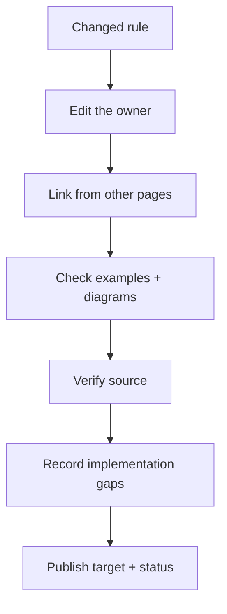

# Documentation Maintenance

This wiki holds the approved target architecture and recommended workflows. Describe behavior, boundaries, and outcomes directly. Keep design rationale and decision history in ADRs and issues. Label approved behavior that awaits implementation and verify deployment availability separately.

The reviewed source is [41e27867](https://github.com/markhuangai/dense-mem/commit/41e278673679c1d9634cd63a68d13c74e8a46452), using contract `dense-mem.v2.8.0`.

## Implementation Status

| Subject | Source behavior | Availability boundary |
| --- | --- | --- |
| Remember | Synchronous terminal outcomes with optional bounded progress notifications. | Implemented in the reviewed source; [client presentation](MCP-Clients#remember-progress) depends on the host. |
| Evidence-only cutover | Migration `20261110010000` resets derived organization and retains Evidence for subsequent maintenance. | Applies once to databases where the migration is pending; see [cutover and rebuild](Operations-Runbook#evidence-only-cutover). |
| Staging deployment | The selected image performs migrations before read-only verification and startup. | Requires the manually installed host helper; live installation and deployment were not inspected in this audit. |

Source implementation does not establish the state of a deployed image or database. [ADR 0001](https://github.com/markhuangai/dense-mem/blob/41e278673679c1d9634cd63a68d13c74e8a46452/adr/0001-predictable-mcp-tool-contracts.md) governs terminal MCP outcomes; [ADR 0017](https://github.com/markhuangai/dense-mem/blob/41e278673679c1d9634cd63a68d13c74e8a46452/adr/0017-evidence-only-memory-without-factual-relationships.md) defines the Evidence-only boundary. Detailed verification receipts remain with the linked changes: [Remember progress](https://github.com/markhuangai/dense-mem/pull/745), [organization reset](https://github.com/markhuangai/dense-mem/pull/757), and [staging deployment](https://github.com/markhuangai/dense-mem/pull/753).

## Canonical Page Ownership

| Subject | Owner |
| --- | --- |
| Reader orientation and navigation | [Home](Home) and its sidebar. |
| Components, dependency direction, runtime composition | [Architecture](Architecture). |
| Exact Evidence, occurrence/revision meaning, ownership, lifecycle, temporal semantics | [Evidence Model And Lifecycle](Evidence-Model-And-Lifecycle). |
| Topics, direct membership, equivalence, freshness, maintenance and manager publication | [Topics And Organization](Topics-And-Organization). |
| Staging, duplicate/assessment orchestration, stage progression, deadlines, embeddings, atomicity and replay | [Memory Write Pipeline](Write-Pipeline). |
| Storage families, durable versus rebuildable state | [Data Model And Storage](Data-Model-And-Storage). |
| Tenant keys, constraints, transactions, RLS, generation and topology mechanics | [PostgreSQL Cluster-Safe Schema](PostgreSQL-Cluster-Safe-Schema). |
| Recall eligibility, branches, grouping, topic follow-up and degradation | [Recall Ranking](Recall-Ranking). |
| Similarity, candidate fusion and typed relevance reranking | [Vector Search And Ranking](Vector-Search-And-Ranking). |
| Physical vector execution, dimensions, HNSW/halfvec and index lifecycle | [ANN, HNSW, And Halfvec](ANN-HNSW-And-Halfvec). |
| Public tools, complete protocol/progress examples, field bounds, result/error shapes | [Technical Reference](Technical-Reference). |
| Recommended host workflow | [Using Dense-Mem](Using-Dense-Mem). |
| Installation, disposable demo and host connection | [Quick Start](Quick-Start), [Hosted Demo](Hosted-Demo), [MCP Clients](MCP-Clients), each for its own procedure. |
| Python, ADK and LangChain adapter use | [Framework Integrations](Framework-Integrations). |
| Authentication, principal, authorization, spaces and exposure policy | [Request Lifecycle And Security](Request-Lifecycle-And-Security). |
| Credential administration and owner erasure requests | [Portals And API Keys](Portals-And-API-Keys). |
| IdP setup, entitlement mapping and directory provisioning | [User Portal SSO](User-Portal-SSO). |
| Evidence replacement/retraction and conflict inspection/decisions | [Conflicts And Corrections](Conflicts-And-Corrections). |
| Portable Evidence artifacts and omission interpretation | [Memory Packs](Memory-Packs). |
| Voluntary observational judgments | [Recall Feedback](Recall-Feedback). |
| Setting names, defaults and configuration source | [Configuration](Configuration). |
| Ingress and distributed-coordination deployment | [Public HTTPS And Redis](Public-HTTPS-And-Redis). |
| Startup, incidents, maintenance, backup and recovery procedures | [Operations Runbook](Operations-Runbook). |
| Metrics, operational diagnostics, cost and export interpretation | [Telemetry](Telemetry). |
| Source-change workflow, test layers and release checks | [Development And Testing](Development-And-Testing). |
| Evaluation protocol, identity, quality gates and artifacts | [Evaluation](Evaluation). |

## Single-Source Rules



Keep complete schemas/examples in Technical Reference, defaults in Configuration, policy in its owning page, and procedures in their workflow/runbook. Framework-native snippets may illustrate their integration without restating the wire schema. Short reader summaries are useful; copied decision tables and full diagrams create competing authority.

Prefer an illustrative diagram for relationships, ordering, boundaries, and failure paths. Use a small table for fields or outcomes. Keep prose for constraints, exceptions, and details the visual cannot express. Preserve distinct subjects rather than merging unrelated responsibilities to reduce page count.

Retired feature URLs retain only short pointers and are absent from active navigation. Delete redundant pages after moving any unique current material. Remove completed plans and obsolete release narratives; preserve exact identifiers still emitted by code, such as artifact formats and `retired_contract`.

## Updating And Verifying

1. Record the approved target, inspected source revision/worktree state, and implementation gaps; read relevant accepted ADRs, callers, owners, and tests.
2. Update the canonical explanation and all affected links, examples, and diagrams together.
3. Test a concrete adverse reading: private-bound access, stale topic/revision, malformed provider response, required failure, or unknown delivery.
4. Validate links/anchors, examples, source identifiers, diagrams, and the final diff.
5. Publish only through the authorized repository workflow and verify its resulting revision.

| Material | Verification |
| --- | --- |
| Complete tool JSON | Current registry schemas and semantic input validation; also validate complete protocol envelopes and any explicitly labeled target examples. Substitute only explicit returned-ID/new-key placeholders. |
| Python snippets | Parse/compile and check current client types, methods, options, and constructor signatures. |
| Shell/config snippets | Syntax plus existing scripts, routes, parser settings, and deployment examples. |
| Source/lifecycle claims | Domain policy, adapters, migrations, real PostgreSQL tests and supported consumers. |
| Wiki links | Resolve every page and GitHub heading anchor, including changed inbound links. |
| Mermaid | Extract backtick and tilde fences; parse with pinned temporary tooling and render/inspect substantial diagrams. |

Flowcharts use `%%{init: {"flowchart": {"curve": "linear"}}}%%`; sequence diagrams use `%%{init: {"sequence": {"rightAngles": true}}}%%`.

```bash
git diff --check
git diff --stat
git status --short
```

Inspect retired-term matches in context. Microsoft Graph, dependency graphs, and HNSW indexes are not retired factual memory features. Do not erase current historical-read/error identifiers with a blanket text replacement.

Report the source baseline, changed responsibilities, executed validation, publication commit, and remaining uncertainty. Preserve concurrent worktree edits and distinguish static inspection from live service proof.
