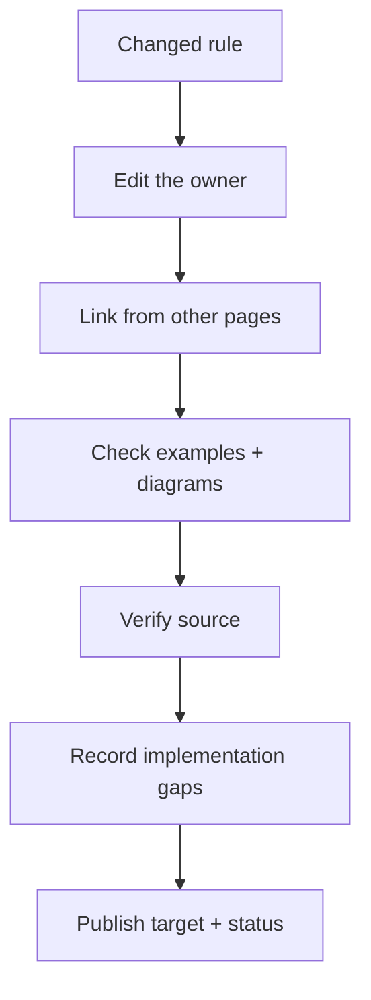

# Documentation Maintenance

This wiki holds the approved target architecture and recommended workflows. Accepted ADRs and explicit maintainer decisions govern the target; registries, implementations, migrations, callers, and tests establish implemented behavior. Describe approved targets before implementation, label the affected sections, and record their implementation gaps here. Verify implementation and deployment claims separately.

The current audit uses [source snapshot 152448a4](https://github.com/markhuangai/dense-mem/commit/152448a4c4c4192a7492ad3ae2ca311fcb82851a) and contract `dense-mem.v2.8.0`. Source state does not establish a deployed release.

## Implementation Status

| Subject | Approved target | Inspected implementation |
| --- | --- | --- |
| Remember outcome | Required work finishes in the originating call; final success or actionable failure remains authoritative. | Synchronous processing is present in the audited Evidence-only baseline. |
| Remember progress | Optional request-scoped stage notifications while the same call remains pending. | Implemented and verified in [candidate 66e103ed](https://github.com/markhuangai/dense-mem/commit/66e103ed04b93c6658e8cbed607bc4decfc01e42), [PR #745](https://github.com/markhuangai/dense-mem/pull/745). Not merged or deployed. |

The #742 candidate passed independent plan audit (`gpt-6.1-sol/max`, round 5), selective local checks, and [Development E2E 43263787048](https://github.com/markhuangai/dense-mem/actions/runs/43263787048): all five selected scenarios and PostgreSQL shard 4. The tested production image was `sha256:85f1338975f758b941aaa2dc2865a58fc7755331f2466da3c571d521911af8f6`; [cleanup 43265955042](https://github.com/markhuangai/dense-mem/actions/runs/43265955042) deleted its owned version. Client fixture probes separately verified visible stage updates in Claude Code 2.1.288 and generic tool status without stage text in Codex 0.166.0. These results establish candidate behavior, not deployment. The maintainer-approved 1k evaluation waiver and replacement verification are recorded in the [issue contract](https://github.com/markhuangai/dense-mem/issues/742#issuecomment-6823449787).

The maintainer authorized [Codex-only review for this delivery](https://github.com/markhuangai/dense-mem/issues/742#issuecomment-6826236791). The separate AI reviewer error remains excluded from that gate. Codex completed without findings, and CodeQL plus CodeQL analysis passed on `66e103ed04b93c6658e8cbed607bc4decfc01e42`.

Full Repository CI and production-image E2E passed in [run 43266534414, attempt 2](https://github.com/markhuangai/dense-mem/actions/runs/43266534414/attempts/2), including all 30 scenarios and six PostgreSQL shards. The initial `ontology_organization` failure was a verified transient embedding-provider HTTP 502; its one scoped retry passed on the unchanged source and image. The production image was `sha256:20a5843dc5061e61d8eb46a39d429f72690f560ee9568550dde9fcdf00fb8c9f`. The candidate includes main `007fbb6fafed69411c09666de37cc0a20ec24523`; the PR remains open and requires human approval.

Sections marked **Target** specify the approved progress behavior. Keep candidate verification separate from merge and deployment status. Client-specific inspection and UI uncertainty belong to [MCP Clients](MCP-Clients#remember-progress-target).

[ADR 0001](https://github.com/markhuangai/dense-mem/blob/66e103ed04b93c6658e8cbed607bc4decfc01e42/adr/0001-predictable-mcp-tool-contracts.md#decision) requires synchronous terminal outcomes. The candidate clarification preserves that decision while allowing optional activity notifications.

## Canonical Page Ownership

| Subject | Owner |
| --- | --- |
| Reader orientation and navigation | [Home](Home) and its sidebar. |
| Components, dependency direction, runtime composition | [Architecture](Architecture). |
| Exact Evidence, occurrence/revision meaning, ownership, lifecycle, temporal semantics | [Evidence Model And Lifecycle](Evidence-Model-And-Lifecycle). |
| Topics, direct membership, equivalence, freshness, maintenance and manager publication | [Topics And Organization](Topics-And-Organization). |
| Staging, duplicate/assessment orchestration, stage progression, deadlines, embeddings, atomicity and replay | [Memory Write Pipeline](Write-Pipeline). |
| Storage families, durable versus rebuildable state | [Data Model And Storage](Data-Model-And-Storage). |
| Tenant keys, constraints, transactions, RLS, generation and topology mechanics | [PostgreSQL Cluster-Safe Schema](PostgreSQL-Cluster-Safe-Schema). |
| Recall eligibility, branches, grouping, topic follow-up and degradation | [Recall Ranking](Recall-Ranking). |
| Similarity, candidate fusion and typed relevance reranking | [Vector Search And Ranking](Vector-Search-And-Ranking). |
| Physical vector execution, dimensions, HNSW/halfvec and index lifecycle | [ANN, HNSW, And Halfvec](ANN-HNSW-And-Halfvec). |
| Public tools, complete protocol/progress examples, field bounds, result/error shapes | [Technical Reference](Technical-Reference). |
| Recommended host workflow | [Using Dense-Mem](Using-Dense-Mem). |
| Installation, disposable demo and host connection | [Quick Start](Quick-Start), [Hosted Demo](Hosted-Demo), [MCP Clients](MCP-Clients), each for its own procedure. |
| Python, ADK and LangChain adapter use | [Framework Integrations](Framework-Integrations). |
| Authentication, principal, authorization, spaces and exposure policy | [Request Lifecycle And Security](Request-Lifecycle-And-Security). |
| Credential administration and owner erasure requests | [Portals And API Keys](Portals-And-API-Keys). |
| IdP setup, entitlement mapping and directory provisioning | [User Portal SSO](User-Portal-SSO). |
| Evidence replacement/retraction and conflict inspection/decisions | [Conflicts And Corrections](Conflicts-And-Corrections). |
| Portable Evidence artifacts and omission interpretation | [Memory Packs](Memory-Packs). |
| Voluntary observational judgments | [Recall Feedback](Recall-Feedback). |
| Setting names, defaults and configuration source | [Configuration](Configuration). |
| Ingress and distributed-coordination deployment | [Public HTTPS And Redis](Public-HTTPS-And-Redis). |
| Startup, incidents, maintenance, backup and recovery procedures | [Operations Runbook](Operations-Runbook). |
| Metrics, operational diagnostics, cost and export interpretation | [Telemetry](Telemetry). |
| Source-change workflow, test layers and release checks | [Development And Testing](Development-And-Testing). |
| Evaluation protocol, identity, quality gates and artifacts | [Evaluation](Evaluation). |

## Single-Source Rules



Keep complete schemas/examples in Technical Reference, defaults in Configuration, policy in its owning page, and procedures in their workflow/runbook. Framework-native snippets may illustrate their integration without restating the wire schema. Short reader summaries are useful; copied decision tables and full diagrams create competing authority.

Prefer an illustrative diagram for relationships, ordering, boundaries, and failure paths. Use a small table for fields or outcomes. Keep prose for intent, exceptions, and details the visual cannot express. Preserve distinct subjects rather than merging unrelated responsibilities to reduce page count.

Retired feature URLs retain only short pointers and are absent from active navigation. Delete redundant pages after moving any unique current material. Remove completed plans and obsolete release narratives; preserve exact identifiers still emitted by code, such as artifact formats and `retired_contract`.

## Updating And Verifying

1. Record the approved target, inspected source revision/worktree state, and implementation gaps; read relevant accepted ADRs, callers, owners, and tests.
2. Update the canonical explanation and all affected links, examples, and diagrams together.
3. Test a concrete adverse reading: private-bound access, stale topic/revision, malformed provider response, required failure, or unknown delivery.
4. Validate links/anchors, examples, source identifiers, diagrams, and the final diff.
5. Publish only through the authorized repository workflow and verify its resulting revision.

| Material | Verification |
| --- | --- |
| Complete tool JSON | Current registry schemas and semantic input validation; validate target protocol envelopes separately and retain their implementation label. Substitute only explicit returned-ID/new-key placeholders. |
| Python snippets | Parse/compile and check current client types, methods, options, and constructor signatures. |
| Shell/config snippets | Syntax plus existing scripts, routes, parser settings, and deployment examples. |
| Source/lifecycle claims | Domain policy, adapters, migrations, real PostgreSQL tests and supported consumers. |
| Wiki links | Resolve every page and GitHub heading anchor, including changed inbound links. |
| Mermaid | Extract backtick and tilde fences; parse with pinned temporary tooling and render/inspect substantial diagrams. |

Flowcharts use `%%{init: {"flowchart": {"curve": "linear"}}}%%`; sequence diagrams use `%%{init: {"sequence": {"rightAngles": true}}}%%`.

```bash
git diff --check
git diff --stat
git status --short
```

Inspect retired-term matches in context. Microsoft Graph, dependency graphs, and HNSW indexes are not retired factual memory features. Do not erase current historical-read/error identifiers with a blanket text replacement.

Report the source baseline, changed responsibilities, executed validation, publication commit, and remaining uncertainty. Preserve concurrent worktree edits and distinguish static inspection from live service proof.
