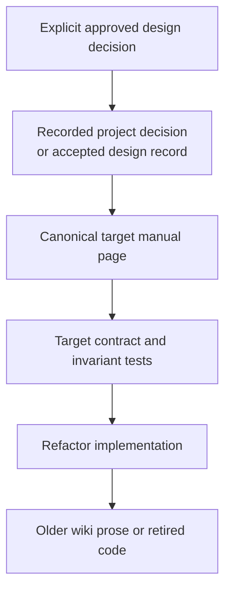
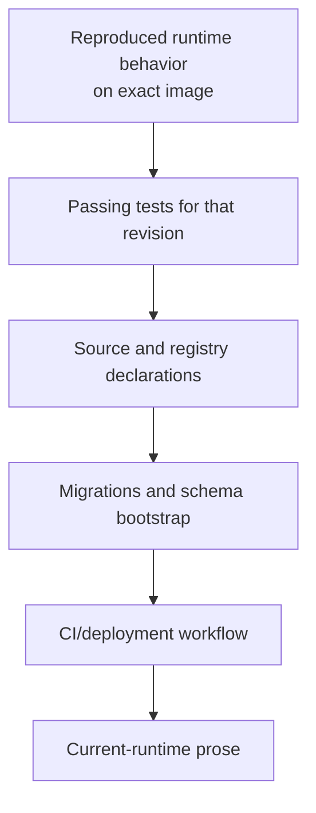
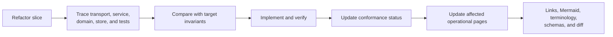
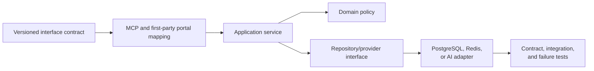
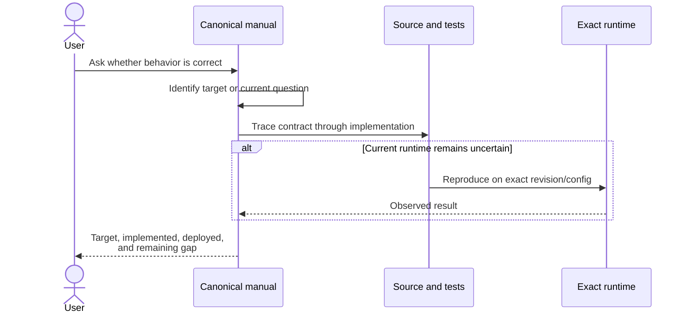

# Documentation Maintenance

This wiki is the current project manual and architecture contract. It describes
the supported current behavior, not a changelog.

## Status Classes

Every deep technical page uses one status:

| Status | Meaning |
| --- | --- |
| current architecture | approved contract the implementation must satisfy |
| current runtime | verified behavior of an exact commit/image |
| operational procedure | commands for a named supported release |
| retired compatibility | temporary compatibility behavior with a removal condition |

Do not mix architecture, runtime findings, and history in one paragraph.
Runtime findings, dated score reports, and work-in-progress deltas belong in
project memory or evaluation reports unless they are part of a supported
operator procedure.

## Authority Depends On The Question

### Architecture question



Current code is conformance evidence; it does not silently supersede the
architecture.
A design change needs an explicit decision, a concrete risk analysis, and an
update to the canonical page before dependent implementation is treated as the
new contract.

### Current-runtime question



When runtime and source disagree, reproduce with the exact image, configuration,
database version, and feature flags before deciding what shipped.

### Resolving a conflict

| Conflict | Interpretation |
| --- | --- |
| architecture page versus current code | implementation/conformance gap |
| explicit new design decision versus architecture page | manual update required before implementation proceeds |
| current-runtime page versus tested code | documentation defect |
| deployed runtime versus source checkout | version/config mismatch until reproduced |
| project memory versus explicit later user decision | later explicit decision wins; update the durable record and manual |

## Canonical Page Ownership

| Subject | Canonical page |
| --- | --- |
| reader navigation and manual status | [Home](Home) |
| system boundaries, dependency direction, and startup | [Architecture](Architecture) |
| Entity identity, names, aliases, reuse/create/ambiguity, merge/split | [Entity Identity And Resolution](Entity-Identity-And-Resolution) |
| Relationship vocabulary, identity, cardinality, status/effective support, trace, and SemanticEdge contract | [Relationship Model And Lifecycle](Relationship-Model-And-Lifecycle) |
| remember stage order, provider retries, commit order, and review orchestration | [Memory Write Pipeline](Write-Pipeline) |
| PostgreSQL/pgvector/Redis ownership, graph-shaped/search reads, jobs, and recovery | [Data Model And Storage](Data-Model-And-Storage) |
| cluster-safe tenant keys, table placement, composite constraints, RLS/query locality, and queue routing | [PostgreSQL Cluster-Safe Schema](PostgreSQL-Cluster-Safe-Schema) |
| recall branches, eligibility, frontier, trace escalation, and degradation | [Recall Ranking](Recall-Ranking) |
| embedding and distance meaning, candidate fusion, RRF, and post-fusion reranking | [Vector Search And Ranking](Vector-Search-And-Ranking) |
| exact/ANN execution, HNSW, halfvec, vector index lifecycle/load, and vector-search topology | [ANN, HNSW, And Halfvec](ANN-HNSW-And-Halfvec) |
| exact versioned MCP tool schemas | [Technical Reference](Technical-Reference) |
| authentication, tenant identity, scopes, MCP discovery/execution, and portal boundaries | [Request Lifecycle And Security](Request-Lifecycle-And-Security) |
| durable team Conflict cases, recall disposition, and evidence-backed correction | [Conflicts And Corrections](Conflicts-And-Corrections) |
| community derivation and analytical summaries | [Community And Dreaming](Community-And-Dreaming) |
| Hypothesis generation, isolation, review, and staleness | [Dreaming](Dreaming) |
| portable knowledge artifact and export workflow | [Memory Packs](Memory-Packs) |
| observational recall feedback | [Recall Feedback](Recall-Feedback) |
| evaluation manifests, quality metrics, and release gates | [Evaluation](Evaluation) |
| browser SSO and entitlement mapping | [User Portal SSO](User-Portal-SSO) |
| portals, memberships, credentials, roles, and key administration | [Portals And API Keys](Portals-And-API-Keys) |
| environment and database runtime settings | [Configuration](Configuration) |
| deployment, backup, restore, and incidents | [Operations Runbook](Operations-Runbook) |
| telemetry names and operational interpretation | [Telemetry](Telemetry) |
| source layout and validation layers | [Development And Testing](Development-And-Testing) |

[Home](Home#start-here) is the navigation map. This table is the ownership map.
Do not reproduce either map on another page.

## Single-Source Rules

A referencing page may state the local consequence of a rule, then link to its
owner. It must not copy the owner's:

- request/response schema
- lifecycle table or decision matrix
- limits/defaults/configuration table
- complete process diagram
- detailed storage shape
- troubleshooting decision tree
- full operational procedure

When content gains its own responsibility, move it to a new canonical page and
replace old copies with narrow links. Git history preserves removed prose.

Examples:

| Local page needs to say | Correct form |
| --- | --- |
| recall is fast because it omits assessor history | state that consequence; link to Relationship trace and Recall |
| aliases do not become edges | state the local effect; link to Entity Identity |
| vector build follows commit | show only the local consequence; link to Data Model for embedding-job semantics |
| Relationship correlation rank is independent from lifecycle | state the local consequence; link to Recall Ranking and Vector Search |

## Design Change Process

```mermaid
%%{init: {"flowchart": {"curve": "linear"}}}%%
flowchart LR
  Problem["Concrete problem or ambiguity"] --> Verify["Inspect memory, manual,<br/>source, tests, and data"]
  Verify --> Options["Compare valid designs"]
  Options --> Risk["Falsify proposal and<br/>document failure modes"]
  Risk --> Decision["Obtain explicit design decision"]
  Decision --> Record["Record durable project decision"]
  Record --> Canonical["Update canonical page"]
  Canonical --> Dependents["Update dependent summaries"]
  Dependents --> Tests["Define conformance tests"]
  Tests --> Implement["Begin refactor slice"]
```



Do not change a high-blast-radius design because it is convenient for the
current code. Identify the mismatch and obtain the decision.

## Implementation Documentation Process



### Fix the source context

Record without modifying either worktree:

```bash
git -C ../dense-mem status --short --branch
git -C ../dense-mem rev-parse HEAD
git -C ../dense-mem log -1 --format='%cI %s'
```

A dirty working tree is not a stable revision. State whether evidence comes from
`HEAD`, a named branch, a working tree, or a deployed image.

### Keep architecture ownership current

`architecture/ownership.v1.json` is the canonical source for current package,
browser-module, and worker ownership. When a package or entry point is added,
removed, or moved, update that manifest in the same implementation slice and
run the repository conformance fixtures. Record only verified current
ownership; future moves belong in an exact exception with a reason and a later
removal issue. The checker must remain deterministic and fail on unclassified
or stale units, forbidden imports, unresolved browser edges, missing worker
anchors, and expired or unused exceptions.

Architecture pages should explain the role matrix and the maintenance rule,
then link to the manifest and checker. They should not copy the generated
inventory or describe a future package split as if it already shipped.

### Trace the path



For configuration, trace parsing, startup validation, effective lookup,
deployment examples, and operator output. For database behavior, trace
migrations, constraints, transaction boundaries, repository queries, and
recovery tests.

### Try to falsify the claim

Ask:

- Can the authenticated role and scope perform this operation?
- Does an async response mean staged, semantically committed, vector-current,
  or processing-completed?
- Can an empty candidate set be confused with a retrieval error?
- Can two workers create duplicate Entities or Relationships?
- Can graph context accidentally count as evidence?
- What remains readable when embedding work fails?
- Does Redis contain the only copy of anything important?
- Can a same-name Entity cross a team boundary?
- Can same-team visibility mutate another profile's knowledge?
- Can a Hypothesis enter primary recall?
- Can an older client silently misread the current response contract?

If the failure changes the contract, add a specific Risk and mitigation before
implementation.

## Removing Stale Material

Remove material that no longer describes a supported or required path. Keep old
terminology only when:

- a compatibility adapter currently accepts it
- an operator must handle stored data containing it
- an explicit tombstone behavior matters

Mark the removal condition. Do not keep old architecture prose for history.

The retired term `Assertion` may appear in the single retirement note or a
retired compatibility mapping. It must not name an active target record,
metric, API field, graph label, or service.

## Page Template

Deep target pages should use the parts that fit:

```markdown
# Feature

## Outcome and responsibility

## End-to-end flow

## Decision or state model

## Failure semantics

## Security and tenant boundary

## Risks and mitigations

## Acceptance invariants
```

Current-runtime or operational pages additionally name the exact supported
release/commit and link to runtime discovery where appropriate.

## Mermaid Conventions

Every flowchart begins with:

```text
%%{init: {"flowchart": {"curve": "linear"}}}%%
```

Every sequence begins with:

```text
%%{init: {"sequence": {"rightAngles": true}}}%%
```

Use flowcharts instead of diagram types that cannot guarantee the required
straight-line rendering.

Guidelines:

- keep labels short
- quote labels containing punctuation
- show failure/retry branches
- distinguish durable stores from calls
- avoid color as the only meaning
- split unreadably large diagrams
- parse every Mermaid block
- reject a diagram missing its type-specific directive

## Validation

### Workspace and diff

```bash
git status --short
git diff --check
```

Do not stage, commit, or discard unrelated user changes.

### Links

Resolve each wiki target after stripping an optional anchor. For anchored links,
verify the target heading's GitHub-style slug.

### Mermaid

Extract and parse every `mermaid` fence with the repository's pinned Mermaid
CLI/parser. Syntax success is not enough; spot-check large diagrams for readable
layout.

### Terminology

```bash
rg -n -i 'assertion|assertion_id|43f3e38' --glob '*.md'
```

Inspect every match. Target pages should contain only deliberate retirement
references.

Also scan for target terms used inconsistently:

```bash
rg -n 'RelationshipObservation|VerificationEvent|RelationshipRecord|SemanticEdge|Hypothesis|entity_id|relationship_id' --glob '*.md'
```

### Contract reconciliation

| Documentation | Compare against |
| --- | --- |
| tool names/scopes | registry declarations plus `tools/list`/`tools/call` tests |
| first-party portal behavior | user/control portal route and browser tests |
| input/output schemas | generated MCP schema fixtures |
| environment defaults | configuration parser and deployment examples |
| database configuration | migrations and effective-config readers |
| Entity/Relationship states | domain constants, constraints, and invariant tests |
| release behavior | CI/release workflows |
| full-text/vector/adjacency indexes | PostgreSQL migrations, plans, and integration/evaluation tests |
| durable records | PostgreSQL migrations and repository integration tests |

## Freshness Metadata

Architecture pages describe the current approved contract and should not
carry dated runtime-conformance notes. Current-runtime pages say:

```text
This page documents runtime behavior at <commit or image digest> on <date>.
```

Do not write “latest” without a resolved tag, digest, commit, or explicit target
decision.

## Reviewing A Reported Mismatch



Answer with actual file/line paths for current-code claims. Keep four categories
separate:

- approved target behavior
- implemented source behavior
- deployed runtime behavior
- historical compatibility behavior

## Review Checklist

- [ ] page status and source context are explicit
- [ ] the relevant canonical owner was identified
- [ ] current behavior and target behavior are not conflated
- [ ] conflicting project decisions were resolved and recorded
- [ ] tenant, role, scope, and feature gates are explicit
- [ ] processing state and vector-search freshness are distinct
- [ ] Entity reuse/create/ambiguity occurs before Relationship identity
- [ ] graph context is not evidence
- [ ] Redis is not described as durable memory
- [ ] failure, retry, job recovery, schema-change, and rollback boundaries are explicit
- [ ] Risk contains specific failure modes and mitigations
- [ ] stale material was removed instead of accumulated
- [ ] schemas/defaults live on one owner page
- [ ] links, headings, Mermaid, terminology, and `git diff --check` pass
- [ ] unrelated user changes remain untouched
