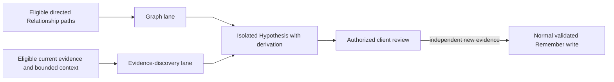

# Dreaming

Dreaming proposes possible Relationships between existing semantic nodes. Its
output is an isolated `Hypothesis`, never evidence or an active semantic edge.
Generation cannot create Entities, Values, predicates, Relationships, or support.

## Boundary



Confidence, likelihood, repetition, or feedback do not make a Hypothesis true.
Confirmation requires independent evidence and the normal accepted write path.

## Graph Lane

The graph lane reads eligible supported Relationships and qualifying
insufficient/pending premises with the required review conditions. It constructs
direct, directed two-edge paths:

```text
A -- r1 --> B -- r2 --> C
```

Endpoints and registered target predicates already exist. The two premises are
distinct, at least one is active, and the endpoints must fit the predicate.
Currentness, support, conflict, review, and source checks exclude unsafe or
ineligible premises.

The provider receives request-local opaque node, predicate, path, and evidence
references with exact excerpts. It may propose no output. A proposal must cite
an allowed excerpt from each premise and use supplied endpoints/predicates.

Current target checks, duplicate prevention, and path/version evaluation
records prevent repeated generation from multiplying accepted Hypotheses.

## Evidence-Discovery Lane

This lane selects bounded current evidence targets with related evidence
context, existing semantic nodes, compatible registered predicates, and
duplicate-prevention context. It can explore evidence that did not produce an
accepted Relationship during Remember.

The provider receives opaque references and server-issued text boundaries.
Every proposal must cite the target evidence and use supplied existing nodes
and predicates. The server validates the complete response, resolves references,
and persists exact derivation spans.

Durable target reservations, dispatch state, evaluation fingerprints, current
source checks, and run/lease fences control retries and duplicate work.
Stale or inaccessible targets cannot authorize a late commit. This processing
does not retroactively treat a Hypothesis as submitted evidence.

## Scheduling And Concurrency

Both lanes obey effective team Dream enablement. A global disable wins;
global force-enable applies only when globally enabled; otherwise the team's
optional `dreaming.enabled` setting overrides the enabled global default.

| Lane | Window |
| --- | --- |
| Graph | One configured local-time daily window in `APP_TIMEZONE`. |
| Evidence discovery | Durable UTC hourly windows, selected by the scheduler. |

For the graph lane, the configured minute is exact. Starting or enabling the
process after that minute does not trigger a late catch-up. A process that
observed the enabled schedule can record a missed window when it could not
claim it. A DST gap is missed; a repeated minute still has one team/date run.

The evidence lane uses the current UTC hour, not the graph lane's exact local
minute. Its `hour:` window key identifies the durable run across scheduler
passes.

Expired scheduled leases have bounded recovery. Current unexpired lease tokens
and source versions are checked when persisting results and completing the run.
Redis never owns the only run record. Fixed input/output/provider bounds keep
each cycle finite.

Editable settings belong in [Configuration](Configuration#dreaming).

## Hypothesis Lifecycle

| Status | Meaning |
| --- | --- |
| `proposed` | Available for review. |
| `reinforced` | Explicit feedback retained the idea; still not accepted knowledge. |
| `stale` | No longer current. |
| `rejected` | Explicitly rejected. |
| `submitted` | Independent evidence completed the linked Remember workflow. |

Generated duplicates do not automatically reinforce an existing Hypothesis.
Source eligibility is checked again before use. A status or probability is not
a substitute for independent evidence.

## Client Workflow

Use `list_dreams` and `get_dream` only when exposed by the authenticated
catalog. Recall may return a separate `related_hypotheses` field and an
action suggestion. Hypotheses never enter primary evidence results.

`resolve_dream_feedback` accepts `reinforce`, `stale`, `reject`,
`confirm_true`, or `confirm_false`. Confirmation needs independently
obtained evidence, not copied Hypothesis or recalled text. Evidence-discovery
confirmation also enforces the source-owner authorization.

Dream confirmation has its own schema: Relationship entries include
`modality` and do not accept `known_evidence_ids`. Use the complete example
and prerequisites returned by `tools/list`; do not copy a Remember payload
without checking that schema.

The original Hypothesis remains isolated until the confirmation workflow
succeeds. A failed Remember result carries its own remediation; a successful
confirmation links the ingest and updates the Hypothesis. Follow
`retry_dream_feedback` only when returned and retain the exact request.

## Run Diagnostics

The private control portal exposes run, target, provider, proposal, disposition,
and confirmation diagnostics. The user-facing Dream view remains a bounded
product projection.

```text
GET /control/api/teams/{teamId}/dreaming/runs/{runId}/diagnostics
GET /control/api/teams/{teamId}/dreaming/runs/{runId}/diagnostics/{diagnosticId}
GET /control/api/teams/{teamId}/dreams/{dreamId}/diagnostics
```

Lists are bounded and cursor-paginated; detail fetches load protected payloads
only within the authorized team/run. Run summaries distinguish eligible inputs,
attempted paths, evidence targets, evaluated targets, provider turns/proposals,
created Hypotheses, and rejection causes.

Zero output can mean no eligible target, already evaluated work, a valid provider
decision to propose nothing, or rejected/stale proposals. It is not evidence
that the provider failed or was never called.

Capture state distinguishes captured, truncated, unavailable, not captured,
and expired data. Operational credentials are protected before persistence.
A failed credential-protection step cannot be reported as a successful capture.
Capture bodies expire after seven days; bounded expiry metadata is short-lived.
Purging diagnostics does not delete semantic Hypotheses or their lineage.

## Risks And Verification

| Failure mode | Protection |
| --- | --- |
| Generated speculation becomes a fact by repetition | Separate Hypothesis storage and independent-evidence confirmation. |
| A provider invents an endpoint or predicate | Closed response schema and request-local allowlists. |
| An expired worker commits after recovery | Lease and source/version checks in the persistence transaction. |
| A target change repeats an old evaluation incorrectly | Durable target/evaluation identity and current-input validation. |
| An operator mistakes empty output for a transport failure | Inspect run phases, provider attempts, and capture availability separately. |

Graph, evidence-discovery, scheduling, confirmation, and diagnostic behavior
have capability-local tests and PostgreSQL integration cases. Operational
triage is in [Operations Runbook](Operations-Runbook).
