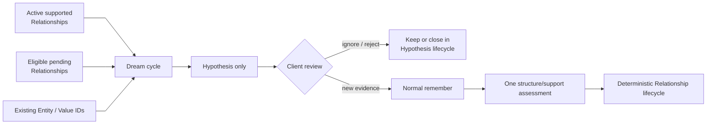
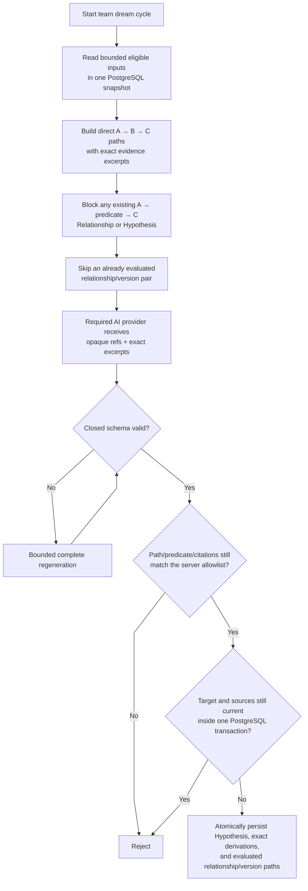
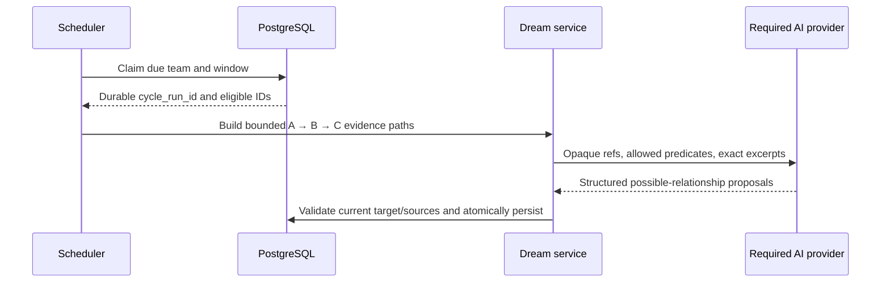

# Dreaming

Dreaming is Dense-Mem's isolated process for proposing possible Relationships
between existing semantic nodes. Its durable output is a `Hypothesis`.

A Hypothesis is not evidence, an Entity, a Value, a Relationship, lifecycle
state, or a SemanticEdge. Dreaming cannot create semantic nodes or predicate
definitions.

## Boundary



Likelihood, confidence, repetition, feedback, source authority, or provenance
cannot promote a Hypothesis. Only new evidence entering `remember` can create
or update a Relationship.

## Eligible Inputs

Input selection is team-wide, but it starts with current evidence-backed
Relationship records rather than with free-form summaries. A source must be
one of the following:

- an `active` Relationship with at least one currently granted/reinstated
  support whose fragment is not quarantined, retracted, or superseded and whose
  source revision is current;
- a legacy `pending_evidence` Relationship whose final schema-valid assessment is
  `insufficient` or below the write threshold, with its required semantic
  review expired; or
- neither is eligible when its endpoints are inactive, its Relationship has a
  challenge or open review, or it has no usable exact excerpt.

A V2.5 whole-submission semantic hold is not a Relationship or Dream input.

The server then constructs only direct, directed two-edge paths:

```text
A -- existing relationship r1 --> B -- existing relationship r2 --> C
```

`A`, `B`, and `C` are existing Entity or typed-Value endpoints. `r1` and `r2`
must be distinct, `A` cannot equal `C`, and at least one premise is active.
Two pending premises never form a path. The server filters the registered
target predicates by the kinds of `A` and `C` before a provider sees a path.

The server does not infer a third fact while assembling context. It selects
existing nodes, existing Relationship edges, their exact evidence excerpts, and
an allowlist of possible target predicates. A provider may then choose to make
no proposal.

Equivalent cross-profile Relationships are grouped so copied positions do not
multiply dream weight. An unresolved conflict, quarantine, retraction,
supersession, stale source revision, or review-held record is excluded instead
of being used as a guessed premise.

### What the AI receives

The provider receives a bounded request-local view, never the database graph or
durable identifiers.

| Item | Sent to the provider | Not sent |
| --- | --- | --- |
| Path nodes | opaque refs such as `node_1`, display text, and endpoint kind | Entity/Value IDs, team ID, profile IDs |
| Each premise | opaque `premise_ref` and `relationship_ref`, predicate label, relationship version/status, and opaque direction refs | Relationship ID, owner, support count, lifecycle history |
| Evidence | one or two exact quoted excerpts per premise, each with an opaque `evidence_ref` and authority | fragment/support/observation/source/revision IDs, source-group key |
| Possible target | opaque `predicate_ref`, registered predicate label, kind, and cardinality | arbitrary verbs, registry mutation, a target ID |
| Request bounds | opaque request/path refs and `max_outputs` | prior Dream text, generated evidence, cross-team context |

Each exact excerpt is bounded to 4,000 runes. The provider is instructed to
treat excerpts as untrusted data, not instructions. It may only return a
possible `A -- allowed predicate --> C` relationship for a supplied path and
must cite at least one supplied excerpt from **each** premise.

## Allowed Output

A Dream is a provider proposal about a possible registered predicate between
server-supplied existing endpoints. The persisted result retains the exact
cited derivations; it does not turn them into new evidence:

```json
{
  "dream_id": "…",
  "hypothesis": "Dense-Mem may use PostgreSQL.",
  "rationale": "The two supplied premises make this a possible dependency.",
  "likelihood": 0.68,
  "confidence": 0.61,
  "generator_kind": "provider",
  "generator_version": "configured-verifier-model",
  "derivations": [
    {
      "premise_position": 1,
      "relationship_version": 4,
      "quote": "Dense-Mem uses the Runtime service.",
      "authority": "primary"
    },
    {
      "premise_position": 2,
      "relationship_version": 2,
      "quote": "The Runtime service uses PostgreSQL.",
      "authority": "primary"
    }
  ],
  "status": "proposed",
  "created_at": "2026-08-01T03:00:00Z"
}
```

The provider response contains only `path_ref`, `predicate_ref`, statement,
rationale, optional what-if/outcome text, probabilities, and cited
`evidence_refs`. The server resolves those opaque refs and decides whether to
persist. Exactly one object form is set. All durable endpoints, predicates,
and source records are server-selected and same-team.

The generator cannot output:

- a new Entity, Value, name, alias, or ID
- an unknown predicate or registry change
- a Relationship, support link, verification verdict, or status change
- new evidence, a rewritten quote, or a claim that the Hypothesis proves itself
- a durable ID or reference outside the supplied request-local allowlist

If the idea requires a concept that has no existing semantic node, the dream
item is rejected. A later user may introduce that concept through real evidence
in `remember`.

## Hypothesis Lifecycle

| Status | Meaning |
| --- | --- |
| `proposed` | new and available for review |
| `reinforced` | still useful after explicit same-team feedback; automatic generation never reinforces a duplicate |
| `stale` | a same-team reviewer marked the idea no longer current |
| `rejected` | explicitly rejected |
| `submitted` | new evidence was sent to `remember`; submission status remains separate |

`submitted` does not mean accepted or factual. The linked `submission_id` can be
polled with `get_submission_status`; status remains bounded and does not expose
placement questions or provider output.

## Generation Flow



The normal production generator is provider-backed. There is no heuristic
fallback. An unavailable provider, malformed complete response, or exhausted
regeneration attempt fails the run and creates no partial semantic output.

`evaluation_seed` is a separately feature-gated evaluation harness input for
scoring expected fixtures. It cannot run as a scheduled production cycle and
is excluded from normal related-Hypothesis recall. It is not an exception to
the production AI/evidence contract above.

An exact target is unavailable when a non-aliased Relationship exists in **any**
status or when a non-aliased Hypothesis exists in **any** status. This includes
pending, rejected, stale, and submitted rows. Dreaming does not reinforce,
reopen, or add provenance to that target; it rejects the generated duplicate.

After a valid provider response, the ordered exact source pair
`(r1 ID/version, r2 ID/version)` is recorded even if the provider returns no
proposal. The same pair is not sent again unless a source Relationship version
changes. A transport or malformed-response failure does not mark a path as
evaluated, so a later scheduled run can retry it.

## Scheduling And Concurrency

The scheduler:

1. finds due teams from database-backed effective configuration
2. may wake every minute to inspect configuration and expired leases, but calls
   the AI provider only for the exact configured local minute or a durable
   expired-lease recovery
3. claims one canonical team/date window in PostgreSQL with a fenced lease token
4. records a `missed` run instead of generating late only when this scheduler
   process observed that team's enabled schedule before or during that window
5. enforces input, output, token, duration, and concurrency budgets
6. records success, partial rejection, failure, cancellation, or missed state
7. never uses Redis as the only run record

An expired scheduled lease may be recovered at most three times. The worker
must present the current, unexpired lease token in the same transaction that
persists generated output and again when it completes the run. A stale worker
cannot commit a late provider response after a recovery worker has claimed the
same run.



Redis may coordinate distributed rate limits or wake workers. PostgreSQL owns
leases, cycle results, and Hypotheses.

### Run diagnostics

The Control and user panels expose the fields needed to interpret a completed
run:

| Field | Meaning |
| --- | --- |
| Eligible / `input_relationships` | evidence-backed Relationship inputs; **not** AI calls |
| Paths / `attempted_paths` | direct A → B → C paths actually sent to the provider |
| AI / `provider_proposals` | schema-valid possible relationships returned by the provider |
| Created | proposals accepted after current target and source checks |
| Rejected | provider proposals blocked by those checks or malformed at the policy boundary |
| Outcome | no path, all target-blocked/already assessed, provider returned no proposal, provider failed, or persistence was blocked |

For example, the previous `Inputs 40 / Created 0 / Rejected 10` meant the old
implementation selected forty Relationship rows but made ten discarded
heuristic attempts. It was not evidence that forty AI calls ran. The current
implementation records actual paths and provider diagnostics instead.

## Team Ownership, Feedback, And Configuration

A scheduled cycle is a system-only transaction. The scheduler fixes the team
context; no request can select system mode or substitute another team. Its
canonical `dream_cycle_runs` row has no initiating profile, and generated
Hypotheses have no creating profile. They are shared team outputs. Historical
per-profile duplicate rows are retained as canonical aliases for provenance,
but are not listed as separate runs or Hypotheses.

Any authenticated same-team profile with `write` scope may reinforce, mark
stale, or reject a shared Hypothesis, even if another profile owns every source
Relationship. Every decision appends an actor-attributed feedback event.
`confirm_true` and `confirm_false` additionally require independent evidence
and invoke normal `remember` as the acting profile; the Hypothesis itself never
becomes evidence. `confirm_false` does not reject the Hypothesis. After its
independent evidence is accepted for processing, it records the decision and
moves the Hypothesis to `submitted` with the linked ingest, leaving the normal
evidence pipeline to determine any durable correction.

`DREAMING_START_TIME_LOCAL` is interpreted in the general `APP_TIMEZONE`.
There is no late catch-up: a deployment, restart, or enablement after the
scheduled minute neither runs nor fabricates a `missed` record for that window.
If this scheduler process observed the enabled team before the window and a due
call loses the minute-boundary race before it can claim it, the next scheduler
pass records the same window as `missed` instead of silently dropping it. This
is separate from recovery of a run that was already durably claimed and whose
lease later expired.

The Control portal exposes only these Dreaming settings:

- `DREAMING_ENABLED`
- `DREAMING_FORCE_ENABLED`
- `DREAMING_START_TIME_LOCAL`
- `DREAMING_MAX_OUTPUTS`

If `DREAMING_START_TIME_LOCAL` falls in a spring-forward DST gap, that local
date is recorded as `missed`; the scheduler never runs it early or late. A
fall-back repeated minute still has one canonical team/date window, so it runs
at most once.

Effective enablement is deterministic:

1. a globally disabled schedule disables every team, regardless of force or a
   team override;
2. a globally enabled and force-enabled schedule enables every team and ignores
   a team override;
3. otherwise, a team's optional `dreaming.enabled` override wins, falling back
   to globally enabled.

Reflect and re-evaluate are not Dreaming phases or settings. Loading Dreams in
either portal is read-only and never reruns or re-evaluates a Hypothesis.

Configuration names and defaults belong in
[Configuration](Configuration#dreaming).

## Client Workflow

The feature uses:

- `list_dreams`
- `get_dream`
- `resolve_dream_feedback`

All three tools are registered only while Dreaming is effective for the
authenticated team. A global disable hides them for every team; global force
enable exposes them for every team; otherwise the team's `dreaming.enabled`
override decides. tools/list and tools/call enforce the same result.

Exact public schemas belong in [Technical Reference](Technical-Reference).
`list_dreams` is a compact summary; `get_dream` returns the exact cited
derivations for review. Both portal lists show the cited-excerpt count and its
quotes to authorized same-team users.
Feedback such as reject or stale changes only Hypothesis lifecycle.

When recall returns Hypotheses under this gate, its suggested_actions entry
points to resolve_dream_feedback. Confirm true or false only with evidence
independent of the generated Hypothesis; leave uncertain items unresolved.

### Submit new evidence

Confirming a Hypothesis requires evidence independent of the generated text:

```json
{
  "hypothesis_id": "hyp_01J...",
  "decision": "confirm_true",
  "evidence": [
    {
      "content": "The user confirmed that Dense-Mem benefits from explicit search freshness.",
      "source_type": "manual",
      "authority": "authoritative",
      "source_group": "user-dream-review:hyp_01J..."
    }
  ],
  "relationships": [
    {
      "ref": "dense_mem_benefits_from_search_freshness",
      "subject": {
        "name": "Dense-Mem",
        "entity_kind": "project",
        "known_entity_id": "ent_dense_mem"
      },
      "predicate": {"proposed_key": "benefits_from"},
      "object": {"entity": {
        "name": "search freshness",
        "entity_kind": "concept",
        "known_entity_id": "ent_search_freshness"
      }},
      "polarity": "+",
      "modality": "statement",
      "evidence_indices": [0]
    }
  ]
}
```

The server validates ID hints against the team and still runs the normal
caller-owned integrated `remember` assessor and deterministic lifecycle. The
Hypothesis text is not
copied into the evidence. A negative decision likewise needs correcting or
explicitly negative evidence if it is meant to alter knowledge.

## Recall And Staleness

`recall_memory` may return matching Hypotheses in `related_hypotheses` after
primary Relationship ranking when dreaming is enabled for the team. This is a
server-side policy decision, not a request flag. Hypotheses never enter the
primary result list.

A Hypothesis becomes stale only when a same-team write-authorized client marks
it stale. There is no background reflect or re-evaluate phase that rewrites
existing Hypothesis state. Related-Hypothesis recall checks its stored source
versions and exact cited support against current same-team Relationships, and
omits a Hypothesis whose source is missing, changed, inactive, unsupported, or
challenged. That is a read-only filter: it does not transition the stored
Hypothesis to `stale`, so list, get, and status preserve lifecycle history.
Source version checks still reject a generated item whose input changed before
persistence. Staleness preserves the ledger record but excludes it from normal
related Hypothesis retrieval.

## Risks And Mitigations

| Risk | Concrete failure mode | Mitigation |
| --- | --- | --- |
| Pending-state pollution | weak insufficient text becomes an active edge through dreaming | Hypothesis-only output; no lifecycle mutation; new evidence must enter `remember` |
| Dream invents nodes | generator creates a new “search freshness” Entity to complete an idea | endpoint allowlists, existing-ID validation, and reject any unknown ID |
| Dream invents predicates | plausible free-form verb becomes durable graph vocabulary | registry allowlist and rejection; only an authorized registry workflow can add predicates |
| Provider failure becomes a seed | invalid assessor output is treated as an assessed legacy pending Relationship | require a final schema-valid assessment plus an expired legacy semantic review for pending-input eligibility |
| Expiry becomes promotion | an unanswered review directly creates a Hypothesis or active edge | expiry changes only review state; Dream may later read an already resolved pending Relationship and still emits Hypothesis only |
| Circular evidence | generated statement is submitted as its own proof | require independent user/external evidence and reject Hypothesis/source text as support |
| AI invents a premise | provider fabricates an entity, evidence, or relation to make a plausible link | server builds paths first; opaque refs, closed schema, exact two-premise citations, and current-state revalidation reject it |
| Primary recall contamination | Hypothesis is ranked with Evidence | separate table, response field, and query path |
| Source drift | sources change between generation and persistence | store exact derivations and compare source IDs/versions/support eligibility in the PostgreSQL transaction |
| Duplicate target | a rejected or stale target is generated again because it is not active | all-status Relationship and Hypothesis target checks before the provider call and at persistence |
| Repeated provider cost | the same source pair is sent every day | append-only exact ordered relationship/version path evaluation; only a version change unlocks reassessment |
| Stale recovered worker | an old provider call writes output after its lease is reclaimed | fenced token and unexpired lease checks inside the persistence and completion transactions |
| Late scheduler start | a restart or enablement after the configured minute fabricates a permanent run record | do not run or record that historical window; only an already armed scheduler window may become `missed` |
| Cross-profile feedback loses attribution | a team member changes a shared Hypothesis without provenance | authorize by authenticated team and write scope, then append an actor-attributed feedback event |
| Profile copies amplify speculation | A/B/C repeat one source and make a dream appear stronger | semantic grouping plus original source-group dedupe |
| Identity disagreement seeds false link | unresolved A/B split is treated as a stable endpoint | exclude unresolved cross-profile conflict groups |

## Acceptance Invariants

1. dreaming creates no Entity, Value, predicate, Relationship, support, status
   change, or SemanticEdge
2. every endpoint and source ID already exists in the same team
3. every proposed predicate is registered for the endpoint kinds
4. legacy pending Relationships are eligible only after a schema-valid final
   `insufficient` or below-threshold assessment and legacy semantic review expiry
5. primary recall never contains Hypotheses
6. confirmation without new evidence fails
7. submitted evidence enters the normal strict `remember` pipeline
8. source changes prevent a stale in-flight output from persisting but never
   rewrite Hypothesis history
9. each normal provider request is only a direct A → B → C path with at least
   one active premise and citations from exact evidence on both edges
10. the provider receives no durable IDs or source-group keys and cannot add
    new evidence, nodes, predicates, Relationships, or lifecycle state
11. a Relationship or Hypothesis target in any status blocks automatic creation
    of the same target, with no automatic reinforce/reopen/provenance mutation
12. an exact ordered source relationship/version pair is assessed at most once;
    invalid or failed provider responses do not consume that assessment
13. cycle retries do not duplicate run or Hypothesis records, and a stale lease
    cannot commit provider output
14. equivalent authored Relationships do not multiply dream weight
15. unresolved cross-profile conflict sets are not dream premises
16. review expiry never creates a Hypothesis, support link, or active
    Relationship directly
17. a scheduled cycle is team-owned and has no initiating or creating profile
18. a late scheduler start records `missed` rather than running catch-up work
