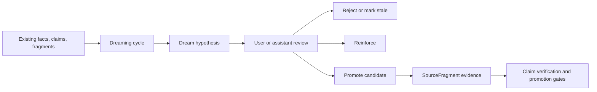

# Dreaming

Dreaming is Dense-Mem's reviewable hypothesis layer. It looks at existing
same-profile memory and proposes "what if this relationship matters?" ideas for
a human or host assistant to review later.

A dream is not a fact, claim, or evidence. It stays separate from active memory
until user feedback sends it into the normal memory pipeline.

## How It Works



The cycle reads the caller's profile graph and writes `Dream` nodes back into
that same profile scope. It never writes active facts directly.

## Cycle Phases

Dreaming always uses the same phase order. Disabled phases are skipped.

| Phase | Purpose |
| --- | --- |
| `reflect` | Reads memory health, stale facts, disputed claims, and clarifications. |
| `re_evaluate` | Rechecks existing proposed or reinforced dreams. Dreams with missing source references become stale; proposed dreams with intact sources become reinforced. |
| `dream` | Generates new hypotheses from recent facts, claims, and fragments. |

The built-in generator is deterministic and conservative. It pairs same-profile
memory items, records source references, and keeps the result as a hypothesis
with likelihood and confidence scores.

## Dream Records

Each dream stores:

| Field | Meaning |
| --- | --- |
| `hypothesis` | The proposed relationship or idea. |
| `what_if` | The question the dream asks. |
| `possible_outcome` | What might change if the hypothesis is true. |
| `rationale` | Why the generator proposed it. |
| `likelihood` | Generator-estimated plausibility from 0 to 1. |
| `confidence` | Generator confidence from 0 to 1. |
| `source_refs` | Same-profile facts, claims, fragments, communities, or dreams used as sources. |

Treat all of this as review material. It is not an instruction source and does
not override active facts.

## Status Lifecycle

| Status | Meaning |
| --- | --- |
| `proposed` | New hypothesis waiting for review. |
| `reinforced` | User feedback or later re-evaluation supports keeping it visible. |
| `stale` | Source references disappeared or the hypothesis no longer appears useful. |
| `rejected` | User rejected it. |
| `promoted` | User confirmed it should enter normal memory review. |

`promote_candidate` creates a normal source fragment labeled `dream_feedback`.
The created evidence then follows the usual claim, verification, conflict, and
promotion gates. If verification fails or a conflict needs clarification, no
active fact is created automatically.

## MCP Tools

Check effective config and latest run:

```json
{"tool": "dreaming_status", "arguments": {}}
```

Manually run a cycle:

```json
{"tool": "run_dreaming_cycle", "arguments": {"max_outputs": 5}}
```

Manual runs can execute while scheduled dreaming is disabled. Disabled phases
are skipped unless the tool input explicitly overrides them for that run:

```json
{
  "tool": "run_dreaming_cycle",
  "arguments": {
    "reflect_enabled": true,
    "reevaluate_enabled": true,
    "dream_enabled": true,
    "max_outputs": 5
  }
}
```

List proposed dreams:

```json
{"tool": "list_dreams", "arguments": {"status": "proposed", "limit": 20}}
```

Fetch one dream:

```json
{"tool": "get_dream", "arguments": {"dream_id": "dream-123"}}
```

Resolve user feedback:

```json
{
  "tool": "resolve_dream_feedback",
  "arguments": {
    "dream_id": "dream-123",
    "decision": "promote_candidate",
    "feedback": "The user confirmed this should be remembered."
  }
}
```

Valid feedback decisions are `reinforce`, `stale`, `reject`, and
`promote_candidate`.

## Recall

`recall_memory` returns a `related_dreams` array when proposed or reinforced
dreams match the query. These are separate from `results`.

Use related dreams to decide what to ask or review:

```json
{
  "query": "release planning",
  "limit": 10
}
```

Do not treat `related_dreams` as active memory. If a related dream matters,
review it with the user and resolve it through `resolve_dream_feedback`.

## REST And Portals

The authenticated user API exposes read-only dream inspection:

| Route | Purpose |
| --- | --- |
| `GET /api/v1/dreaming/status` | Effective config, latest run, and pending count. |
| `GET /api/v1/dreaming/runs` | Recent cycle runs. |
| `GET /api/v1/dreams` | Dream list with optional `status`, `limit`, and `cursor`. |
| `GET /api/v1/dreams/{dreamId}` | One dream. |

The user portal shows the current profile's dreaming status, dream outputs, and
recent cycle runs.

The control portal can inspect the same dream data for a selected team and can
edit global dreaming config from the Config tab.

## Scheduled Dreaming

Scheduled dreaming is disabled by default.

| Setting | Default | Meaning |
| --- | --- | --- |
| `DREAMING_ENABLED` | `false` | Enables scheduled dreaming when the effective team config allows it. |
| `DREAMING_FORCE_ENABLED` | `false` | Forces dreaming on even when team config disables it. |
| `DREAMING_START_TIME_LOCAL` | `03:00` | Local HH:MM start time. |
| `DREAMING_REFLECT_ENABLED` | `true` | Runs the reflection phase. |
| `DREAMING_REEVALUATE_ENABLED` | `true` | Runs the dream re-evaluation phase. |
| `DREAMING_DREAM_ENABLED` | `true` | Runs new hypothesis generation. |
| `DREAMING_MAX_OUTPUTS` | `5` | Maximum new dreams per cycle, from 1 to 50. |
| `APP_TIMEZONE` | `Local` | Shared scheduler timezone. |

The scheduler checks once per minute and runs at most one scheduled cycle per
profile per local day.

Use an IANA timezone such as `America/New_York` for predictable production
schedules. `Local` depends on the server/container local timezone.

## When To Use It

| Situation | Use dreaming? |
| --- | --- |
| You want normal memory recall | No. Use `recall_memory`. |
| You want to inspect unresolved memory health | Maybe. Start with `reflect_memories`. |
| You want possible connections between stored memories | Yes. Run or inspect dreams. |
| You want to store a confirmed user fact | No. Use `remember` or `confirm_memory`; dreams are for hypotheses. |

## Troubleshooting

| Problem | Check |
| --- | --- |
| No scheduled dreams | `DREAMING_ENABLED=true`, effective team config, `APP_TIMEZONE`, and `DREAMING_START_TIME_LOCAL`. |
| Manual run creates no dreams | The profile may have fewer than two usable memory inputs or duplicate hypotheses already exist. |
| Dream was promoted but no fact appeared | `promote_candidate` creates evidence only; check claim verification, promotion gates, and clarifications. |
| Related dreams seem wrong | Treat them as hypotheses, reject stale ones, and keep active facts as the source of truth. |
