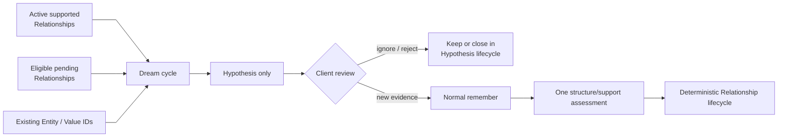
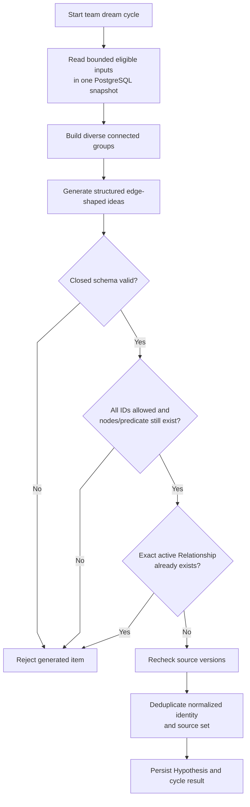
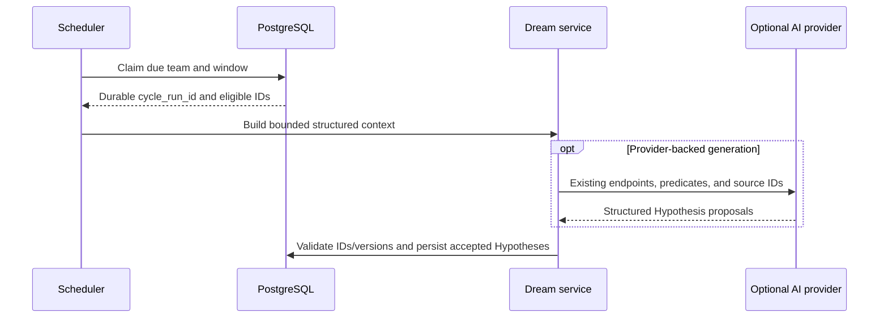

# Dreaming

Dreaming is Dense-Mem's isolated process for proposing possible Relationships
between existing semantic nodes. Its durable output is a `Hypothesis`.

A Hypothesis is not evidence, an Entity, a Value, a Relationship, lifecycle
state, or a SemanticEdge. Dreaming cannot create semantic nodes or predicate
definitions.

## Boundary



Likelihood, confidence, repetition, feedback, source authority, or provenance
cannot promote a Hypothesis. Only new evidence entering `remember` can create
or update a Relationship.

## Eligible Inputs

Dreaming may read:

- compact active Relationships with effective support
- a `pending_evidence` Relationship only when its final schema-valid assessment
  is `insufficient` or `entailed` below the positive-support threshold and its
  seven-day semantic review has expired
- existing resolved Entity and typed-Value endpoints referenced by those
  Relationships
- registered predicate definitions

Equivalent cross-profile Relationships are grouped so copied positions do not
multiply dream weight. Dreaming may use only the preferred position of a
`resolved` Conflict case, with all source Relationship IDs. An `open` or
`overdue` cross-profile case is excluded rather than used as a guessed premise.

A pending Relationship is eligible only when:

```text
status = pending_evidence
subject Entity already exists
object Entity or Value already exists
predicate is registered and valid for both endpoint kinds
final schema-valid assessment is insufficient or entailed below threshold
the associated semantic review is expired
no identity, predicate, scope, or temporal ambiguity is open
```

Context retained after an unavailable assessor or invalid provider response is
not yet an eligible pending Relationship. Dense-Mem keeps that context in the
placement ledger, but dreaming cannot use it until normal assessment produces a
valid material result and the review window closes. This prevents provider
failure text from becoming a speculation seed.

Dreaming must exclude quarantined, disputed, rejected, retracted, superseded,
ambiguous, and review-held records. It must also exclude records whose only
support comes from a non-current source revision, even while the replacement
revision is still quarantined or awaiting placement.

## Allowed Output

A dream may propose only a possible registered predicate between server-supplied
existing endpoint IDs:

```json
{
  "hypothesis_id": "hyp_01J...",
  "team_id": "team-1",
  "source_owner_profile_ids": ["profile-a", "profile-b"],
  "subject_entity_id": "ent_dense_mem",
  "predicate_key": "benefits_from",
  "object_entity_id": "ent_search_freshness",
  "object_value_id": null,
  "statement": "Dense-Mem may benefit from explicit search freshness.",
  "rationale": "Active recall and embedding-job Relationships suggest a useful connection.",
  "likelihood": 0.68,
  "confidence": 0.61,
  "source_relationship_ids": ["r_recall", "r_embedding_job"],
  "source_pending_relationship_ids": ["r_pending_freshness"],
  "source_versions": {
    "r_recall": 4,
    "r_embedding_job": 2,
    "r_pending_freshness": 1
  },
  "generator_kind": "provider",
  "generator_version": "dream-v2",
  "status": "proposed",
  "created_at": "2026-07-11T00:00:00Z"
}
```

Exactly one object form is set. All endpoint, predicate, and source IDs come
from immutable server allowlists and must belong to the same team.

The generator cannot output:

- a new Entity, Value, name, alias, or ID
- an unknown predicate or registry change
- a Relationship, support link, verification verdict, or status change
- evidence text claiming that the Hypothesis proves itself
- a source ID outside the supplied input set

If the idea requires a concept that has no existing semantic node, the dream
item is rejected. A later user may introduce that concept through real evidence
in `remember`.

## Hypothesis Lifecycle

| Status | Meaning |
| --- | --- |
| `proposed` | new and available for review |
| `reinforced` | still useful after feedback or a later generation cycle |
| `stale` | source state changed or the idea no longer applies |
| `rejected` | explicitly rejected |
| `submitted` | new evidence was sent to `remember`; placement outcome remains separate |

`submitted` does not mean accepted or factual. The linked `ingest_id` and any
later `relationship_outcomes[]` relationship ID expose the actual placement
outcome.

## Generation Flow



The generator receives compact current rows, not full evidence or assessor
rationales. Source Relationship IDs explain origin but are not confirming
evidence. A pending source remains visibly identified as pending.

An exact pending Relationship may be the target of the Hypothesis. Dreaming
still does not change that Relationship; it only records why the possibility may be
worth seeking new evidence for.

## Scheduling And Concurrency

The scheduler:

1. finds due teams from database-backed effective configuration
2. acquires a unique team/time-window PostgreSQL lease
3. records a cycle run before generation
4. enforces input, output, token, duration, and concurrency budgets
5. records success, partial rejection, failure, or cancellation
6. never uses Redis as the only run record



Redis may coordinate distributed rate limits or wake workers. PostgreSQL owns
leases, cycle results, and Hypotheses.

Configuration names and defaults belong in
[Configuration](Configuration#dreaming).

## Client Workflow

The feature uses:

- `list_dreams`
- `get_dream`
- `resolve_dream_feedback`

Exact public schemas belong in [Technical Reference](Technical-Reference).
Feedback such as reject or stale changes only Hypothesis lifecycle.

### Submit new evidence

Confirming a Hypothesis requires evidence independent of the generated text:

```json
{
  "hypothesis_id": "hyp_01J...",
  "decision": "confirm_true",
  "evidence": [
    {
      "content": "The user confirmed that Dense-Mem benefits from explicit search freshness.",
      "source_type": "manual",
      "authority": "authoritative",
      "source_group": "user-dream-review:hyp_01J..."
    }
  ],
  "proposal": {
    "entities": [
      {
        "ref": "dense_mem",
        "name": "Dense-Mem",
        "known_entity_id": "ent_dense_mem"
      },
      {
        "ref": "search_freshness",
        "name": "search freshness",
        "known_entity_id": "ent_search_freshness"
      }
    ],
    "relationships": [
      {
        "proposal_id": "dense_mem_benefits_from_search_freshness",
        "subject_ref": "dense_mem",
        "predicate": "benefits_from",
        "object_ref": "search_freshness",
        "polarity": "+",
        "evidence": [
          {
            "evidence_index": 0,
            "start": 0,
            "end": 73
          }
        ]
      }
    ]
  }
}
```

The server validates ID hints against the team and still runs the normal
caller-owned integrated `remember` assessor and deterministic lifecycle. The
Hypothesis text is not
copied into the evidence. A negative decision likewise needs correcting or
explicitly negative evidence if it is meant to alter knowledge.

## Recall And Staleness

`recall_memory` may return matching Hypotheses in `related_hypotheses` after
primary Relationship ranking when dreaming is enabled for the team. This is a
server-side policy decision, not a request flag. Hypotheses never enter the
primary result list.

A Hypothesis becomes stale when:

- a source Relationship is retracted, superseded, disputed, or hidden
- a source pending Relationship becomes rejected or its ambiguity reopens
- a source revision changes and regeneration does not reinforce the idea
- a retention rule expires it
- a client marks it stale

Staleness preserves the ledger record but excludes it from normal related
Hypothesis retrieval.

## Risks And Mitigations

| Risk | Concrete failure mode | Mitigation |
| --- | --- | --- |
| Pending-state pollution | weak insufficient text becomes an active edge through dreaming | Hypothesis-only output; no lifecycle mutation; new evidence must enter `remember` |
| Dream invents nodes | generator creates a new “search freshness” Entity to complete an idea | endpoint allowlists, existing-ID validation, and reject any unknown ID |
| Dream invents predicates | plausible free-form verb becomes durable graph vocabulary | registry allowlist and rejection; only an authorized registry workflow can add predicates |
| Provider failure becomes a seed | invalid assessor output is treated as an assessed pending Relationship | require a final schema-valid assessment plus an expired semantic review for pending-input eligibility |
| Expiry becomes promotion | an unanswered review directly creates a Hypothesis or active edge | expiry changes only review state; Dream may later read an already resolved pending Relationship and still emits Hypothesis only |
| Circular evidence | generated statement is submitted as its own proof | require independent user/external evidence and reject Hypothesis/source text as support |
| Primary recall contamination | Hypothesis is ranked with Evidence | separate table, response field, and query path |
| Source drift | sources change between generation and persistence | store and compare source IDs/versions in the PostgreSQL transaction |
| Duplicate cycles | two replicas generate the same window | unique team/window run key, durable lease, and normalized Hypothesis dedupe |
| Profile copies amplify speculation | A/B/C repeat one source and make a dream appear stronger | semantic grouping plus original source-group dedupe |
| Identity disagreement seeds false link | unresolved A/B split is treated as a stable endpoint | exclude unresolved cross-profile conflict groups |

## Acceptance Invariants

1. dreaming creates no Entity, Value, predicate, Relationship, support, status
   change, or SemanticEdge
2. every endpoint and source ID already exists in the same team
3. every proposed predicate is registered for the endpoint kinds
4. pending Relationships are eligible only after a schema-valid final
   `insufficient` or below-threshold assessment and semantic review expiry
5. primary recall never contains Hypotheses
6. confirmation without new evidence fails
7. submitted evidence enters the normal strict `remember` pipeline
8. source changes can stale but never delete Hypothesis history
9. cycle retries do not duplicate run or Hypothesis records
10. equivalent authored Relationships do not multiply dream weight
11. unresolved cross-profile conflict sets are not dream premises
12. review expiry never creates a Hypothesis, support link, or active
    Relationship directly
