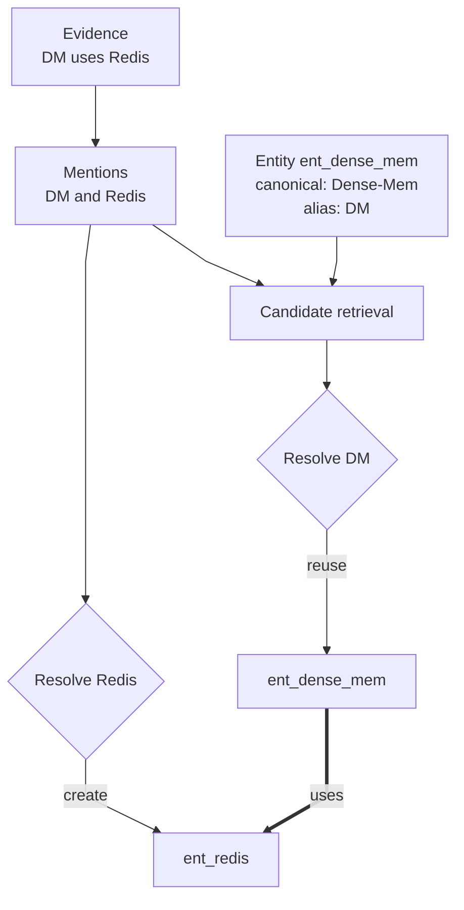
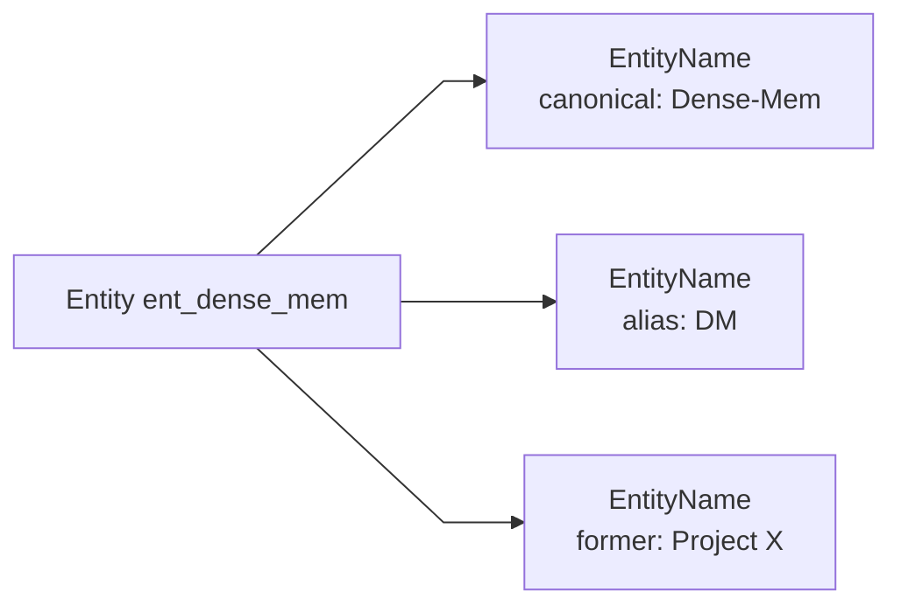
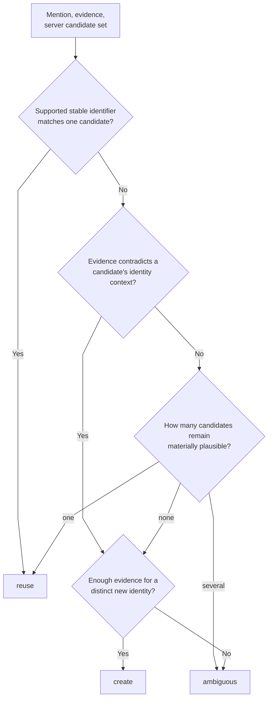
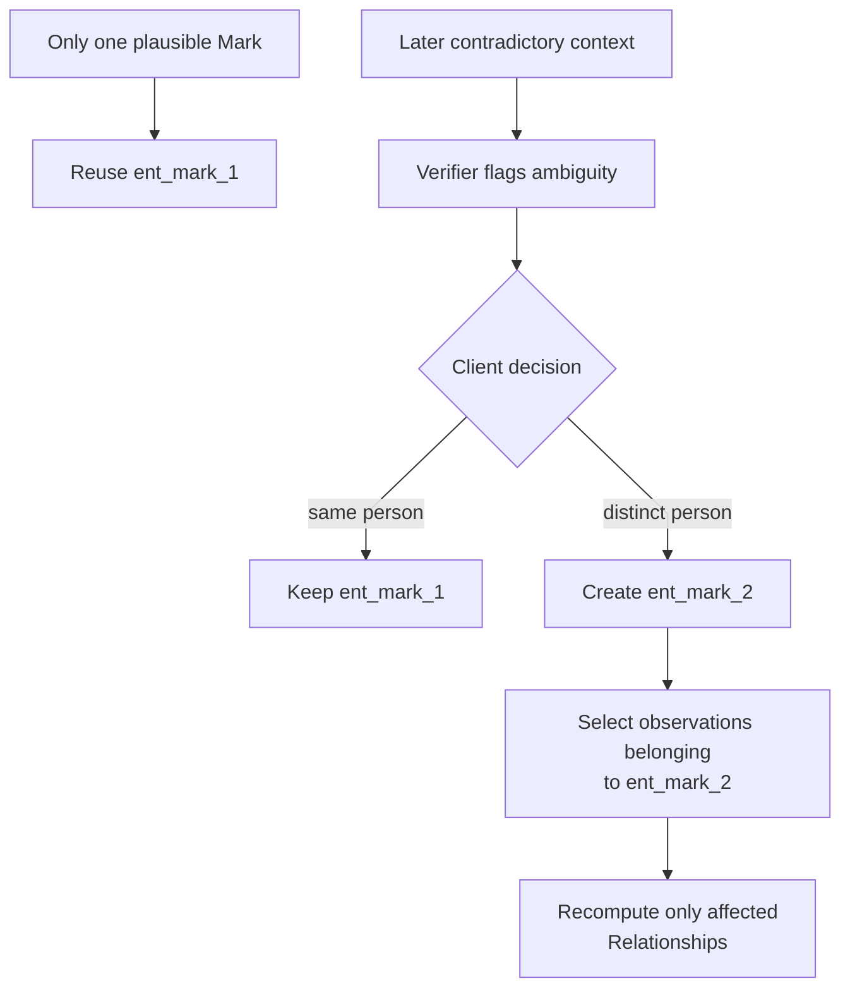
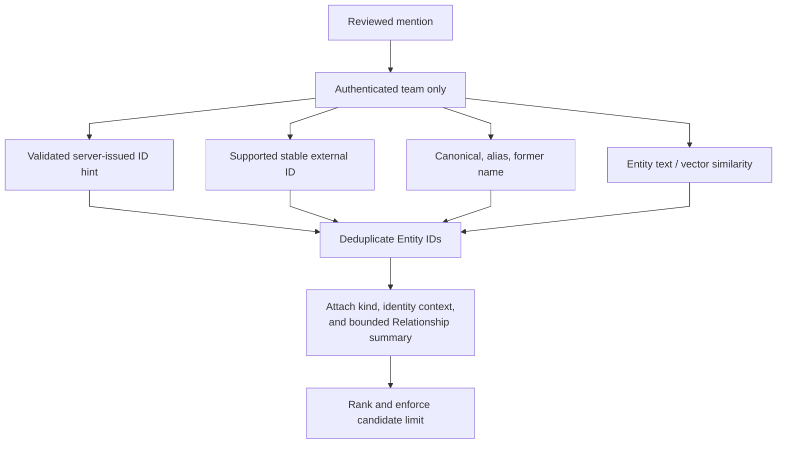
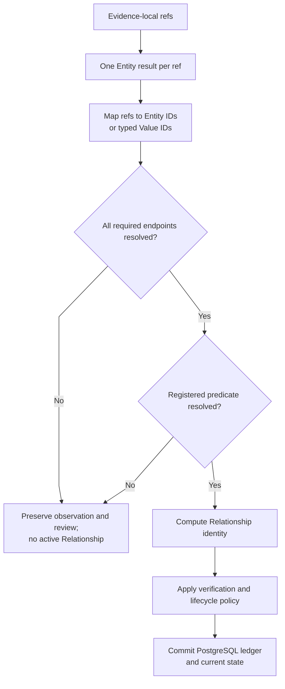
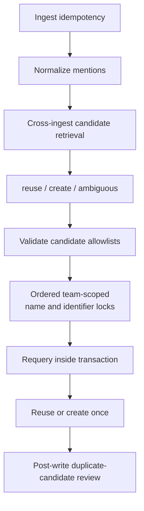

# Entity Identity And Resolution

This page is the single source of truth for deciding whether a mention reuses
an Entity, creates an Entity, or requires client resolution.

The stage order and strict verifier response are defined in
[Memory Write Pipeline](Write-Pipeline). Storage is defined in
[Data Model And Storage](Data-Model-And-Storage). Relationship identity is
defined in
[Relationship Model And Lifecycle](Relationship-Model-And-Lifecycle).

## Core Rule

Within one team, one real-world identity has one canonical `entity_id`. A new
Entity is created only when the evidence introduces a distinct identity.
Spelling, alias, title, source, or a new Relationship does not make a new
identity.



The result is one Dense-Mem Entity, one Redis Entity, and one Relationship.
Dense-Mem does not create a `DM` node or an alias edge.

## Entity, Node, ID, Name, And Value

| Term | Meaning |
| --- | --- |
| Entity | One canonical, team-scoped real-world identity. |
| Entity node | Graph-shaped API view of the Entity's PostgreSQL record; not a second object. |
| `entity_id` | Opaque stable identifier allocated by Dense-Mem. |
| Canonical name | Current preferred display name. |
| Alias | Alternate evidence-supported surface attached to the same Entity. |
| Former name | Time-bounded prior name attached to the same Entity. |
| Mention | Evidence-local text that may refer to an Entity. |
| Reviewer ref | Request-local token used before durable identity resolution. |
| Identity context | Evidence-supported discriminator such as employer, role, location, product, or namespace. |
| Candidate | Existing same-team Entity supplied to the verifier for comparison. |
| Value | Canonical typed scalar endpoint such as a number, boolean, date, date-time, or literal string. |

`entity_id` is not node text:

```json
{
  "entity_id": "ent_01J...",
  "team_id": "team-1",
  "canonical_name": "Mark Huang",
  "entity_kind": "person",
  "identity_context": {
    "team": "Dense-Mem",
    "role": "maintainer"
  },
  "status": "active",
  "version": 3
}
```

The display name may change while the ID remains stable. Two people displayed
as `Mark` have different IDs.

Typed scalars do not become Entities to make a graph endpoint. For example:

```text
(Dense-Mem:Entity)-[released_on]->(2026-07-11:Value<date>)
```

An occurrence may be an Entity when it needs its own stable identity and
Relationships; the date on which it occurred remains a Value.

### Typed Value identity

Value resolution is deterministic; the verifier does not decide whether two
well-formed scalars are equal. A Value record contains:

```json
{
  "value_id": "val_01J...",
  "team_id": "team-1",
  "value_type": "number",
  "canonical_value": "42",
  "unit": "percent",
  "display": "42%",
  "normalization_version": 1
}
```

Canonical identity is:

```text
team_id
value_type
canonical_value
normalized unit or null
normalization_version
```

| Type | Canonicalization |
| --- | --- |
| `number` | exact decimal representation; never binary floating-point formatting |
| `boolean` | `true` or `false` |
| `date` | ISO calendar date |
| `date_time` | one normalized instant; original offset/text remains on the observation |
| `string` | bounded Unicode-normalized literal under a versioned, conservative subtype policy |

Equivalent input reuses one `value_id`. Display formatting and original text do
not create another Value. Units are normalized through a server registry; an
unknown or incompatible unit is held for review rather than guessed.

Long prose, explanations, documents, and unresolved concepts remain evidence,
not string Value nodes. A named concept that needs identity and Relationships
is an Entity, not a string Value.

## Names And Aliases

Names are identity metadata with provenance, never Relationships.



A name record retains:

```text
entity_id
display_name
normalized_name
name_kind: canonical | alias | former
locale
valid_from / valid_to
evidence span or client-decision provenance
recorded_at
```

The normalized name is a candidate-retrieval key, not a unique identity key.
Aliases are attached only when evidence or a client decision supports
equivalence.

## Resolution Outcomes

Every Entity mention receives exactly one result before its dependent
Relationship identity can be computed.

| Action | When | Durable effect |
| --- | --- | --- |
| `reuse` | exactly one supplied Entity is materially plausible and no evidence discriminator contradicts it | map the ref to that candidate and append the resolution event |
| `create` | no plausible candidate exists and the evidence sufficiently introduces a distinct identity | allocate one opaque ID and append the new Entity, names, and resolution event |
| `ambiguous` | multiple candidates remain plausible, or evidence conflicts with reuse but does not prove a distinct identity | create no Entity; preserve context, create review work, and block dependent Relationship activation |



This intentionally prefers reuse over speculative duplication when only one
plausible existing identity is known. It does not claim certainty. Later
contradictory context can surface a split for client confirmation.

A confidence score is diagnostic only. It cannot make an unknown candidate
valid or turn several plausible candidates into one.

Entity kind is a classification aid, not identity. Calling Dense-Mem a
project, product, or system does not create parallel Entities when the referent
is the same. A materially incompatible kind is a contradiction/review signal,
not an automatic split.

## Same Name Over Time

Assume the team has one known Mark:

```text
ent_mark_1: Mark, Dense-Mem team
new evidence: "Mark works on the recall pipeline."
```

With no contrary discriminator, the verifier returns `reuse ent_mark_1`. This
avoids creating `Mark 2` merely because the evidence is brief.

Later evidence says:

```text
"Mark from the finance team approved the budget."
```

If `ent_mark_1` is known not to be that person, the verifier returns
`ambiguous` or proposes `create` only when the evidence sufficiently
distinguishes the finance-team Mark. Dense-Mem exposes the ambiguity and impact
to the client. It does not silently split or overwrite the first Entity.



## Extraction And Candidate Retrieval

The reviewer extracts evidence-local mentions, exact spans, names, coarse
kinds, identity context, and atomic Relationship observations. It does not
allocate Entity IDs or decide that a candidate is canonical.

Candidate retrieval is deterministic, bounded, and team-scoped:



| Signal | Useful for | Cannot do by itself |
| --- | --- | --- |
| valid server ID hint | recover a previously recalled Entity | bypass team or active-state validation |
| trusted stable identifier | strongly identify a namespace-scoped subject | turn an unverified string into a global identity |
| normalized name | retrieve punctuation and spelling variants | merge homonyms |
| alias or former name | retrieve acronyms and renames | prove the alias is unique |
| Entity kind | remove implausible candidates | define identity |
| identity context | distinguish same-name candidates | invent missing context |
| vector similarity | retrieve paraphrases | authorize reuse or merge by threshold |
| Relationship summary | compare known roles and affiliations | become evidence for the new statement |

An empty candidate list means retrieval found none; it does not automatically
authorize `create`. A retrieval error is not an empty result and fails
placement visibly.

## One Verifier Request

After extraction and candidate retrieval, one verifier request returns
separate `entity_results` and `relationship_results`. The exact input,
closed output schema, retry behavior, and no-coercion rule belong only in
[Memory Write Pipeline](Write-Pipeline#strict-verifier-contract).

For identity, the server enforces:

- exactly one result for every mention ref
- `reuse` names exactly one active candidate supplied for that ref
- `create` contains no pre-existing `entity_id`
- `ambiguous` contains no Entity ID
- no result crosses the authenticated team
- names, aliases, kinds, and context are bounded and evidence-supported
- every dependent Relationship remains non-active until its endpoints and
  predicate resolve

Invalid or incomplete output causes bounded regeneration of the entire
response. No subset commits and application code does not repair provider
JSON.

## Build Relationships After Resolution



Several refs may resolve to one Entity. The service coalesces the Entity write
while retaining every original mention and decision as provenance.

Conceptual service logic:

```go
resolved := make(map[string]EntityResolution)

for _, mention := range extraction.Mentions {
	candidates := entityCandidates(teamID, mention)
	result := verifier.EntityResult(mention.Ref)
	resolved[mention.Ref] = validateResolution(teamID, mention, candidates, result)
}

for _, draft := range extraction.Relationships {
	subject, object := resolveEndpoints(draft, resolved)
	if subject.Ambiguous || object.Ambiguous {
		createIdentityReviewTask(draft)
		continue
	}

	upsertRelationshipObservation(subject.EntityID, draft, object)
}
```

This is illustrative target logic, not a claim that these function names exist
in the current code.

## Duplicate Prevention

Duplicate prevention is layered because natural-language identity has no
globally safe name key.



Before `create`, the PostgreSQL transaction:

1. acquires deterministic team-scoped locks for supported normalized names and
   stable identifiers
2. reruns candidate lookup against committed records
3. invalidates `create` if a new plausible candidate appeared
4. reuses an exact candidate, requests another verifier pass, or holds review
5. inserts the Entity and names once

A uniqueness constraint can protect a stable external identifier within its
namespace. It cannot make a human name unique. Concurrent aliases with no
shared token or identifier can still evade the same lock, so likely duplicates
are review candidates and are never auto-merged from similarity alone.

## Alias And Rename Example

Earlier state:

```text
Entity ent_dense_mem
canonical name: Dense-Mem
```

Later evidence:

```text
DM uses Redis.
```

When evidence and context resolve `DM` to `ent_dense_mem`:

- reuse `ent_dense_mem`
- attach `DM` as a supported alias if new
- build or update the `uses` Relationship
- create no `DM` Entity and no alias edge

A supported rename changes the preferred name but preserves `entity_id` and
former-name history.

## Merge And Split Corrections

Entity records are shared team handles, but mention resolutions, observations,
and Relationships are profile-owned. Identity corrections are explicit,
evidence-backed operations with dry-run impact reports. Any profile with
`write` scope may correct only its own observations and Relationships.

Creating a distinct Entity makes that handle visible to the team. It does not
move or invalidate another profile's observations. Another profile may later
reuse the new Entity after its own evidence and verifier decision.

### Profile-local merge

A profile-local merge:

1. selects the surviving Entity ID
2. previews and selects only observations owned by the authenticated profile
3. maps those selected observations to the surviving Entity
4. recomputes only that owner's affected Relationship identities
5. combines that owner's exact duplicate Relationships without losing support
   or history
6. leaves other profiles' resolutions and Relationships unchanged
7. records actor, reason, mappings, counts, and before/after versions

The duplicate Entity is not globally redirected while another profile still
uses it. Team-wide retirement is allowed only after no active profile-owned
knowledge depends on it; it is never an ordinary cross-profile mutation.

### Profile-local late split

A confirmed false merge:

1. previews every caller-owned observation and Relationship that might move
2. creates the distinct Entity only after client confirmation
3. maps explicitly selected caller-owned observations to the new Entity
4. leaves uncertain observations on review rather than guessing
5. appends correction and resolution events; original evidence remains intact
6. supersedes or retracts only the caller-owned affected Relationship records
   and creates recomputed records where necessary
7. verifies that active SemanticEdges now point to the intended Entity
8. leaves every other profile's knowledge unchanged

Selection occurs by immutable observation/evidence IDs and optional time or
source scope—never by changing every row whose display name is `Mark`.

Forget is not a split. Relationship retraction and ledger retention are
defined in
[Relationship Model And Lifecycle](Relationship-Model-And-Lifecycle#forget-and-retraction).

## Security Boundary

Candidates, locks, records, vector results, and returned IDs are scoped to the
authenticated team. The verifier receives immutable candidate sets but no
credentials and cannot select an arbitrary database ID.

Write authorization additionally scopes merge/split selection to observations
owned by the authenticated profile. Team visibility is not cross-profile write
authority.

Evidence and candidate text are untrusted model input. Embedded instructions
cannot alter the schema, candidate allowlist, tenant, or decision rules.

## Risks And Mitigations

| Risk | Concrete failure mode | Mitigation |
| --- | --- | --- |
| False merge | the first known Mark absorbs statements about a different Mark | reuse only without contrary context; flag later conflict; require client-confirmed observation-level split |
| False split | `Dense-Mem` and `DM` become parallel Entities | alias/name/vector candidate retrieval, prefer the one plausible candidate, and recheck before create |
| Bad bulk correction | resolving one finance-team Mark moves all historical Mark observations | preview immutable observation IDs and move only caller-owned, client-selected evidence |
| Concurrent duplicate | two workers create the same new Entity | ingest idempotency, ordered locks, in-transaction recheck, and stable-ID constraints |
| Retrieval outage | a backend error looks like no candidates and authorizes create | treat errors distinctly and fail placement visibly |
| Cross-team reuse | provider returns an ID from another team | per-ref candidate allowlists, RLS, and team validation before commit |
| Similarity merge | a high vector score collapses valid homonyms | similarity retrieves candidates only; verifier/client decisions authorize identity changes |
| Merge evidence loss | duplicate Relationships are combined but one source disappears | dry-run mapping, one transaction, append-only support/history, and post-change count checks |
| Cross-profile identity rewrite | profile B's split moves profile A's observations | owner predicate on selected observations and integration tests with three writable profiles |
| Duplicate/scalar collapse | `42`, `42.0`, or case-varied codes become wrong duplicate/equal Value nodes | exact type-specific versioned canonicalization; conservative string rules and normalized-unit registry |

## Acceptance Invariants

The identity refactor is incomplete until tests prove:

1. repeating evidence creates no duplicate Entity or same-owner Relationship
2. one plausible candidate with no contradiction is reused
3. an evidence-supported alias reuses its Entity
4. coarse Entity-kind drift does not split one identity
5. different same-name identities with distinguishing context remain separate
6. several plausible homonyms create review work and no active dependent edge
7. a later client-confirmed split moves only selected caller-owned observations
8. a non-candidate or cross-team ID invalidates the entire verifier response
9. missing, extra, or duplicate results never cause a partial write
10. simultaneous equivalent creates converge after the transactional recheck
11. Entity resolution finishes before Relationship identity is computed
12. merge and split preserve every evidence span, decision, support, and
    transition
13. aliases never become nodes or edges
14. equivalent typed scalars reuse one Value while distinct types/units remain
    distinct
15. long prose and unresolved concepts never become string Value nodes
16. a write-scoped profile may merge or split its own resolutions without
    changing another profile's observations or Relationships
17. a newly created split Entity is team-readable and may be adopted by another
    profile through that profile's normal verification flow
