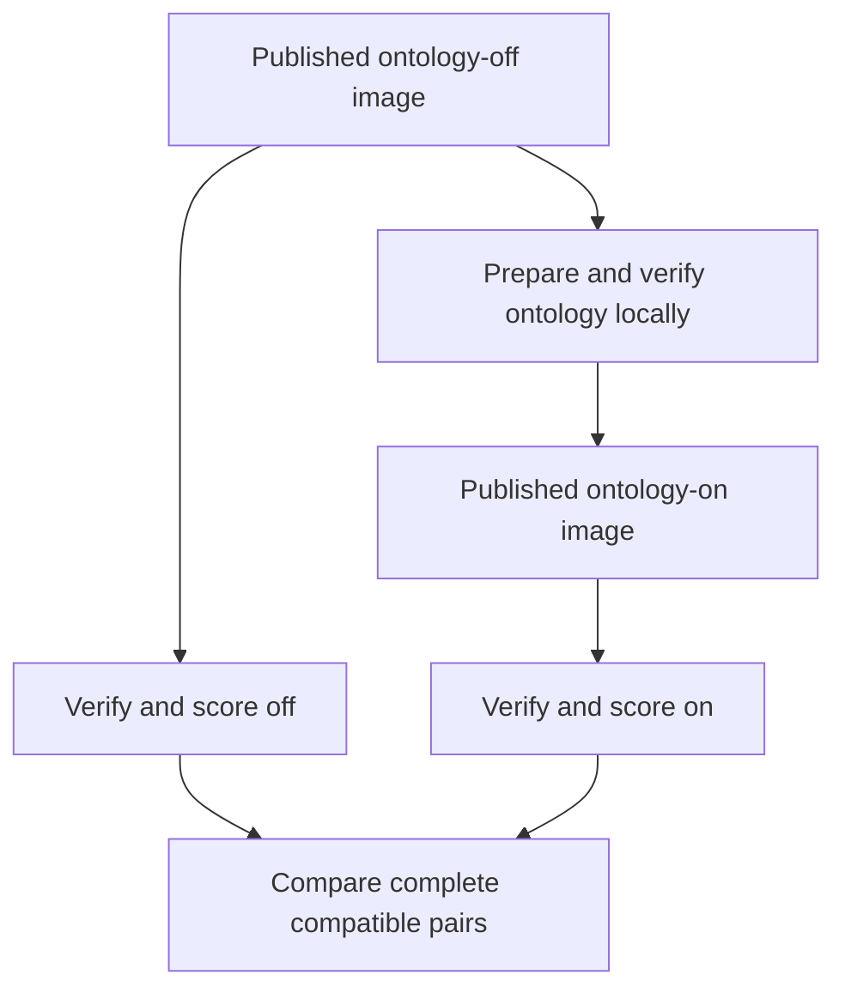

# Evaluation

The hosted public evaluation compares retrieval and answers with ontology off
and on. It uses the published HotpotQA, MuSiQue, 2WikiMultiHopQA, NQ Rear, and
PopQA packs. A complete campaign has 20,000 answers across both ontology
conditions and the single-Recall and multi-turn policies.

## Image Boundary And Tool Surface

Each GitHub-hosted job restores one pinned PostgreSQL image into fresh storage
and starts the pinned Dense-Mem production image. A complete campaign has ten
jobs, one per dataset and condition. Retrieval enters through MCP.

Maintainers prepare the ontology-on child locally from the published off
parent. The builder uses eight ontology workers, a 500,000-token context and
a deadline of 24 hours per dataset. HTTP 429 holds new ontology requests for
at least 60 seconds or the provider's longer wait. The builder pauses and
drains the ontology before exporting a verified, fully organized image.

## Current Evidence Evaluation

The paired images share canonical Evidence, original mappings, and search
fingerprints. The on image also records its parent digest and ontology
fingerprint. The hosted job verifies the appropriate state before and after
scoring. Preparation usage and scoring usage have independent receipts.

## Validate And Smoke-Test

Use the synthetic hosted fixture to verify seeded startup, scoring, protected
failure capture, and cleanup. Use the live mode for the published packs. The
[maintainer guide](https://github.com/markhuangai/dense-mem/blob/main/tests/eval/README.md)
documents the Actions inputs and trusted validation routes.

## Matched Campaign And Comparison

Use matching source, image, registry, model, embedding, and worker settings
across the jobs. Revisions with an `answer_workers` input accept four
through ten workers per job. At ten workers, two jobs can score at once. Confirmed transient answer transport failures can retry within the model
deadline. HTTP 429 delays new answer requests in the affected dataset.

Reports record retrieval and answer metrics, phase timings, usage, canonical
identity and explicit incomplete axes. Protected Actions logs retain the
attempts and recovery decisions. The
[overall baseline](https://github.com/markhuangai/dense-mem/blob/main/tests/eval/baseline.json)
records the most recent complete measurement with its tested source and image.

## Change Gate And Artifacts

Quality, ranking, placement, semantic assessment, embeddings, search-document,
migration-placement, and performance changes retain the repository's
deterministic evaluation requirement or an explicitly approved replacement.

Generated seeds, runtime databases, protected captures and full reports stay
outside Git. Keep the compact baseline after a complete comparison and link
the verified run from the corresponding issue or PR.
