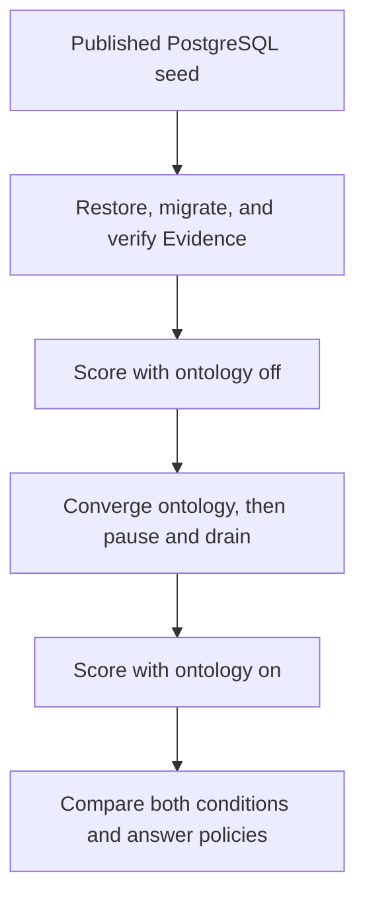

# Evaluation

The hosted public evaluation compares retrieval and answers with ontology off
and on. It uses the published HotpotQA, MuSiQue, 2WikiMultiHopQA, NQ Rear, and
PopQA packs. A complete campaign has 20,000 answers across both ontology
conditions and the single-Recall and multi-turn policies.

## Image Boundary And Tool Surface

Each GitHub-hosted dataset job restores its pinned PostgreSQL seed into fresh
storage and starts the pinned Dense-Mem production image. Retrieval enters
through MCP. The isolated runner uses the private control API to enable,
recover, and pause ontology maintenance.

## Current Evidence Evaluation

The runner verifies the source locks, authorized scope, embedding and search
state, and canonical Evidence fingerprint before scoring. It checks the same
fingerprint after ontology work and final scoring. Native recovery reassesses
confirmed stale or rate-limited failures through the existing maintenance
command.

## Validate And Smoke-Test

Use the synthetic hosted fixture to verify seeded startup, scoring, protected
failure capture, and cleanup. Use the live mode for the published packs. The
[maintainer guide](https://github.com/markhuangai/dense-mem/blob/main/tests/eval/README.md)
documents the Actions inputs and trusted validation routes.

## Matched Campaign And Comparison

Use matching source, image, registry, model, embedding, and worker settings
across the dataset jobs. Revisions with an `answer_workers` input accept four
through ten workers per dataset. At ten workers, two datasets can score at
once. Confirmed transient answer transport failures can retry within the model
deadline. HTTP 429 delays new answer requests in the affected dataset.

Reports record retrieval and answer metrics, phase timings, usage, canonical
identity and explicit incomplete axes. Protected Actions logs retain the
attempts and recovery decisions. The
[overall baseline](https://github.com/markhuangai/dense-mem/blob/main/tests/eval/baseline.json)
records the most recent complete measurement with its tested source and image.

## Change Gate And Artifacts

Quality, ranking, placement, semantic assessment, embeddings, search-document,
migration-placement, and performance changes retain the repository's
deterministic evaluation requirement or an explicitly approved replacement.

Generated seeds, runtime databases, protected captures and full reports stay
outside Git. Keep the compact baseline after a complete comparison and link
the verified run from the corresponding issue or PR.
