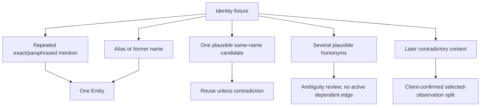
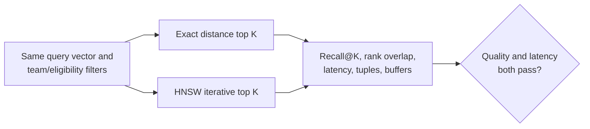

# Evaluation

Evaluation decides whether the target architecture is correct, retrievable,
isolated, recoverable, and fast under representative concurrent reads and
writes. A single answer-quality score is insufficient.

## Current V2 Retrieval Evaluation

The V2 release train uses the deterministic 1k public comparison as the hard
retrieval-quality gate. Larger runs and judge outputs are diagnostic unless a
later roadmap decision explicitly promotes them.

The active public comparison uses validated six-axis seeds generated locally and
ignored by git:

```text
tests/eval/seeds/public_6axis_1k_v1
tests/eval/seeds/public_6axis_5k_v1
tests/eval/suites/public_6axis_1k_v1.jsonl
tests/eval/suites/public_6axis_5k_v1.jsonl
```

`public_6axis_1k_v1` contains exactly 1,000 corpus rows and is the required
v2.1 hard gate. `public_6axis_5k_v1` contains exactly 5,000 corpus rows and may
be run as an optional diagnostic. The 1k seed is a strict deterministic subset
of the 5k seed. The six axes are SciFact, MS MARCO, HotpotQA, MuSiQue, QASPER,
and LongMem Oracle. The corpus-row allocation is:

| Axis | 1k rows | 5k rows |
| --- | ---: | ---: |
| SciFact | 90 | 500 |
| MS MARCO | 90 | 500 |
| HotpotQA | 90 | 500 |
| MuSiQue | 160 | 1000 |
| QASPER | 300 | 1400 |
| LongMem Oracle | 270 | 1100 |

Corpus evidence is split rather than truncated, every row is at most 999
Unicode code points, and qrels resolve to generated `source_key` plus
`source_revision` pairs before import. Seed validation, not recall quality, is
a mandatory gate before any v1 or v2 stack starts.

### Run protocol

```text
validated seed and suite
  -> isolated runtime for each compared implementation
  -> production MCP remember for every corpus evidence row
  -> wait for every placement to reach a terminal successful state
  -> export and validate complete remember outcomes
  -> exactly one production recall_memory call per case
  -> deterministic direct ranking report
  -> separate discovery exposure report
  -> AI-judge report over the initial response only
  -> record final report and durable project-memory summary
```

Runs are sequential so provider contention does not bias recall latency. Each
run records the server revision, evaluator revision and dirty-state
fingerprint, seed/suite hashes, embedding configuration, reviewer/verifier
model, judge model, transport, and isolated team ID. The reviewer/verifier
model is configured by the runtime profile. The answer-quality judge model is
recorded exactly. Import uses one evidence row per production `remember` call,
and runner concurrency is part of the manifest.

When v1 behavior and the seed are unchanged, the retained clean v1 trace and
retrieval artifact may be reused. If the seed, v1 behavior, recall parser, or
judge contract changes, regenerate the affected v1 artifact. V2 is reimported
whenever remember logic, persisted semantic shape, verifier/reviewer prompt, or
schema behavior changes. If only recall ranking changes, the existing successful
v2 import may be reused after validating search freshness and placement state.

The evaluator must not call `assemble_context`, embed the query again, perform a
second retrieval, import through a shortcut, write the database directly, or let
the judge discover missing facts. Final scoring requires every latest corpus
evidence row to reach successful terminal placement; timed-out or failed
production remembers must be repaired or reprocessed before recall scoring.
Completed evidence rows are not restarted unless the production remember logic
or persisted semantic shape changed. Monitor and resume logic count latest
placement state per evidence `idempotency_key`, not raw placement-run rows.

Direct Recall@K, MRR, nDCG@K, rank-one rate, and bad-result counts score only
the initial ranked `results[]`. `discovery_paths` are navigation and trace
hints, so discovery recall and exposure are secondary metrics and never improve
the direct top-K score. The AI judge receives only the exact initial response
and supplied gold data; it cannot follow guidance, recall again, or use outside
knowledge. Recall latency reports average, p50, and p95.

Optional diagnostic ablations may run after the main v2 report, but they must
use the same production recall entry point with a named runtime profile, never
gold labels or evaluator-only candidate manipulation. Useful ablations are:
full-text-only, vector-only, no-discovery, and adjusted evidence branch limits.

### Seed generation and validation

Before seed generation, delete the existing ignored generated seed, suite, and
`.runtime` contents after stopping eval compose projects and confirming their
mounts. Preserve `tests/eval/data/`, source scripts, compose files, and tracked
repository files. After cleanup, the final generated inventory must contain
only the two six-axis seeds and their two suites.

Generate into temporary staging directories, validate independently, regenerate
cleanly and byte-compare, write `validation_report.json`, then atomically
promote. The 1k seed must pass before any required import, baseline, candidate,
recall, judge, or comparison run. If a diagnostic 5k run is requested, the 5k
seed must pass the same validation before that run starts. A failed validation
promotes no required seed; fix the generator or mapping, regenerate from
scratch, and rerun validation.

Validation must prove exact counts, deterministic 1k subset of 5k, stable
hashes, upstream hash/license metadata, unique same-scope source IDs, no
oversized rows, no within-scope exact duplicate content, complete qrel
resolution, grouped/alternative qrel semantics, no answer/qrel leakage in
corpus metadata, BEIR positive completeness, QASPER original-unit mapping, and
LongMem Oracle non-abstention sourcing. Final import and runner modes refuse a
seed whose validation report is missing, failed, hash-mismatched, or produced
by an incompatible validator.

## Source Versus Runtime Boundary

| Committed source | Local ignored runtime data |
| --- | --- |
| evaluation runner and harness code | downloaded/generated datasets |
| generation, sampling, execution, and validation scripts | generated seeds and suites |
| schemas, deterministic test definitions, and gate logic | isolated databases, run outputs, and logs |
| documentation describing methodology and required gates | baseline/candidate results and generated comparison artifacts |

Generated seeds, suites, downloaded datasets, imports, results, and comparison
artifacts stay under ignored evaluation paths such as `tests/eval/data/`,
`tests/eval/seeds/`, `tests/eval/suites/`, `tests/eval/runs/`, and
`tests/eval/.runtime/`. They are local runtime data: never stage or commit them,
exclude them from line-count checks, and do not treat them as release
documentation or release evidence. The manual defines how to evaluate and what
must pass; it may include compact dated notes when a run changes methodology or
comparability, but it does not replace the generated artifact files.

## PR Evaluation Rule

Any PR that may affect retrieval quality, ranking, placement accuracy,
verifier/reviewer behavior, embeddings, search documents, migration placement,
or performance must run the 1k corpus evaluation/comparison and include the
result in the PR. If the seed and import logic are unchanged, a later PR may
reuse a previous successful import after validating manifest identity, placement
terminality, search/vector freshness, and schema/contract compatibility.
Recall/ranking-only changes still rerun recall and scoring against the retained
import.

## Pre-Evaluation Local Gate

Before running or reporting the v2 evaluation, the branch must pass:

```text
go test ./... -count=1
npm --prefix web run build
npm --prefix web test -- --run
npm --prefix web run playwright:mock
scripts/e2e-compose.sh
tests/uat/e2e-journey.spec.ts against an isolated compose stack
```

The UAT journey is the current v2 production-surface smoke: MCP `tools/list` and
`tools/call` for `remember`, `get_memory_placement`, `recall_memory`, and
`trace_memory`; absence/not-found checks for those tools on HTTP/OpenAPI; and
cross-team isolation. It must not depend on removed direct v1 fragment, claim,
fact, or generic HTTP memory-tool routes.

## Evaluation Dimensions

| Dimension | Question |
| --- | --- |
| semantic correctness | did evidence become the right Entity/Value/Relationship state and history? |
| identity | did aliases converge and homonyms stay separable? |
| verification contract | did invalid model output produce zero partial semantic writes? |
| retrieval quality | did full-text/vector/adjacency return the intended active Relationships? |
| vector fidelity | how close is filtered HNSW to exact team-filtered search? |
| temporal/lifecycle | are candidate, conflict, supersession, retraction, and time handled correctly? |
| provenance | can trace reconstruct exact evidence, verification, support, and transitions? |
| isolation/security | can any actor see or affect another team, and can a profile mutate another profile's knowledge? |
| performance/scaling | what happens under simultaneous remember/recall/trace/job load? |
| operations | do restart, Redis loss, backup/restore, and vector rebuild preserve behavior? |
| migration | does legacy data map without silent collapse or activation? |

## Reproducibility Manifest

Every run records:

```text
run_id
UTC start/end
application commit and dirty-tree state
Go/web dependency lock hashes
contract and schema migration versions
cluster-safe schema/key-contract version
PostgreSQL and pgvector versions/config
predicate registry version
reviewer/verifier provider, model, prompt revision, and local contract hash
embedding provider/model, dimensions, normalization, and document version
search-index profile, distance/operator, and HNSW construction
ranking profile and HNSW query parameters
PostgreSQL topology, node/shard count, connection budget, and replica policy
team-size/skew/concurrency dataset version
random seeds and algorithm versions
Redis mode/topology when used
feature flags and hard limits
```

Secrets, unnecessary evidence content, provider raw responses, and vectors are
excluded from the local run record.

## Isolated Run Lifecycle

```mermaid
%%{init: {"flowchart": {"curve": "linear"}}}%%
flowchart LR
  Manifest["Freeze manifest"] --> DB["Create isolated PostgreSQL database"]
  DB --> Migrate["Install pgvector and run migrations"]
  Migrate --> Seed["Seed through MCP tools and<br/>first-party review workflows"]
  Seed --> Poll["Poll processing and search state"]
  Poll --> Integrity["Run semantic and RLS invariants"]
  Integrity --> Cases["Run recall, trace, dream,<br/>correction and load cases"]
  Cases --> Oracle["Compare ANN with exact<br/>and outputs with judgments"]
  Oracle --> Outputs["Write ignored local<br/>runtime outputs"]
  Outputs --> Cleanup["Stop isolated dependencies"]
```



Baseline and candidate use separate restored copies of the same seed snapshot.
Do not run both against one mutable team or share vector-job state.

If evaluation invokes a real provider, store stable request IDs, model/version,
and bounded structured verdicts needed for comparison. A deterministic recorded
provider may test protocol repeatability, but it cannot substitute for
model-quality evaluation.

## Seed Design

Seed packs are generated locally from approved public or synthetic inputs and
remain ignored runtime data. Commit the generator and validation logic, not the
generated corpus, suite, or seed manifest.

The corpus includes:

- repeated paraphrases of the same Entity/Relationship
- aliases, former names, title/kind drift, and two same-name people
- one initially plausible Mark followed by later distinguishing conflict
- Entity and typed-Value objects
- registered predicate aliases and unknown predicates
- state/event and one/many current-cardinality predicates
- positive/negative polarity and temporal intervals
- authoritative user evidence, dependent duplicates, and independent sources
- entailed, contradicted, insufficient, conflict, update, and ambiguity cases
- deterministic pass, guarded, and quarantine evidence, including quoted
  security documentation that must not become a one-phrase false positive
- reviewer and verifier security-signal cases, manager release, and unauthorized
  release
- stable source revisions, stale prior-revision tokens, explicit fragment
  supersession, team-wide support revocation, and fact demotion
- hub/cyclic graph shapes
- candidate inputs eligible/ineligible for dreaming
- cross-team near-duplicates designed to catch vector/RLS leaks
- three writable same-team profiles with corroborating and conflicting
  Relationships, cross-references, and profile-local merge/split corrections
- stale A knowledge followed by B's later correction and C's independent
  response, with reliable/missing effective times, case deadlines, copied-source
  controls, pre-TTL/post-TTL thresholds, authority-override controls, and
  nightly evaluation fixtures

Seed through MCP `remember` and the first-party client-review workflow so runs
exercise extraction, verification, policy, transactions, jobs, and interface
contracts. Direct SQL is allowed only to create an explicitly labeled
corruption/failure fixture.

## Hard Semantic Invariants

Every run fails immediately on:

| Invariant | Required result |
| --- | --- |
| Entity identity | one real identity has one canonical ID; homonyms may have separate IDs |
| semantic node kinds | only Entity and typed Value appear in graph-shaped reads |
| Relationship identity | repeated same-owner evidence attaches to one episode; another owner remains distinct and grouped; `valid_to` closure does not change identity |
| edge eligibility | only `active validated_claim/fact` appears as SemanticEdge |
| candidate isolation | `candidate/pending_evidence` appears in neither default recall nor active graph |
| Hypothesis isolation | dream output changes no Entity/Value/Relationship/support/tier/status |
| evidence lineage | every support resolves to an exact immutable span/source group; effective counts match latest support decisions |
| fact promotion | authority or two genuinely independent accepted sources; stored facts are not new evidence |
| source revision | one source lineage remains one independence group; exact prior token required; activation revokes old support team-wide |
| fact demotion | loss of effective promotion basis demotes the same Relationship automatically |
| injection boundary | deterministic quarantine calls no model; model signals commit no semantic subset; release requires manager plus write |
| unknown predicate | observation/review only; no Relationship |
| forget | no active edge; Entity/Value and ledger history remain |
| append-only | evidence, material decisions, support, correction, and transition history is unchanged |
| tenant isolation | zero cross-team rows/IDs across all branches and trace |
| profile ownership | same-team eligible knowledge is readable, but ordinary lifecycle/support/merge/split changes affect caller-owned records only |
| system reviewer boundary | nightly Conflict review may close losing stale Relationship episodes, but cannot edit evidence, support links, owner/author, Entity resolution, or source history |
| version safety | stale embedding job cannot update a newer document |

## Identity Cases



Measure false merge, false split, duplicate-candidate rate, ambiguity rate, and
client-correction burden. A low duplicate count is not success if valid
homonyms were collapsed.

## Strict Verifier Evaluation

Fault fixtures include:

```text
malformed JSON
unknown field
missing or extra result array
extra predicate_results array
missing, duplicate, or unknown ref
candidate ID outside allowlist
non-null ID on create/ambiguous
unknown predicate key
security signal with unknown evidence ID
security signal with invalid or mismatched span
wrong enum/type/range
oversized string/array/output
cross-array unresolved endpoint
timeout and 429
valid response after one full regeneration
invalid response after retry budget
```

For every invalid attempt assert:

- no Entity/Value/Relationship/support/transition is committed from that output
- no partial array is spliced into a later response
- no `VerificationEvent` represents the invalid attempt
- staged evidence and safe processing failure remain traceable
- a retry contains the original immutable request and validation pointers and
  expects a complete response

## Relationship And Fact Cases

Required examples:

1. one entailed ordinary source creates/updates an active
   `validated_claim` under policy
2. one entailed authoritative user source can produce `fact`
3. two genuinely independent entailed accepted source groups can produce
   `fact`
4. duplicate copies or quoted common origin count once
5. `Mark works_on Dense-Mem` and `Dense-Mem uses PostgreSQL` do not automatically
   create `Mark uses PostgreSQL`
6. a dream may propose that third connection as a Hypothesis using existing
   nodes, but cannot activate it
7. `insufficient` creates/retains a pending candidate only when endpoints and a
   predicate resolve
8. same-owner conflict/single-current replacement remains review-held until safe
9. forget retracts from current reads without erasing trace
10. B's entailed correction creates B-owned knowledge, links A, and creates an
    open team Conflict case without changing A during placement
11. an open/overdue case returns material alternatives and clarification; a
    resolved case returns preferred current support paths plus conflict refs
12. C's independent response creates C-owned knowledge and may contribute to
    later nightly resolution; a bare assertion or copied source adds no vote
13. `valid_at` before the change and `known_at` before later evidence/resolution
    reconstruct the earlier position and case state
14. nightly evaluation resolves only one qualifying position, otherwise records
    `overdue`, and never treats TTL as evidence
15. nightly resolution atomically supersedes losing stale episodes with
    `valid_to`, Relationship transitions, Conflict events, and search refresh
16. A can adopt B's exact evidence without duplicating its source group, then
    supersede only A's prior Relationship

## Recall Judgments

Each case records query, allowed actor/team, expected relevant IDs, forbidden
IDs, time scope, expected branch behavior, and optional Hypothesis/community
expectations.

Core metrics:

| Metric | Meaning |
| --- | --- |
| Recall@K | relevant evidence-context coverage after support-path eligibility |
| MRR | first relevant rank |
| nDCG@K | graded ranking quality |
| exact-anchor success | all required hard anchors satisfied by one result |
| judged-bad rate | top-K results explicitly unsafe/irrelevant |
| trace completeness | expected evidence/verification/transition refs present |
| candidate/Hypothesis leak count | must be zero in primary results |
| cross-team leak count | must be zero |
| cross-profile placement mutation count | must be zero |
| reviewer closure accuracy | losing stale Relationship episodes receive the intended `valid_to` and ledger only after nightly resolution |
| conflict preference accuracy | the uniquely qualifying evidence-backed position resolves and supplies primary current paths |
| conflict clarification accuracy | zero or multiple qualifying positions produce clarification |
| conflict disposition accuracy | resolved current recall includes only the qualifying preferred support paths |
| conflict false-suppression count | eligible unresolved, historical, or unrelated support paths suppressed; must be zero |
| conflict overdue accuracy | deadline cases without one qualifying position become overdue rather than resolved |
| conflict historical reconstruction | `valid_at`/`known_at` return the labeled position/event view |
| p50/p95/p99 latency | overall and per branch |

Report results by tier, time, team size, degree, query type, and search-freshness
state. Aggregate scores can hide a small-tenant or homonym failure.

## Exact Versus HNSW Oracle

For each vector dataset/query:



Datasets vary:

- small/medium/large teams
- many small tenants sharing one table
- one large skewed tenant
- selective status/tier/time/predicate filters
- concurrent inserts/updates and reads
- pending/stale/current embedding mixtures
- single-primary, qualified hot-standby, and every advertised team-sharded
  topology

Exact filtered search is the quality oracle, not an assumed production path.
Changing `ef_search`, iterative mode, topology/partitioning, index construction,
RRF/reranking, or document format requires the applicable execution checks in
[ANN, HNSW, And Halfvec](ANN-HNSW-And-Halfvec) and fusion checks in
[Vector Search And Ranking](Vector-Search-And-Ranking), plus a new matched run.

## PostgreSQL Graph-Read Evaluation

Evaluate point lookup, one-hop incoming/outgoing, predicate-filtered one-hop,
and bounded multi-hop/recursive expansion under:

- uniform and power-law degree
- hubs and cycles
- strict seed/fan-out/depth/edge/time caps
- concurrent `remember` transactions and embedding jobs
- tenant-filter selectivity and RLS
- cold/warm cache conditions

Record query plans, rows, buffers, temp spill, lock/wait time, stopped reason,
and result parity with a deterministic in-test traversal oracle.

The goal is not to prove PostgreSQL wins every graph workload. It is to prove
Dense-Mem's bounded workload meets its SLO. If it cannot, capture the failing
shape before proposing another store.

## Concurrent Load Matrix

| Workload | Example mix |
| --- | --- |
| write-heavy | remember intake + placement + embedding jobs |
| read-heavy | full-text/vector/adjacency recall + trace |
| mixed | 20% writes, 70% recall, 10% trace/control |
| burst | many users submit and recall after a shared event |
| correction | active recall while corrections/forget/splits commit |
| optional jobs | dream/community runs beside core traffic |

For each, record throughput, latency percentiles, errors, per-process and total
connection-pool saturation, vector-semaphore waits, locks/deadlocks, WAL/disk,
replica lag/cancellation, CPU/memory, HNSW quality, queue age, and tenant
fairness.

## Failure Injection

Inject:

- reviewer/verifier timeout, 429, malformed and partial response
- deterministic scanner false-positive/false-negative fixtures, valid reviewer
  and verifier security signals, and repeated quarantine after release
- stale or unowned source revision, source-activation fanout overflow, and crash
  before/after the atomic source pointer and support transition
- embedding provider outage and wrong dimension
- PostgreSQL connection loss, lock timeout, serialization failure, and worker
  restart
- standby replay lag, recovery-conflict cancellation, failover, and stale-route
  prevention
- one distributed worker missing the active pgvector index/profile
- stale team placement epoch during rebalance/failover and attempted
  alternate-shard write
- cross-team composite-FK insert, missing-team repository lookup, and worker
  claim without transaction-local team context
- stale embedding job racing correction
- Redis loss in one-process and multi-instance modes
- crash before and after semantic transaction commit
- backup restore followed by derived vector rebuild
- dream/community source version change during generation

Expected outcomes come from
[Memory Write Pipeline](Write-Pipeline#failure-semantics) and
[Operations Runbook](Operations-Runbook), not per-test invention.

## Migration Evaluation

Legacy Neo4j is read-only corpus input during `2.1.x` migration evaluation.

Compare:

- current non-superseded source knowledge versus terminal official-pipeline
  outcomes, plus the superseded exclusion manifest
- every team/original owner versus migrated owner and system migration actor
- Entity duplicates/homonyms/aliases and unresolved review counts
- Relationship identity collisions by polarity/scope/time
- active/candidate/review/rejected outcomes produced by v2 policy rather than
  copied v1 tiers
- exact evidence/trace coverage where legacy provenance exists
- default recall parity on approved cases
- no newly activated unsupported candidate
- required vector freshness, hard gate report, and automatic cutover marker

Count parity alone cannot approve migration because a one-to-one copy may
preserve duplicates or wrong semantics.

## Local Runtime Outputs

Suggested ignored local layout:

```text
tests/eval/.runtime/
  final-v1/
    1k/
    5k/
  final-v2/
    1k/
    5k/
  final-comparison/
    1k/
    5k/
```

Runtime outputs may include stable IDs and bounded judgments but omit secrets
and unapproved evidence/provider payloads. They may be regenerated or deleted
without changing source or release documentation.

## Release Gates

These are future release criteria. They are intentionally not applied as a
pass/fail gate to the initial v1/v2 comparison above; its report presents raw
paired results and examples for review first.

| Gate | Requirement |
| --- | --- |
| hard invariant | zero tenant, candidate, Hypothesis, duplicate-edge, append-only, and partial-commit violations |
| verifier | every negative fixture rejects the whole response |
| injection | no quarantined semantic/search state, no unauthorized release, and no model signal accepted as a safety clearance |
| source lifecycle | stale/unowned revision changes nothing; accepted revision atomically revokes old effective support and recomputes tiers |
| identity | false merge/split thresholds approved per dataset slice |
| recall | agreed Recall@K/MRR/nDCG and judged-bad thresholds |
| vector | HNSW Recall@K versus exact plus latency SLO |
| performance | p95/p99 and throughput under target concurrent mix |
| topology | single-primary plus every advertised HA/distributed topology passes parity, lag, failover, RLS, and bounded-load gates |
| cluster-safe schema | zero nullable tenant rows, unscoped tenant keys/FKs/lookups, or cross-team references |
| recovery | isolated PITR restore, vector rebuild, and smoke pass |
| migration | every team/author accounted for, official-pipeline terminal outcomes complete, vectors current, hard gates pass, and automatic marker valid |

A gate waiver names the failing slice, owner, expiry, user impact, and rollback.
Security/tenant-leak and append-only/partial-write invariants are not waivable.
Gate review reads the ignored local outputs; generated seeds, results, and
comparisons are not added to the release evidence set.

## Risks And Mitigations

| Risk | Concrete failure mode | Mitigation |
| --- | --- | --- |
| Benchmark overfits one tenant | HNSW looks good globally but misses small-team matches | stratify by tenant size/filter and use exact filtered oracle |
| Baseline/candidate contaminate | both runs share mutable vectors/jobs | isolated restored databases and frozen manifests |
| Mocked success | fake repositories pass while RLS/locks/operators fail | real PostgreSQL + `pgvector` for storage gates |
| Count parity hides semantic loss | migration maps every edge but collapses two Marks | identity/trace/collision cases plus client-reviewed sample |
| Cross-profile correction mutates target | B's stronger evidence supersedes A automatically | A/B/C ownership fixtures and target-row version checks |
| Provider variability hides regression | model change shifts identity/verdict output | record provider, model, prompt revision, and local contract hash; use repeated/paired runs |
| Security corpus overfits keywords | detector passes benchmark but quarantines ordinary security prose | include quoted/adversarial minimal pairs and measure pass/guarded/quarantine confusion separately |
| Source fixtures miss shared adoption | revision tests pass for one profile but leave another profile's fact active | use A/B/C adoption fixtures and verify effective support/tier/search state for every dependent owner |
| Load test corrupts production | evaluation endpoints run on real teams | isolated credentials/database and production feature gate off |
| Single-node benchmark hides cluster failure | local HNSW passes while a standby is stale or one shard lacks the index | topology manifest plus replica/shard parity, lag, failover, and plan gates |

## Evaluation Acceptance

1. no run finalizes with nonterminal placement/embedding work
2. all manifests are complete and comparable
3. hard semantic/isolation invariants run before quality scoring
4. HNSW is always compared with exact team-filtered results
5. concurrent read/write load includes tenant skew and hub graphs
6. invalid verifier output proves zero partial semantic commit
7. failure injection and recovery produce canonical expected outcomes
8. migration reports identity/Relationship ambiguity, not only row counts
9. RRF enabled/disabled profiles, deterministic reranking, and cross-profile
   conflict preference are evaluated separately
10. migration cannot pass with a missing author, nonterminal corpus item,
    required stale vector, or cross-profile mutation
11. every advertised PostgreSQL topology passes the same semantic, tenant,
    exact/ANN, connection-budget, backup, and failover gates
12. reviewer/verifier contracts contain bounded security signals but no model
    schema version, stored-knowledge alignment, or stored Relationship IDs
13. source revision activation, automatic demotion, and stale-token rejection
    pass with same-team cross-profile adopters
14. three-profile Conflict cases pass placement-open/nightly-resolve,
    copied-source, missing-time, deadline, stale-version, lease-recovery, and
    bitemporal slices
15. no evaluation can pass with a cross-profile placement mutation, deadline-only
    winner, wrong reviewer closure, or false suppression of an
    unrelated/historical support path
