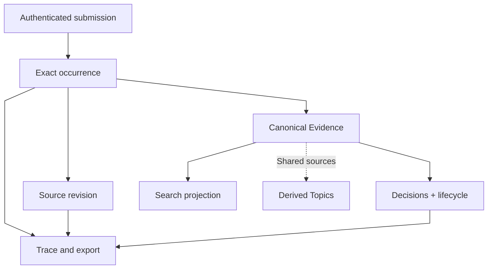
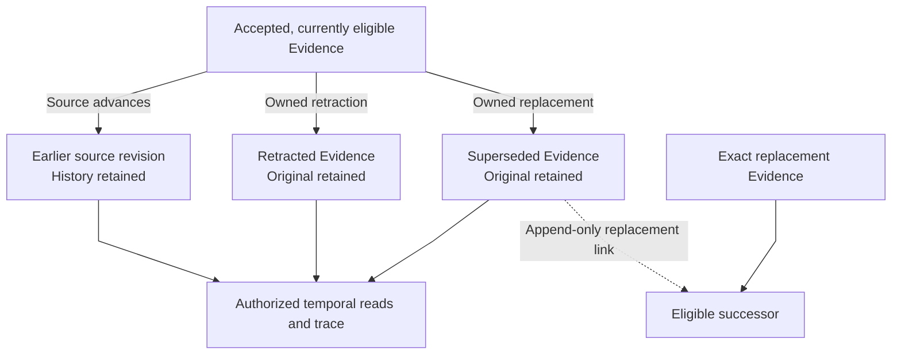

# Evidence Model And Lifecycle

Evidence is exact submitted source content with provenance. Acceptance does not rewrite it into extracted facts. PostgreSQL retains its identity, occurrences, source revisions, decisions, and append-only lifecycle history.

## The Memory Model

| Concept | Responsibility |
| --- | --- |
| Evidence | Canonical retained source memory. |
| Occurrence | One exact submission and its source/authorship, including when canonical Evidence is reused. |
| Source revision | An owner-scoped source identity and its opaque revision token. |
| Decision | The validated assessment or lifecycle action and its provenance. |
| Search document | Rebuildable retrieval state tied to source and embedding generations. |
| Topic / membership / equivalence | Derived organization; see [Topics And Organization](Topics-And-Organization). |

Factual Relationships, Entities, typed Values, predicates, support edges, and Dream have no current memory path.

## Exactness And Reuse

Exact duplicate reuse and assessed semantic equivalence retain the exact submitted occurrence. Reuse does not authorize replacing one submitted quote with another. `force_insert` bypasses semantic duplicate reuse; exact-byte reuse still applies.

Content hashes identify retained content. They do not prove that a statement is correct or grant access to it. Recall equivalence groups do not merge authorship or lifecycle authority.

## Lifecycle

This diagram shows eligibility effects, not a public processing-state enum. Ordinary lifecycle changes preserve original text and provenance. Physical private erasure is a separate governed operation.

| Change | Current behavior |
| --- | --- |
| Direct supersession | Remember exact replacement Evidence with `supersedes_evidence_ids`. |
| Source revision advancement | Submit a consistent source identity/revision and, when advancing it, the exact expected previous revision. |
| Retraction | Use `retract_evidence` with owned Evidence IDs and a reason. |
| Conflict resolution | Appends a conflict decision; it does not rewrite source text. |
| Physical private erasure | Seals/fences the private space and removes its covered data, subject to legal holds. |

Direct supersession and previous-source-revision input cannot be combined on the same Evidence item. See [Conflicts And Corrections](Conflicts-And-Corrections) for the supported procedures.

## Visibility And Ownership

Authentication determines the actual team, owner, allowed spaces, and generations. Read visibility does not grant another owner's lifecycle authority. An SSO user/team membership has its own private space; every API credential has a separate private space.

Authorization rules live in [Request Lifecycle And Security](Request-Lifecycle-And-Security#memory-space-authorization).

## Time Views And Provenance

| View | Meaning |
| --- | --- |
| Current recall | Currently eligible Evidence within authenticated visibility. |
| `valid_at` | The requested real-world time view. |
| `known_at` | The requested system-knowledge time view. |
| Trace | Authorized original occurrences, source revisions, decisions, lifecycle events, and search metadata. |

Topic metadata remains current during temporal Evidence reads. Trace budgets can omit or truncate content/history explicitly; an incomplete trace is not a complete ledger. [Memory Packs](Memory-Packs) preserve exact authorized source material and report omissions.
