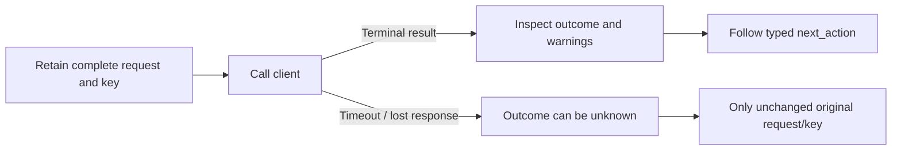

# Framework Integrations

The Python package provides a typed MCP core client, a Google ADK memory service, and a read-only LangChain retriever. Use a verified wheel built from the matching release source. Python 3.11–3.14 and MCP SDK `>=1.30.0,<2` are supported.

```bash
python -m pip install /path/to/densemem-VERSION-py3-none-any.whl
```

The core installs neither framework. Add `[adk]` or `[langchain]` to the wheel installation for the corresponding integration.

## Authentication And Operations

```python
from densemem import DenseMemClient

client = DenseMemClient(endpoint, token=api_key)
tools = await client.list_tools()
```

`endpoint` is the authenticated team MCP URL copied from the portal. Supply exactly one static `token` or caller-owned async `token_provider`. The client resolves the provider once per operation; it does not acquire or refresh OAuth tokens. Keep credentials out of URLs and committed configuration.

| Interface | Behavior |
| --- | --- |
| `DenseMemClient` | Async initialize, list_tools, remember, ingest_session, recall_memory, and trace_memory. |
| `SyncDenseMemClient` | Same core methods; rejects use inside an active event loop. |
| Typed requests/results | Typed dictionaries with `py.typed`; server discovery/validation remains authoritative. |
| Default deadline | 190 seconds total; a shorter positive finite timeout is configurable. |
| Current contract | `dense-mem.v2.8.0`; refresh discovery after upgrading. |

## Remember With Python

The following uses a caller-retained operation key:

```python
from densemem import RememberRequest

request: RememberRequest = {
    "target_space": "private",
    "idempotency_key": retained_operation_key,
    "evidence": [{
        "content": "Dense-Mem stores durable memory in PostgreSQL.",
        "source_type": "manual",
        "source": "Python example",
    }],
}
result = await client.remember(request)
```

Inspect Evidence dispositions, processing/search state, errors, and warnings. Trace takes an `evidence_id`; recall preserves server order, equivalent IDs, Evidence conflicts, topic hints, and degradations. The full protocol and lifecycle rules live in [Technical Reference](Technical-Reference) and [Memory Write Pipeline](Write-Pipeline).

## Exact Private Session Ingestion

```python
from densemem import SessionRequest

request: SessionRequest = {
    "idempotency_key": retained_session_operation_key,
    "framework": "generic",
    "app_name": "python-example",
    "user_id": "external-user-1",
    "session_id": "session-1",
    "events": [{
        "event_id": "user-event-1",
        "text": "  Ari uses Go. café 🧭\n",
        "occurred_at": "2026-11-11T10:00:00Z",
    }],
}
result = await client.ingest_session(request)
```

Keep exact immutable event text and timestamps. Authentication selects the private space; external IDs are provenance. The server must enable intake. Inspect `memory_outcome`: `no_memory` explicitly means no excerpts were selected, not a failed or pending write.

## Failures And Unknown Outcomes



| Error | Meaning |
| --- | --- |
| `DenseMemAuthenticationError` | Token acquisition or HTTP 401/403. |
| `DenseMemTransportError` / `DenseMemProtocolError` | Transport failure or malformed MCP/response. |
| `DenseMemOperationError` | Actionable public failure or failed receipt, retained in `result`. |
| `DenseMemTimeoutError` | Deadline expired. |
| `DenseMemCancelledError` | Async cancellation; subclasses `asyncio.CancelledError`, preserving a returned cancellation receipt when available. |

A disconnect/cancellation can lose delivery after commit. With MCP SDK 1.30's protocol behavior, closing the client does not prove that server processing stopped. The core never automatically retries, rotates operation keys, or polls a status tool. Preserve the exact request and follow [replay guidance](Write-Pipeline#replay-and-recovery).

## Google ADK 2.7.0

```bash
python -m pip install '/path/to/densemem-VERSION-py3-none-any.whl[adk]'
```

```python
from densemem.adk import DenseMemMemoryService

memory = DenseMemMemoryService(endpoint, token=alice_token, bound_user_id="alice")
snapshot = session.model_copy(deep=True)
await memory.add_session_to_memory(snapshot)
response = await memory.search_memory(
    app_name=snapshot.app_name, user_id="alice", query="Ari Go"
)
```

Use actual ADK Session/Event types. A static token requires `bound_user_id` and rejects other users, including empty ingestion. For multiple users, resolve their distinct credentials through your existing credential manager:

```python
async def credential_provider(app_name: str, user_id: str) -> str:
    return await credentials.access_token(app_name, user_id)

memory = DenseMemMemoryService(endpoint, credential_provider=credential_provider)
await memory.add_events_to_memory(
    app_name=session.app_name, user_id=session.user_id,
    session_id=session.id, events=session.events,
)
```

| ADK behavior | Contract |
| --- | --- |
| Event selection | Exact visible user text, IDs, order, and UTC timestamps. Exclude assistant/system/tool/state/transcription/binary/thought content; unknown part shapes fail. |
| Batching | Sequential requests of at most 20 eligible events. An individual event is never truncated or split by the adapter. |
| Operations | `add_session_to_memory` and `add_events_to_memory` return None after all batches complete. Deltas require `session_id`; nonempty custom metadata and direct `add_memory` are unsupported. |
| Limits | Default 190-second deadline covers slot waiting, credential resolution, and all batches; default concurrency four public operations. |
| Retry identity | Deterministic `google-adk-v1` keys from application/user/session/ordered event identities. Retain the unchanged original snapshot. |

Earlier batches can commit before a later batch fails. Errors retain `completed_results` and, when attempted, the exact `failed_request`. A waiting timeout has no attempted request. Replay the unchanged snapshot or send the exact failed request through the core client; never alter text/order/timestamps to recover.

The adapter does not cache credentials or own OAuth refresh. Different external app/user IDs using one credential do not create separate authorization boundaries. Search retains Evidence IDs, equivalent IDs, and space kind in `MemoryEntry.custom_metadata["densemem"]`, with the complete bounded recall projection in `response.custom_metadata["densemem"]`. Empty/degraded results remain explicit; no extra trace calls or private/shared post-filtering are added.

## LangChain Core 1.5.4

```bash
python -m pip install '/path/to/densemem-VERSION-py3-none-any.whl[langchain]'
```

```python
from densemem.langchain import DenseMemRetriever

retriever = DenseMemRetriever(endpoint=endpoint, token=api_key, k=10)
documents = retriever.invoke("Which database does this project use?")
```

Inside an event loop, use:

```python
documents = await retriever.ainvoke("Which database does this project use?")
```

| Option or result | Contract |
| --- | --- |
| Authentication | Exactly one static token or async token_provider; no credential cache or token refresh. |
| `k` | Integer 1–50, default 10. |
| `recall_options` | `topic_ids`, `topic_limit`, `valid_at`, `known_at`, and `known_evidence_ids`. Query/limit/team/space and invocation-time overrides are rejected. |
| Documents | One per returned Evidence item in server order; ID is `evidence_id`, content is the exact server-bounded context. |
| `metadata["densemem"]` | Evidence/equivalent IDs, space kind, recall ID, related Topics, topic truncation, conflicts, search states, degradations, and suggested actions. Query-wide context does not imply per-document support. |
| Optional degradation | Available documents plus content-free `DenseMemRecallWarning`; its `result` retains the complete response, including empty results. |

Required failures remain typed errors; malformed mapping produces no partial documents. The adapter adds no reranking, deduplication, semantic writes, trace calls, or automatic retries. Sync invocation rejects an active event loop. Standard LangChain callbacks/tags/metadata and batch operations remain available; caller-configured callbacks receive ordinary query/document data.

## Build And Validation

Framework extras pin `google-adk==2.7.0` and `langchain-core==1.5.4`; missing/incompatible extras fail with actionable imports while the core remains usable. Installed-wheel checks, Python/MCP matrices, real server scenarios, artifact provenance, and shared-release publication are documented in [Development And Testing](Development-And-Testing#python-package-and-frameworks).
