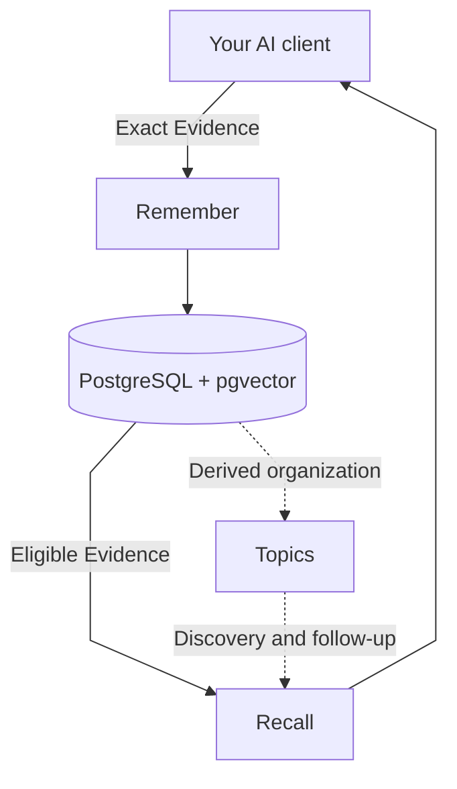

# Dense-Mem

Dense-Mem stores exact Evidence with provenance and a governed lifecycle. AI clients decide when to save or retrieve memory; the server owns authorization, assessment, persistence, and retrieval.

This wiki describes the approved Evidence-only target architecture and contract `dense-mem.v2.8.0`. [Implementation status](Documentation-Maintenance#implementation-status) identifies gaps between the target and inspected code. Check the connected server's authenticated `tools/list` before using tool arguments; a deployed image can lag the source.

## Start Here

| Goal | Read |
| --- | --- |
| Set up a server or try disposable memory | [Quick Start](Quick-Start), [Hosted Demo](Hosted-Demo) |
| Use memory from an AI client | [Using Dense-Mem](Using-Dense-Mem), [MCP Clients](MCP-Clients) |
| Integrate Python, Google ADK, or LangChain | [Framework Integrations](Framework-Integrations) |
| Understand the current model | [Evidence Model And Lifecycle](Evidence-Model-And-Lifecycle), [Topics And Organization](Topics-And-Organization) |
| Understand execution and storage | [Architecture](Architecture), [Memory Write Pipeline](Write-Pipeline), [Data Model And Storage](Data-Model-And-Storage) |
| Inspect the tool contract | [Technical Reference](Technical-Reference) |
| Understand search | [Recall Ranking](Recall-Ranking), [Vector Search And Ranking](Vector-Search-And-Ranking), [ANN, HNSW, And Halfvec](ANN-HNSW-And-Halfvec) |
| Correct, retract, export, or give feedback | [Conflicts And Corrections](Conflicts-And-Corrections), [Memory Packs](Memory-Packs), [Recall Feedback](Recall-Feedback) |
| Administer access | [Portals And API Keys](Portals-And-API-Keys), [User Portal SSO](User-Portal-SSO), [Request Lifecycle And Security](Request-Lifecycle-And-Security) |
| Operate a deployment | [Configuration](Configuration), [Public HTTPS And Redis](Public-HTTPS-And-Redis), [Operations Runbook](Operations-Runbook), [Telemetry](Telemetry) |
| Develop or maintain documentation | [Development And Testing](Development-And-Testing), [Evaluation](Evaluation), [PostgreSQL Cluster-Safe Schema](PostgreSQL-Cluster-Safe-Schema), [Documentation Maintenance](Documentation-Maintenance) |

## Choose The Right Memory

| Input or action | Meaning |
| --- | --- |
| Remember | Submit exact source text to an explicit private or team-shared destination. |
| Ingest session | Submit exact user-authored events to private memory; the server selects verbatim excerpts. |
| Recall | Retrieve authorized, eligible Evidence and useful current topic hints. |
| Trace | Inspect the provenance and lifecycle of a returned Evidence ID. |
| Topics | Organize shared Evidence without creating new claims or submitted Evidence. |

PostgreSQL is the durable authority. Redis or process memory coordinates requests and workers. Dense-Mem preserves sources and disagreement; a retrieved item is not a guarantee that its contents are true.
