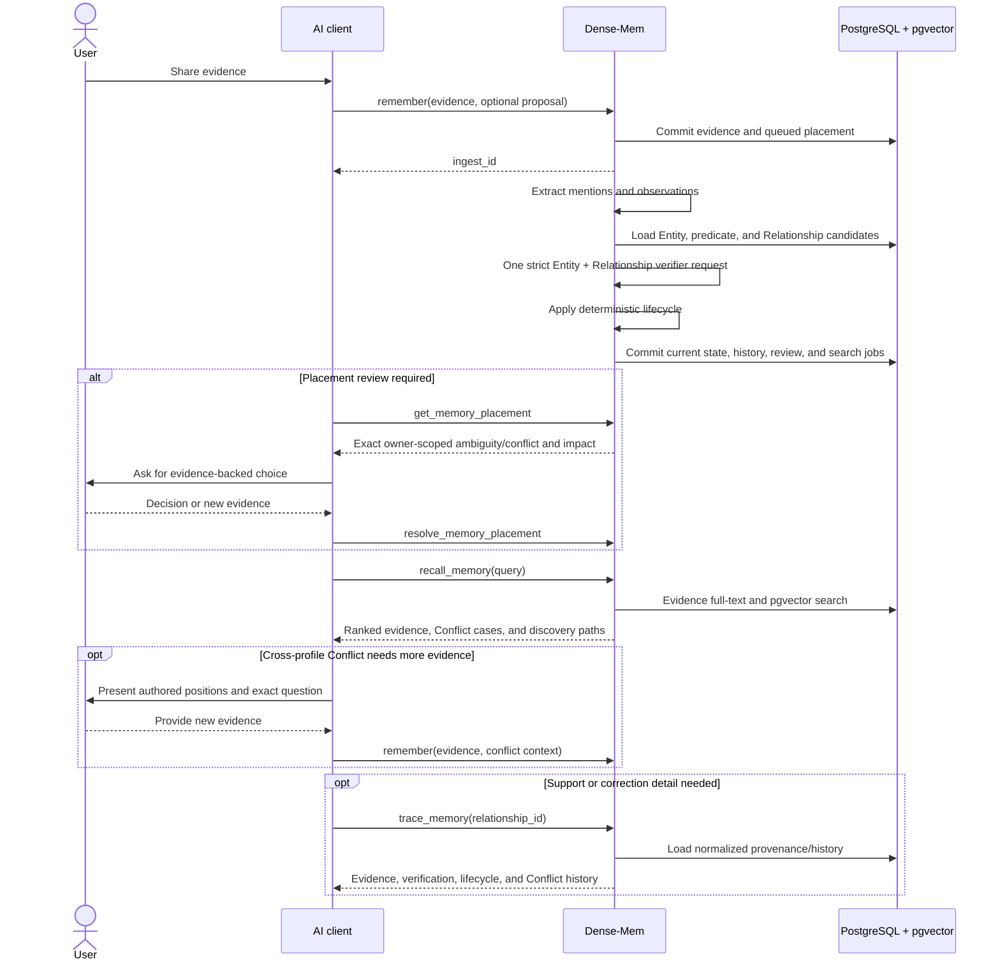
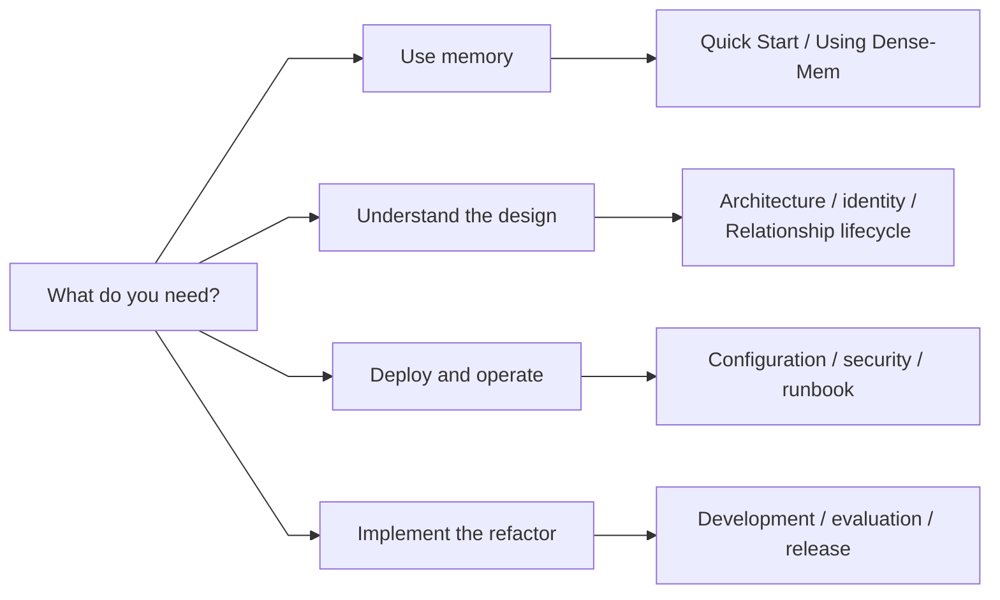
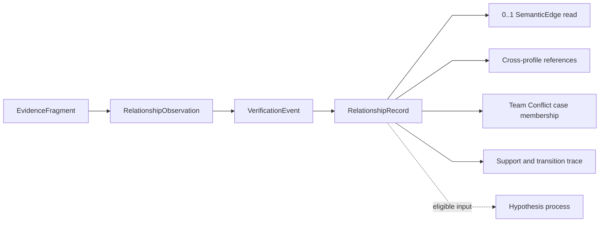

# Dense-Mem

Dense-Mem gives AI clients a shared, evidence-backed semantic memory service.

This manual is the approved target contract for a full PostgreSQL + `pgvector`
refactor. The current source still contains legacy behavior; pages label that
gap when it matters. A code/design mismatch is implementation work, not a
second valid architecture.

## What Dense-Mem Remembers

Dense-Mem is suited to:

- project goals, systems, ownership, and current priorities
- preferences and team agreements
- decisions and corrections across sessions
- time-scoped operational knowledge
- provenance needed to explain a remembered Relationship

Dense-Mem is not a truth oracle. A host LLM chooses when to call it. Dense-Mem
stores exact evidence, extracts structure, resolves identity, verifies in one
strict response, applies deterministic lifecycle rules, and preserves trace.

## How It Works



The convergence rule:

```text
same real identity      -> reuse the Entity
same owner + relationship -> attach evidence to that Relationship
another profile agrees  -> keep its authored Relationship and group on recall
profiles disagree       -> preserve each author; use a team Conflict case
new real identity       -> create one Entity
new relationship        -> create one Relationship
actual ambiguity        -> review; do not guess
insufficient evidence   -> pending candidate; no active edge/default recall
dream speculation       -> Hypothesis only; no new node
```

Aliases are Entity-name metadata, never edges.

## Start Here



| Goal | Canonical page |
| --- | --- |
| System boundary | [Architecture](Architecture) |
| Entity IDs, names, aliases, homonyms, merge/split | [Entity Identity And Resolution](Entity-Identity-And-Resolution) |
| Predicate, Relationship, evidence, verification, tier/status, forget | [Relationship Model And Lifecycle](Relationship-Model-And-Lifecycle) |
| `remember` process and strict verifier | [Memory Write Pipeline](Write-Pipeline) |
| PostgreSQL, `pgvector`, Redis, queues, and recovery | [Data Model And Storage](Data-Model-And-Storage) |
| Tenant keys, composite constraints, RLS, queues, and future team sharding | [PostgreSQL Cluster-Safe Schema](PostgreSQL-Cluster-Safe-Schema) |
| Recall eligibility, branches, adjacency, and trace escalation | [Recall Ranking](Recall-Ranking) |
| Embedding/cosine meaning, candidate fusion, RRF, and reranking | [Vector Search And Ranking](Vector-Search-And-Ranking) |
| Exact/ANN execution, HNSW, halfvec, index lifecycle, and vector scale | [ANN, HNSW, And Halfvec](ANN-HNSW-And-Halfvec) |
| Public MCP tool schemas | [Technical Reference](Technical-Reference) |
| Local setup | [Quick Start](Quick-Start) |
| Everyday client workflow | [Using Dense-Mem](Using-Dense-Mem) |
| MCP clients | [MCP Clients](MCP-Clients) |
| Conflict, correction, identity split, and forget | [Conflicts And Corrections](Conflicts-And-Corrections) |
| Hypotheses | [Dreaming](Dreaming) |
| Community discovery | [Community Memory](Community-And-Dreaming) |
| Configuration and operation | [Configuration](Configuration), [Operations Runbook](Operations-Runbook) |
| Security, portals, SSO, keys | [Request Lifecycle And Security](Request-Lifecycle-And-Security), [Portals And API Keys](Portals-And-API-Keys), [User Portal SSO](User-Portal-SSO) |
| Telemetry, feedback, evaluation | [Telemetry](Telemetry), [Recall Feedback](Recall-Feedback), [Evaluation](Evaluation) |
| Source refactor and release | [Development And Testing](Development-And-Testing), [Release Process](Release-Process) |
| Manual ownership | [Documentation Maintenance](Documentation-Maintenance) |

## Semantic Model At A Glance



- Entity is one team-scoped real-world identity.
- `entity_id` is an opaque ID, not display text.
- Value is a canonical typed scalar endpoint.
- Predicate is the registered meaning such as `works_on`.
- RelationshipRecord owns one profile's canonical subject-predicate-object
  lifecycle and is readable across its team.
- A profile corrects another profile by writing its own verified knowledge and
  an immutable cross-reference, never by mutating the target.
- SemanticEdge is the read shape of an `active validated_claim` or `fact`.
- Hypothesis is isolated speculation between existing endpoints.

Full definitions exist only in
[Relationship Model And Lifecycle](Relationship-Model-And-Lifecycle).

## Storage At A Glance

| Component | Target responsibility |
| --- | --- |
| PostgreSQL | every durable knowledge/control record plus graph-shaped, full-text, and vector-ready reads |
| `pgvector` | vector type/index inside PostgreSQL |
| Redis | optional distributed coordination: limits, short leases/signals, SSE |
| process memory | the same coordination interfaces for one process only |

Neo4j is not in normal target runtime. The temporary `2.1.x` bridge reads it
only for boot-gated migration and `2.2.0` removes that connection path. Redis
never stores the only copy of an Entity, Relationship, evidence, review, key,
or audit event.

## What Dense-Mem Does Not Do

Dense-Mem does not:

- use a name as an Entity ID
- create alias edges or a new Entity for every spelling
- let an AI select arbitrary database IDs or assign tier/status
- treat stored facts, graph context, or search hits as new evidence
- infer a third fact merely because two facts form a plausible chain
- expose insufficient candidates in the active graph/default recall
- let dreaming create Entities, Values, predicates, or Relationships
- erase nodes/history when a Relationship is forgotten
- store durable memory only in Redis
- browse the internet to validate a submitted claim

## Manual Status

Canonical pages define the v2 architecture. Operational commands must be
checked against the deployed contract/version.
Update and evidence rules are in
[Documentation Maintenance](Documentation-Maintenance).
