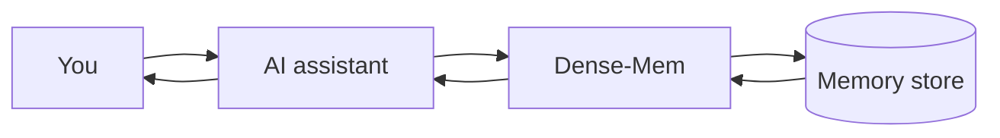

# Dense-Mem

Dense-Mem gives your AI tools a shared long-term memory.

Most AI assistants remember only the current chat. Dense-Mem runs as your own
memory service, so tools like Claude Code, Codex, or other MCP clients can store
important facts, recall them later, and keep memory separate from any one chat
window.

You can use Dense-Mem when you want an assistant to remember:

- your project names, goals, and current priorities
- preferences such as coding style, naming rules, and review standards
- decisions already made in earlier sessions
- important setup details for a repo or team
- facts that should survive after the chat ends

Dense-Mem is not an AI agent by itself. It is the memory system your AI tools
call when they need to save or recall information.

## Common Use Cases

| Use case | Example |
| --- | --- |
| Personal coding memory | "Remember that I prefer small pull requests and explicit error handling." |
| Project memory | "Recall the deployment steps for my API service." |
| Team memory | "Remember the frontend team uses Bun and strict TypeScript." |
| Portable memory handoff | "Package the validated onboarding facts so another team can inspect and import them." |
| AI assistant continuity | "Before answering, recall what you know about this project." |
| Safer corrections | "Actually, keep the new preference and replace the old one." |

## How It Works In One Minute

1. You tell an AI assistant something worth remembering.
2. The assistant sends that memory to Dense-Mem.
3. Dense-Mem stores the original evidence and checks whether it should become an
   active fact.
4. Later, the assistant asks Dense-Mem what it remembers.
5. Dense-Mem returns relevant memory for the assistant to use.

## Start Here

| Goal | Page |
| --- | --- |
| Try Dense-Mem before installing anything | [Hosted Demo](Hosted-Demo) |
| Run Dense-Mem with the fewest choices | [Quick Start](Quick-Start) |
| Learn what to do after it is running | [Using Dense-Mem](Using-Dense-Mem) |
| Review every important setting | [Configuration](Configuration) |
| Understand the system design | [Architecture](Architecture) |
| Read tool, API, and operations notes | [Technical Reference](Technical-Reference) |

## What You Need

For the easiest setup, you need:

- a computer or server that can run Docker
- an AI provider API key for embeddings
- one command line window
- one MCP client such as Claude Code or Codex

The quick start keeps everything local by default. You can make Dense-Mem public
later, after the local version works.

## What Dense-Mem Stores

Dense-Mem stores evidence first. An evidence fragment is the text that supports a
memory. From that evidence, Dense-Mem can create typed claims and promote safe,
non-conflicting claims into active facts.

That means memory is not only a pile of notes. It keeps track of where a memory
came from and whether it became an active fact.

Dense-Mem can also package selected facts, validated claims, and manual triples
as portable skill packs. A skill pack is canonical JSON plus a SHA-256 hash, so
another team can inspect the contents before importing them.

## What Dense-Mem Does Not Do

Dense-Mem does not:

- replace your AI assistant
- choose truth silently when memories conflict
- browse the internet for facts
- manage your whole application
- expose the control portal as a public admin site by default

If Dense-Mem sees a comparable conflict, the assistant should ask you which
memory to keep.
