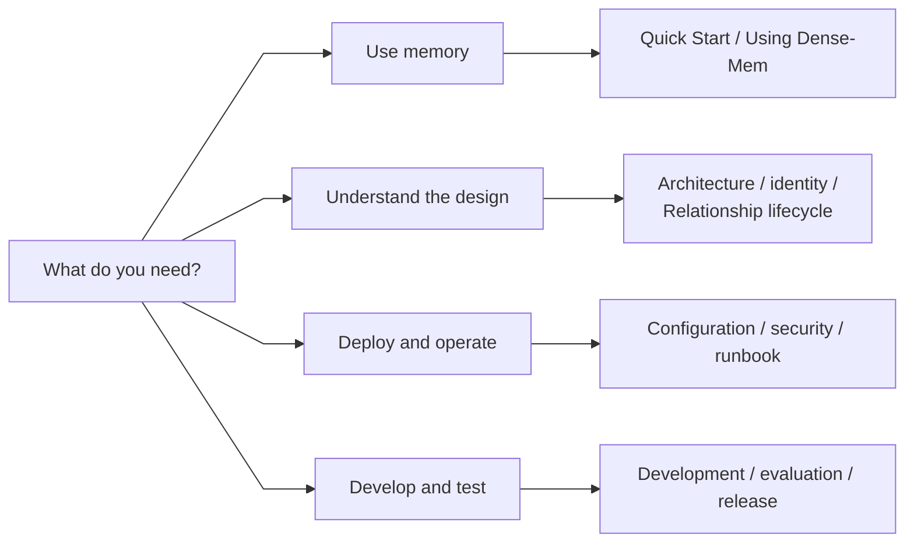
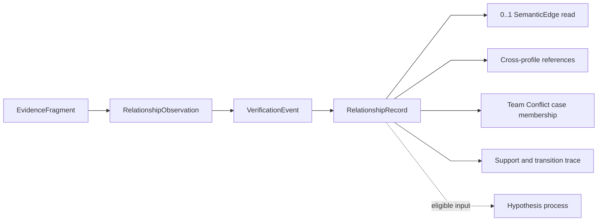

# Dense-Mem

Dense-Mem gives AI clients a shared, evidence-backed semantic memory service.

This manual describes the current PostgreSQL + `pgvector` architecture and
supported product behavior. A code/design mismatch is implementation work, not
a second valid architecture.

## Current Memory Contract

The current contract is `dense-mem.v2.6.3`. `remember` accepts exact evidence
and optional Relationship proposals, validates the complete batch, and returns
a terminal result. Safe evidence can be stored without an accepted
Relationship. Default recall still requires an eligible Relationship support
path.

The private control portal provides operation logs and Remember/Dream
diagnostics. Graph and evidence-discovery Dream lanes produce isolated
Hypotheses. Exact schemas and examples are in
[Technical Reference](Technical-Reference).

## What Dense-Mem Remembers

Dense-Mem is suited to:

- project goals, systems, ownership, and current priorities
- preferences and team agreements
- decisions and corrections across sessions
- time-scoped operational knowledge
- provenance needed to explain a remembered Relationship

Dense-Mem is not a truth oracle. A host LLM chooses when to call it. Dense-Mem
stores exact evidence, lets one bounded assessor session repair
grounding/identity/predicate/support decisions, applies deterministic lifecycle
rules, and preserves trace. Unsupported proposals receive `not_stored`; safe evidence can still be stored.

## How It Works

~~~mermaid
%%{init: {"sequence": {"rightAngles": true}}}%%
sequenceDiagram
  actor User
  participant Host as AI client
  participant DM as Dense-Mem
  participant PG as PostgreSQL and pgvector
  User->>Host: Share exact evidence
  Host->>DM: remember with optional proposals and a retry key
  DM->>DM: Validate, resolve duplicates, and assess
  alt Accepted
    DM->>DM: Embed required documents
    DM->>PG: Commit evidence, semantics, vectors, and result
    DM-->>Host: Completed result with dispositions
  else Failed
    DM->>PG: Bounded attempt or audit diagnostics
    DM-->>Host: Typed error with next action
  end
  Host->>DM: recall_memory(query)
  DM->>PG: Authorized support and time-view reads
  DM-->>Host: Evidence, related frontiers, and degradations
  opt Provenance needed
    Host->>DM: trace_memory(relationship_id)
    DM->>PG: Read evidence and decision history
    DM-->>Host: Bounded authorized lineage
  end
~~~

The convergence rule:

```text
same real identity      -> reuse the Entity
same owner + relationship -> attach evidence to that Relationship
another profile agrees  -> keep its authored Relationship and group on recall
profiles disagree       -> preserve each author; use a team Conflict case
new real identity       -> create one Entity
new relationship        -> create one Relationship
actual ambiguity        -> server assessment; no client resolution loop
unsupported proposal   -> not_stored; safe evidence can still be stored
stored evidence        -> recall only with an eligible support path
dream speculation       -> Hypothesis only; no new node
```

Aliases are Entity-name metadata, never edges.

## Start Here



| Goal | Canonical page |
| --- | --- |
| System boundary | [Architecture](Architecture) |
| Entity IDs, names, aliases, homonyms, merge/split | [Entity Identity And Resolution](Entity-Identity-And-Resolution) |
| Predicate, Relationship, evidence, verification, status/support, forget | [Relationship Model And Lifecycle](Relationship-Model-And-Lifecycle) |
| `remember` process and strict assessor | [Memory Write Pipeline](Write-Pipeline) |
| PostgreSQL, `pgvector`, Redis, queues, and recovery | [Data Model And Storage](Data-Model-And-Storage) |
| Tenant keys, composite constraints, RLS, queues, and future team sharding | [PostgreSQL Cluster-Safe Schema](PostgreSQL-Cluster-Safe-Schema) |
| Recall eligibility, branches, adjacency, and trace escalation | [Recall Ranking](Recall-Ranking) |
| Embedding/cosine meaning, candidate fusion, RRF, and reranking | [Vector Search And Ranking](Vector-Search-And-Ranking) |
| Exact/ANN execution, HNSW, halfvec, index lifecycle, and vector scale | [ANN, HNSW, And Halfvec](ANN-HNSW-And-Halfvec) |
| Public MCP tool schemas | [Technical Reference](Technical-Reference) |
| Local setup | [Quick Start](Quick-Start) |
| Everyday client workflow | [Using Dense-Mem](Using-Dense-Mem) |
| MCP clients | [MCP Clients](MCP-Clients) |
| Conflict, correction, identity split, and forget | [Conflicts And Corrections](Conflicts-And-Corrections) |
| Hypotheses | [Dreaming](Dreaming) |
| Community discovery | [Community Memory](Community-And-Dreaming) |
| Configuration and operation | [Configuration](Configuration), [Operations Runbook](Operations-Runbook) |
| Security, portals, SSO, keys | [Request Lifecycle And Security](Request-Lifecycle-And-Security), [Portals And API Keys](Portals-And-API-Keys), [User Portal SSO](User-Portal-SSO) |
| Telemetry, feedback, evaluation | [Telemetry](Telemetry), [Recall Feedback](Recall-Feedback), [Evaluation](Evaluation) |
| Source changes and testing | [Development And Testing](Development-And-Testing) |
| Manual ownership | [Documentation Maintenance](Documentation-Maintenance) |

## Semantic Model At A Glance



- Entity is a scoped real-world identity, subject to its memory-space visibility.
- `entity_id` is an opaque ID, not display text.
- Value is a canonical typed scalar endpoint.
- Predicate is the registered meaning such as `works_on`.
- RelationshipRecord owns one profile's canonical subject-predicate-object
  lifecycle within its memory space.
- A profile corrects another profile by writing its own verified knowledge and
  an immutable cross-reference, never by mutating the target.
- SemanticEdge is the read shape of an active Relationship with effective
  support.
- Hypothesis is isolated speculation between existing endpoints.

Full definitions exist only in
[Relationship Model And Lifecycle](Relationship-Model-And-Lifecycle).

## Storage At A Glance

| Component | Responsibility |
| --- | --- |
| PostgreSQL | every durable knowledge/control record plus graph-shaped, full-text, and vector-ready reads |
| `pgvector` | vector type/index inside PostgreSQL |
| Redis | optional distributed coordination: limits, short leases/signals, SSE |
| process memory | the same coordination interfaces for one process only |

Redis never stores the only copy of an Entity, Relationship, evidence, submission,
key, or audit event.

## What Dense-Mem Does Not Do

Dense-Mem does not:

- use a name as an Entity ID
- create alias edges or a new Entity for every spelling
- let an AI select arbitrary database IDs or assign lifecycle status/support
- treat stored facts, graph context, or search hits as new evidence
- infer a third fact merely because two facts form a plausible chain
- expose pending Relationships in the active graph/default recall
- let dreaming create Entities, Values, predicates, or Relationships
- erase nodes/history when a Relationship is forgotten
- store durable memory only in Redis
- browse the internet to validate a submitted claim

## Manual Status

Source baseline: `654ebdcae31ea3da6f2a948a07a6e12ecc51818f`, checked on
2026-09-22.

This manual covers current installations and fresh setup. Accepted repository
ADRs govern architecture; current source and tests establish implemented
behavior. A checkout inspection does not establish which image is deployed.
Update and evidence rules are in
[Documentation Maintenance](Documentation-Maintenance).
