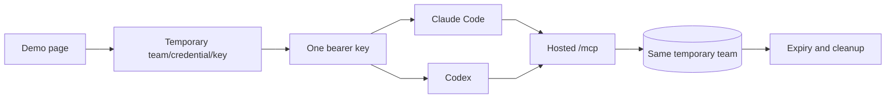

# Hosted Demo

Use the hosted demo to test the shared-memory experience with disposable data:

```text
https://demo-dense-mem.markhuang.ai
```

The hosted demo runs the PostgreSQL-backed runtime. Check tool discovery before
using it to validate behavior. This page does not hardcode changing quotas; the
demo UI/runtime response owns its current limits.

## Safety Boundary

- use only disposable test data
- never store secrets, credentials, personal data, production notes, or critical
  memory
- demo teams/credentials expire and may be cleaned without recovery
- SSO/control-plane access is not part of the public demo
- a generated key grants access to that temporary team; protect it for its
  lifetime

## What The Demo Proves

Several clients using one key share one isolated team memory.



It proves cross-session/client access. It does not prove:

- production durability or backup
- multi-instance/Redis correctness
- your own provider/privacy policy
- high-load behavior

## Step 1: Generate A Key

Open the demo page, generate a temporary key, then keep it in the client
environment:

```bash
export DENSE_MEM_API_KEY="dm_..."
```

Use the same key for clients that should share the demo team. Generate another
key for isolation.

## Step 2: Connect Clients

Follow [MCP Clients](MCP-Clients) with:

```text
https://demo-dense-mem.markhuang.ai/mcp
```

Run tool discovery and use the deployed schema. Remember requires exact
evidence and one retained top-level idempotency key; Relationship proposals are
optional. Scope and feature policy determine the visible tools. The demo's
currently deployed version must be verified separately from this source manual.

## Step 3: Test Shared Memory

Client A:

```text
Use Dense-Mem to remember that this demo project codename is river-lamp and I prefer concise answers with concrete commands.
```

Client B, using the same key:

```text
Before answering, use Dense-Mem to recall the demo codename and response style.
```

Use the terminal Remember result before testing recall. A new chat with the
same key should then recall from Dense-Mem rather than the old chat transcript.

## Step 4: Test Trace

Ask:

```text
Show the Relationship Dense-Mem recalled for the demo codename and trace its supporting evidence.
```

Normal recall should be compact and trace should use
`relationship_id` to expand evidence/verification/history.

## Step 5: Test Identity Ambiguity

Store two clearly distinguished people with the same first name, then submit an
underspecified statement about that name. The server must not guess an identity. An unsupported proposal can be
`not_stored` while the safe evidence is stored; inspect the complete result.

Supply distinguishing evidence before expecting a supported identity-specific
Relationship.

## Step 6: Test A Correction

For a changed preference, submit new exact evidence through Remember. For a
misresolved Entity or predicate on an owned active Relationship, use
`correct_relationship` with the current version and complete effective support
set. Typed-Value replacement is not supported by that patch.

See [Conflicts And Corrections](Conflicts-And-Corrections) before treating any
operation as a completed correction.

## Troubleshooting

| Symptom | Check |
| --- | --- |
| tool names/fields differ | reconnect and compare the current `tools/list` schema |
| another client sees nothing | both clients use exactly the same key |
| submission is not searchable | inspect the original terminal result and bounded error guidance |
| failed operation or unsupported proposal | inspect errors/dispositions and follow the returned remediation |
| quota/expiry error | current limits on demo page/runtime response |
| deployed behavior differs from this page | check the current release tag and `tools/list` schema |

## Next

Use [Quick Start](Quick-Start) for a pinned local deployment and
[Using Dense-Mem](Using-Dense-Mem) for the current workflow.
