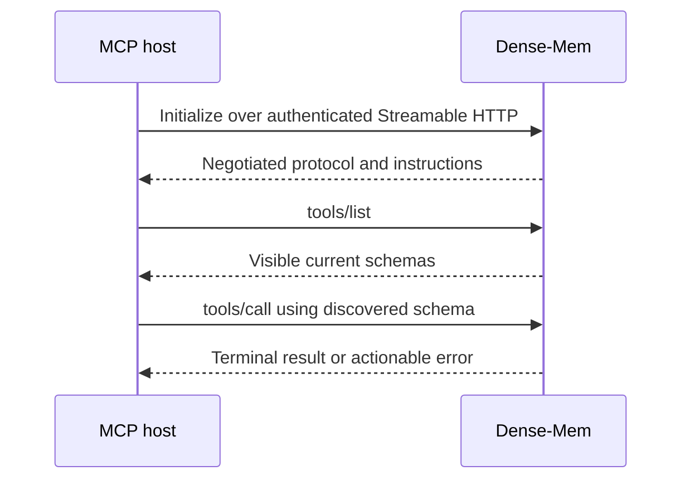

# MCP Clients

Connect an MCP Streamable HTTP host to the team-scoped URL copied from `/ui` → **Connect**:

```text
https://memory.example.com/teams/<team-id>/mcp
```

For local use, the main listener is `http://127.0.0.1:8080`. `/mcp` also supports authenticated unscoped access where team resolution permits it. Exact identity, token, and cookie rules belong to [Request Lifecycle And Security](Request-Lifecycle-And-Security).

## Credentials And Discovery



Supply an API key or configured customer-IdP OAuth access token in the bearer header. Browser SSO/portal cookies do not authenticate MCP. Configure credentials privately and allow the server's bounded synchronous operation time.

OAuth-aware hosts can use the RFC 9728 resource metadata and `401` challenge link. Those require configured `MCP_PUBLIC_BASE_URL`; the portal's explicitly labeled browser-origin fallback is only a manual connection aid. See [OAuth authentication](Request-Lifecycle-And-Security#oauth-bearer-authentication-for-mcp).

## Claude Code

The installed Claude CLI exposes the HTTP transport/header form:

~~~bash
claude mcp add --transport http dense-mem   "http://127.0.0.1:8080/teams/$DENSE_MEM_TEAM_ID/mcp"   --header "Authorization: Bearer $DENSE_MEM_API_KEY"
~~~

Set `DENSE_MEM_TEAM_ID` to the full UUID shown in `/ui`. Run
`claude mcp add --help` on the installed version before scripting the command
across machines.

## Codex

Codex uses config.toml for Streamable HTTP MCP servers:

~~~toml
[mcp_servers.dense_mem]
url = "http://127.0.0.1:8080/teams/00000000-0000-0000-0000-000000000000/mcp"
bearer_token_env_var = "DENSE_MEM_API_KEY"
tool_timeout_sec = 240
enabled = true
~~~

Replace the zero UUID and base URL with the value copied from `/ui`. User
configuration normally lives at ~/.codex/config.toml; a trusted project can
use .codex/config.toml. Restart or refresh the host after changing
configuration, then use `codex mcp list` or `/mcp`.

Make `DENSE_MEM_API_KEY` available to the Codex process without committing it to
a configuration file. The 240-second client timeout allows the server's
180-second Remember budget plus transport overhead; it does not extend server
processing limits.

The version-sensitive source is the
[official Codex MCP documentation](https://developers.openai.com/codex/mcp).

## Remember Progress

A supporting host can display changing status while `remember` remains pending. See the [processing sequence](Write-Pipeline#atomic-commit-and-deadlines) and [protocol examples](Technical-Reference#optional-progress).

Illustrative text for a host that displays progress; each arrow replaces the running status:

~~~text
dense-mem · remember
  Preparing intake
          ↓
  Checking duplicate Evidence
          ↓
  Assessing Evidence
          ↓
  Preparing search state
          ↓
  Committing
          ↓
  Final result: saved Evidence or actionable error
~~~

The final line comes from the tool result. A progress message alone never establishes success or a reason to resubmit.

| Client tested on 2026-11-12 | Observed CLI display | Verification limit |
| --- | --- | --- |
| Claude Code 2.1.288 | Live stage text before the terminal result. | Controlled presentation fixture; invocation remained host-dependent. IDE/desktop and a deployed Dense-Mem connection were not tested. |
| Codex 0.166.0 | Generic working/tool status without stage text, despite receiving all five notifications and the final result. | Controlled presentation fixture; app-server protocol support does not establish CLI or IDE rendering. |

The [client probes](https://github.com/markhuangai/dense-mem/pull/745) used numeric progress tokens. A valid final result alone does not prove that a host displays progress.

Claude Code documents automatic backgrounding of main-conversation MCP calls after two minutes by default; the task view retains the latest progress and later delivers the tool outcome. This is host behavior around the same server call. See [Claude Code's MCP reference](https://code.claude.com/docs/en/mcp#automatic-backgrounding-of-long-tool-calls).

Server progress emission requires no extra model inference. A host that only updates its UI needs no model turn for each update. Context injection or host-managed background-result handling can consume tokens; rendering, model resumption, correction, and retries remain client decisions.

## Verify The Connection

| Check | Expected behavior |
| --- | --- |
| Initialize and discover | Host negotiates protocol and reads the authenticated catalog. |
| Remember schema | Exact Evidence, explicit destination, retained key; retired graph fields absent. |
| Mutation outcome | Complete terminal receipt or typed failure, without required polling. |
| Recall | Eligible Evidence, current topic hints, conflicts, and explicit degradations. |
| Trace | Authorized `evidence_id`. |

Refresh tool discovery after upgrading; the MCP protocol revision and Dense-Mem contract version are different concepts. Feature/scopes can hide tools, and invocation rechecks the same gates.

## Session And Python Integrations

Use [Framework Integrations](Framework-Integrations) for the typed Python core, Google ADK memory service, and LangChain retriever. Exact private session intake is optional: send stable user-event IDs, original text/timestamps, and a retained complete request. External session/user identifiers never select authorization.

## Troubleshooting

| Symptom | Check |
| --- | --- |
| 401/403 | Correct bearer source, selected team, current credential/membership, and permitted scopes. |
| Missing tool | Current discovery, feature/provider configuration, and effective access. |
| Invalid parameters | Refresh schemas; remove retired graph fields and old trace handles. |
| Timeout or lost response | Preserve request/key and follow [unchanged-request recovery](Write-Pipeline#replay-and-recovery). |
| Browser works, MCP fails | Configure a bearer credential; browser cookies are deliberately separate. |

Host CLI/config syntax can change independently of Dense-Mem. Verify the installed host's help when automating configuration.
