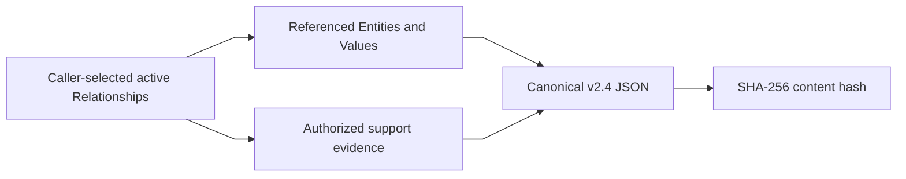

# Memory Packs

Dense-Mem memory packs are read-only exports of selected active Relationships
and their authorized support provenance. They are portability artifacts, not
database backups and not a write or identity-resolution path.

This page owns the current `dense-mem.memory-pack.v2.4` artifact. The runtime
contract exposes only `export_memory_pack`; candidate discovery, artifact
inspection, import, and rollback tools were removed with the placement-era
import ledger. A destination must receive knowledge through its normal
authenticated `remember` workflow.

## What an export contains



An export may include:

- selected active Relationship snapshots and temporal/polarity qualifiers;
- referenced Entity, Value, and predicate descriptors;
- evidence and accepted support spans that the caller may read;
- source author and installation metadata as provenance only; and
- format, creation, counts, omissions, and canonical hash metadata.

It never includes API keys, sessions, security/audit logs, raw embeddings,
search documents, provider retry data, Redis state, unresolved review work, or
Hypotheses unless a future explicitly versioned extension says otherwise.

## Artifact outline

```json
{
  "format": "dense-mem.memory-pack.v2.4",
  "pack_id": "pack_01J...",
  "name": "dense-mem-architecture",
  "description": "Selected architecture Relationships",
  "created_at": "2026-07-11T00:00:00Z",
  "source": {"installation_id": "install-a", "team_id": "team-a"},
  "entities": [],
  "values": [],
  "predicate_definitions": [],
  "relationships": [],
  "evidence": [],
  "evidence_supports": [],
  "extensions": {},
  "content_sha256": "..."
}
```

Artifact-local IDs are references in the export. They are never destination
IDs, owner identities, or authorization grants. Canonical JSON fixes ordering,
Unicode normalization, omitted/null behavior, number formatting, and the hash
exclusion fields. Export validation uses one canonicalizer and reports bounded
omissions instead of silently dropping selected data.

## Export request

```json
{
  "name": "release-workflow",
  "description": "Reusable release Relationships",
  "relationship_ids": ["<same-team-relationship-uuid>"],
  "include_evidence": true,
  "include_entity_names": true
}
```

The request is authenticated and owner/team scoped. The result contains
`artifact_json`, `content_sha256`, a suggested filename, per-kind counts, and
bounded `omissions`. An export fails or records an explicit omission when a
selected Relationship or support evidence is not readable by the caller.

## Destination workflow

An exported pack is an external artifact. To use its contents elsewhere, a
caller must extract exact evidence and submit a complete, authenticated
`remember` request with logical Relationships and supporting
`evidence_indices`; the originating call returns the complete terminal result.
The destination never copies
source IDs, lifecycle status, review decisions, or source profile ownership.

## Not a backup

Exports omit control state, unresolved history, provider metadata, and
non-exportable evidence. Use the [Operations Runbook](Operations-Runbook#backup)
for recovery and database backup procedures.

## Invariants

1. Export never writes durable semantic state.
2. Artifact-local IDs never become destination IDs.
3. Export obeys team visibility and profile mutation authority.
4. Credentials, security payloads, embeddings, search documents, and Redis state
   are never exportable.
5. Every omission is explicit and bounded.
6. The current artifact format is `dense-mem.memory-pack.v2.4`.
