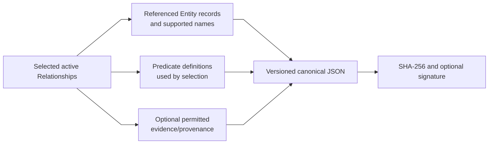
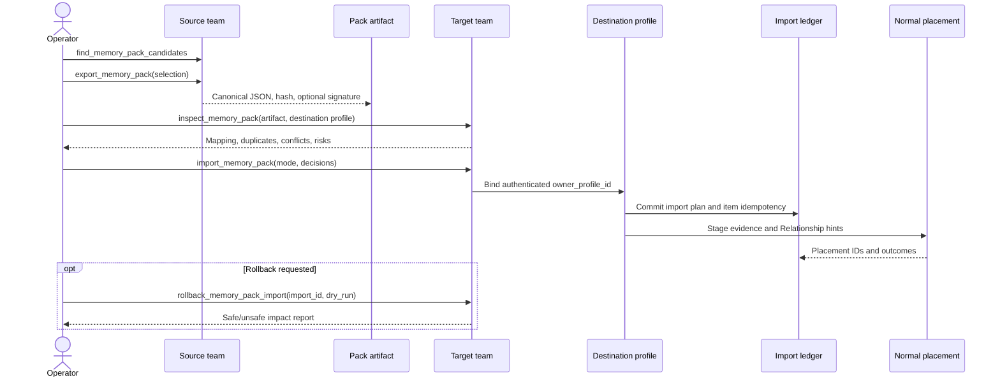
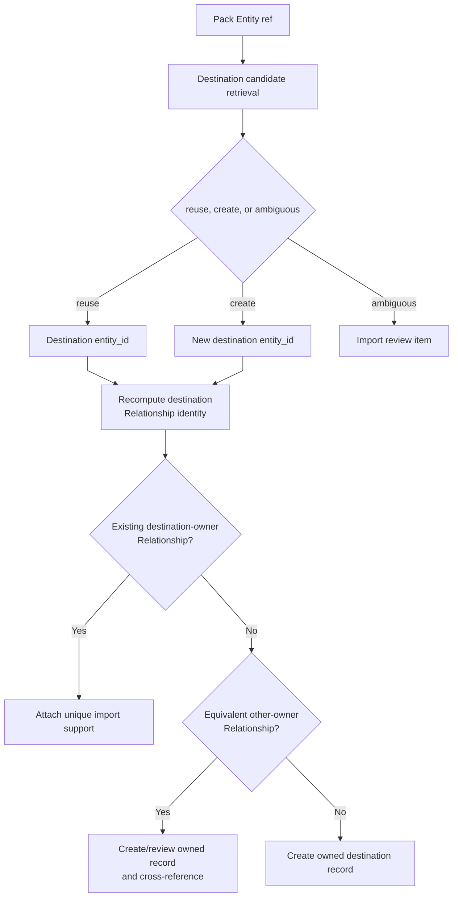
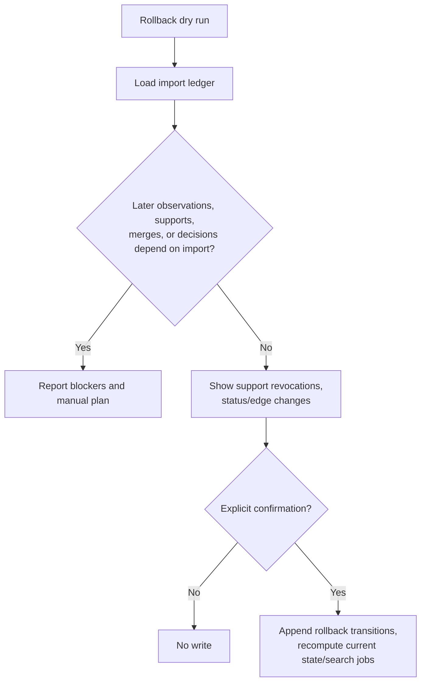

# Memory Packs

Memory packs move selected Dense-Mem knowledge between teams or installations
as reviewable, versioned JSON artifacts. They are portability packages, not
database backups and not a path around normal identity resolution or
assessment.

This page owns the current `dense-mem.memory-pack.v2.3` artifact and workflow.
The artifact version is independent from the public runtime contract. Dense-Mem
V2.4 continues to read/write this exact pack format; a compatible import sends
each newly staged evidence placement item through the one-call assessor.
Selecting a server-supplied Entity or predicate mapping reuses persisted
placement state and makes no extra assessor call.
Tool discovery and transport schemas are in
[Technical Reference](Technical-Reference#memory-packs).

## What A Pack Contains



A pack can include:

- selected active Relationship snapshots
- each Relationship's source author as provenance metadata
- source Entity descriptors and name metadata
- typed Values and predicate keys used by those Relationships
- temporal/polarity qualifiers
- optional evidence fragments and accepted support spans
- source lifecycle status as provenance, not a destination instruction
- export team/install identifiers as audit metadata
- format/schema version, creation time, selection query, and content hash

A pack excludes:

- API keys, credentials, sessions, and SSO data
- audit/security logs
- raw embeddings and search documents
- provider retry telemetry
- Redis/in-process state
- unresolved review work unless an explicit review-work extension is defined
- dream Hypotheses unless an explicit Hypothesis extension is selected

## Artifact Outline

```json
{
  "format": "dense-mem.memory-pack.v2.3",
  "pack_id": "pack_01J...",
  "name": "dense-mem-architecture",
  "description": "Selected architecture Relationships",
  "created_at": "2026-07-11T00:00:00Z",
  "source": {
    "installation_id": "install-a",
    "team_id": "team-a"
  },
  "entities": [],
  "values": [],
  "predicate_definitions": [],
  "relationships": [],
  "evidence_fragments": [],
  "evidence_supports": [],
  "extensions": {},
  "content_sha256": "..."
}
```

Source `entity_id` and `relationship_id` values are artifact-local references.
They never become destination IDs merely because they appear in a pack.
Source profile IDs and author names are also provenance only. Ordinary pack
import never grants permission to impersonate that profile at the destination.

Canonical JSON defines ordering, Unicode normalization, omitted/null behavior,
number formatting, and hash exclusion fields. Export/import tests must share one
canonicalizer.

## Workflow



| Step | Writes durable state? | Semantic graph effect |
| --- | --- | --- |
| find candidates | no | none |
| export | no | none |
| inspect | no | none |
| import | yes | normal PostgreSQL remember/placement path only |
| rollback dry run | no | none |
| confirmed rollback | yes | recompute affected current state and search jobs |

## Find And Export

Candidate search returns active Relationships eligible under export policy.
Selection uses `relationship_id` values:

```json
{
  "query": "release workflow",
  "limit": 20,
  "predicate_keys": ["requires", "runs", "publishes"]
}
```

Export:

```json
{
  "name": "release-workflow",
  "description": "Reusable release Relationships",
  "relationship_ids": ["r1", "r2", "r3"],
  "include_evidence": true,
  "include_entity_names": true
}
```

The export result returns canonical JSON, `content_sha256`, filename, counts,
omissions, and signature metadata when configured.

An export must fail or report explicit omissions when selected Relationships
refer to evidence the caller cannot read.

## Inspect Before Import

Inspection validates without writing:

1. size, format, and canonical hash
2. optional signature/trust policy
3. schema and extension compatibility
4. duplicate artifact-local IDs
5. evidence span bounds and source links
6. predicate support
7. destination Entity candidates
8. possible duplicate/conflicting Relationships
9. data-classification and provenance policy
10. expected create/update/review counts

Import accepts only the exact compatible `dense-mem.memory-pack.v2.3` format.
An older, newer, or unknown required format/extension is rejected before
mapping or writing; clients must export a compatible artifact.

```json
{
  "artifact_json": "{...}",
  "expected_sha256": "...",
  "mode": "review"
}
```

Remote URL inspection requires HTTPS, an expected hash, bounded download size,
redirect limits, allow/deny network policy, and protection against private
network/metadata endpoints.

## Import Modes

| Mode | Meaning |
| --- | --- |
| `review` | treat pack content as untrusted external evidence; ambiguous identity/conflicts become review work |
| `trusted` | accept configured signer/source authority as an input to lifecycle policy; still resolve Entities, validate evidence, and use the normal PostgreSQL pipeline |

Trusted does not mean:

- preserve source IDs
- copy source lifecycle status directly
- skip Entity ambiguity
- skip Relationship assessment
- supersede local knowledge without policy
- write a SemanticEdge/current-state row directly
- preserve or select the source profile as destination owner
- update a semantically matching Relationship owned by another destination profile

Conflict decisions are bounded:

| Decision | Effect |
| --- | --- |
| `skip` | do not stage that artifact item |
| `import_for_review` | stage it without permission to replace current knowledge |
| `map_entity` | map one source Entity ref to a supplied same-team candidate |
| `confirm_new_entity` | permit resolution with destination discriminator evidence |
| `accept_source_authority` | apply a configured trusted-source policy; does not force active status |

A source active Relationship may become a destination pending Relationship,
active Relationship, or review item depending on destination evidence and
policy.

## Destination Ownership

One import is bound to the authenticated destination profile before inspection
decisions are committed. Every Relationship created or updated by that import
is owned by that profile. The source author stays in provenance so recall and
trace can explain where the artifact came from, but it is not the destination
`owner_profile_id`.

If the same semantic meaning already exists:

- under the destination owner, accepted evidence may attach to that existing
  Relationship through the normal pipeline
- under another same-team owner, import creates or reviews a destination-owned
  Relationship and may append a cross-profile reference
- under another team, it is not a candidate and must not be visible

## Identity And Relationship Mapping



Aliases remain Entity-name metadata. Pack import cannot create alias edges.

## Import Ledger

Each import records:

```text
import_id
pack hash/signature
mode and actor
source-to-destination Entity mapping
source-to-destination Relationship mapping
authenticated destination owner profile
created observations/supports and support-decision events
pre-import Relationship versions
placement IDs and outcomes
decisions and omissions
pre-import search-document versions and states
status and timestamps
```

The ledger makes retries idempotent and rollback auditable.

## Rollback

Rollback neutralizes only current effects attributable to the import, then
recomputes affected state. It appends reversal/retraction records and never
deletes the import ledger or restores a whole graph snapshot blindly.
It can change only Relationships owned by the import's destination profile;
cross-profile references are neutralized with append-only events and their
targets remain untouched.



Rollback may move a Relationship to `pending_evidence` after imported support
is revoked from current policy. The original support/import history remains
traceable. If later evidence independently supports it, the Relationship
remains active.
A Relationship/Entity created by the import can be retired only when no later
record depends on it.

## Not A Backup

A memory pack is selective and may omit control state, unresolved history,
audit, exact provider metadata, and non-exportable evidence. Use
[Operations Runbook](Operations-Runbook#backup) for recovery.

## Risks And Mitigations

| Risk | Concrete failure mode | Mitigation |
| --- | --- | --- |
| Source IDs collide | destination treats source `entity_id` as canonical | artifact-local refs and mandatory destination resolution |
| Trusted import bypasses truth policy | a signed pack copies active status without destination assessment | signature affects authority only; normal one-call assessment/lifecycle remains |
| SSRF through URL import | server fetches cloud metadata/private services | HTTPS policy, IP/redirect validation, size/time limits, and expected hash |
| Evidence disclosure | pack includes source content caller may not export | per-fragment authorization and explicit omission/failure report |
| Rollback erases later work | imported Entity gained new Relationships after import | dry-run dependency graph and block unsafe automatic rollback |
| Duplicate replay | same pack imported twice adds support repeatedly | team+pack-hash idempotency and item-level keys |
| Malicious extension | unknown JSON changes semantics | reject unknown required extensions and ignore only explicitly optional ones |
| Source author becomes an impersonation path | a pack from Profile A writes A-owned knowledge at the destination | bind one authenticated destination owner; retain source author as provenance only |
| Cross-profile import overwrite | imported support changes another profile's matching Relationship | owner-scoped lookup/upsert and append-only cross-reference instead of target mutation |

## Acceptance Invariants

1. source IDs never become destination IDs without resolution
2. import writes only through the canonical PostgreSQL write pipeline
3. trusted mode cannot set lifecycle status directly
4. pack retries do not duplicate observations or supports
5. inspection writes nothing
6. rollback preserves later independent evidence
7. artifact hash is stable across supported implementations
8. no credential, embedding, or Redis state is exportable
9. ordinary import writes only destination-profile-owned Relationships
10. rollback cannot mutate another profile's Relationship
11. incompatible artifact formats are rejected before destination writes
