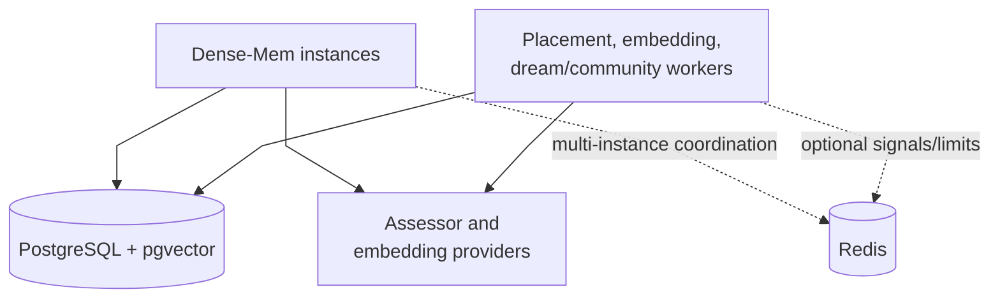
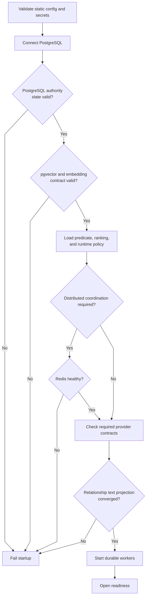
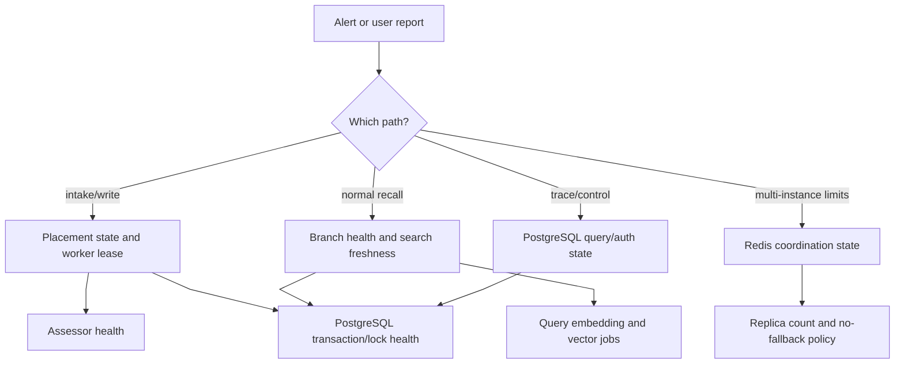
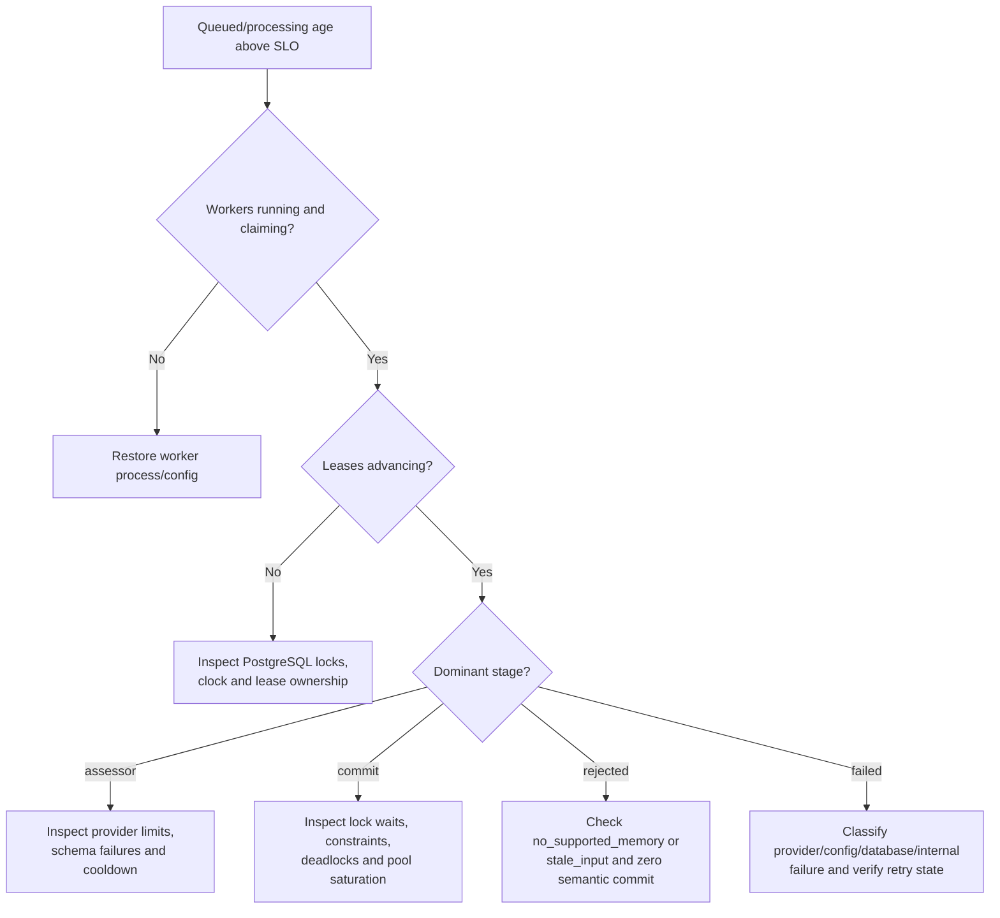
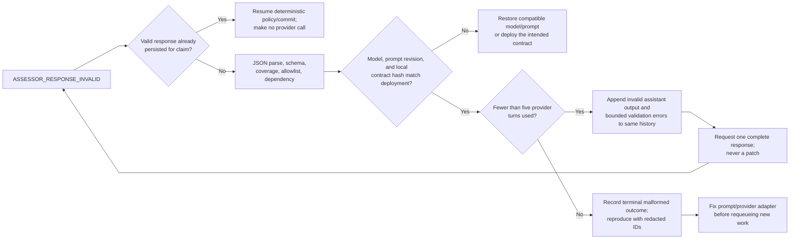
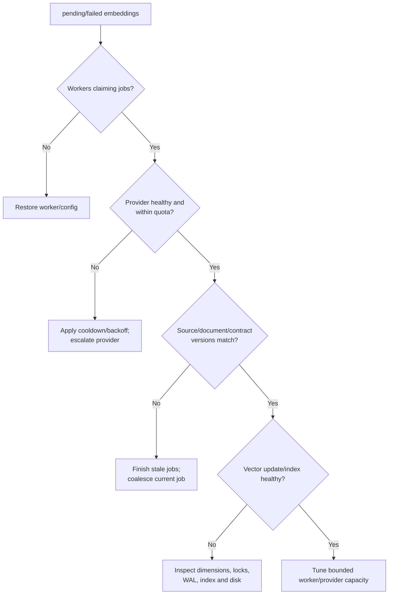
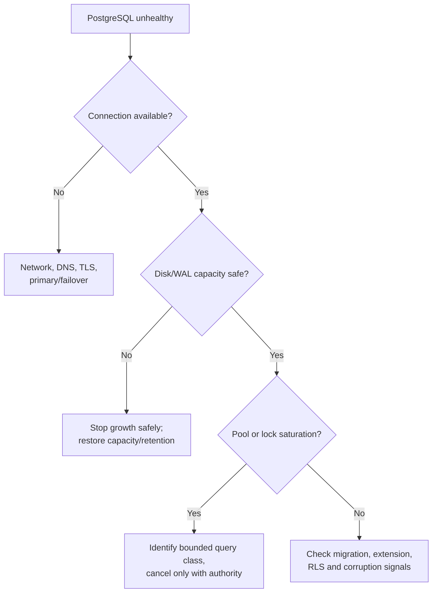
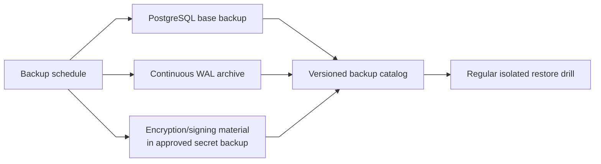
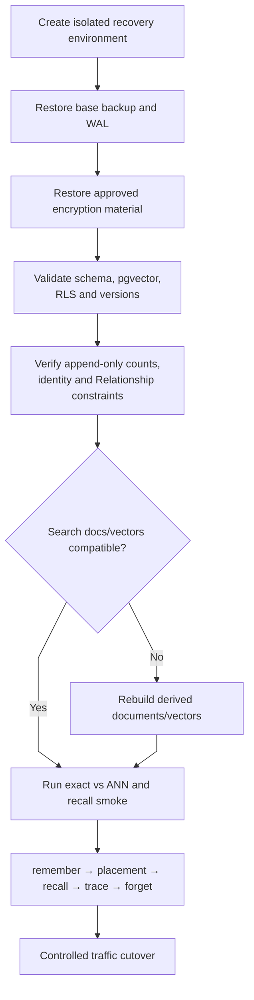
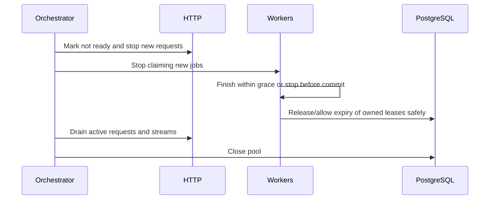

# Operations Runbook

This page is the operating contract for the PostgreSQL + `pgvector`
architecture. Commands and dashboards must still be verified against the
deployed release before use.

## Dependency Matrix

| Dependency | Required | Durable authority |
| --- | --- | --- |
| PostgreSQL with `pgvector` | yes | yes: all knowledge, workflow, security, audit, and search state |
| assessor provider | yes for write placement | no |
| embedding provider | yes for vector build/query profiles that require it | no |
| Redis | only for required distributed coordination or explicit configuration | no |
| summary/dream provider | only for enabled provider-backed optional features | no |



Redis loss must not lose memory. PostgreSQL loss means durable service is
unavailable and must be recovered before writes resume.

## PostgreSQL Topology Operations

The supported topology contract belongs in
[ANN, HNSW, And Halfvec](ANN-HNSW-And-Halfvec#single-database-and-cluster-topologies).
Tenant keys, placement classes, composite constraints, and per-team queue/RLS
behavior belong in
[PostgreSQL Cluster-Safe Schema](PostgreSQL-Cluster-Safe-Schema).
Operationally, every topology exposes one writer/coordinator endpoint and keeps
the same team-scoped repository contract:

| Topology | Required operational behavior |
| --- | --- |
| single primary | all reads/writes use the primary; one bounded application pool |
| primary with physical standbys | writes, jobs, migrations, profiles, and HNSW builds use the writer; replica recall remains disabled until lag/version/query-conflict gates pass |
| qualified distributed-by-team adapter | coordinator routes by authenticated `team_id`; every owning shard has matching schema, pgvector version, RLS behavior, and active index profile |

Before increasing service replicas, prove that the sum of every process pool
fits the database connection budget with operator and failover reserve. Before
enabling standby reads, test read-after-write routing, replay lag, recovery-
conflict cancellation, HNSW plan parity, and primary retry capacity. Before
activating a distributed index profile, require every shard to report the same
ready profile version.

## Startup And Readiness



Readiness should expose component-level state:

| Component | Readiness failure |
| --- | --- |
| PostgreSQL | cannot connect, migration mismatch, RLS/bootstrap invalid, or pool exhausted |
| `pgvector` | missing extension/operator class, dimension/contract mismatch, inactive search-index generation, or unusable search schema |
| assessor | required write contract cannot be reached or the provider cannot satisfy the closed contract probe |
| embedding | required recall profile cannot embed, or configured contract probe fails |
| Redis | unreachable when distributed coordination is required |
| placement/embedding jobs | backlog exceeds the release-defined readiness boundary |
| Relationship projection | any eligible Relationship lacks format-2 text or any ineligible Relationship is not marked `not_required` |
| authority state | missing, incompatible, or corrupt PostgreSQL authority metadata |

### Dependency disclosure and telemetry smoke checks

The control usage rollup reports the current dependency observation as
`healthy/total`, lists every non-healthy dependency, and includes bounded reason
codes, latency, and `dependencies_checked_at`. The six normal checks are
PostgreSQL, PostgreSQL topology, `pgvector`, authority, search readiness, and
Redis. The server runs at most three checks at once and gives each check two
seconds. A failed check reports `check_failed`; a deadline reports
`check_timeout`. When Redis is intentionally absent for a single-node
deployment, the control portal reports `single_node_mode` for Redis. That mode
does not provide distributed rate limiting or cleanup. A multi-instance
deployment must configure and pass the Redis check.

The Overview, usage rollup, and telemetry views refresh every 60 seconds while
their browser tab is visible. A hidden tab cancels the current request. The
portal shows the observation or generation time, and a Metrics link opens the
full dependency list.

Telemetry snapshots distinguish `ready`, `inactive`, `unavailable`, and
`unsupported` items. A valid zero is ready. No activity and disabled features
are inactive. Missing provider usage or pricing, invalid usage, failed
Prometheus queries, and failed lifecycle-ledger reads remain unavailable.
Successful cards and charts remain visible when another item fails. The portal
groups non-ready items in a collapsed reason ledger and does not draw an empty
chart axis for them.

For every production release, run this smoke matrix after a real Remember event
and a real recall, then wait for a Prometheus scrape:

| Scope | Windows | Required evidence |
| --- | --- | --- |
| system | 15m, 1h | dependency observation, all applicable operator cards, assessor data, cost boundary, Relationship ledgers |
| team | 15m, 1h | team-owned counts, feature state, supported costs, and no other-team data |
| profile | 15m, 1h | owner-only lifecycle counts, verifier cost if priced, unsupported combined/embedding cost, and no other-owner data |

Record any `unavailable` item with its exact reason. Do not replace it with a
zero or declare the smoke successful until the source or configuration issue is
understood.

Do not report a single green dependency flag when write, vector recall, trace,
and control readiness differ.

## First Deployment

Before user traffic:

1. keep main/control listeners private
2. create production secrets outside the repository
3. create/upgrade PostgreSQL and install the supported `pgvector` extension
4. start one release server against the writable primary and wait for its
   session-locked startup migrations to finish
5. validate the configured single/HA/distributed PostgreSQL topology and total
   connection budget
6. verify cluster-safe composite tenant keys and runtime-role/RLS behavior with
   two-team fixtures
7. validate the integrated-assessor schema, token budgets, and persisted-result
   reuse probe
8. validate one embedding against persisted dimensions/normalization
9. validate the active search-index generation, query plan, and exact/ANN oracle
10. configure Redis as required by service-instance topology
11. start workers and confirm queues are empty/healthy
12. run `remember` → placement → recall → trace → forget smoke
13. verify a pending embedding does not hide committed SemanticEdges
14. take and restore a PostgreSQL backup before accepting important memory

### Migration startup progress

The release and demo server log `running postgres migrations` at the start of a
migration run and `postgres migrations still running` every 10 seconds until it
completes. The heartbeat includes `direction`, `elapsed_seconds`, and
`timeout_seconds`. Release images do not ship a standalone migration command or
separate migration container.

`POSTGRES_MIGRATION_TIMEOUT_SECONDS` defaults to 1800 seconds and is bounded
to 1–86400 seconds. The five-minute preflight and post-migration checks remain
separate; the extended timeout applies only to the migration run. Set a higher,
finite value only for a planned maintenance window.

A heartbeat means the migration run is still active and may be executing DDL or
waiting on a PostgreSQL lock. Do not restart it solely because heartbeats appear.
If elapsed time approaches the configured deadline, inspect migration status and
authorized database lock/transaction state before choosing a recovery action.

Concurrent replicas connected to the same writable primary serialize this work
with a PostgreSQL session lock. A replica waits rather than applying the same
migration concurrently. Keep migrations compatible with the previous binary for
rolling deployments. Independent databases do not share that lock; each must be
started and migrated separately.

The v2.6 Remember migration is a deliberate exception: stop every Dense-Mem API,
worker, and control service, verify that no worker lease remains, apply the
ordered migration, and start only v2.6 services. There is no rolling deployment,
mixed v2.5/v2.6 interval, compatibility window, fallback reader, or public
projection of historical submissions.

#### Migration rollout and recovery

Use expand/backfill/cutover/contract for changes that cross application
releases:

1. add schema that remains compatible with the previous binary
2. run a bounded, resumable backfill and cut application reads/writes over
3. remove compatibility schema only after the rollback window closes and a
   backup/PITR checkpoint has been restored successfully

A failed transactional migration must leave the prior schema intact and block
server readiness. Diagnose the migration and database state before retrying.
A `NO TRANSACTION` migration can leave partial DDL, so it must be idempotent,
retry-safe, and covered by a disposable real-PostgreSQL test that reproduces
its interrupted state.

Production does not invoke Goose Down automatically. After a committed
migration, prefer a new roll-forward migration. Use PITR with the matching old
application only when forward repair cannot preserve the required data or
contract. Down migrations remain for local tests and controlled recovery
analysis, including their documented irreversible boundaries.

The release-organized Goose history under `migrations/postgres/v2_4/`,
`migrations/postgres/v2_5/`, and `migrations/postgres/v2_6/` is the only schema
authority. The first two directories are immutable history; new v2.6 work
belongs only in `v2_6/`. Verify versions and checksums with
`scripts/check-postgres-migrations.sh`; do not maintain a generated schema
mirror or treat dumps as a substitute for migration and backup evidence.

Identity migrations `2026081001` and `2026081501` run automatically in order.
The first installs and backfills the canonical identity model; the second sets
a 30-second `lock_timeout`, takes `ACCESS EXCLUSIVE` on `team_profiles`, reruns
the bridge reconciliation, validates retained credentials, memberships,
aliases, SSO sessions, portal sessions, usage, and semantic history, then drops
the bridge, `identity_compatibility_state`, and `team_profiles`. There is no
manual cleanup command, feature flag, backup-confirmation gate, or required
intermediate release.

Migration `2026081601` adds the partial terminal embedding-job retention index.
Migration `2026081602` then validates the active embedding contract and every
semantic team/owner reference, installs and validates direct foreign keys to
`teams` and `ownership_aliases`, and drops `semantic_team_refs`,
`semantic_profile_refs`, and `embedding_config`. The foreign-key validation
scans and `ALTER TABLE` locks occur inside one transaction with a 30-second lock
timeout. Rehearse this migration on a disposable production-data copy, take a
restorable backup, and use roll-forward or that backup rather than Goose Down.

Migration `2026081701` creates memory spaces and assigns `space_id` across the
memory-owned tables. On a populated database, its runtime is dominated by one
backfill update per table, index builds, `SET NOT NULL` scans, foreign-key
validation, and the WAL generated by rewritten rows. It runs as one serialized
startup migration, so several minutes of migration heartbeats can be normal on
a database with substantial evidence, operation-log, search, or workflow
history. It does not call a model provider, change embedding input, enqueue
embedding jobs, or re-embed evidence.

The backfill installs narrow temporary migration-mode SELECT and UPDATE RLS
policies before updating each FORCE-RLS table, including
`evidence_source_revisions`, and removes them before commit. The pre-image gate
upgrades a populated `2026081602` fixture and verifies that evidence revisions
receive a shared space; it also applies and validates the concurrent submission
diagnostic indexes. Run `scripts/pre-image-check.sh [base-ref]` before a manual
image build. Release and demo prerelease workflows resolve the nearest prior
canonical release tag on first-parent history and use it as the migration
baseline before building an image.

Normal pull-request and `main` push CI runs the static migration-history check
only. It does not run the tagged Testcontainers/PostgreSQL integration suite on
the shared runner; populated SQL execution remains required in the
Docker-capable pre-image release gate.

Credentials deleted while the bridge is active can have their legacy foreign
key nulled by PostgreSQL. Cleanup therefore resolves the retained ownership
alias before marking those credentials `disabled`, preserving the tombstone and
freeing the active-name slot without resurrecting the key.

Any mismatch, lock timeout, or DDL failure rolls back `2026081501`, leaves the
bridge migration applied, and prevents the new server from becoming ready.
After cleanup commits, an old replica may fail and rollback to a binary that
requires `team_profiles` is unsupported. Recover by rolling forward or by
restoring PostgreSQL with the matching old application version.

Migration `2026080701` is a coordinated-stop exception: it drops the unused
`evidence_security_events.scan_policy_hash` column under an `ACCESS EXCLUSIVE`
table lock, and an old binary cannot write security events after that drop. For
the Docker Compose release, stop every API and worker container, confirm no old
process retains a placement lease or database session, and take a PostgreSQL
backup if the historical values must remain recoverable. Start only the new
release; its startup migration must finish before listeners or workers become
ready. Then verify the column is absent and run the `security_intake` Compose
scenario. The down migration recreates a blank compatibility column but cannot
restore discarded values, so a value-preserving rollback requires the backup
and matching old application release.

The image healthcheck uses a 30-minute startup grace matching the default
migration timeout. Docker ignores failed probes during that grace and switches
to normal failure counting after the first successful probe. If
`POSTGRES_MIGRATION_TIMEOUT_SECONDS` is raised above 1800, override the
deployment healthcheck start period to at least the same duration.

### Release image contents

The release runtime contains `/app/server`, PostgreSQL migrations, and both
static portal bundles. The demo runtime contains `/app/demo-server`, migrations,
and only the user bundle. Administration uses the private control portal/API;
dreaming and Conflict review remain background workers in the server process.

Use immutable tags in release deployment configuration:

| Channel | Release image | Demo image |
| --- | --- | --- |
| pull request test | `test-<PR number>` | not built |
| release candidate | `vX.Y.Z-rc.N` | `demo-vX.Y.Z-rc.N` |
| stable | `vX.Y.Z` or `latest` | `demo-vX.Y.Z` |

The `test-<PR number>` tag is mutable and must be used only for temporary test
instances. A maintainer requests it with the `deploy-test-image` pull-request
label. The branch must contain current `main`; automation does not update the
branch. Each same-repository push rebuilds the tag while the label remains and
posts a new result comment. Fork previews are disabled until an isolated,
ephemeral build runner is configured; applying the label to a fork removes it
and reports that requirement. Once fork builds are enabled, each fork push must
still remove the label so a maintainer can review the new head and apply it
again. Removing the label or closing the pull request does not delete an
existing test tag.

After a labeled pull request is squash-merged, prerelease automation reuses its
production layers only when the final tested head and the squash commit have
identical Git trees, the tested `main` revision is in the previous `main`, and
the retained label, successful workflow receipt, image platforms, revision, and
preview metadata all match. Promotion rewrites the OCI version, revision, and
created metadata for the RC while requiring every production layer descriptor
to remain identical. An ineligible or missing preview causes a production build
from merged `main`; a failed eligible promotion fails the RC. The demo RC is
always built after merge.

There is no rolling `demo` tag. Stable tags promote the already-published RC
manifests without rebuilding them.

Public exposure belongs in
[Public HTTPS And Redis](Public-HTTPS-And-Redis).

## Health Triage



Always capture:

- UTC window and correlation/ingest/Relationship IDs
- deployed application/schema/config/ranking/embedding/assessor versions
- affected team/profile without evidence content
- processing/search state and safe error code
- PostgreSQL pool, transaction, lock, query, WAL, disk, and replica state
- provider request outcome classes without prompts/responses
- Redis requirement and health when applicable

### Submission diagnostics

The control portal's team **Submissions** workspace reads authoritative
PostgreSQL placement state. It lists state, attempts, evidence count,
correlation ID, timestamps, and a scheduled retry. Detail shows the closed
error, retryability, next action, remediation, per-evidence search state, and
resubmission guidance without returning evidence text, prompts,
provider payloads, or internal placement IDs.

The detail timeline is supplemental history from operation logs. Durable
transitions emit `submission_accepted`, `submission_retry_scheduled`,
`submission_completed`, `submission_failed`, or
`submission_quarantined` only after the corresponding PostgreSQL transition
succeeds. The safe attributes include team/profile/correlation/submission,
from/to state, attempts, stage, reason code, and the next retry time when one
exists.

Use exact `event`, `team_id`, `reference_type`, `reference_id`, `from`, and `to`
filters on the operation-log API. A missing retained event does not override
the PostgreSQL state; log retention and asynchronous persistence can make the
timeline incomplete. Start triage from the submission detail, then use its
`submission_id` and `correlation_id` to scope logs and database inspection.

## Placement Backlog



Required checks:

- queued count and oldest age
- active lease owner, heartbeat, and attempt count
- failures grouped by stage and safe code
- `densemem_assessor_terminal_failures_total{stage=...}` and owner-scoped
  submission status `errors`; use the stage to distinguish predicate option
  overflow, input/catalog overflow, provider exhaustion, and commit failures
- invalid-assessor-response count, JSON-pointer classes, provider turns per
  assessor conversation, persisted-assessment reuse, and
  `densemem_assessor_validation_failures_total` /
  `densemem_assessor_validation_field_failures_total` by bounded stage and
  field family (including input/output budgets, JSON/schema, contract, and
  temporal validation)
- provider 429/cooldown/concurrency
- database deadlocks, lock timeouts, serialization failures, and constraint
  errors
- historical v2.5 restart-terminalized count separately from the live worker
  backlog; it is not a v2.6 status code

Retryable provider failures use deterministic exponential backoff with bounded
jitter. The first four retry releases wait about 15s, 30s, 60s, and 120s. A
valid `Retry-After` hint may extend that delay; the effective delay remains
capped at 300s. Attempts are not reset by ordinary retries. A schema-invalid
HTTP 200 response does not release the placement item: the assessor receives
the bounded validation errors in the same message history and may return a
complete replacement, for at most five provider turns total in that
conversation. Transport failures use bounded in-claim retries; exhausted
normalization/provider failures use the durable attempt budget.

Public v2.6 Remember status projects `no_supported_memory` and `stale_input`
for semantic rejection, and `provider_unavailable`,
`provider_response_invalid`, `input_budget_exceeded`, `configuration_invalid`,
`database_failure`, or `internal_failure` for
operational failure. Search/embedding trouble is a degradation on a completed
submission. A non-v2.6 submission ID returns the same bounded not-found result
as an unavailable submission. Historical failure stages remain control-plane
audit data and are never live worker outcomes or public status codes. Never use
provider/database error text from logs or SQL as a client diagnostic. If the operator stage is `unknown`, inspect
the authenticated correlation window, worker lease/attempt row, and PostgreSQL
transaction/constraint state without exporting raw payloads.

The historical v2.5 Remember-normalizer restart is an explicit migration
boundary, not a resumable v2.6 queue handoff. It terminalizes unfinished old
Remember runs/items and preserves completed canonical state. Do not requeue
those rows or present their migration error as current v2.6 client behavior.

Do not mark jobs complete, delete queue rows, reset attempts, or extend leases
with direct SQL. Repair the root cause, use the supported pause/resume repair
path, and let stable idempotency converge retries.

## Invalid Remember-Assessor Responses

The application never coerces or splices provider output. It may ask the same
assessor session for a complete replacement after bounded validation feedback.



Safe evidence for diagnosis includes the local contract hash, bounded token
counts, provider-turn count, durable attempt count, JSON pointers, result
cardinalities, and model/provider version. Do not log evidence text, rationales,
raw response payloads, or provider error bodies.

No `VerificationEvent` or semantic subset exists for an invalid intermediate
turn. The full history is transient and sent only back to the same provider.
After five total semantic turns, the submission reaches a visible typed
operational failure with zero partial semantic commit. Do not delete the claim,
clear its attempt history, or manually invoke the provider.

A timeout, 429, 4xx, 5xx, transport failure, or invalid provider envelope ends
the current conversation immediately. The placement item requeues through its
durable `max_attempts` budget with fresh message history and the bounded
backoff above. On the final durable attempt it fails terminally. A provider
failure is never appended to the malformed-response correction history.

If a valid assessment exists, treat any later provider turn as an invariant
failure. Stop the affected placement workers, preserve the assessment and claim
rows, inspect uniqueness/lease/version predicates, and resume only after the
retry path is proven to reload the persisted result.

## Embedding Backlog And Search Freshness



During a vector backlog:

- current PostgreSQL Relationships and SemanticEdges remain authoritative
- exact, full-text, and adjacency branches may remain available
- vector retrieval includes only version-matched vectors
- the API reports pending/failed document counts and degraded branches
- embedding throughput is tuned by `EMBEDDING_BATCH_SIZE` first and
  `EMBEDDING_WORKER_COUNT` second; increasing many single-job workers is not the
  target operating mode

Never copy an older vector onto a newer document or mark `search_state=current`
without the source/document/contract version predicate succeeding.

### Daily failed-embedding reconciliation

`/ready` is a structural safety probe. A `200` response can coexist with an
optional `search_convergence` dependency in `degraded`, `attention_required`,
or `recovering` state. Start triage at the private control API and Search
convergence panel:

```bash
curl -fsS "$CONTROL_URL/control/api/search/convergence" \
  -H "Authorization: Bearer $CONTROL_PORTAL_TOKEN"
```

The response contains the active provider/model/dimensions and index
generation, queue counts, allowlisted failure codes, affected teams, guidance,
job-derived failure groups, and the latest durable run/canary. A failure group
is the current unresolved set of `embedding_jobs` with the same team, contract,
dimensions, source kind, failure class, and failure code. A group with failed
jobs is `attention_required`; a group whose jobs are queued or processing is
`recovering`. Completing or superseding the last job removes the group without
a separate lifecycle write. The operation-log view records bounded
`embedding_failure_recorded`, `embedding_recovery_completed`, and reconciliation
events; Prometheus exposes
`densemem_embedding_reconciliation_runs_total`,
`densemem_embedding_reconciliation_canaries_total`,
`densemem_embedding_reconciliation_jobs_total`, and the duration histogram.
Only active teams contribute to this operational projection. Soft-deleted-team
jobs remain as history but cannot keep active convergence in
`attention_required`. A projection query failure returns a bounded internal
error and safe event code rather than PostgreSQL details.

The server also runs terminal-job retention at startup and hourly. Each
system-context transaction claims at most 1,000 `completed`, `stale`, or
`cancelled` jobs with `completed_at` strictly older than 14 days, ordered by
completion time, team, and job ID with `SKIP LOCKED`. It never deletes
`queued`, `processing`, or `failed` jobs. Logs expose only bounded deleted-count,
duration, and error-class fields; they never include job content.

Recovery is automatic and daily during the strict General-configured
`EMBEDDING_RECONCILIATION_START_TIME_LOCAL` in `APP_TIMEZONE` (default
`04:30`). A run may be created only during that local minute; missing it defers
new work to the following local date. An incomplete run created during the
minute remains resumable later that day under its fenced lease token. One
durable run per active contract/local date claims one failed document. The
marker is committed before the raw provider call, so a restart cannot silently
make a second same-day canary. A successful canary completes that job and
requeues the pre-cutoff recoverable backlog in independently committed batches
capped at 500. Each batch renews the token-fenced run lease. Requeued jobs make
their derived failure groups `recovering`; completed or superseded jobs leave no
current group. A permanent input rejection is terminalized and
skipped so it cannot gate other teams' recoverable failures; the service tries
the next bounded canary. Source updates do not retire reconciliation-owned
canaries; completion records the old projection as stale and the run continues
with the provider-health result. A failed or ambiguous canary leaves the
backlog blocked for the next day. If a later batch fails after earlier batches
commit, the run remains deferred but retains the successful canary outcome and
exact committed `requeued_count`. Prometheus canary and job counters record only
newly performed durable transitions; a lease takeover does not replay the
persisted cumulative totals.

Multi-instance deployments with `DISTRIBUTED_COORDINATION_REQUIRED=true` must
configure `APP_TIMEZONE` as an explicit IANA name. Reconciliation rejects
process-relative `Local` in that mode so replicas cannot reserve different
local dates for the same instant. The convergence view orders its latest run by
the PostgreSQL creation timestamp rather than local date, so a timezone change
cannot make an older run replace the current recovery result.

During upgrade, stop old application workers and use a coordinated restart.
Bounded legacy timeout, network, rate-limit, quota, auth, and provider 5xx
strings are mapped to the closed failure contract. The migration repairs legacy
jobs in 1,000-row committed batches, retires superseded failures, adds new job
checks as `NOT VALID`, creates the concurrent recovery indexes, then validates
those checks in the same no-transaction migration. No rolling-version
compatibility trigger or incident table remains after the migration. Unknown
legacy strings remain permanent rather than being guessed recoverable.

| Code/class | Automatic policy | Operator guidance |
| --- | --- | --- |
| `provider_quota_exhausted` / provider action | retry on the next daily canary indefinitely | add provider credit or repair billing |
| `provider_authentication_failed` / provider action | retry on the next daily canary indefinitely | replace the credential |
| `provider_permission_denied` / provider action | retry on the next daily canary indefinitely | restore access or endpoint permission |
| transient provider/network/server | retry on the next daily canary indefinitely | inspect provider health and capacity |
| `embedding_input_rejected`, `embedding_contract_mismatch`, `unknown_embedding_failure` | remain blocked | inspect data/contract compatibility |

Do not add a manual retry endpoint, edit job state directly, or change model or
dimensions as a “fix.” Provider changes are guidance only and must preserve the
active embedding contract. Failed text remains lexical-recall eligible while
failed vectors remain excluded; resolve the provider or contract cause, then
let the canary prove recovery.

### Relationship projection upgrade

Use this release procedure for projection format `2`; the canonical state
machine and schema are in
[Data Model And Storage](Data-Model-And-Storage#relationship-projection-generation).

Before migration:

1. stop all API, placement, scheduler, and embedding-worker versions that can
   write the database;
2. confirm no old process retains a lease;
3. take and restore-test the rollback backup;
4. export per-team eligible/ineligible Relationship counts, Relationship
   document-state counts, Evidence document/vector counts and hashes,
   outstanding jobs by source kind, numerical embedding contract, and active
   search-index generation;
5. confirm provider quota, database free space, WAL capacity, connection
   reserve, and expected Relationship-only embedding volume.

During the blocking text phase:

- run only the release migrator under its application projection lock;
- watch generation state, last projected Relationship ID, projected/eligible
  counts, batch duration, new tagged jobs, and renderer errors;
- expect batches of 500 ordered by `(team_id, relationship_id)`;
- on failure, fix the root cause and resume the same generation—the renderer
  hash and job-coalescing keys make the repeated boundary batch idempotent;
- do not open readiness until every eligible Relationship has format-2 text and
  every ineligible Relationship is `not_required`;
- compare Evidence counts and hashes with preflight before opening traffic.

After text convergence, traffic may open. `results[]`, Evidence vectors, and
Relationship lexical discovery remain available. The Relationship vector
branch stays disabled for the complete affected team and recall reports
`relationship_vector_warming`.

During asynchronous re-embedding:

- generation jobs contain only `source_kind=relationship` and carry the
  projection generation ID;
- ordinary live Relationship writes use untagged foreground jobs;
- each non-empty class receives reserved claim capacity, with remaining slots
  filled foreground-first;
- workers drain immediately while claimable backlog exists;
- provider retries, batch splitting, leases, and document-version fences remain
  unchanged;
- one terminal failed generation job keeps the generation from activating but
  does not disable lexical Relationship recall.

The generation activates only after a transactional recount proves every
eligible format-2 Relationship vector is current, every ineligible
Relationship is `not_required`, and no tagged job is queued, processing, or
failed. Verify that vector RRF then enables for the complete team, Evidence
counts/hashes still match preflight, and the embedding/search-index contract IDs
did not change. Run `VACUUM (ANALYZE)`; reindex concurrently only when measured
bloat or ANN quality warrants it.

Rollback restores the pre-migration PostgreSQL backup and the matching old
application release together. Never roll back one without the other or allow
old and new workers to overlap.

### V2.4 integrated-assessor placement upgrade (historical)

Run this upgrade only after the Relationship projection migration is complete
and healthy. V2.4 changes placement and semantic-review workflow. It
must not start another projection generation or embedding drain.

Before cutover:

1. freeze the application, schema, assessor model/prompt/contract,
   `assessment_policy_version`, and bootstrap threshold (`0.7`);
2. export counts for placement runs/items, VerificationEvents, Relationship
   statuses/effective supports, review task kinds/states, search documents,
   vectors, and embedding jobs;
3. export search-text hashes by source kind plus the active projection,
   embedding, and HNSW generation IDs;
4. inventory legacy semantic review rows separately from security quarantine and
   cross-profile Conflict cases; V2.5 does not resume those rows;
5. take and restore-test the PostgreSQL backup.

During cutover:

1. stop placement/API versions that can create or claim semantic placement
   work, then confirm their leases are absent or expired;
2. apply the additive assessment, stable-claim, confidence-audit, team-config,
   and review-expiry schema migration;
3. set `expires_at = cutover_time + 7 days` only for unresolved (`open` or
   `acknowledged`) semantic `support_confidence`, `identity`, `predicate`,
   `scope`, and `time` tasks;
4. leave completed/held VerificationEvents, Relationship status/support,
   security quarantine, and Conflict cases unchanged;
5. deploy the V2.4 API and placement workers together and reject mixed-version
   claim execution;
6. resume work only after the same-history malformed-correction probe, durable
   provider-retry probe, persisted-assessment crash/reload probe, and threshold
   configuration validation pass.

After cutover:

- compare lifecycle, review, search, vector, job, hash, and active-contract
  snapshots with preflight;
- allow differences only for the documented open semantic-review expiry fields
  and new V2.4 work admitted after traffic opens;
- verify legacy VerificationEvents have null V2.4 audit fields and were not
  rescored;
- verify an in-flight claim with a persisted valid assessment makes zero
  provider turns, malformed output uses at most five turns in one conversation,
  and a provider failure consumes the durable attempt budget with fresh
  history;
- verify expiry closes a task without granting support, creating an active
  Relationship, or directly creating a Hypothesis;
- verify no search document version changed, no embedding job was enqueued, and
  no assessor or embedding provider was called by the migration.

Any changed vector, search-text hash, projection generation, embedding job
count, or embedding-provider call attributable to this migration is a blocker.
Do not “repair” it by draining the queue; find and remove the unintended
projection change before traffic. Re-embedding associated with the projection
migration is complete before this procedure and is not part of V2.4.

Rollback is supported only before V2.4 traffic writes. Restore the pre-cutover
database and matching V2.3 application together. After V2.4 claims commit,
rollback requires the same full restore; never run V2.3 workers against
persisted V2.4 assessment state.

## Recall Latency Or Quality

Break down the request by branch:

| Branch | Inspect |
| --- | --- |
| query embedding | provider latency/errors, model and dimensions |
| PostgreSQL full text | plan, GIN use, row estimate, tenant predicate |
| `pgvector` exact | eligible row count, distance sort, memory/time |
| `pgvector` HNSW | iterative scan mode, `ef_search`, tuples scanned, filtered Recall@K |
| Entity seeds | name/alias indexes, candidate cap, homonym behavior |
| adjacency | subject/object partial indexes, seed/fan-out/depth/edge/time caps |
| hydration/ranking | RLS, duplicate union, response bytes, ranking version |

For suspected ANN quality regression, run the same queries with an exact
team-filtered baseline and compare Recall@K. Do not raise HNSW work or remove
filters blindly; test latency, CPU, I/O, and isolation together.

HNSW/halfvec mechanics, candidate exact rerank, database/application ownership,
and load controls belong in
[ANN, HNSW, And Halfvec](ANN-HNSW-And-Halfvec#load-and-concurrency-contract).

For a hub Entity, confirm `stopped_reason` and caps rather than removing
traversal bounds.

## PostgreSQL Incident



Because PostgreSQL is the only truth store, fail writes rather than buffering
semantic decisions in Redis or process memory. Normal reads must not switch to
search documents or caches as substitute truth.

Before terminating queries, failing over, reindexing, or changing WAL/retention,
follow database change control and confirm blast radius.

## Redis Incident

| Topology | Required response |
| --- | --- |
| one service process, Redis not required | local coordination may continue if that was the startup mode |
| Redis configured as mandatory | fail affected readiness; do not silently change mode |
| multiple service instances | protect global quotas/leases by failing affected operations until distributed coordination returns |

After recovery, rate-limit windows and short leases may reset/reacquire.
Validate that PostgreSQL placement, review, API key, audit, and memory rows were
unaffected. Redis restoration from backup is not part of knowledge recovery.

## Dream And Community Jobs

Dream and community work is optional and must not block core memory.

Check durable run keys/leases, eligible input counts, node/edge/token/time caps,
source-version rechecks, provider schema failures, and stale results. A
too-large community run is an expected bounded outcome, not authority to remove
caps.

Dreaming that references an unknown endpoint/predicate is a rejected output;
never “repair” it by creating a node. See [Dreaming](Dreaming).

## Conflict Review Job

Conflict review is core maintenance, separate from optional dream and community
work. It deterministically handles ordinary cases and uses the configured
verifier only for an unchanged overdue case with no deterministic winner. New
evidence is evaluated synchronously, so a nightly outage does not roll back
committed placement. A provider/schema failure is one bounded local-day attempt;
after five failures for the unchanged tuple, server-side last-write-wins applies.

Inspect durable per-team run rows, oldest due/overdue age, attempts, lease owner
and expiry, current case/version, member Relationship versions, policy version,
assessment-attempt/plan history, pending deletion-only derivation tasks, and the
last append-only event. After
process/database recovery, let bounded catch-up reserve the team/local date and
reclaim expired leases. Do not launch parallel manual scans, extend deadlines,
or mark a case resolved to clear an alert.

For a stuck case:

1. verify the active resolver policy and `APP_TIMEZONE`
2. verify the case still has at least two material positions and current support
3. distinguish a live lease from an expired lease before retrying
4. allow the supported worker path to recompute from current PostgreSQL state
5. for an unchanged overdue case, inspect only the durable assessment outcome,
   failure class, model, and policy—not provider content—and allow the supported
   retry/fallback path to run
6. if a resolution is `resolution_pending`, reduce the bounded fanout through
   normal lifecycle/source changes; do not apply a partial manual retraction
7. if a deletion-only derivation task is pending or has an expired lease, let the
   next supported nightly run reclaim it; do not recreate raw evidence manually
8. confirm current and historical recall plus trace before closing the incident

The worker path may resolve the case and losing Relationship episodes selected
by deterministic policy or the validated overdue-assessment path. It may retract
only a case-exclusive losing fragment through its audited system lifecycle
operation; a fragment that supports any Relationship outside the active case is
retained. Never edit raw evidence, add support, rewrite a case event, or set
another owner's `valid_to`/status outside the locked nightly Conflict review
transaction.
Lifecycle rules are in
[Conflicts And Corrections](Conflicts-And-Corrections#nightly-conflict-review).

## Private-Memory Erasure

The control portal private-memory API is the supported operational surface. It
lists private spaces, active legal holds, erasure operations, retention runs,
and `PRIVATE_MEMORY_RETENTION_DAYS`; there is no dedicated browser Privacy
workspace yet. A zero retention value disables the scheduled scan; owner and
control requests still work.

Before an erasure:

1. confirm the exact team, space kind, owner ID, credential binding, and active
   legal-hold state;
2. use a new bounded `Idempotency-Key` and the exact body
   `{"acknowledge_irreversible":true}`;
3. treat `202 Accepted` as a queued durable operation, not completed deletion;
4. poll the operation until `completed` or `failed`, preserving its ID and
   correlation window in the change record.

Acceptance seals the private space and advances its generation in the same
transaction as the operation. For an accepted SSO-owned credential deletion,
the credential is disabled in that transaction. A credential-private binding
queues erasure and permanent retirement of only that credential space;
profile-private and team-shared content remain. Profile-private owner/control
erasure reopens an empty space after completion.

The control Team-credentials delete route is a separate manager operation. It
disables the selected credential and queues the same credential-private
retirement when that binding exists, without an owner acknowledgement body;
profile-private and team-shared spaces remain preserved.

The SSO owner path appends its safe `REVOKE` audit row before the credential
disable and erasure queue become visible; the control/manager path does the
same with a `DELETE` audit row. An audit insert failure rolls back the
disablement and queueing. Session invalidation happens after commit and is
best-effort coordination cleanup: a failure is logged and does not undo the
durable credential state. If a credential deletion arrives while an erase is
already queued or processing, its second idempotency mapping upgrades that
operation to retirement while preserving the sealed target generation and
worker fence. A different request hash still returns an idempotency conflict.

Placement workers use the same fence: run and outcome rows carry the run's
private `space_id` and `space_generation`, and claims require that generation to
remain active. Sealed or stale-generation runs are left unclaimed; they are not
replayed under a new space generation. Team/RLS predicates remain in force for
both the claim and the later semantic commit.

Team soft-delete marks only queued or processing embedding jobs from the active
semantic generation as stale. Jobs stamped with a sealed or stale private
generation remain untouched; they are not reclassified or replayed under the
new generation.

The worker reclaims expired leases with a higher fence. It rechecks the
operation, sealed generation, legal hold, and credential state, then deletes
the catalog-complete manifest in one transaction, verifies zero remaining rows,
and redacts private audit payloads while retaining the audit tombstone. If a
team hard-delete later removes a memory-space catalog row, the append-only audit
row remains and its `memory_space_id` becomes `NULL`. A worker
failure is requeued after 1, 2, 4, and 8 seconds; the fifth failed attempt or
an exhausted expired lease becomes terminal `failed`. Do not manually update
`status`, `fence`, `manifest_position`, space lifecycle, or deleted counts.

For a stuck operation:

| Observation | Response |
| --- | --- |
| live `processing` lease | wait; do not start a second worker |
| expired lease | let the normal worker reclaim it with a new fence |
| terminal `failed` | inspect `attempt_count` and bounded `last_error_code`, correct the underlying fault, and submit a new reviewed intent with a new idempotency key if erasure is still authorized; the new operation preserves the failed operation's sealed generation, action, target credential, and retirement outcome |
| `last_error_code=legal_hold` | verify the hold; release it only under the applicable legal/change authority, then let the worker retry |
| `last_error_code=manifest_mismatch` or boot reports a manifest mismatch | stop private erasure rollout; identify the unaccounted `space_id` table/FK and ship a reviewed manifest/migration fix |
| repeated database/timeout error | inspect PostgreSQL health, locks, and the bounded operation metadata; do not delete rows manually |

Automatic retention selects only active private spaces whose most recent
private content is older than the cutoff, which have no active hold, and which
have no queued or processing erasure. The retention-run receipt records the
fixed cutoff and number queued. Changing the configured days later does not
rewrite an existing run.

A terminal failure does not unseal the space or rewrite the failed operation.
An authorized owner or control request with a fresh idempotency key creates a
new queued operation against the same sealed target contract. The space reopens
or retires only after that recovery operation completes and verifies the full
manifest.

There is no cancellation or restore endpoint after an erasure is accepted.
After completion, recovery means an authorized backup/PITR restore into an
isolated environment and a separate reviewed re-ingestion decision; never copy
rows back into the live space or reset its generation. Restoring content does
not re-enable a disabled or retired credential.

## Backup

PostgreSQL base backup plus WAL/PITR and required encryption material are the
complete durable backup. Verify restores in an isolated environment on a
regular schedule.



The catalog records:

```text
backup ID and UTC range
PostgreSQL and pgvector versions
application and schema versions
embedding, search-index, and search-document contract versions
predicate and ranking versions
WAL coverage and target restore time
encryption/signing-material reference
checksums and retention class
```

Do not wait for Redis before taking a canonical backup. HNSW indexes are
recoverable with PostgreSQL; a planned rebuild may reduce backup size only when
the restore procedure and RTO account for it.

## Restore And Disaster Recovery



Restore checks include:

- no cross-team visibility under representative profiles
- same-team A/B/C visibility with owner-only mutation enforcement
- expected Entity/Value/Relationship/evidence/history counts
- no pending Relationship or Hypothesis in active SemanticEdge reads
- exact support/source-group counts on sampled traces
- embedding dimensions and contract versions
- vector Recall@K against exact filtered queries
- queue leases safely expired/reacquired
- distributed coordination restored before multiple instances

Never restore another data store over newer PostgreSQL state.

## Routine Maintenance

| Area | Work |
| --- | --- |
| PostgreSQL | backup verification, vacuum/analyze, bloat, locks, slow plans, WAL/disk, replica/PITR checks |
| `pgvector` | index size/build health, Recall@K, iterative-scan cost, reindex planning |
| placement | queue age, lease churn, assessor schema/repair failures, turns per conversation, durable provider retries, persisted-result reuse, rejected-versus-failed counts |
| embeddings | pending/failed age, provider quota, version mismatch, rebuild progress |
| Conflict review | run/due/overdue age, lease recovery, policy parity, resolved/reopened/dismissed events, three-profile recall smoke |
| security | key/session cleanup, audit retention, RLS tests |
| optional jobs | dream/community due state, caps, stale output cleanup |
| Redis | connectivity, memory/eviction, TLS/auth, global quota correctness |

Embedding, predicate, assessor-schema, and search-document changes are data
contract migrations, not routine config edits.

## Graceful Shutdown



A worker that loses its lease must stop before semantic commit. Shutdown does
not mark unfinished work successful.

## Support Bundle

Include bounded, redacted:

- UTC window, correlation/ingest/Relationship IDs
- application/schema/config/predicate/ranking/assessor/embedding versions
- component readiness and queue/search freshness summaries
- metric samples and structured safe error codes
- PostgreSQL version, `pgvector` version, pool/lock/plan summaries
- Redis topology/health when relevant

Exclude evidence text, names when unnecessary, provider prompts/responses,
vectors, DSNs, headers, cookies, keys, tokens, passwords, and raw database
dumps.

## Risks And Mitigations

| Risk | Concrete failure mode | Mitigation |
| --- | --- | --- |
| PostgreSQL treated as replaceable projection | operator serves stale search docs during database outage | fail source reads/writes; PostgreSQL-only truth contract and restore drills |
| Embedding backlog mistaken for data loss | client repeats `remember` and duplicates provenance | separate processing/search state, idempotency, and SemanticEdge source checks |
| ANN latency fix harms quality | operator lowers HNSW work without exact comparison | paired latency/Recall@K gate and versioned tuning |
| Scale-out exhausts connections | adding service replicas multiplies per-process pools beyond PostgreSQL capacity | deployment-wide connection formula, vector semaphore, and preflight gate |
| Standby serves stale memory | replica recall misses a committed correction or active contract | primary for freshness-sensitive reads and explicit replay-lag/version gate |
| Distributed activation is partial | some shards query an older or absent HNSW generation | all-shard build/plan/oracle gate before atomic generation activation |
| Queue manually edited | placement history and idempotency diverge | supported lease/retry tooling only; investigate root cause |
| Redis outage breaks global limits | replicas silently use independent counters | mandatory distributed mode fails readiness/affected operations |
| Restore leaks tenants | RLS/runtime actor settings are missing after recovery | schema validation plus two-team isolation smoke before traffic cutover |
| Destructive repair loses ledger | direct deletes remove support/transition history | append-only roles, explicit approval/change control, backup, and dry-run impact |
| Cross-profile repair damages another author | operator retries B's split under a system role and moves A | owner-preserving jobs, selected-observation checks, and three-profile smoke |
| Conflict backlog is “fixed” by choosing a winner | operator updates `preferred_position_id` directly to clear overdue alerts | append-only/system-owned workflow, supported deterministic retry only, and new evidence through MCP |
| Projection rollout biases Relationship rank | traffic opens while only some Relationships have replacement vectors | require complete text convergence before serve and whole-team vector activation after transactional recount |
| Projection rollout changes Evidence | an operator launches a global vector rebuild for a Relationship-only format change | pre/post Evidence hashes and counts, source-kind-tagged generation, and unchanged contract/index IDs |
| Mixed-version rollback writes incompatible state | old workers resume against the migrated schema | stop/lease audit before migration and restore database plus matching application as one unit |
| Placement retry calls the assessor after persistence | a worker loses its lease after persisting a valid result and the next worker starts another conversation | unique claim assessment, post-persist provider-turn alert, stop workers on any violation, and resume from stored result |
| Team threshold change rewrites history | an operator expects a new value to rescore active or held Relationships | commit-time policy applies only to future/in-flight work; audit the effective version and prohibit backfill |
| Retired review metadata becomes approval | an operator treats an old expiry field as permission to clear a failed run | V2.5 has no review-task expiry or approval path; inspect the bounded failure and resubmit the complete batch |
| V2.4 cutover re-embeds Relationships | a shared format/version bump queues vectors even though search text is unchanged | pre/post text hashes and job/provider counts; treat any V2.4 embedding work as a blocker |

## Operational Acceptance

Before production:

1. PostgreSQL/PITR restore is proven in isolation
2. `pgvector` rebuild and exact-vs-ANN quality checks are proven
3. assessor invalid responses use the same bounded history for at most five
   complete replacements, and exhaustion is visible with zero partial commit
4. placement and embedding backlog alerts are active
5. multi-instance Redis failure does not fall back locally
6. two-team RLS/recall/trace leakage tests pass
7. graceful shutdown and lease recovery are proven
8. support bundles contain no secrets/evidence/provider payloads
9. core memory remains usable when optional dream/community jobs fail
10. single-primary, HA failover, and every advertised distributed topology pass
    the same tenant, exact/ANN, backup, and recovery contract
11. Conflict review catch-up, lease recovery, overdue-without-winner, resolved
    support-path filtering, and historical trace/recall are proven without
    mutating either author's Relationship
12. Relationship projection upgrade proves resumable text convergence,
    Relationship-only fair re-embedding, whole-team vector activation, and
    unchanged Evidence/embedding/index state
13. V2.4 cutover after the projection migration proves bounded same-history correction, durable
    provider retry, persisted-assessment reuse, and zero legacy rescoring or
    lifecycle mutation
14. V2.4 migration makes zero embedding calls/jobs and leaves search hashes,
    vectors, projection formats, and active embedding/index contracts unchanged
15. Remember restart terminalization closes unfinished placement work without
    activating knowledge; missing knowledge is resubmitted as a complete batch
