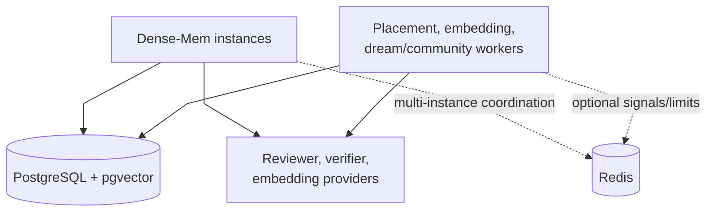
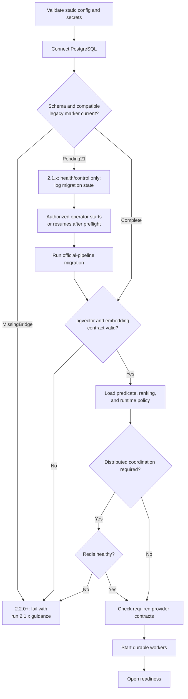
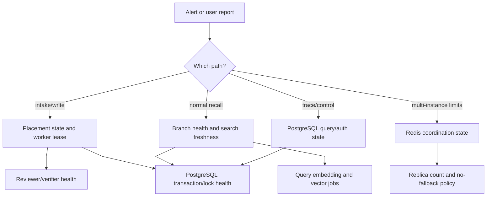
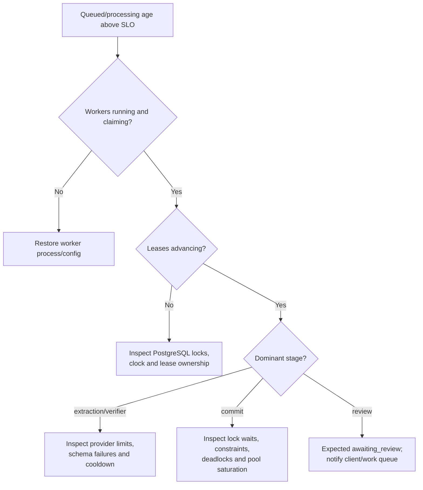
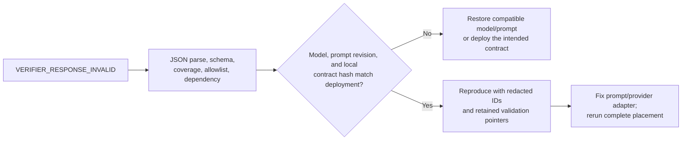
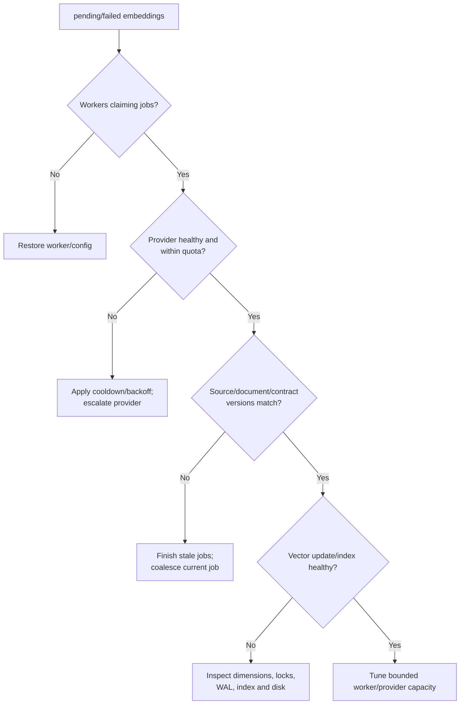
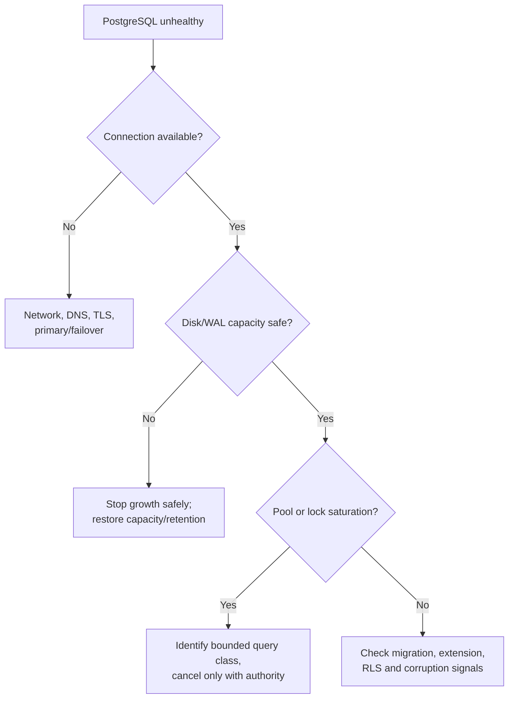
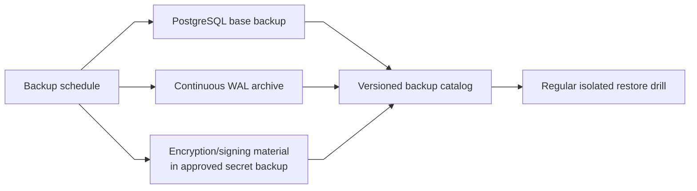
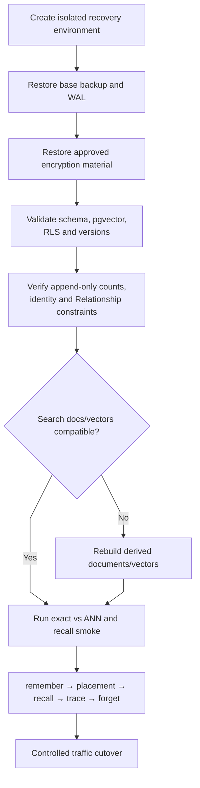
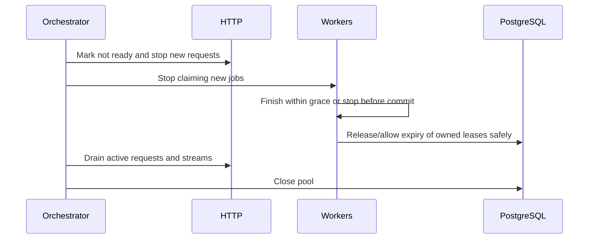

# Operations Runbook

This page is the operating contract for the PostgreSQL + `pgvector` v2
architecture. Commands and dashboards must still be verified against the
deployed release before use.

## Dependency Matrix

| Dependency | Required | Durable authority |
| --- | --- | --- |
| PostgreSQL with `pgvector` | yes | yes: all knowledge, workflow, security, audit, and search state |
| reviewer/verifier provider | yes for write placement | no |
| embedding provider | yes for vector build/query profiles that require it | no |
| Redis | only for required distributed coordination or explicit configuration | no |
| summary/dream provider | only for enabled provider-backed optional features | no |
| Neo4j | temporary `2.1.x` boot-gated migration only | no; read-only corpus source |



Redis loss must not lose memory. PostgreSQL loss means durable service is
unavailable and must be recovered before writes resume.

## PostgreSQL Topology Operations

The supported topology contract belongs in
[ANN, HNSW, And Halfvec](ANN-HNSW-And-Halfvec#single-database-and-cluster-topologies).
Tenant keys, placement classes, composite constraints, and per-team queue/RLS
behavior belong in
[PostgreSQL Cluster-Safe Schema](PostgreSQL-Cluster-Safe-Schema).
Operationally, every topology exposes one writer/coordinator endpoint and keeps
the same team-scoped repository contract:

| Topology | Required operational behavior |
| --- | --- |
| single primary | all reads/writes use the primary; one bounded application pool |
| primary with physical standbys | writes, jobs, migrations, profiles, and HNSW builds use the writer; replica recall remains disabled until lag/version/query-conflict gates pass |
| qualified distributed-by-team adapter | coordinator routes by authenticated `team_id`; every owning shard has matching schema, pgvector version, RLS behavior, and active index profile |

Before increasing service replicas, prove that the sum of every process pool
fits the database connection budget with operator and failover reserve. Before
enabling standby reads, test read-after-write routing, replay lag, recovery-
conflict cancellation, HNSW plan parity, and primary retry capacity. Before
activating a distributed index profile, require every shard to report the same
ready profile version.

## Startup And Readiness



Readiness should expose component-level state:

| Component | Readiness failure |
| --- | --- |
| PostgreSQL | cannot connect, migration mismatch, RLS/bootstrap invalid, or pool exhausted |
| `pgvector` | missing extension/operator class, dimension/contract mismatch, inactive search-index generation, or unusable search schema |
| verifier | required write contract cannot be reached or the provider cannot satisfy the closed contract probe |
| embedding | required recall profile cannot embed, or configured contract probe fails |
| Redis | unreachable when distributed coordination is required |
| placement/embedding jobs | backlog exceeds the release-defined readiness boundary |
| legacy migration | pending/running/failed in `2.1.x`, or required marker absent in `2.2.0+` |

Do not report a single green dependency flag when write, vector recall, trace,
and control readiness differ.

## First Deployment

Before user traffic:

1. keep main/control listeners private
2. create production secrets outside the repository
3. create/upgrade PostgreSQL and install the supported `pgvector` extension
4. run migrations with the migration role
5. validate the configured single/HA/distributed PostgreSQL topology and total
   connection budget
6. verify cluster-safe composite tenant keys and runtime-role/RLS behavior with
   two-team fixtures
7. validate reviewer extraction and strict verifier schema
8. validate one embedding against persisted dimensions/normalization
9. validate the active search-index generation, query plan, and exact/ANN oracle
10. configure Redis as required by service-instance topology
11. start workers and confirm queues are empty/healthy
12. run `remember` → placement → recall → trace → forget smoke
13. verify a pending embedding does not hide committed SemanticEdges
14. take and restore a PostgreSQL backup before accepting important memory

For an upgrade from v1, replace normal traffic steps with the boot-gated
`2.1.x` procedure in [Release Process](Release-Process). Do not run v1 against
the same stores during migration.

Public exposure belongs in
[Public HTTPS And Redis](Public-HTTPS-And-Redis).

## Health Triage



Always capture:

- UTC window and correlation/ingest/Relationship IDs
- deployed application/schema/config/ranking/embedding/verifier versions
- affected team/profile without evidence content
- processing/search state and safe error code
- PostgreSQL pool, transaction, lock, query, WAL, disk, and replica state
- provider request outcome classes without prompts/responses
- Redis requirement and health when applicable

## Placement Backlog



Required checks:

- queued count and oldest age
- active lease owner, heartbeat, and attempt count
- failures grouped by stage and safe code
- invalid-verifier regeneration count and JSON-pointer classes
- provider 429/cooldown/concurrency
- database deadlocks, lock timeouts, serialization failures, and constraint
  errors
- awaiting-review age separately from worker backlog

Do not mark jobs complete, delete queue rows, or extend leases blindly. Repair
the root cause, release only expired/abandoned leases through supported tooling,
and let stable idempotency converge retries.

## Invalid Verifier Responses

The application never repairs or splices provider output.



Safe evidence for diagnosis includes the local contract hash, response byte
count, attempt count, JSON pointers, result cardinalities, and model/provider
version. Do not log evidence text, rationales, or raw response payloads.

No `VerificationEvent` or semantic subset exists for invalid attempts. The
ingest remains traceable in `failed` processing state.

## Embedding Backlog And Search Freshness



During a vector backlog:

- current PostgreSQL Relationships and SemanticEdges remain authoritative
- exact, full-text, and adjacency branches may remain available
- vector retrieval includes only version-matched vectors
- the API reports pending/failed document counts and degraded branches
- embedding throughput is tuned by `EMBEDDING_BATCH_SIZE` first and
  `EMBEDDING_WORKER_COUNT` second; increasing many single-job workers is not the
  target operating mode

Never copy an older vector onto a newer document or mark `search_state=current`
without the source/document/contract version predicate succeeding.

## Recall Latency Or Quality

Break down the request by branch:

| Branch | Inspect |
| --- | --- |
| query embedding | provider latency/errors, model and dimensions |
| PostgreSQL full text | plan, GIN use, row estimate, tenant predicate |
| `pgvector` exact | eligible row count, distance sort, memory/time |
| `pgvector` HNSW | iterative scan mode, `ef_search`, tuples scanned, filtered Recall@K |
| Entity seeds | name/alias indexes, candidate cap, homonym behavior |
| adjacency | subject/object partial indexes, seed/fan-out/depth/edge/time caps |
| hydration/ranking | RLS, duplicate union, response bytes, ranking version |

For suspected ANN quality regression, run the same queries with an exact
team-filtered baseline and compare Recall@K. Do not raise HNSW work or remove
filters blindly; test latency, CPU, I/O, and isolation together.

HNSW/halfvec mechanics, candidate exact rerank, database/application ownership,
and load controls belong in
[ANN, HNSW, And Halfvec](ANN-HNSW-And-Halfvec#load-and-concurrency-contract).

For a hub Entity, confirm `stopped_reason` and caps rather than removing
traversal bounds.

## PostgreSQL Incident



Because PostgreSQL is the only truth store, fail writes rather than buffering
semantic decisions in Redis or process memory. Normal reads must not switch to
search documents or caches as substitute truth.

Before terminating queries, failing over, reindexing, or changing WAL/retention,
follow database change control and confirm blast radius.

## Redis Incident

| Topology | Required response |
| --- | --- |
| one service process, Redis not required | local coordination may continue if that was the startup mode |
| Redis configured as mandatory | fail affected readiness; do not silently change mode |
| multiple service instances | protect global quotas/leases by failing affected operations until distributed coordination returns |

After recovery, rate-limit windows and short leases may reset/reacquire.
Validate that PostgreSQL placement, review, API key, audit, and memory rows were
unaffected. Redis restoration from backup is not part of knowledge recovery.

## Dream And Community Jobs

Dream and community work is optional and must not block core memory.

Check durable run keys/leases, eligible input counts, node/edge/token/time caps,
source-version rechecks, provider schema failures, and stale results. A
too-large community run is an expected bounded outcome, not authority to remove
caps.

Dreaming that references an unknown endpoint/predicate is a rejected output;
never “repair” it by creating a node. See [Dreaming](Dreaming).

## Backup

After v2 cutover, PostgreSQL base backup plus WAL/PITR and required encryption
material are the complete durable backup. Before a `2.1.x` bridge migration,
also take and verify the read-only Neo4j source snapshot required by
[Release Process](Release-Process#1-backup-and-preflight).



The catalog records:

```text
backup ID and UTC range
PostgreSQL and pgvector versions
application and schema versions
embedding, search-index, and search-document contract versions
predicate and ranking versions
WAL coverage and target restore time
encryption/signing-material reference
checksums and retention class
```

Do not wait for Redis before taking a canonical backup. HNSW indexes are
recoverable with PostgreSQL; a planned rebuild may reduce backup size only when
the restore procedure and RTO account for it.

## Restore And Disaster Recovery



Restore checks include:

- no cross-team visibility under representative profiles
- same-team A/B/C visibility with owner-only mutation enforcement
- expected Entity/Value/Relationship/evidence/history counts
- no candidate or Hypothesis in active SemanticEdge reads
- exact support/source-group counts on sampled traces
- embedding dimensions and contract versions
- vector Recall@K against exact filtered queries
- queue leases safely expired/reacquired
- distributed coordination restored before multiple instances

Never restore a legacy graph copy over newer PostgreSQL state. Neo4j may be
read only by the temporary `2.1.x` migration adapter, but it is not a recovery
source after cutover and no adapter exists in `2.2.0+`.

## Routine Maintenance

| Area | Work |
| --- | --- |
| PostgreSQL | backup verification, vacuum/analyze, bloat, locks, slow plans, WAL/disk, replica/PITR checks |
| `pgvector` | index size/build health, Recall@K, iterative-scan cost, reindex planning |
| placement | queue age, lease churn, review age, verifier schema failures |
| embeddings | pending/failed age, provider quota, version mismatch, rebuild progress |
| security | key/session cleanup, audit retention, RLS tests |
| optional jobs | dream/community due state, caps, stale output cleanup |
| Redis | connectivity, memory/eviction, TLS/auth, global quota correctness |

Embedding, predicate, verifier-schema, and search-document changes are data
contract migrations, not routine config edits.

## Graceful Shutdown



A worker that loses its lease must stop before semantic commit. Shutdown does
not mark unfinished work successful.

## Support Bundle

Include bounded, redacted:

- UTC window, correlation/ingest/Relationship IDs
- application/schema/config/predicate/ranking/verifier/embedding versions
- component readiness and queue/search freshness summaries
- metric samples and structured safe error codes
- PostgreSQL version, `pgvector` version, pool/lock/plan summaries
- Redis topology/health when relevant

Exclude evidence text, names when unnecessary, provider prompts/responses,
vectors, DSNs, headers, cookies, keys, tokens, passwords, and raw database
dumps.

## Risks And Mitigations

| Risk | Concrete failure mode | Mitigation |
| --- | --- | --- |
| PostgreSQL treated as replaceable projection | operator serves stale search docs during database outage | fail source reads/writes; PostgreSQL-only truth contract and restore drills |
| Embedding backlog mistaken for data loss | client repeats `remember` and duplicates provenance | separate processing/search state, idempotency, and SemanticEdge source checks |
| ANN latency fix harms quality | operator lowers HNSW work without exact comparison | paired latency/Recall@K gate and versioned tuning |
| Scale-out exhausts connections | adding service replicas multiplies per-process pools beyond PostgreSQL capacity | deployment-wide connection formula, vector semaphore, and preflight gate |
| Standby serves stale memory | replica recall misses a committed correction or active contract | primary for freshness-sensitive reads and explicit replay-lag/version gate |
| Distributed activation is partial | some shards query an older or absent HNSW generation | all-shard build/plan/oracle gate before atomic generation activation |
| Queue manually edited | placement history and idempotency diverge | supported lease/retry tooling only; investigate root cause |
| Redis outage breaks global limits | replicas silently use independent counters | mandatory distributed mode fails readiness/affected operations |
| Restore leaks tenants | RLS/runtime actor settings are missing after recovery | migration validation plus two-team isolation smoke before cutover |
| Destructive repair loses ledger | direct deletes remove support/transition history | append-only roles, explicit approval/change control, backup, and dry-run impact |
| Migration appears hung | long verifier/vector work emits no bounded status | durable phase counters plus periodic structured progress and ETA logs |
| Cross-profile repair damages another author | operator retries B's split under a system role and moves A | owner-preserving jobs, selected-observation checks, and three-profile smoke |

## Operational Acceptance

Before production:

1. PostgreSQL/PITR restore is proven in isolation
2. `pgvector` rebuild and exact-vs-ANN quality checks are proven
3. verifier invalid-response failure is visible and commits no subset
4. placement and embedding backlog alerts are active
5. multi-instance Redis failure does not fall back locally
6. two-team RLS/recall/trace leakage tests pass
7. graceful shutdown and lease recovery are proven
8. support bundles contain no secrets/evidence/provider payloads
9. core memory remains usable when optional dream/community jobs fail
10. `2.1.x` resumes migration from checkpoints and cuts over automatically only
    after all hard gates pass
11. `2.2.0+` rejects a database that lacks the compatible bridge marker and has
    no Neo4j connection path
12. single-primary, HA failover, and every advertised distributed topology pass
    the same tenant, exact/ANN, backup, and recovery contract
