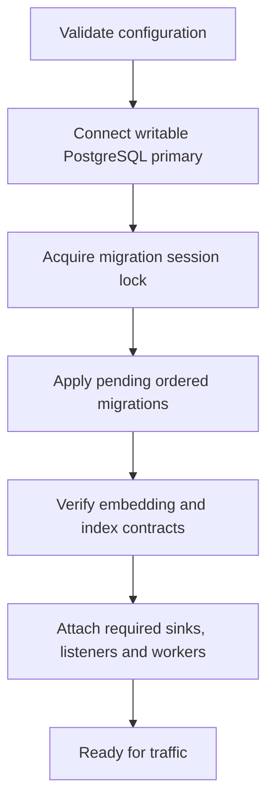
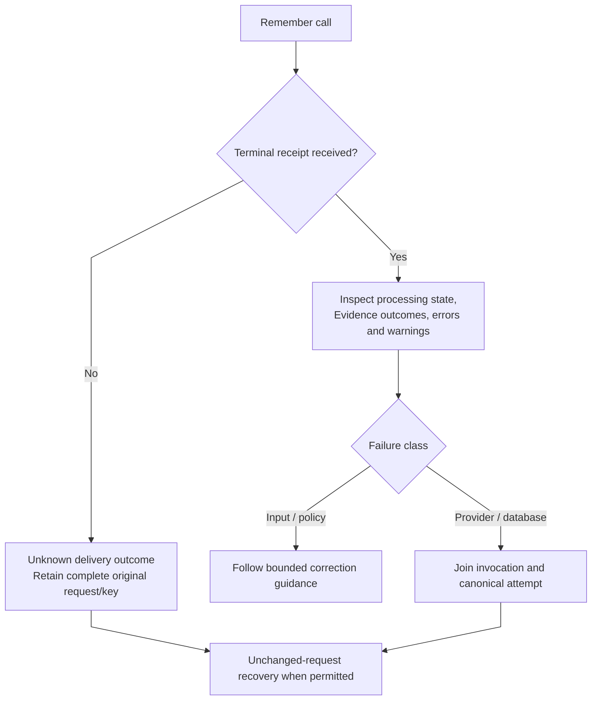
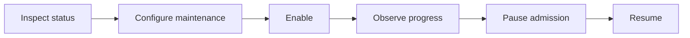

# Operations Runbook

Establish the deployed image, effective configuration, database state, and operation IDs before acting. Source documentation does not establish which binary is deployed.

## Startup And Readiness



| Dependency | Role |
| --- | --- |
| PostgreSQL + pgvector | Required durable authority and search execution. |
| Assessment and embedding providers | Required configured clients; affected operations surface failures. |
| Redis | Required shared coordination for multiple instances; single-process local mode is supported. |
| Operation-log sink | Required PostgreSQL diagnostic sink participates in readiness. |
| Prometheus/OTLP | Optional telemetry according to configuration. |

```bash
docker compose ps
docker compose logs --tail=100 server
curl -fsS http://127.0.0.1:8080/health
curl -fsS http://127.0.0.1:8080/ready
```

Migrations have no overall deadline by default (`POSTGRES_MIGRATION_TIMEOUT_SECONDS=0`); shutdown still cancels. Progress logs appear every ten seconds. Extend startup/healthcheck grace and rollout deadlines for a long migration instead of launching a competing migration process. See [Configuration](Configuration#postgresql-and-pgvector).

### Destructive Migration Boundary

If pending Evidence-only migrations remove retired graph data, stop incompatible readers/writers and verify a matching restore-tested backup before starting the new binary. The migration uses an explicit inventory/fingerprint, bounded lock acquisition, and one transaction without provider calls. A blocked inventory or retained dependency needs investigation, not manual deletion.

Before destructive commit, transaction rollback preserves the prior state. After commit, restoration requires the matching backup; after new accepted writes, use forward recovery unless separately authorized. Ordinary rolling changes must remain compatible with the previous supported binary.

Private attribution migration also runs automatically before serving. Its read-only diagnostic command is:

```bash
/app/server private-memory-preflight
```

When an operator deliberately invokes the existing migration command with a retained inspected fingerprint:

```bash
/app/server private-memory-migrate \
  --source-fingerprint='<preflight-source-fingerprint>'
```

Do not guess ownership to clear a preflight blocker. Partial migration remains a readiness failure. The deprecated maintenance-confirmation flag is not an activation requirement.

## Health Triage

1. Record the image/source revision, UTC window, correlation ID, and bounded public error.
2. Check readiness, database connectivity/locks, effective configuration, and required sink health.
3. Open the matching control diagnostic view and inspect actual capture availability.
4. Follow typed remediation; preserve source data and operation identity.

Console logs can contain admitted user text. Inspect within the operator boundary; collect only the authorized protected evidence needed for diagnosis.

## Synchronous Remember Failure Triage



The control Remember view links admitted invocations to canonical attempts. Execution, replay, and key-conflict calls are different invocations and can refer to one attempt. Inspect phase, request hash, validation details, retry eligibility, and provider-exchange availability.

| Failure | Operator action |
| --- | --- |
| Initial security rejection | Use content-free rule/span metadata; no rejected body was captured. |
| Changed request under the same key | Compare saved request identity; do not bypass conflict by rotating keys. |
| Stale source or generation | Refresh authorized current state before an intentional revised operation. |
| Provider/embedding failure | Check actual endpoint/model, remaining deadline, dimensions, and returned retry action. |
| Commit failure | Check transaction/fence errors and database health. |
| Retired contract | Inspect retained outcome; no replay through the removed graph contract. |

Staged exact intake can remain after required failure without new accepted semantic memory. A response-write observation is not proof of client delivery. See [Memory Write Pipeline](Write-Pipeline) and [Telemetry](Telemetry#operation-logs-and-protected-captures).

## Search Convergence

Inspect `GET /control/api/search/convergence` or the control Search convergence view. Compare expected, current, drifted, pending, and failed documents with active source/embedding/index generations.

Required foreground embeddings finish before Remember success. Later source or contract changes can need bounded reconciliation. Investigate the allowlisted failure and latest reconciliation outcome; do not repair search by rewriting canonical Evidence or relabeling incompatible vectors.

## Recall Latency Or Quality

| Observation | Investigate |
| --- | --- |
| Empty/degraded results | Public search states and degradations, then authorized source/lifecycle visibility. |
| Missing topic follow-up | Organization enablement, current memberships, dependencies, and unseen eligible counts. |
| Slow provider phase | Model, request/context size, concurrency, and provider diagnostics. |
| Slow database phase | Scoped full-text/vector plans, active index definition, connection pressure, and slow-query logs. |
| Quality changed | Same-identity deterministic comparison; see [Evaluation](Evaluation). |

Use trace for individual Evidence state. Metrics cannot establish the lifecycle or truth of a source.

## Ontology Maintenance



| Private control route | Purpose |
| --- | --- |
| `GET/PATCH /control/api/config/ontology-maintenance` | Read/update supported settings. |
| `GET /control/api/ontology/status` | Current policy, pause state, usage, and progress. |
| `GET /control/api/ontology/runs` | Bounded run history. |
| `POST /control/api/ontology/runs` | Explicit bounded run with retained `operation_key` and optional `max_batches`. |
| `POST /control/api/ontology/runs/{runId}/retry` | Supported explicit retry of the selected run. |
| `POST /control/api/ontology/pause` or `/resume` | Idempotent admission control with retained operation key. |

Inspect failed/ambiguous outcomes and unknown usage separately from pending or in-flight work. Disabling stops admissions and drains dispatched work. Pause preserves eligible current topic reads; disabling organization removes them. Neither control revives graph clustering or Dream. There are no token-allowance grants.

[Configuration](Configuration#ontology-maintenance) owns defaults; [Topics And Organization](Topics-And-Organization) owns publication and manager policy.

## Evidence Conflicts

Use the control Evidence-conflict workspace. Inspect exact positions and provenance before a version-fenced resolve/dismiss command. The current procedure and routes are in [Conflicts And Corrections](Conflicts-And-Corrections#operator-inspection-and-decision).

## Private-Memory Erasure

Inspect the exact private target, operation state, active generation, and applicable legal holds. A queued acknowledgement is not physical completion. Let the privacy owner seal/fence and verify its catalog-complete purge. Do not unseal a target or reset generations to retry a stale writer.

Erasure includes raw intake, extraction checkpoints, retained memory, dependent projections, and applicable migration copies. Unaffected spaces remain separate. Owner-facing requests and polling are in [Portals And API Keys](Portals-And-API-Keys#private-memory-erasure).

## Backup

Use a PostgreSQL backup/PITR policy matching durability requirements. For a logical backup of the bundled stack:

```bash
docker compose exec -T postgres sh -c 'pg_dump -U "$POSTGRES_USER" -d "$POSTGRES_DB" -Fc' > dense-mem.dump
```

Protect the dump. Record database/server versions, schema, pgvector, active search contracts, WAL coverage, checksums, and protected configuration references. Memory packs and Redis are not full backups. Test restores in isolation.

## Restore And Disaster Recovery

1. Restore the selected PostgreSQL backup and WAL into an isolated environment.
2. Restore compatible protected configuration; verify schema, pgvector, ownership, RLS, and search contracts.
3. Check canonical counts, representative traces, private isolation, and current/temporal recall.
4. Verify derived reconciliation and worker lease recovery.
5. Restore traffic only through the authorized deployment procedure.

Do not restore erased private content by resetting a space generation. After incompatible migrations or new writes, retain compatible readers/writers and recover forward as required.

## Routine Maintenance And Shutdown

Monitor locks, slow queries, connection budget, vacuum/analyze, disk/WAL, backups, provider failures, search/organization convergence, diagnostic retention, and coordination health. More application replicas increase database/provider pressure.

Graceful shutdown stops admission and cancels request/worker contexts before closing dependencies. A forced disconnect can leave a client uncertain about delivery; retain operation identity. Keep support bundles bounded and protect operational credentials and admitted text.
