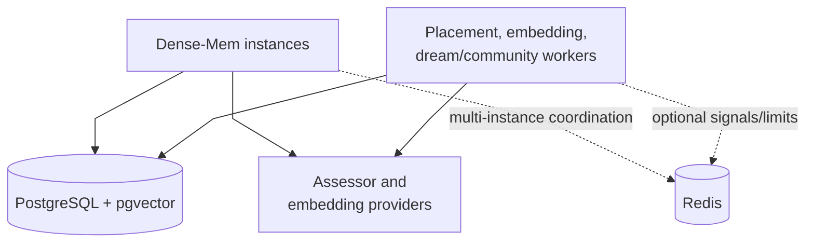
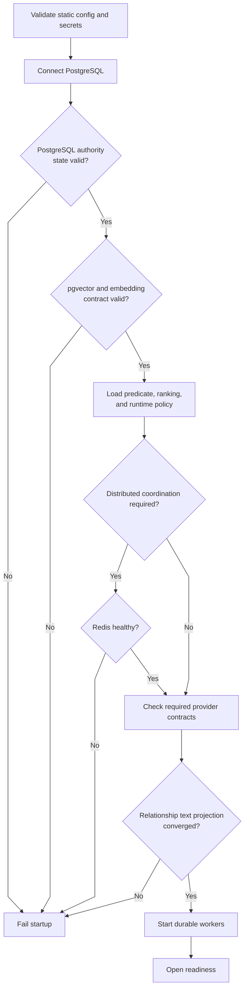
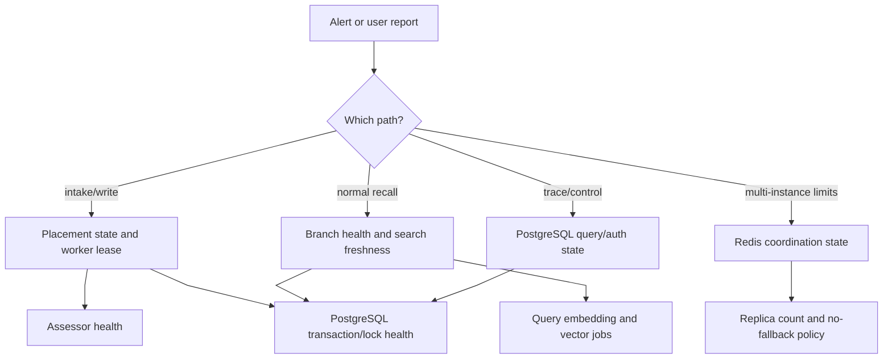
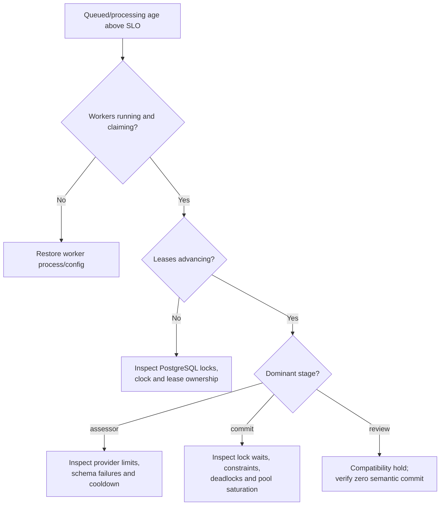
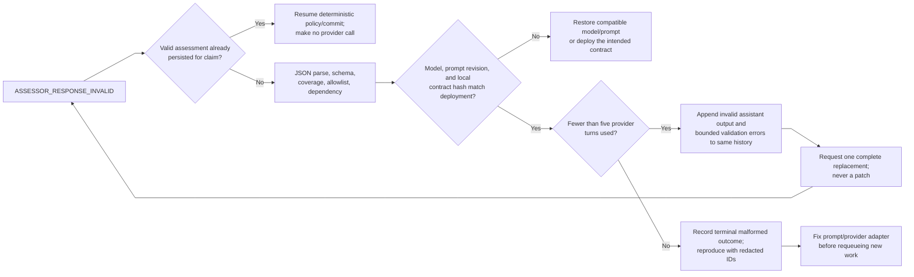
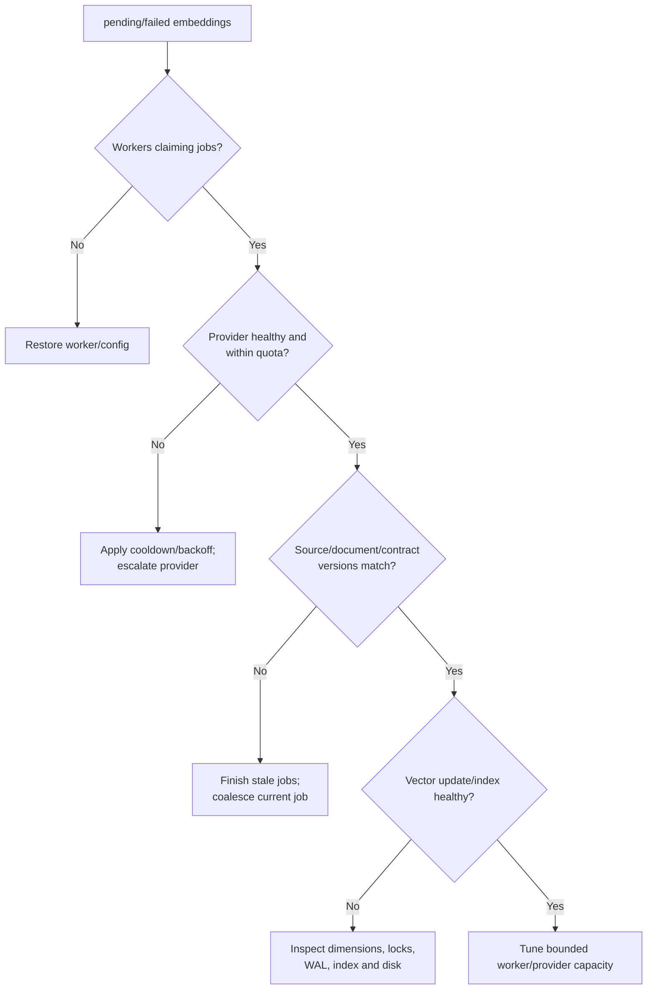
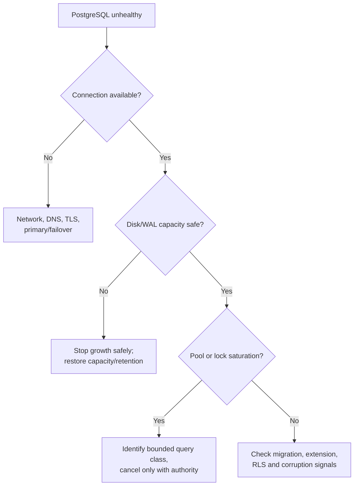
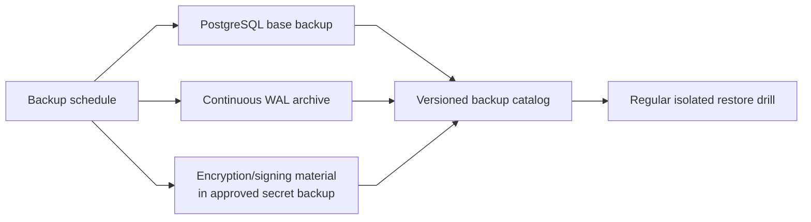
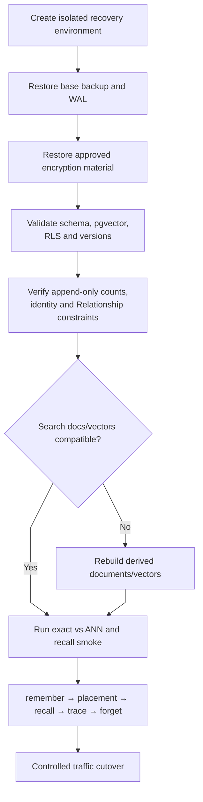
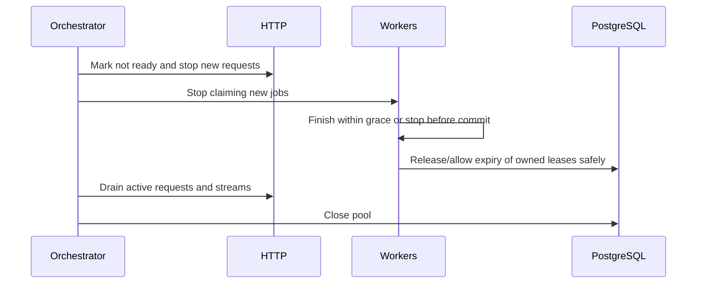

# Operations Runbook

This page is the operating contract for the PostgreSQL + `pgvector`
architecture. Commands and dashboards must still be verified against the
deployed release before use.

## Dependency Matrix

| Dependency | Required | Durable authority |
| --- | --- | --- |
| PostgreSQL with `pgvector` | yes | yes: all knowledge, workflow, security, audit, and search state |
| assessor provider | yes for write placement | no |
| embedding provider | yes for vector build/query profiles that require it | no |
| Redis | only for required distributed coordination or explicit configuration | no |
| summary/dream provider | only for enabled provider-backed optional features | no |



Redis loss must not lose memory. PostgreSQL loss means durable service is
unavailable and must be recovered before writes resume.

## PostgreSQL Topology Operations

The supported topology contract belongs in
[ANN, HNSW, And Halfvec](ANN-HNSW-And-Halfvec#single-database-and-cluster-topologies).
Tenant keys, placement classes, composite constraints, and per-team queue/RLS
behavior belong in
[PostgreSQL Cluster-Safe Schema](PostgreSQL-Cluster-Safe-Schema).
Operationally, every topology exposes one writer/coordinator endpoint and keeps
the same team-scoped repository contract:

| Topology | Required operational behavior |
| --- | --- |
| single primary | all reads/writes use the primary; one bounded application pool |
| primary with physical standbys | writes, jobs, migrations, profiles, and HNSW builds use the writer; replica recall remains disabled until lag/version/query-conflict gates pass |
| qualified distributed-by-team adapter | coordinator routes by authenticated `team_id`; every owning shard has matching schema, pgvector version, RLS behavior, and active index profile |

Before increasing service replicas, prove that the sum of every process pool
fits the database connection budget with operator and failover reserve. Before
enabling standby reads, test read-after-write routing, replay lag, recovery-
conflict cancellation, HNSW plan parity, and primary retry capacity. Before
activating a distributed index profile, require every shard to report the same
ready profile version.

## Startup And Readiness



Readiness should expose component-level state:

| Component | Readiness failure |
| --- | --- |
| PostgreSQL | cannot connect, migration mismatch, RLS/bootstrap invalid, or pool exhausted |
| `pgvector` | missing extension/operator class, dimension/contract mismatch, inactive search-index generation, or unusable search schema |
| assessor | required write contract cannot be reached or the provider cannot satisfy the closed contract probe |
| embedding | required recall profile cannot embed, or configured contract probe fails |
| Redis | unreachable when distributed coordination is required |
| placement/embedding jobs | backlog exceeds the release-defined readiness boundary |
| Relationship projection | any eligible Relationship lacks format-2 text or any ineligible Relationship is not marked `not_required` |
| authority state | missing, incompatible, or corrupt PostgreSQL authority metadata |

Do not report a single green dependency flag when write, vector recall, trace,
and control readiness differ.

## First Deployment

Before user traffic:

1. keep main/control listeners private
2. create production secrets outside the repository
3. create/upgrade PostgreSQL and install the supported `pgvector` extension
4. start one release server against the writable primary and wait for its
   session-locked startup migrations to finish
5. validate the configured single/HA/distributed PostgreSQL topology and total
   connection budget
6. verify cluster-safe composite tenant keys and runtime-role/RLS behavior with
   two-team fixtures
7. validate the integrated-assessor schema, token budgets, and persisted-result
   reuse probe
8. validate one embedding against persisted dimensions/normalization
9. validate the active search-index generation, query plan, and exact/ANN oracle
10. configure Redis as required by service-instance topology
11. start workers and confirm queues are empty/healthy
12. run `remember` → placement → recall → trace → forget smoke
13. verify a pending embedding does not hide committed SemanticEdges
14. take and restore a PostgreSQL backup before accepting important memory

### Migration startup progress

The release and demo server log `running postgres migrations` at the start of a
migration run and `postgres migrations still running` every 10 seconds until it
completes. The heartbeat includes `direction`, `elapsed_seconds`, and
`timeout_seconds`. Release images do not ship a standalone migration command or
separate migration container.

`POSTGRES_MIGRATION_TIMEOUT_SECONDS` defaults to 1800 seconds and is bounded
to 1–86400 seconds. The five-minute preflight and post-migration checks remain
separate; the extended timeout applies only to the migration run. Set a higher,
finite value only for a planned maintenance window.

A heartbeat means the migration run is still active and may be executing DDL or
waiting on a PostgreSQL lock. Do not restart it solely because heartbeats appear.
If elapsed time approaches the configured deadline, inspect migration status and
authorized database lock/transaction state before choosing a recovery action.

Concurrent replicas connected to the same writable primary serialize this work
with a PostgreSQL session lock. A replica waits rather than applying the same
migration concurrently. Keep migrations compatible with the previous binary for
rolling deployments. Independent databases do not share that lock; each must be
started and migrated separately.

#### Migration rollout and recovery

Use expand/backfill/cutover/contract for changes that cross application
releases:

1. add schema that remains compatible with the previous binary
2. run a bounded, resumable backfill and cut application reads/writes over
3. remove compatibility schema only after the rollback window closes and a
   backup/PITR checkpoint has been restored successfully

A failed transactional migration must leave the prior schema intact and block
server readiness. Diagnose the migration and database state before retrying.
A `NO TRANSACTION` migration can leave partial DDL, so it must be idempotent,
retry-safe, and covered by a disposable real-PostgreSQL test that reproduces
its interrupted state.

Production does not invoke Goose Down automatically. After a committed
migration, prefer a new roll-forward migration. Use PITR with the matching old
application only when forward repair cannot preserve the required data or
contract. Down migrations remain for local tests and controlled recovery
analysis, including their documented irreversible boundaries.

The generated schema catalog documents the result of the complete Goose
history. It is never applied to production, used as a live desired-state diff,
or treated as a substitute for migration and backup evidence.

Migration `2026080701` is a coordinated-stop exception: it drops the unused
`evidence_security_events.scan_policy_hash` column under an `ACCESS EXCLUSIVE`
table lock, and an old binary cannot write security events after that drop. For
the Docker Compose release, stop every API and worker container, confirm no old
process retains a placement lease or database session, and take a PostgreSQL
backup if the historical values must remain recoverable. Start only the new
release; its startup migration must finish before listeners or workers become
ready. Then verify the column is absent and run the `security_intake` Compose
scenario. The down migration recreates a blank compatibility column but cannot
restore discarded values, so a value-preserving rollback requires the backup
and matching old application release.

The image healthcheck uses a 30-minute startup grace matching the default
migration timeout. Docker ignores failed probes during that grace and switches
to normal failure counting after the first successful probe. If
`POSTGRES_MIGRATION_TIMEOUT_SECONDS` is raised above 1800, override the
deployment healthcheck start period to at least the same duration.

### Release image contents

The release runtime contains `/app/server`, PostgreSQL migrations, and both
static portal bundles. The demo runtime contains `/app/demo-server`, migrations,
and only the user bundle. Administration uses the private control portal/API;
dreaming and Conflict review remain background workers in the server process.

Use immutable tags in deployment configuration:

| Channel | Release image | Demo image |
| --- | --- | --- |
| release candidate | `vX.Y.Z-rc.N` | `demo-vX.Y.Z-rc.N` |
| stable | `vX.Y.Z` or `latest` | `demo-vX.Y.Z` |

There is no rolling `demo` tag. Stable tags promote the already-published RC
manifests without rebuilding them.

Public exposure belongs in
[Public HTTPS And Redis](Public-HTTPS-And-Redis).

## Health Triage



Always capture:

- UTC window and correlation/ingest/Relationship IDs
- deployed application/schema/config/ranking/embedding/assessor versions
- affected team/profile without evidence content
- processing/search state and safe error code
- PostgreSQL pool, transaction, lock, query, WAL, disk, and replica state
- provider request outcome classes without prompts/responses
- Redis requirement and health when applicable

## Placement Backlog



Required checks:

- queued count and oldest age
- active lease owner, heartbeat, and attempt count
- failures grouped by stage and safe code
- `densemem_assessor_terminal_failures_total{stage=...}` and owner-scoped
  submission status `errors`; use the stage to distinguish predicate option
  overflow, input/catalog overflow, provider exhaustion, and commit failures
- invalid-assessor count, JSON-pointer classes, provider turns per assessor
  conversation, and persisted-assessment reuse
- provider 429/cooldown/concurrency
- database deadlocks, lock timeouts, serialization failures, and constraint
  errors
- compatibility-hold age separately from worker backlog

Retryable provider failures use deterministic exponential backoff with bounded
jitter. The first four retry releases wait about 15s, 30s, 60s, and 120s. A
valid `Retry-After` hint may extend that delay; the effective delay remains
capped at 300s. Attempts are not reset by ordinary retries. A schema-invalid
HTTP 200 response does not release the placement item: the assessor receives
the bounded validation errors in the same message history and may return a
complete replacement, for at most five provider turns in that conversation.

The public placement status projects only an allowlisted terminal stage such as
`predicate_options_overflow` or `assessment`. Never use provider/database error
text from logs or SQL as a client diagnostic. If the stage is `unknown`, inspect
the authenticated correlation window, worker lease/attempt row, and PostgreSQL
transaction/constraint state without exporting raw payloads.

When a legacy authority handoff reaches the end of its source cursor with all
items terminal but some items failed or were excluded, the supervisor pauses the
run instead of repeatedly trying cutover. The private portal shows whether
resume can repair the run. Supported repair may requeue abandoned processing
rows, orphan review rows, and retryable exhausted placement failures.

Legacy evidence missing its owner is auto-repairable only when the active
same-team legacy corpus has exactly one distinct owner. Resume rewinds the
legacy cursor, the executor validates that exact team/profile pair in
PostgreSQL, and stable idempotency skips evidence that was already staged. The
original exclusion row remains as audit history and stops blocking cutover only
after the evidence is durably staged. Zero owners, multiple owners, invalid
team/profile membership, other cutover exclusions, and deterministic terminal
failures remain hard blockers that need operator investigation.

For the submission-wide worker, a valid but non-promotable result is terminal
for worker progress when every item and its run are `awaiting_review` with the
same `candidate` category. It has zero semantic commit and deliberately creates
no review task or client action. Treat it as a compatibility hold, not a missing
review-task incident. #152 owns its formal immutable expiry and replacement
lifecycle. Legacy item-scoped review rows remain a separate compatibility path:
those rows still require their historical task invariants.

For semantic holds, inspect `submission_holds` and the run projection together.
The immutable fact must retain its assessment, reason, owner, `held_at`, and
`expires_at = held_at + 24 hours`; expiry may change only
`placement_runs.semantic_hold_state` and append an outcome. A successor is
allowed only from the same owner and may be queued/guarded/processing once per
target. Never manually mark a target superseded: only the successor's successful
semantic transaction may do so. Failed, held, rejected, quarantined, or expired
successors must release the slot without changing the target.

Do not mark jobs complete, delete queue rows, reset attempts, or extend leases
with direct SQL. Repair the root cause, use the supported pause/resume repair
path, and let stable idempotency converge retries.

## Invalid Assessor Responses

The application never repairs or splices provider output.



Safe evidence for diagnosis includes the local contract hash, bounded token
counts, provider-turn count, durable attempt count, JSON pointers, result
cardinalities, and model/provider version. Do not log evidence text, rationales,
raw response payloads, or provider error bodies.

No `VerificationEvent` or semantic subset exists for an invalid intermediate
turn. The full history is transient and sent only back to the same provider.
After five malformed responses, the claim reaches a visible terminal malformed
outcome with zero partial semantic commit. Do not delete the claim, clear its
attempt history, or manually invoke the provider.

A timeout, 429, 4xx, 5xx, transport failure, or invalid provider envelope ends
the current conversation immediately. The placement item requeues through its
durable `max_attempts` budget with fresh message history and the bounded
backoff above. On the final durable attempt it fails terminally. A provider
failure is never appended to the malformed-response correction history.

If a valid assessment exists, treat any later provider turn as an invariant
failure. Stop the affected placement workers, preserve the assessment and claim
rows, inspect uniqueness/lease/version predicates, and resume only after the
retry path is proven to reload the persisted result.

## Embedding Backlog And Search Freshness



During a vector backlog:

- current PostgreSQL Relationships and SemanticEdges remain authoritative
- exact, full-text, and adjacency branches may remain available
- vector retrieval includes only version-matched vectors
- the API reports pending/failed document counts and degraded branches
- embedding throughput is tuned by `EMBEDDING_BATCH_SIZE` first and
  `EMBEDDING_WORKER_COUNT` second; increasing many single-job workers is not the
  target operating mode

Never copy an older vector onto a newer document or mark `search_state=current`
without the source/document/contract version predicate succeeding.

### Relationship projection upgrade

Use this release procedure for projection format `2`; the canonical state
machine and schema are in
[Data Model And Storage](Data-Model-And-Storage#relationship-projection-generation).

Before migration:

1. stop all API, placement, scheduler, and embedding-worker versions that can
   write the database;
2. confirm no old process retains a lease;
3. take and restore-test the rollback backup;
4. export per-team eligible/ineligible Relationship counts, Relationship
   document-state counts, Evidence document/vector counts and hashes,
   outstanding jobs by source kind, numerical embedding contract, and active
   search-index generation;
5. confirm provider quota, database free space, WAL capacity, connection
   reserve, and expected Relationship-only embedding volume.

During the blocking text phase:

- run only the release migrator under its application projection lock;
- watch generation state, last projected Relationship ID, projected/eligible
  counts, batch duration, new tagged jobs, and renderer errors;
- expect batches of 500 ordered by `(team_id, relationship_id)`;
- on failure, fix the root cause and resume the same generation—the renderer
  hash and job-coalescing keys make the repeated boundary batch idempotent;
- do not open readiness until every eligible Relationship has format-2 text and
  every ineligible Relationship is `not_required`;
- compare Evidence counts and hashes with preflight before opening traffic.

After text convergence, traffic may open. `results[]`, Evidence vectors, and
Relationship lexical discovery remain available. The Relationship vector
branch stays disabled for the complete affected team and recall reports
`relationship_vector_warming`.

During asynchronous re-embedding:

- generation jobs contain only `source_kind=relationship` and carry the
  projection generation ID;
- ordinary live Relationship writes use untagged foreground jobs;
- each non-empty class receives reserved claim capacity, with remaining slots
  filled foreground-first;
- workers drain immediately while claimable backlog exists;
- provider retries, batch splitting, leases, and document-version fences remain
  unchanged;
- one terminal failed generation job keeps the generation from activating but
  does not disable lexical Relationship recall.

The generation activates only after a transactional recount proves every
eligible format-2 Relationship vector is current, every ineligible
Relationship is `not_required`, and no tagged job is queued, processing, or
failed. Verify that vector RRF then enables for the complete team, Evidence
counts/hashes still match preflight, and the embedding/search-index contract IDs
did not change. Run `VACUUM (ANALYZE)`; reindex concurrently only when measured
bloat or ANN quality warrants it.

Rollback restores the pre-migration PostgreSQL backup and the matching old
application release together. Never roll back one without the other or allow
old and new workers to overlap.

### V2.4 integrated-assessor placement upgrade

Run this upgrade only after issue #129's Relationship projection migration is
complete and healthy. V2.4 changes placement and semantic-review workflow. It
must not start another projection generation or embedding drain.

Before cutover:

1. freeze the application, schema, assessor model/prompt/contract,
   `assessment_policy_version`, and bootstrap threshold (`0.7`);
2. export counts for placement runs/items, VerificationEvents, Relationship
   statuses/effective supports, review task kinds/states, search documents,
   vectors, and embedding jobs;
3. export search-text hashes by source kind plus the active projection,
   embedding, and HNSW generation IDs;
4. identify unresolved semantic reviews separately from security quarantine and
   cross-profile Conflict cases;
5. take and restore-test the PostgreSQL backup.

During cutover:

1. stop placement/API versions that can create or claim semantic placement
   work, then confirm their leases are absent or expired;
2. apply the additive assessment, stable-claim, confidence-audit, team-config,
   and review-expiry schema migration;
3. set `expires_at = cutover_time + 7 days` only for unresolved (`open` or
   `acknowledged`) semantic `support_confidence`, `identity`, `predicate`,
   `scope`, and `time` tasks;
4. leave completed/held VerificationEvents, Relationship status/support,
   security quarantine, and Conflict cases unchanged;
5. deploy the V2.4 API and placement workers together and reject mixed-version
   claim execution;
6. resume work only after the same-history malformed-correction probe, durable
   provider-retry probe, persisted-assessment crash/reload probe, and threshold
   configuration validation pass.

After cutover:

- compare lifecycle, review, search, vector, job, hash, and active-contract
  snapshots with preflight;
- allow differences only for the documented open semantic-review expiry fields
  and new V2.4 work admitted after traffic opens;
- verify legacy VerificationEvents have null V2.4 audit fields and were not
  rescored;
- verify an in-flight claim with a persisted valid assessment makes zero
  provider turns, malformed output uses at most five turns in one conversation,
  and a provider failure consumes the durable attempt budget with fresh
  history;
- verify expiry closes a task without granting support, creating an active
  Relationship, or directly creating a Hypothesis;
- verify no search document version changed, no embedding job was enqueued, and
  no assessor or embedding provider was called by the migration.

Any changed vector, search-text hash, projection generation, embedding job
count, or embedding-provider call attributable to this migration is a blocker.
Do not “repair” it by draining the queue; find and remove the unintended
projection change before traffic. Re-embedding associated with #129 is complete
before this procedure and is not part of V2.4.

Rollback is supported only before V2.4 traffic writes. Restore the pre-cutover
database and matching V2.3 application together. After V2.4 claims commit,
rollback requires the same full restore; never run V2.3 workers against
persisted V2.4 assessment state.

## Recall Latency Or Quality

Break down the request by branch:

| Branch | Inspect |
| --- | --- |
| query embedding | provider latency/errors, model and dimensions |
| PostgreSQL full text | plan, GIN use, row estimate, tenant predicate |
| `pgvector` exact | eligible row count, distance sort, memory/time |
| `pgvector` HNSW | iterative scan mode, `ef_search`, tuples scanned, filtered Recall@K |
| Entity seeds | name/alias indexes, candidate cap, homonym behavior |
| adjacency | subject/object partial indexes, seed/fan-out/depth/edge/time caps |
| hydration/ranking | RLS, duplicate union, response bytes, ranking version |

For suspected ANN quality regression, run the same queries with an exact
team-filtered baseline and compare Recall@K. Do not raise HNSW work or remove
filters blindly; test latency, CPU, I/O, and isolation together.

HNSW/halfvec mechanics, candidate exact rerank, database/application ownership,
and load controls belong in
[ANN, HNSW, And Halfvec](ANN-HNSW-And-Halfvec#load-and-concurrency-contract).

For a hub Entity, confirm `stopped_reason` and caps rather than removing
traversal bounds.

## PostgreSQL Incident



Because PostgreSQL is the only truth store, fail writes rather than buffering
semantic decisions in Redis or process memory. Normal reads must not switch to
search documents or caches as substitute truth.

Before terminating queries, failing over, reindexing, or changing WAL/retention,
follow database change control and confirm blast radius.

## Redis Incident

| Topology | Required response |
| --- | --- |
| one service process, Redis not required | local coordination may continue if that was the startup mode |
| Redis configured as mandatory | fail affected readiness; do not silently change mode |
| multiple service instances | protect global quotas/leases by failing affected operations until distributed coordination returns |

After recovery, rate-limit windows and short leases may reset/reacquire.
Validate that PostgreSQL placement, review, API key, audit, and memory rows were
unaffected. Redis restoration from backup is not part of knowledge recovery.

## Dream And Community Jobs

Dream and community work is optional and must not block core memory.

Check durable run keys/leases, eligible input counts, node/edge/token/time caps,
source-version rechecks, provider schema failures, and stale results. A
too-large community run is an expected bounded outcome, not authority to remove
caps.

Dreaming that references an unknown endpoint/predicate is a rejected output;
never “repair” it by creating a node. See [Dreaming](Dreaming).

## Conflict Review Job

Conflict review is core maintenance, separate from optional dream and community
work. It deterministically handles ordinary cases and uses the configured
verifier only for an unchanged overdue case with no deterministic winner. New
evidence is evaluated synchronously, so a nightly outage does not roll back
committed placement. A provider/schema failure is one bounded local-day attempt;
after five failures for the unchanged tuple, server-side last-write-wins applies.

Inspect durable per-team run rows, oldest due/overdue age, attempts, lease owner
and expiry, current case/version, member Relationship versions, policy version,
assessment-attempt/plan history, pending deletion-only derivation tasks, and the
last append-only event. After
process/database recovery, let bounded catch-up reserve the team/local date and
reclaim expired leases. Do not launch parallel manual scans, extend deadlines,
or mark a case resolved to clear an alert.

For a stuck case:

1. verify the active resolver policy and `APP_TIMEZONE`
2. verify the case still has at least two material positions and current support
3. distinguish a live lease from an expired lease before retrying
4. allow the supported worker path to recompute from current PostgreSQL state
5. for an unchanged overdue case, inspect only the durable assessment outcome,
   failure class, model, and policy—not provider content—and allow the supported
   retry/fallback path to run
6. if a resolution is `resolution_pending`, reduce the bounded fanout through
   normal lifecycle/source changes; do not apply a partial manual retraction
7. if a deletion-only derivation task is pending or has an expired lease, let the
   next supported nightly run reclaim it; do not recreate raw evidence manually
8. confirm current and historical recall plus trace before closing the incident

The worker path may resolve the case and losing Relationship episodes selected
by deterministic policy or the validated overdue-assessment path. It may retract
only a case-exclusive losing fragment through its audited system lifecycle
operation; a fragment that supports any Relationship outside the active case is
retained. Never edit raw evidence, add support, rewrite a case event, or set
another owner's `valid_to`/status outside the locked nightly Conflict review
transaction.
Lifecycle rules are in
[Conflicts And Corrections](Conflicts-And-Corrections#nightly-conflict-review).

## Backup

PostgreSQL base backup plus WAL/PITR and required encryption material are the
complete durable backup. Verify restores in an isolated environment on a
regular schedule.



The catalog records:

```text
backup ID and UTC range
PostgreSQL and pgvector versions
application and schema versions
embedding, search-index, and search-document contract versions
predicate and ranking versions
WAL coverage and target restore time
encryption/signing-material reference
checksums and retention class
```

Do not wait for Redis before taking a canonical backup. HNSW indexes are
recoverable with PostgreSQL; a planned rebuild may reduce backup size only when
the restore procedure and RTO account for it.

## Restore And Disaster Recovery



Restore checks include:

- no cross-team visibility under representative profiles
- same-team A/B/C visibility with owner-only mutation enforcement
- expected Entity/Value/Relationship/evidence/history counts
- no pending Relationship or Hypothesis in active SemanticEdge reads
- exact support/source-group counts on sampled traces
- embedding dimensions and contract versions
- vector Recall@K against exact filtered queries
- queue leases safely expired/reacquired
- distributed coordination restored before multiple instances

Never restore another data store over newer PostgreSQL state.

## Routine Maintenance

| Area | Work |
| --- | --- |
| PostgreSQL | backup verification, vacuum/analyze, bloat, locks, slow plans, WAL/disk, replica/PITR checks |
| `pgvector` | index size/build health, Recall@K, iterative-scan cost, reindex planning |
| placement | queue age, lease churn, semantic review age/expiry, assessor schema failures, turns per conversation, durable provider retries, persisted-result reuse |
| embeddings | pending/failed age, provider quota, version mismatch, rebuild progress |
| Conflict review | run/due/overdue age, lease recovery, policy parity, resolved/reopened/dismissed events, three-profile recall smoke |
| security | key/session cleanup, audit retention, RLS tests |
| optional jobs | dream/community due state, caps, stale output cleanup |
| Redis | connectivity, memory/eviction, TLS/auth, global quota correctness |

Embedding, predicate, assessor-schema, and search-document changes are data
contract migrations, not routine config edits.

## Graceful Shutdown



A worker that loses its lease must stop before semantic commit. Shutdown does
not mark unfinished work successful.

## Support Bundle

Include bounded, redacted:

- UTC window, correlation/ingest/Relationship IDs
- application/schema/config/predicate/ranking/assessor/embedding versions
- component readiness and queue/search freshness summaries
- metric samples and structured safe error codes
- PostgreSQL version, `pgvector` version, pool/lock/plan summaries
- Redis topology/health when relevant

Exclude evidence text, names when unnecessary, provider prompts/responses,
vectors, DSNs, headers, cookies, keys, tokens, passwords, and raw database
dumps.

## Risks And Mitigations

| Risk | Concrete failure mode | Mitigation |
| --- | --- | --- |
| PostgreSQL treated as replaceable projection | operator serves stale search docs during database outage | fail source reads/writes; PostgreSQL-only truth contract and restore drills |
| Embedding backlog mistaken for data loss | client repeats `remember` and duplicates provenance | separate processing/search state, idempotency, and SemanticEdge source checks |
| ANN latency fix harms quality | operator lowers HNSW work without exact comparison | paired latency/Recall@K gate and versioned tuning |
| Scale-out exhausts connections | adding service replicas multiplies per-process pools beyond PostgreSQL capacity | deployment-wide connection formula, vector semaphore, and preflight gate |
| Standby serves stale memory | replica recall misses a committed correction or active contract | primary for freshness-sensitive reads and explicit replay-lag/version gate |
| Distributed activation is partial | some shards query an older or absent HNSW generation | all-shard build/plan/oracle gate before atomic generation activation |
| Queue manually edited | placement history and idempotency diverge | supported lease/retry tooling only; investigate root cause |
| Redis outage breaks global limits | replicas silently use independent counters | mandatory distributed mode fails readiness/affected operations |
| Restore leaks tenants | RLS/runtime actor settings are missing after recovery | schema validation plus two-team isolation smoke before traffic cutover |
| Destructive repair loses ledger | direct deletes remove support/transition history | append-only roles, explicit approval/change control, backup, and dry-run impact |
| Cross-profile repair damages another author | operator retries B's split under a system role and moves A | owner-preserving jobs, selected-observation checks, and three-profile smoke |
| Conflict backlog is “fixed” by choosing a winner | operator updates `preferred_position_id` directly to clear overdue alerts | append-only/system-owned workflow, supported deterministic retry only, and new evidence through MCP |
| Projection rollout biases Relationship rank | traffic opens while only some Relationships have replacement vectors | require complete text convergence before serve and whole-team vector activation after transactional recount |
| Projection rollout changes Evidence | an operator launches a global vector rebuild for a Relationship-only format change | pre/post Evidence hashes and counts, source-kind-tagged generation, and unchanged contract/index IDs |
| Mixed-version rollback writes incompatible state | old workers resume against the migrated schema | stop/lease audit before migration and restore database plus matching application as one unit |
| Placement retry calls the assessor after persistence | a worker loses its lease after persisting a valid result and the next worker starts another conversation | unique claim assessment, post-persist provider-turn alert, stop workers on any violation, and resume from stored result |
| Team threshold change rewrites history | an operator expects a new value to rescore active or held Relationships | commit-time policy applies only to future/in-flight work; audit the effective version and prohibit backfill |
| Review expiry becomes approval | an expiry worker grants support to clear backlog | expiry may update only task state; lifecycle/support invariants page on any associated activation |
| V2.4 cutover re-embeds Relationships | a shared format/version bump queues vectors even though search text is unchanged | pre/post text hashes and job/provider counts; treat any V2.4 embedding work as a blocker |

## Operational Acceptance

Before production:

1. PostgreSQL/PITR restore is proven in isolation
2. `pgvector` rebuild and exact-vs-ANN quality checks are proven
3. assessor invalid responses use the same bounded history for at most five
   complete replacements, and exhaustion is visible with zero partial commit
4. placement and embedding backlog alerts are active
5. multi-instance Redis failure does not fall back locally
6. two-team RLS/recall/trace leakage tests pass
7. graceful shutdown and lease recovery are proven
8. support bundles contain no secrets/evidence/provider payloads
9. core memory remains usable when optional dream/community jobs fail
10. single-primary, HA failover, and every advertised distributed topology pass
    the same tenant, exact/ANN, backup, and recovery contract
11. Conflict review catch-up, lease recovery, overdue-without-winner, resolved
    support-path filtering, and historical trace/recall are proven without
    mutating either author's Relationship
12. Relationship projection upgrade proves resumable text convergence,
    Relationship-only fair re-embedding, whole-team vector activation, and
    unchanged Evidence/embedding/index state
13. V2.4 cutover after #129 proves bounded same-history correction, durable
    provider retry, persisted-assessment reuse, and zero legacy rescoring or
    lifecycle mutation
14. V2.4 migration makes zero embedding calls/jobs and leaves search hashes,
    vectors, projection formats, and active embedding/index contracts unchanged
15. seven-day semantic review expiry closes workflow without activating
    knowledge or directly creating a Hypothesis
