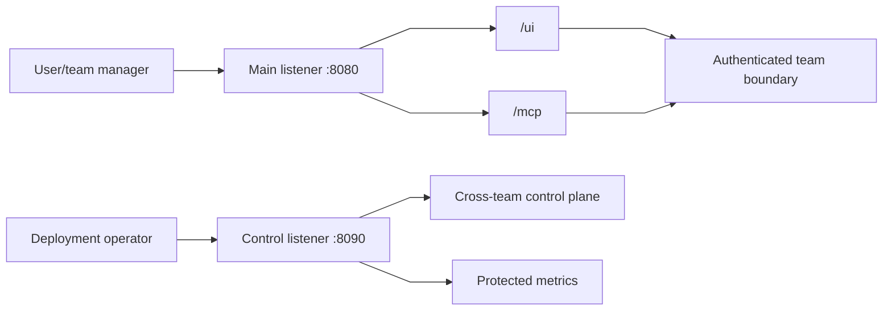
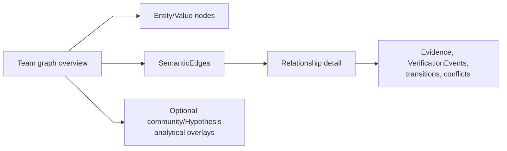
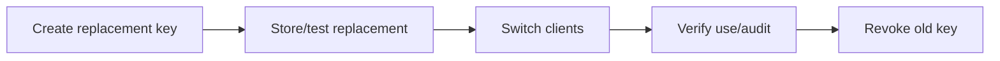

# Portals And API Keys

Dense-Mem has a team/user portal on the main listener and a deployment control
portal on a separate private listener.

| Portal | Local URL | Authentication | Purpose |
| --- | --- | --- | --- |
| user | `http://127.0.0.1:8080/ui` | Dense-Mem key or configured SSO | same-team recall, graph/trace, reviews, keys, and self telemetry |
| control | `http://127.0.0.1:8090/` | control-plane authentication | cross-team administration, config, security, logs, and operations |

Keep the control portal private.

## Boundary



A user key never becomes a control-plane credential. A control token must not be
accepted by main memory routes.

The user and control portals use first-party server handlers built for their
own browser views. Those handlers are not a public client SDK or an alternative
memory automation contract; external memory use goes through MCP.

User-portal authentication remains either a Dense-Mem API key or configured
SSO. API-key login continues to use the key-based authentication path; SSO uses
its separate browser-session and CSRF contract. The portal does not imply that
every API-key login is exchanged for an HttpOnly session.

## User Portal

The target user portal provides:

- authenticated team/profile/session display
- ranked Evidence recall with separate compact Relationship and Community frontiers
- Entity/Value graph exploration
- Relationship trace with evidence/history panels
- placement review and correction workflow
- separate Hypothesis/community views
- self/team-scoped telemetry according to role
- current-key rotation
- same-team member management for managers
- SSO login/team switching when configured

It does not expose raw Cypher, embeddings, provider prompts, or cross-team
candidates.

## Graph Explorer



The semantic graph contains only Entity/Value endpoints and active semantic
edges. Evidence, observations, verification, and transitions are detail/trace
records, not graph nodes. Hypotheses use distinct styling and never look like
active knowledge.

Overview/local queries enforce node, edge, depth, time, and response-size
budgets. Large teams should use search/local views rather than an unbounded full
graph.

Parallel authored edges show an author badge and conflict state. The portal may
visually group equivalent edges for clarity only when it retains every
`relationship_id` and author in the expandable group; visual grouping never
merges their lifecycle or data.

This is a read-only visualization consequence, not a cross-profile Conflict
inbox. The initial Conflict workflow is MCP-only; the portal cannot select a
preferred position or submit a bare confirmation. Placement review below
continues to cover owner-scoped identity/predicate/Relationship decisions.

## Placement Review

The portal shows:

- exact item and `relationship_id` when available
- immutable owner/author profile and same-team conflict references
- current versus proposed Relationship
- Entity candidates and discriminator context
- evidence/source handles
- status/effective-support and search state
- explicit decision effects

Decisions append durable input and re-enter normal processing. The browser never
edits a SemanticEdge or current-state row directly.

## User Portal SSO

OIDC setup, entitlement mapping, SSO-owned keys, and session behavior are in
[User Portal SSO](User-Portal-SSO).

## Control Portal

The control portal manages:

- teams and profiles
- roles and key scopes
- key creation, rotation, expiry, and revocation
- SSO providers and mappings
- global/team runtime configuration
- versioned RRF enable/disable, branch, and deterministic-rerank contracts with
  atomic activation/rollback
- provider/embedding and search-index generation visibility without exposing
  secret values
- placement and embedding backlog/search freshness
- PostgreSQL, pgvector, query, and backup health
- operation/audit/security views
- telemetry and feedback summaries
- dream/community scheduler state
- memory-pack import/rollback operations

It is not a general memory editor. Semantic changes use versioned review,
correction, merge/split, retraction, or import workflows with audit.

## API Keys

A key belongs to one profile and one team. It has a role-derived actor plus
explicit scopes.

| Role | Purpose |
| --- | --- |
| `manager` | same-team profile/key/config administration where permitted |
| `member` | normal same-team memory use |

| Scope | Purpose |
| --- | --- |
| `read` | recall, trace, Entity/Relationship inspection |
| `write` | remember and placement/dream decisions; merge/split/supersede only caller-owned knowledge; create evidence-backed cross-profile corrections |
| `feedback:read` | stored recall-feedback details |

Role does not imply scope. A manager key without `write` cannot remember.

Use cases:

| Key | Use |
| --- | --- |
| read-write member | main AI client |
| read-only member | LLM host that must never mutate memory |
| manager with minimal scopes | team administration |
| SSO-owned personal key | user client tied to current entitlement |

## Create And Rotate

The supported release may provide operator CLIs such as:

```bash
docker compose exec server /app/provision-team --name "primary-memory"
docker compose exec server /app/list-teams
docker compose exec server /app/list-team-profiles --team-id "<team-id>"
docker compose exec server /app/rotate-team-profile-key \
  --team-id "<team-id>" \
  --profile-id "<profile-id>"
```

Validate available flags with `--help` on the exact image. The raw key is
returned once; store it in a secret manager.

Team managers create and rotate profile keys through the Team tab. SSO members
use the My key tab subject to their current entitlement. Deployment operators
may use the release's supported provisioning CLI on the private host.

Do not place raw keys in command history on shared machines; prefer a protected
input/file mechanism supported by the client.

## Rotation



Rotation must allow a bounded overlap where policy permits. Never delete the old
credential before confirming the replacement works unless compromise requires
immediate revocation.

## Deletion And Revocation

Revocation stops future authentication but preserves audit and actor references.
Profile deletion must fail or become deactivation when durable records still
reference the actor. Do not cascade-delete knowledge/audit because a credential
is removed.

Team deletion is a soft tombstone: the team row is marked deleted, active
team-profile credentials are revoked, and future writes/jobs for that team are
rejected. Existing knowledge, support history, source lineage, conflicts, and
audit rows remain durable. There is no active restore/re-enable workflow in the
current contract; a future restore policy would need explicit authorization and
fresh entitlement/key issuance.

## SSO-Owned Keys

An SSO-owned key is usable only while its external entitlement remains valid.
Entitlement revalidation can revoke or deny it even when the local hash is
valid. Manual rotation cannot sever that ownership silently.

## Security Rules

- keep control and metrics listeners private
- use HTTPS beyond loopback
- assign least privilege and separate automation keys
- store only hashes in the database
- never display a raw key again
- audit create/rotate/revoke/role/scope changes
- rate-limit authentication and key operations
- revalidate same-team paths/IDs
- do not copy keys into provider prompts, logs, or support bundles

## Risks And Mitigations

| Risk | Concrete failure mode | Mitigation |
| --- | --- | --- |
| Control portal exposed | public attacker can manage all teams | private listener/ingress and separate strong auth |
| Manager overreach | manager key writes despite lacking `write` | independent role/scope checks |
| Graph leaks provenance | overview renders evidence/verification as nodes | semantic-only graph plus authorized detail/trace panels |
| Team visibility becomes write authority | B edits A's Relationship from the portal | show immutable owner and route B through its own remember/cross-reference workflow |
| Key rotation outage | old key revoked before clients switch | create-test-switch-observe-revoke sequence |
| SSO entitlement drift | removed user keeps a local personal key | periodic/request-time entitlement revalidation |
| Profile deletion erases audit | cascading FK removes actor history | deactivate/tombstone actor and preserve durable references |
| Team deletion erases knowledge | delete path cascades team-owned semantic rows | tombstone team, revoke credentials, and preserve durable knowledge/audit |

## Acceptance Invariants

1. user portal reads only authenticated-team data
2. control authentication is never accepted by main routes
3. graph overview contains only semantic nodes/edges plus explicit analytical
   overlays
4. browser decisions use the canonical PostgreSQL write pipeline
5. role and scopes remain independent
6. raw API keys are returned once and never stored reversibly
7. credential deletion preserves knowledge and audit history
8. team deletion tombstones the team and revokes credentials without deleting
   knowledge or audit rows
9. external memory automation uses MCP; portal handlers remain first-party UI
   implementation details
