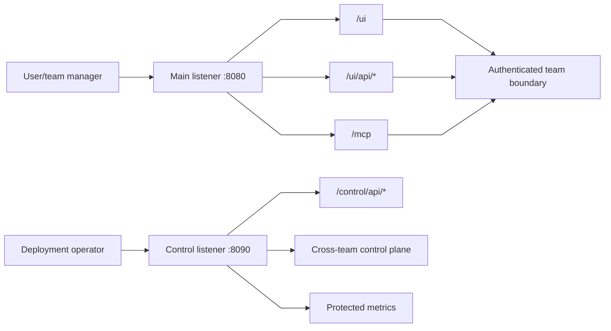
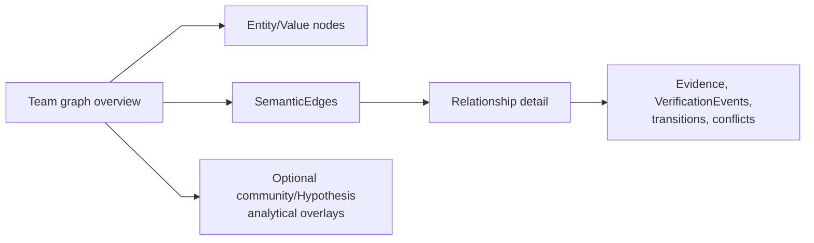
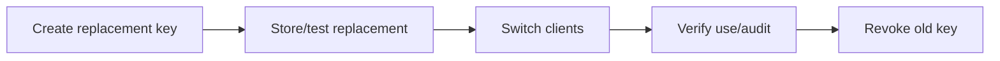

# Portals And API Keys

Dense-Mem has a team/user portal on the main listener and a deployment control
portal on a separate private listener.

| Portal | Local URL | Authentication | Purpose |
| --- | --- | --- | --- |
| user | `http://127.0.0.1:8080/ui` | Dense-Mem key or configured SSO | same-team recall, graph/trace, reviews, keys, and self telemetry |
| control | `http://127.0.0.1:8090/` | control-plane authentication | cross-team administration, config, security, logs, and operations |

Keep the control portal private.

## Boundary



A user key never becomes a control-plane credential. A control token must not be
accepted by main memory routes.

The user and control portals use first-party server handlers built for their
own browser views. Those handlers are not a public client SDK or an alternative
memory automation contract; external memory use goes through MCP.

The only supported application API prefixes are `/mcp`, `/ui/api/*`, and
`/control/api/*`. `/ui` is the user-portal document route. Health endpoints are
operational probes, not memory APIs. Retired generic REST paths, including
`/api/v1`, must not be exposed.

User-portal authentication remains either a Dense-Mem API key or configured
SSO. API-key login uses the bearer path by default. When the user explicitly
checks “Keep me signed in for 7 days,” the portal exchanges that direct bearer
login for an opaque server-side browser session; the raw API key is never put
in a cookie. SSO continues to use its separate browser-session and CSRF
contract.

The API-key portal session is fixed at seven days on the server. The checked
browser cookies are persistent for seven days; an unchecked exchange creates
browser-session cookies while retaining the same seven-day server expiry. The
session stores the stable credential ID, so in-place key rotation does not
sign the user out, while revocation, expiration, team deletion, role, scopes,
and SSO-owned-key entitlement are revalidated on every request. The session
cookie is HttpOnly, host-only, SameSite=Lax, and scoped to `/ui`; the separate
CSRF cookie is readable by the first-party UI and is sent as
`X-Dense-Mem-CSRF` for state-changing requests.

## User Portal

The target user portal provides:

- authenticated team/membership/credential/session display
- full selected team UUID and copyable `/teams/{team_id}/mcp` URL, refreshed
  after an SSO team switch
- ranked Evidence recall with separate compact Relationship and Community frontiers
- Entity/Value graph exploration
- Relationship trace with evidence/history panels
- caller-owned correction workflow
- separate Hypothesis/community views
- self/team-scoped telemetry according to role
- current-credential key rotation
- owner-scoped private-memory erasure routes and status polling
- same-team credential management for managers
- SSO login/team switching when configured

It does not expose raw Cypher, embeddings, provider prompts, or cross-team
candidates.

## Graph Explorer



The semantic graph contains only Entity/Value endpoints and active semantic
edges. Evidence, observations, verification, and transitions are detail/trace
records, not graph nodes. Hypotheses use distinct styling and never look like
active knowledge.

Overview/local queries enforce node, edge, depth, time, and response-size
budgets. Large teams should use search/local views rather than an unbounded full
graph.

Parallel authored edges show an author badge and conflict state. The portal may
visually group equivalent edges for clarity only when it retains every
`relationship_id` and author in the expandable group; visual grouping never
merges their lifecycle or data.

This is a read-only visualization consequence, not a cross-profile Conflict
inbox. The initial Conflict workflow is MCP-only; the portal cannot select a
preferred position or submit a bare confirmation. Caller-owned corrections use
the authenticated `correct_relationship` MCP workflow and never expose the
retired placement-review controls. The browser never edits a SemanticEdge or
current-state row directly.

## User Portal SSO

OIDC setup, entitlement mapping, SSO-owned keys, and session behavior are in
[User Portal SSO](User-Portal-SSO).

## Control Portal

The control portal manages:

- teams and credentials
- membership roles and credential scopes
- credential creation, rotation, expiry, and revocation
- SSO providers and mappings
- global/team runtime configuration
- versioned RRF enable/disable, branch, and deterministic-rerank contracts with
  atomic activation/rollback
- provider/embedding and search-index generation visibility without exposing
  secret values
- placement and embedding backlog/search freshness
- private-space inventory, legal holds, retention policy/runs, and erasure
  operation status
- Search convergence: structural readiness versus asynchronous embedding recovery,
  allowlisted failure codes, affected teams, guidance, run/canary state, logs,
  and metrics
- PostgreSQL, pgvector, query, and backup health
- operation/audit/security views
- telemetry and feedback summaries
- dream/community scheduler state
- memory-pack export and bounded omission reporting

It is not a general memory editor. Semantic changes use versioned review,
correction, merge/split, retraction, or import workflows with audit.

The control usage rollup shows the dependency observation time, `healthy/total`,
every unhealthy dependency name, bounded reason code, and check latency. The
normal checks are PostgreSQL, PostgreSQL topology, `pgvector`, authority,
search readiness, and Redis. Redis may report `single_node_mode` when the
single-node process-local coordination mode is intentionally enabled. That
status is not sufficient for a multi-instance deployment.

Telemetry cards and charts carry `ready`, `inactive`, `unavailable`, or
`unsupported` status. Ready zero values remain visible. Disabled features,
missing activity, missing provider usage/pricing, failed queries, and failed
lifecycle reads explain themselves with bounded reasons. Successful items stay
visible during partial degradation. Non-ready items appear in a collapsed
Inactive / unavailable disclosure, and unavailable charts do not render empty
axes. The user portal omits operator-only cards; control team/profile views
show scope-unsupported entries where that boundary matters.

Overview, usage rollup, and telemetry refresh every 60 seconds while visible.
Changing a scope or window cancels the previous request, and manual refresh is
kept available without allowing overlapping requests.

The Search convergence view is read-only. It has no retry button or provider
credential editor. Quota, authentication, access, and transient provider
failure groups are retried by the daily scheduler after one raw-provider canary;
input, contract, and unknown failures remain blocked. Public users see only the
bounded `search_indexing_delayed` status error, while operators see the exact
allowlisted code and guidance. A provider change is guidance only and must keep
the active model and dimensions compatible.

The corresponding operator endpoint is `GET /control/api/search/convergence`.
It is protected by the control-plane authentication boundary and returns only
the active contract summary, bounded queue/failure data, current failure groups
derived from `embedding_jobs`, team names, guidance, and durable run state. It
does not expose or mutate a separate incident lifecycle.

## Credentials And API Keys

A credential belongs to one actor identity, membership, and team. Its API key
is bearer material for that credential; role and grants come from the resolved
membership, and effective scopes are bounded by both the membership and the
credential.

| Role | Purpose |
| --- | --- |
| `manager` | same-team credential/config administration where permitted |
| `member` | normal same-team memory use |

| Scope | Purpose |
| --- | --- |
| `read` | recall, trace, Entity/Relationship inspection |
| `write` | remember and placement/dream decisions; merge/split/supersede only caller-owned knowledge; create evidence-backed cross-profile corrections |
| `feedback:read` | stored recall-feedback details |

Role does not imply scope. A manager key without `write` cannot remember.

Use cases:

| Key | Use |
| --- | --- |
| read-write member | main AI client |
| read-only member | LLM host that must never mutate memory |
| manager with minimal scopes | team administration |
| SSO-owned personal key | user client tied to current entitlement |

## Create And Rotate

Deployment operators create teams and credentials through the private control
portal or its authenticated API. For example:

```bash
control_token="<CONTROL_PORTAL_TOKEN>"

curl -fsS -X POST http://127.0.0.1:8090/control/api/teams \
  -H "Authorization: Bearer ${control_token}" \
  -H "Content-Type: application/json" \
  -d '{"name":"primary-memory"}'
```

Create the first credential from the returned team ID at
`POST /control/api/teams/{team_id}/credentials`. The response contains
`data.credential` and the one-time `data.api_key`; store the raw key once.
Release images do not contain standalone
provisioning, listing, deletion, rotation, migration, or conflict-review
commands.

Team managers create and rotate credentials through the Team tab. SSO members
use the My credentials tab subject to their current entitlement. Deployment operators
use the control portal/API on the private listener.

Do not place raw keys in command history on shared machines; prefer a protected
input/file mechanism supported by the client.

## Rotation



Rotation must allow a bounded overlap where policy permits. Never delete the old
credential before confirming the replacement works unless compromise requires
immediate revocation.

## Deletion And Revocation

Revocation stops future authentication but preserves audit and actor references.
Credential deletion deactivates authentication while retaining its tombstone
when durable records still reference the actor/owner. Control/manager
credential deletion also queues erasure of the selected credential's
`credential_private` space when one exists; it preserves `profile_private`,
`team_shared`, and the audit tombstone. The safe credential-deletion audit is
committed before the erasure operation becomes visible to a worker. The
explicit SSO owner deletion flow requires irreversible acknowledgement and has
the same private-space boundary.
A legal hold blocks the physical purge/retirement worker but does not keep a
credential bearer active.

Team deletion is a soft tombstone: the team row is marked deleted, active
team credentials are revoked, and future writes/jobs for that team are
rejected. Existing knowledge, support history, source lineage, conflicts, and
audit rows remain durable. There is no active restore/re-enable workflow in the
current contract; a future restore policy would need explicit authorization and
fresh entitlement/key issuance.

## SSO-Owned Keys

An SSO-owned key is usable only while its external entitlement remains valid.
Entitlement revalidation can revoke or deny it even when the local hash is
valid. Manual rotation cannot sever that ownership silently.

Deleting an SSO-owned key requires `Idempotency-Key` and exactly
`{"acknowledge_irreversible":true}`. An accepted response is `202`, disables
the key immediately, and returns the durable operation to poll. A legal hold on
its credential-private space leaves that operation queued until the hold is
released; it never permits the physical purge to run. A profile-private or
shared-only key has no credential-private content to erase, so its disable
operation completes without deleting those retained spaces.

## Private-Memory Erasure

The user portal API exposes irreversible owner routes for the current
profile-private or credential-private space and owner-scoped status polling.
The current browser UI exposes SSO-owned credential revocation; it does not yet
provide a dedicated privacy workspace or controls for profile erasure. The
control portal API can inventory private spaces, place/release legal holds,
request a scoped erasure, run retention, and inspect control-only operation
details. `202 Accepted` means the request is durable and queued; completion is
asynchronous.

The erasure worker seals and generation-fences the exact private space,
rechecks holds, deletes the complete space-owned manifest, verifies zero
remaining rows, and scrubs private audit payloads. There is no cancel or restore
button. A terminal worker failure leaves the space sealed; after correcting the
fault, an authorized owner or control request with a fresh idempotency key
queues a new operation without changing the original target generation or
retirement outcome. Recovery after completion requires the backup/PITR
procedure and does not re-enable a credential.

## Security Rules

- keep control and metrics listeners private
- use HTTPS beyond loopback
- assign least privilege and separate automation keys
- store only hashes in the database
- never display a raw key again
- audit create/rotate/revoke/role/scope changes
- rate-limit authentication and key operations
- revalidate same-team paths/IDs
- do not copy keys into provider prompts, logs, or support bundles

## Risks And Mitigations

| Risk | Concrete failure mode | Mitigation |
| --- | --- | --- |
| Control portal exposed | public attacker can manage all teams | private listener/ingress and separate strong auth |
| Manager overreach | manager key writes despite lacking `write` | independent role/scope checks |
| Graph leaks provenance | overview renders evidence/verification as nodes | semantic-only graph plus authorized detail/trace panels |
| Team visibility becomes write authority | B edits A's Relationship from the portal | show immutable owner and route B through its own remember/cross-reference workflow |
| Key rotation outage | old key revoked before clients switch | create-test-switch-observe-revoke sequence |
| SSO entitlement drift | removed user keeps a local personal key | periodic/request-time entitlement revalidation |
| Profile deletion erases audit | cascading FK removes actor history | deactivate/tombstone actor and preserve durable references |
| Team deletion erases knowledge | delete path cascades team-owned semantic rows | tombstone team, revoke credentials, and preserve durable knowledge/audit |
| Credential-private erasure expands to identity/team data | SSO key deletion removes another personal key's profile memory or team knowledge | immutable space binding, exact manifest predicate, A/B/C tests, and terminal zero-count verification |

## Acceptance Invariants

1. user portal reads only authenticated-team data
2. control authentication is never accepted by main routes
3. graph overview contains only semantic nodes/edges plus explicit analytical
   overlays
4. browser decisions use the canonical PostgreSQL write pipeline
5. role and scopes remain independent
6. raw API keys are returned once and never stored reversibly
7. credential deletion may erase only the selected credential-private space
   while preserving profile-private, team-shared, and redacted audit history
8. team deletion tombstones the team and revokes credentials without deleting
   knowledge or audit rows
9. external memory automation uses MCP; portal handlers remain first-party UI
   implementation details

## Canonical Identity And Credentials

`actor_identities`, `team_memberships`, and `credentials` are the only current
identity authority. Existing API-key IDs and key material survive the ordered
bridge and cleanup migrations. `team_admin` controls governance; it does not
imply private-memory access to another owner. Effective scopes are the
intersection of membership maximum grants and the credential's scopes.
Permanent ownership aliases keep correction, forget, audit, portal-session,
and usage history addressable by old owner IDs after `team_profiles` removal.

Every authenticated request carries immutable `team_id`, actor identity,
membership, permanent owner alias, role/grants, and an optional credential ID.
SSO sessions use the selected membership's owner alias and set `credential` to
`null`. Direct API-key and API-key portal sessions carry a credential; for a
standard API credential, its stable ID is also its permanent owner alias.
Neither route bodies nor clients can select the owner alias.

The current first-party credential routes are:

```text
/control/api/teams/{team_id}/credentials[/{credential_id}[/rotate]]
/ui/api/team/credentials[/{credential_id}[/rotate]]
/ui/api/credential/rotate
/ui/api/sso/credentials
/ui/api/sso/credentials/{credential_id}
/ui/api/sso/credentials/{credential_id}/rotate
```

Private `/profiles` and `/ui/api/key` aliases are not registered.

Rotation changes bearer material in place. Deletion disables the credential
and revokes its membership and actor while retaining the credential and alias
as an audit tombstone. No portal or public API can invoke schema cleanup.

## Immutable Memory Bindings

Credential creation chooses exactly one immutable binding: `shared_only`,
`profile_private`, or `credential_private` (the last two are team-scoped). A
credential cannot be rebound, and rotation preserves its ID, binding, and
private space. Revoked credentials cannot authenticate or rotate; expired
credentials may rotate in place only while still active. SSO self-service
creation requires the selected membership's existing grants. A token-derived
portal session cannot create or link credentials. Linking requires SSO
authentication plus proof of an existing same-team token and never unions token
grants into membership grants. Existing token writes remain team-shared.

The normal `remember` contract has no caller-selectable space parameter and
writes to `team_shared`. Any private-ingestion path derives its destination
from the authenticated binding; request payloads cannot select or broaden a
memory space.
